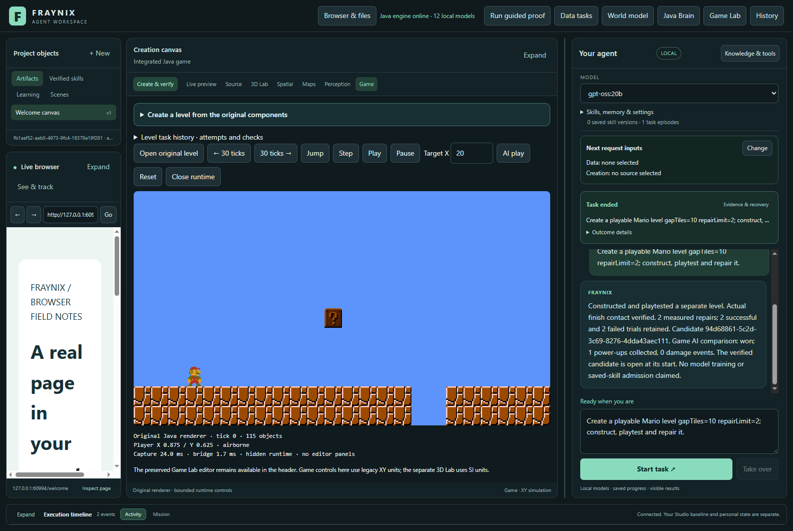
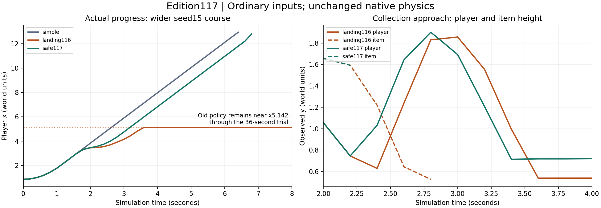
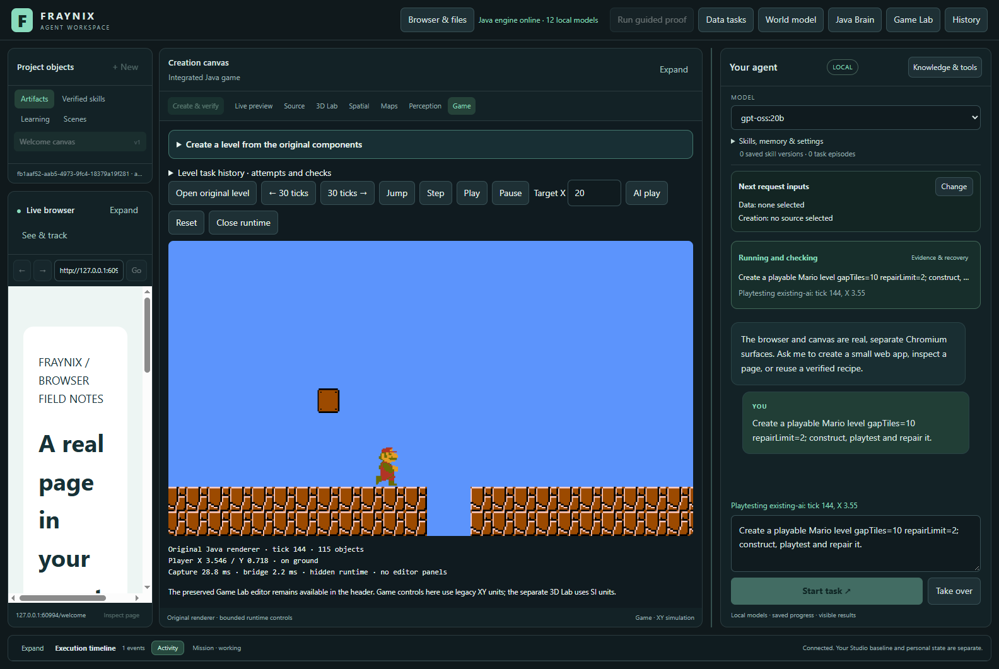
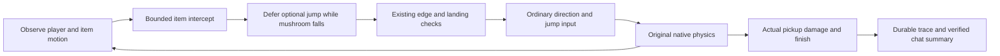
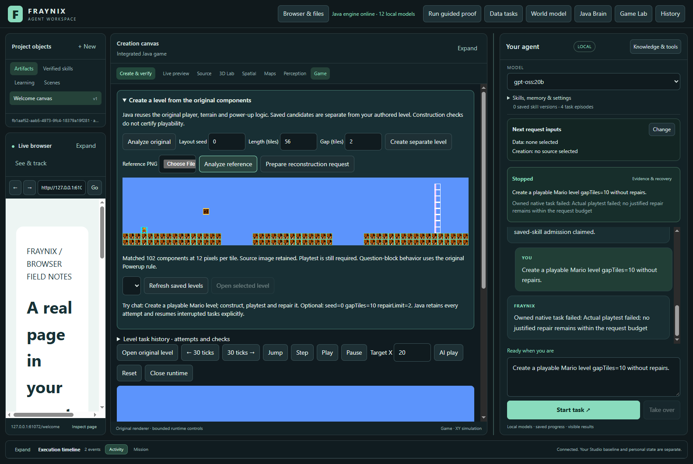
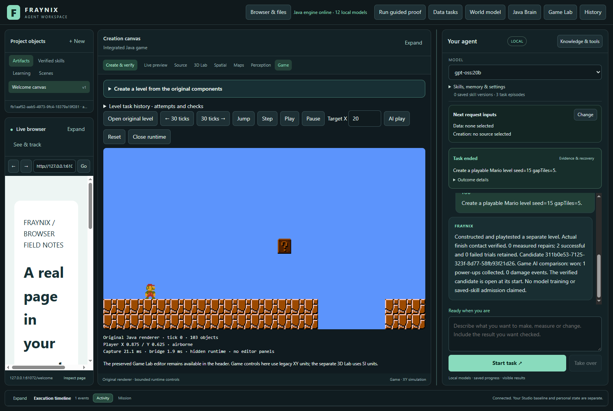

# Fraynix Agent Workspace — edition 117

[Published and fetched verification receipt](docs/PUBLICATION_117.json) · [Release tag](https://github.com/eyeoverthink/Fraynix-Agent-Workspace/tree/readme-117)

## Collect the mushroom. Cross the gap. Verify both.

Edition117 fixes the wider-gap failure retained in [edition116](README-116.md) by changing the approach to a falling power-up. Owned Java control estimates a short intercept, defers the optional chase jump while the mushroom descends, then uses the existing edge and landing checks to continue. Original physics and actual collision outcomes remain the authority.

**24/24 declared hardware layouts finish, with 24 power-ups collected and 0 damage events.** This includes all twelve previous regression layouts, six wider development layouts and six layouts reserved until the controller was fixed. The previous landing116 policy's result on exactly these layouts is 22/24, with 5 pickups. These are controlled two-gap courses with one intended mushroom; zero damage here does not establish safety among enemies.

[Previous edition116](README-116.md) · [Full phased plan](docs/PLAYABLE_LEVEL_CREATION_PLAN.md) · [Declared acceptance contract](docs/EDITION_117_CONTRACT.md) · [Offline interactive guide](docs/readmes/117/index.html) · [Validation](docs/readmes/117/verification.json)



## What you can do

1. Ask chat to construct and playtest a supported Mario level. Java creates separate candidates from the original component definitions.
2. Watch the integrated Game Lab. Simple control tests first; game AI runs in a separate fresh session. Chat now reports the AI's verified pickups and damage alongside its finish result.
3. Allow at most two repairs to observed gap failures. Failed candidates, inputs and outcomes remain inspectable.
4. Resume an interrupted request from **Mission → Resume**. Java checks the original evidence and restarts the unfinished trial in a new native session.
5. Import a supported reference PNG, inspect its component outlines, and prepare a reconstruction request. The separate new candidate must undergo actual playtesting.
6. Inspect **Level task history**, **Recheck evidence** and **Open verified result**. The review level reopens at its beginning; completed trials remain separate evidence.

Try the previously failing course:

```text
Create a playable Mario level seed=15 gapTiles=5.
```

Or request a deliberately difficult gap with a repair allowance:

```text
Create a playable Mario level gapTiles=10 repairLimit=2; construct, playtest and repair it.
```

Supported fields remain `seed=0..9999`, `lengthTiles=48..72`, `gapTiles=1..10`, `secondGapTiles=1..10`, and `repairLimit=0..2`. `without repairs` disables repair. This is a bounded two-gap construction recipe, not unrestricted level design. Image requests cannot also override inferred geometry.

For reconstruction, save the [actual native reference](docs/readmes/117/actual-reference.png). In **Create a level**, choose that PNG, **Analyze reference**, inspect the outlines, then **Prepare reconstruction request → Start task**. Appearance identifies a supported component; its original code supplies behavior. The image alone is not a physics proof.

## Run the current app

Use Java 21 and Node.js. Existing rendering, physics and desktop dependencies remain. New pursuit, diagnostics and orchestration logic are owned Java.

```powershell
.\gradlew.bat prepareGameRuntime115 :workspace-engine:installDist
.\scripts\Start-Agent-Workspace.ps1
```

Stop this installation's Java owner before replacing its files. Closing the desktop does not necessarily stop Java. Choose the intended project explicitly; do not silently point a new checkout at a private active database. Current isolated tests preserve the user's original projects and private Java owners.

The historical `prepareGameRuntime115` name prepares current game code/assets without copying the documentation archive for every test. Full distribution packaging retains that history. New controller bytes change the engine identity: old trials remain old evidence and must not be relabelled as current outcomes.

## What caused the stall

The retained seed15 course has a five-tile first gap. With landing116, the player starts jumping toward a falling mushroom around tick144. At tick156 the player is ascending near y1.239 while the mushroom has fallen to about y0.645. The player passes above it, approaches the gap without sufficient momentum, and catches the far corner around x5.142/y0.539.

The original 25-second no-progress stop remains in the archived baseline. Read-only contacts show an upward contact and a diagonal side contact on the same ground object. The grounding ray does not report supported standing. Reported body velocity continues to change even when position does not: the player controller writes requested velocity after the physics step. **Before/after displacement, contact normals and the requested velocity must be distinguished.** The new trace preserves all three.

The new policy has collected the mushroom and begun an edge crossing by tick144. It defers an optional chase jump; it does not suppress the safety jump at an edge.



The plot uses original observations every 12 ticks at 60 ticks/second; this is simulation time, not wall-clock performance. The first panel shows the initial 8 seconds; the retained old-policy trial remains stalled through 36 seconds.

The fix prevents this failed approach; it does not claim to free every already-wedged character. Source geometry, gravity, collider dimensions, transforms and finish criteria are unchanged.



## Owned Java control and evidence



`Pursuit117` projects the observed item's horizontal velocity for 0.2 seconds, capped to ±0.25 world units. For a mushroom descending faster than 0.1 units/second, it defers the optional collection jump. Flowers and non-descending objects keep the existing jump conditions. Inputs must be finite. The existing recovery, edge-crossing commitment and bounded landing forecast still apply; an unsafe chase may be abandoned.

`safe117` is the new default AI policy. Explicit `legacy115` and `landing116` remain comparison options. A policy cannot change midway through a bounded trial. The old boolean entry point retains its original policy mapping. There is no teleport, synthetic pickup or forced finish.

`GameContact117` adds read-only native positions and up to 32 contact edges, including normal direction, point count and other-object identity. It does not modify collisions. Observations also expose pursuit target/reason, item position/velocity, landing checks, collection waiting ticks and actual collision counters. Chat derives collection/damage counts from the verified final AI trial, alongside its original trace hash and source checks.

## Declared comparison and costs

| Partition | Controller | Finish contact | Pickups | Damage events | Median complete trial |
| --- | --- | ---: | ---: | ---: | ---: |
| regression | simple | 12/12 | n/a | n/a | 2.590 s |
| regression | legacy115 | 5/12 | 7 | 0 | 2.822 s |
| regression | landing116 | 12/12 | 2 | 0 | 3.367 s |
| regression | safe117 | 12/12 | 12 | 0 | 3.088 s |
| wider | simple | 6/6 | n/a | n/a | 2.502 s |
| wider | legacy115 | 3/6 | 1 | 0 | 2.817 s |
| wider | landing116 | 5/6 | 1 | 0 | 3.103 s |
| wider | safe117 | 6/6 | 6 | 0 | 2.872 s |
| reserved | simple | 6/6 | n/a | n/a | 2.662 s |
| reserved | legacy115 | 3/6 | 3 | 0 | 2.481 s |
| reserved | landing116 | 5/6 | 2 | 0 | 3.230 s |
| reserved | safe117 | 6/6 | 6 | 0 | 2.942 s |
| software-reserved | simple | 6/6 | n/a | n/a | 2.725 s |
| software-reserved | legacy115 | 3/6 | 3 | 0 | 2.535 s |
| software-reserved | landing116 | 5/6 | 2 | 0 | 3.318 s |
| software-reserved | safe117 | 6/6 | 6 | 0 | 3.219 s |

All cases and acceptance gates were declared before controller results. The twelve edition116 regressions retain seeds 0,1,4,8,11,17,2,5,6,10,13,16. Wider development uses 15,9,20,23,27,30. Reserved wider uses 22,26,29,31,35,38. Lengths 48–72 and gap widths up to 6 are independently varied; exact tuples are in the contract and raw results. Each policy starts a fresh native session. The simple baseline knows the declared gap positions; it is a lower-cost comparator, not general visual reasoning.

Pickup/damage counters cover automatic AI policies. Simple control has no corresponding event counters, so its cells are marked n/a; its final player remains small in every case. Its actual finish, death, position and timing are still observed.

The software-renderer run repeats the six reserved layouts. Those are the same geometries on another renderer, not six more unfamiliar cases. Every trial retains before/input/after observations, contacts, final outcomes and PNGs. Complete trial time includes launch/reset, input chunks and the final observation, excluding subsequent archive writing. One run per case/policy is not a repeated latency benchmark. [Exact measurements](docs/readmes/117/measurements.json).

The original failing baseline, first successful probes, development runs and final results are retained separately. A test-invalidation defect was also caught: Gradle initially reused an older native test result after game code changed. Test inputs now include the root game JAR, runtime dependencies, assets, level sources and study selection properties. The skipped run and subsequent actual rerun both remain; a missing new output was never accepted as a new success.

## Reference reconstruction and durable chat

The six existing reference cases are regenerated in fresh native sessions on each renderer. They retain declared sky crops, horizontal shifts and nearest-neighbor scales. Recognized geometry must equal the independent source candidate. Each image creates a distinct candidate, and both simple control and safe117 now must finish all six. Pickup and damage assertions strengthen that gate. Missing finish, incomplete floor, covered player and blank images must still refuse. Original changed-source and unknown-foreground refusals remain.



These are known original sprites and the supported two-gap layout. They do not establish arbitrary web-image recognition, hidden geometry or general game understanding. [Hardware evidence](docs/readmes/117/reference-hardware.json) · [Software evidence](docs/readmes/117/reference-software.json).

The installed app was exercised through four visible chat requests:

| Actual request | Complete elapsed | Simple control | Safe117 | Repairs |
| --- | ---: | --- | --- | ---: |
| Two observed gap repairs | 63.804 s | won | won | 2 |
| Wider gap with abrupt restart | 43.375 s | won | won | 0 |
| Repairs disabled | 10.117 s | failed | not run | 0 |
| Image reconstruction | 41.767 s | won | won | 0 |

The wider-gap request includes an abrupt termination of its own Java owner, reopening the same isolated test project, and visible explicit resume. Its partial trial remains and the new session differs. The no-repair failure is retained and cancelled after the expected refusal; it is not a completion. Whole-request costs include orchestration, checking, persistence, recovery and capture overhead. [Exact UI record](docs/readmes/117/actual-ui.json).



## Validation and CI status

**144 distinct Java methods, 165 desktop checks, four visible requests and the desktop/mobile offline guide pass locally.** Root checks, relevant Java owners/routing, constructor, image refusals, source/outcome checks, repairs, restart, shaders and actual native cohorts are included. The app is captured at 1600 and 1100 pixels; guide widths 1440/390 are a documentation check, not phone-app support.

CI was checked before work: edition116 main [run43056641370](https://github.com/eyeoverthink/Fraynix-Agent-Workspace/actions/runs/43056641370) was still running. Setup, software renderer and documentation had passed; compile/test/package was pending. Local software verification reuses the checksum-verified Mesa26.2.5 package in a private Java installation, leaving system Java unchanged. Current remote CI status is reported separately in the publication receipt. Local success is not remote CI success.

Run serially from the root:

```powershell
.\gradlew.bat :test :workspace-engine:test --tests 'fraymus.workspace.Game*Test' --console=plain --max-workers=2
npm --prefix workspace-desktop test
```

`GameController117Test` accepts JVM property `study117.partition=regression|wider|reserved|probe`; select a fresh `study117.output` directory to preserve earlier outputs. `reference116.output` remains the property for the strengthened six-image test. The [actual UI recorder](workspace-desktop/test/game117-integration.cjs) requires a current build receipt, a fresh output directory and the declared local model catalog option. These supported requests make **zero model calls**. Catalog availability is not inference or training evidence.

## Boundaries and source map

The original 1248-object scene remains unchanged; root `level.txt` is still a small example. Existing 24 chat slots, 24 level-task records, 32 candidates, three explicit resumes and 32 active procedures remain. Level-task records do not automatically enter the reusable skill bank. Data imports are not executable tools.

```text
src/main/java/agent/Pursuit117.java               bounded item intercept
src/main/java/agent/GameContact117.java           read-only contact diagnostics
src/main/java/agent/GameInput.java                owned control and retained baselines
src/main/java/agent/LandingGuard116.java          existing bounded landing model
src/main/java/runtime/EmbeddedGameRuntime.java    native state and ordinary inputs
workspace-engine/src/main/java/fraymus/workspace/GameTask115.java  checked outcomes
workspace-engine/src/main/java/fraymus/workspace/Domain044.java    chat summary
workspace-engine/src/test/java/                  declared native and refusal checks
workspace-desktop/test/game117-integration.cjs    actual app/recovery/screenshots
docs/readmes/117/                                evidence, guide and original archive
docs/publication117/                             reproducible publication checks
```

Java continues to own tasks, world state, controls, checks and retained memory. The desktop presents chat, browser, canvas and game surfaces. This release improves a measured action-selection failure inside that system. It is hand-written control informed by observed outcomes, not a newly trained LLM or evidence of unrestricted self-improvement.

## Next phases

1. **Obstacle and enemy variation:** declare unreachable and risky pickups, alternate heights and enemy placements. Compare survival, collection and completion against simple control; test when the agent should decline a pickup. Investigate escape from an already-wedged state separately from prevention.
2. **Broader image components:** add explicitly supported sprites/layouts, independent images, unknown-region review and measured false accepts/refusals. Preserve actual playtesting.
3. **Procedure lifecycle:** retire/reactivate with original provenance before admission under the unchanged 32 active slots. Qualify game procedures before reuse and keep old runtime proofs distinct.
4. **Shared world experiments:** carry the observe/predict/act/check/retain pattern into supported 3D components and calibrated observations, preserving units, uncertainty and physical outcomes.

[Original evidence](docs/readmes/117/original-evidence.json) · [Project memory](docs/PROJECT_MEMORY.md) · [Development log](docs/DEVELOPMENT_LOG.md) · [Obsidian map](docs/obsidian/125-safe-game-pursuit.md) · [All editions](docs/readmes/INDEX.md)
