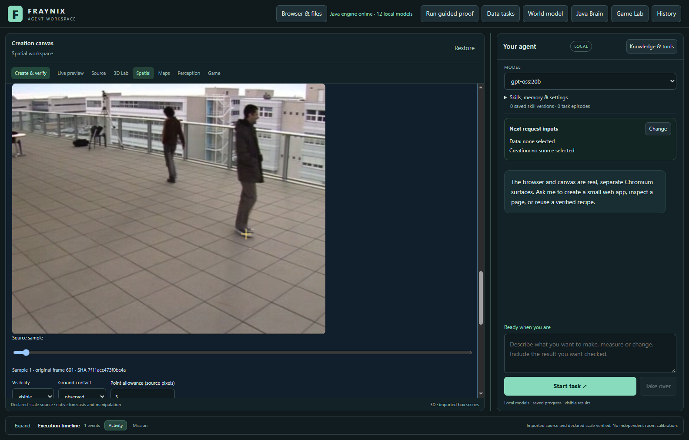
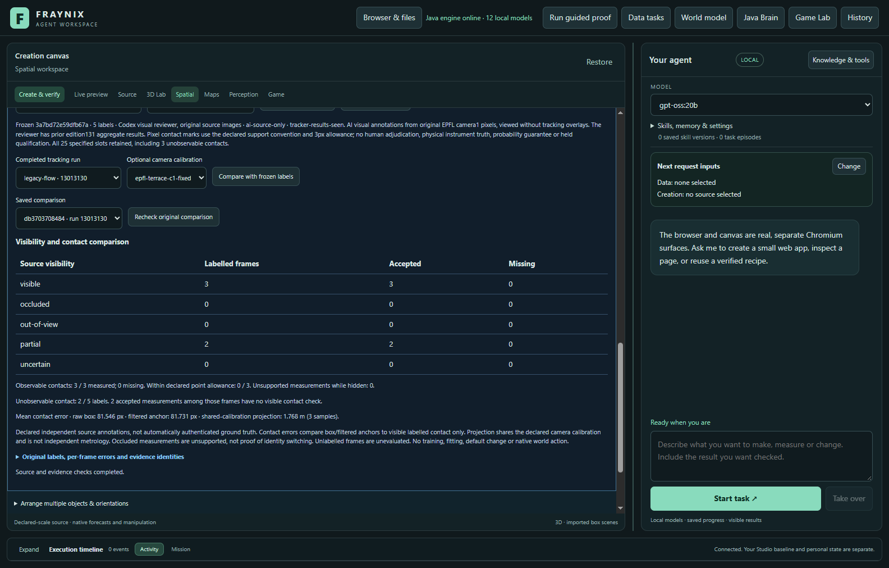

# Fraynix Agent Workspace — Edition 132

[Published and fetched verification receipt](docs/PUBLICATION_132.json) · [Release tag](https://github.com/eyeoverthink/Fraynix-Agent-Workspace/tree/readme-132)

**Independent visibility and ground-contact labels now live in the Java application. Mark original images, freeze the evidence, compare tracking against it, and recheck the same result after restart. Tracking and forecasting defaults remain unchanged.**

2026-11-12 · Local Java agent · Persistent world, browser, creation and observation

[Previous edition](README-131.md) · [All editions](docs/readmes/INDEX.md) · [Illustrated offline guide](docs/readmes/132/index.html) · [Acceptance contract](docs/EDITION_132_CONTRACT.md) · [Fixed diagnostic protocol](docs/OBSERVATION_132_PROTOCOL.json)

Original public EPFL footage in the actual application. The yellow mark is the reviewer's contact annotation; there is no tracker overlay in this view. It is not a new webcam recording or a generated mockup.

## The connected application

Fraynix joins **observe → choose → act → verify → retain → evaluate reuse** in one local workspace. Java owns continuing worlds, durable tasks, typed actions, source evidence, recovery and reusable procedures. Chat, browser, the creation canvas, Game Lab and 3D physics are working surfaces of that system. Observations can become a verified motion explorer; successful creation and world procedures retain their evidence and can be inspected, retired or reactivated.

This edition strengthens the boundary between seeing a plausible track and having evidence for a physical claim. It adds handwritten Java logic and desktop controls without a new model, external runtime library or paid service. It does not claim person recognition, consciousness, general physical accuracy or hardware actuation. Existing simulation and observation state remain separate.

## What changed

- **Source-only annotation view.** Open imported footage before running a tracker. Inspect original frames, choose the source object, label visibility, and click an observable contact point. The view does not request or display tracking output. The first frame remains an identification seed and is excluded from scoring.
- **Explicit uncertainty.** Visibility can be visible, partial, fully occluded, out of view or uncertain. Contact can be observed, occluded, out of view, not grounded or uncertain. Only an observed contact receives coordinates and a declared 1–32 source-pixel allowance. The server refuses a visible contact on a fully hidden or uncertain target, incompatible frame labels, duplicate samples and invented hidden coordinates.
- **Immutable evidence.** Freeze ordered labels with an annotator, method, provenance and prior-exposure declaration. Every row binds its original frame number and image checksum. The set binds the complete original dataset. Corrections are new sets; existing labels are never overwritten. Export/import preserves the exact set identity and refuses altered exports.
- **Independent downstream scoring.** Choose a completed run of that same source. Java scores accepted measurements against the frozen labels, separates visibility categories, keeps missing contacts in the denominator, and compares both raw box and filtered anchors with visible contact points. An optional matching camera calibration projects those errors into metres.
- **Cold re-verification.** Saved comparisons bind the label set, completed run, code and optional metric view. Reopening rereads original image bytes and recomputes the outcome. Changed evidence, code, clock, geometry or outcome refuses. Each project retains up to 64 label sets and 64 comparisons without pruning. Verification reads the original observation history once per immutable dataset snapshot, then checks every image byte checksum; it does not repeatedly revalidate the growing history for each image or substitute cached success for original bytes.

Labels do not enter tracker updates, the observation filter, forecasting, fitting or native actions. `legacy-flow` remains the tracking default; ordinary adjacent-point forecasts remain the forecasting default. Earlier experimental choices and their failed qualification results remain intact.

Every estimate and numeric tracker field across all **950 frames** is compared with the already published edition131 traces on identical source bytes. They match exactly; only the declared object identity and descriptive label differ between the historical standalone study and the persistent app. See the [published-evidence compatibility check](docs/readmes/132/compatibility.json).

## What the labels mean

A box's bottom centre is an assumption about contact, not an independent observation. A walking person's planted foot can differ from that centre because of pose, cropping, occlusion and tracking drift. The annotation convention used here marks the midpoint of visible support extremities when both contact the ground, otherwise a visible planted foot. Hidden or ambiguous support is not reconstructed from the track.

The allowance describes reviewer imprecision in original pixels. It is not a calibrated probability interval and is never added to the tracker radius. Projected errors use the same declared camera calibration as the tracker, so they isolate contact disagreement; they do **not** independently validate camera geometry, scale or real-world location. A measurement while fully hidden is unsupported by that frame, but is not sufficient proof of an identity switch. Unlabelled frames remain unevaluated.

## Fixed retrospective diagnostic

Before the new comparisons, the protocol and manual annotations were committed. We reused five already studied EPFL Terrace camera1 windows beginning at 600, 1600, 2600, 3600 and 4600. Each has 96 original frames. The fixed label slots are 1, 25, 50, 75 and 95: **25 labels, 22 observable contacts and three unobservable contacts**. All slots remain in the evidence. Ten serial runs compare default flow with the explicit, unpromoted edition131 candidate.

The annotations were visually reviewed by AI from original images without tracker overlays. The reviewer had already seen edition131 aggregate results. They are independent of the tracking calculations, **not blinded human gold-standard, new trajectories, new population or held qualification**. The original annotations and exposure declaration are in [source-labels.json](docs/publication132/source-labels.json). No tuning or promotion follows this diagnostic.

| Method | Available / visible contacts | Missing | Within 3 px / visible contacts | Raw mean error / px | Filtered mean error / px | Projected mean / m |
| --- | ---: | ---: | ---: | ---: | ---: | ---: |
| legacy-flow | 21 / 22 | 1 | 0 / 22 | 40.956 | 40.974 | 1.024 |
| renewing-flow-131 | 13 / 22 | 9 | 0 / 22 | 22.699 | 22.667 | 0.626 |

Accepted-only mean errors exclude missing contacts. Read them beside the available/total counts. The fixed sample contains partial occlusion and one cropped contact, but **no fully occluded or completely out-of-view target labels**. Those paths have synthetic software tests; this real-footage subset cannot estimate their false-measurement rates or general false-reacquisition performance.

On the 13 contact samples measured by both methods, mean filtered contact error is 22.604 px for default and 22.667 px for the candidate. This paired subset is descriptive, not qualification. The labels expose contact-anchor disagreement separately from missing tracks; they do not fix either error. Physical accuracy remains unresolved. In window2600 the default anchor differs horizontally from the visible marked contact by 51.7px at sample50, 81.5px at sample75, 109.1px at sample95. Changing box height alone cannot correct these labelled horizontal errors. Target association needs independent review alongside contact estimation; this does not by itself certify an identity switch.

| Method | Tracking timed runs / ms | Verified UI comparisons / ms |
| --- | ---: | ---: |
| legacy-flow | 955231.2 (5/5 timed) | 64008.1 |
| renewing-flow-131 | 1023622.3 (3/5 timed) | 74628.6 |

Timing records the original and continued serial work on this computer. Completed tracker runs were retained across two driver timeouts. Two candidate tracking timers were not saved before those timeouts and remain unavailable. The table states how many runs have retained timings; missing timing is not zero. Tracking includes selection, worker startup, source processing and polling. Comparison includes the real UI request, source verification, scoring and the returned result; it is not just arithmetic time. These measurements are diagnostic, not a stable speed benchmark.

## Try the workflow

1. Start the prepared Java21 workspace with [Start-Agent-Workspace.ps1](scripts/Start-Agent-Workspace.ps1). Existing setup instructions remain in [architecture](docs/ARCHITECTURE.md). This edition adds no installation requirement.
2. In **Spatial → Real footage**, import a frame package or local video and identify the source object in its first frame. Import alone does not run tracking.
3. Open **Independent labels · visibility & ground contact**. Select the footage and source object, then **Open source-only view**. Move the sample slider; sample zero is only the original seed.
4. Label visibility and contact separately. Click a visible ground-contact point only when supported by the pixels. Describe the evidence and its pixel allowance; use unknown/occluded/out-of-view when appropriate. **Keep this label in draft** for each sample.
5. Declare the annotator, method, prior exposure and provenance, then **Freeze source-bound labels**. Drafts are window-local until frozen. Revisions create new retained sets rather than replacing originals.
6. Track the same footage using the existing flow default, or explicitly choose a candidate. Confirm the saved world and source-object/body binding as before. Predictions through missing frames are not counted as measurements.
7. Select the frozen label set and completed run. Choose **Image pixels only**, or the correct fixed-camera calibration and original clock. **Compare with frozen labels** shows visibility counts, missing contacts and both anchor errors.
8. **Export verified labels** to the project's exports. Import works against the same original dataset identity; it is not an unverified cross-project rebinding. Preserve the project with its original images to keep evidence readable. **Recheck original comparison** after restart to verify every source and outcome again.

The existing observation-to-artifact chat workflow remains available: choose a calibrated run, prepare an explorer request, retain the forecast, create the artifact, independently check its contents, and save the procedure. This edition does not give the model authority to declare its own annotations independent or to use them as verified native movement.

## Tests and actual application checks

Local checks passed: 210 distinct Java methods across the broad baseline and affected final-verifier suites, 161 desktop checks, executable kernel harnesses, actual agency regression and isolated offline/package preparation. The actual app independently checks label arithmetic, source identities, export/import and cold restart. No existing verification condition was weakened.

The new Java tests cover source-only reads before tracking, unchanged native state, hidden versus partial versus missing counts, separate raw/filtered anchors, reference isolation, seed/duplicate/fractional/wrong-image refusals, impossible contact labels, damaged exports, exact restart, tampered labels/audits/images, wrong-dataset/incomplete-run refusal and capacity retention. Synthetic labels are explicitly marked as synthetic; they do not stand in for physical measurements.

- Original source view and real canvas contact click work before tracking. All 25 fixed study labels frozen through actual import controls before any new run. Three unobservable contacts retain no coordinates.
- Original audit 519ab736c8b0 retains its identity; newly verified audit has identical numerical/source results and a new implementation identity.
- Original audit 47bd3a9826ed retains its identity; newly verified audit has identical numerical/source results and a new implementation identity.
- Original audit 519ab736c8b0 retains its identity; new implementation audit matches its numerical/source results.
- Original audit af00e8089028 retains its identity; idempotent recheck matches its numerical/source results.
- Original audit 47bd3a9826ed retains its identity; new implementation audit matches its numerical/source results.
- Original audit f677f25c8236 retains its identity; idempotent recheck matches its numerical/source results.
- Original audit 8218098a6969 retains its identity; idempotent recheck matches its numerical/source results.
- Ten real Java tracker runs, including completed runs preserved from timed-out driver attempts, complete serially on the fixed public pixels. Independent host arithmetic agrees with every available contact error. Each audit retains original frame hashes, source binding and missing labels. Native world unchanged.
- Actual comparison values checked at 1100 and 1600 px without horizontal page overflow; export bytes re-import idempotently with the same immutable identity.
- Abrupt owned-Java termination and cold restart preserve all five frozen label sets, all ten original runs/audits and the untouched native world. Actual saved-comparison control recomputes the same result.

The first app attempt froze all labels and completed two tracker runs, but its second audit recheck exceeded the driver's 30-second wait. Original source code/class, saved audits, traces, failed driver records and a later failure screenshot are retained. The cause was repeatedly validating the entire growing observation history for each source image. The new verifier validates that history once per immutable dataset snapshot and still rereads/checks every original image, including unlabelled frames. The affected suites pass again. Continuation retains both completed tracker runs, creates new audit identities, compares original numerical outcomes and completes the remaining runs. The old audit identities are not relabelled under the new implementation. A bounded 120-second UI wait accommodates genuine source work; no source or outcome check is removed.

A later driver wait stopped at90 seconds while the fourth tracker run completed its original95 frames. This is the existing full-history tracking cost, not an incorrect label result. The four completed runs remain unchanged. Continuation uses a bounded10-minute tracking wait and keeps unavailable timer records absent; it does not skip source/history checks, shorten the fixed footage or restart completed runs. Both failed driver records remain, along with the retained later failure screenshot.

[Verification](docs/readmes/132/verification.json) · [Actual app study](docs/readmes/132/app-study.json) · [Complete comparison](docs/readmes/132/comparison.json) · [Original evidence](docs/readmes/132/original-evidence.json) · [Source inventory](docs/readmes/132/file-inventory.json)

CI was checked first and is reported separately from local verification. Pending hosted runs are never counted as passed. Publication is claimed only after main, edition132 and the annotated readme-132 tag have actually been pushed and fetched, with every source and frozen evidence hash checked. Private projects, raw video/frame packs, dependency folders and browser profiles are excluded. Limited public screenshots are attributed to [EPFL CVLab POM](https://www.epfl.ch/labs/cvlab/data/data-pom-index-php/); original research-use footage stays local.

## Next steps

1. Obtain independent human review of contact/identity annotations and sequences with complete occlusion and genuine out-of-view transitions. Measure reviewer disagreement instead of treating these AI marks as certified truth.
2. Check target association and implement an explicit ground-contact estimator that can say “unobservable,” and compare it with the current box-bottom assumption using separate development and untouched evaluation sequences. Keep identity association and contact accuracy as separate questions.
3. Fit uncertainty on separate evidence, then check both useful width and coverage at fixed future horizons. Edition129's 28/30→16/30 coverage loss and the failed130/131 promotion gates are still unresolved evidence, not erased history.
4. Connect justified physical tolerances to durable Java goals: request another view or refuse when the current observation cannot support an action. Keep advancing the unified mission, source-age, uncertainty and skills layout around the connected application.

The destination remains a continuing local Java agent that observes, creates, tests and retains useful procedures with checkable outcomes.
