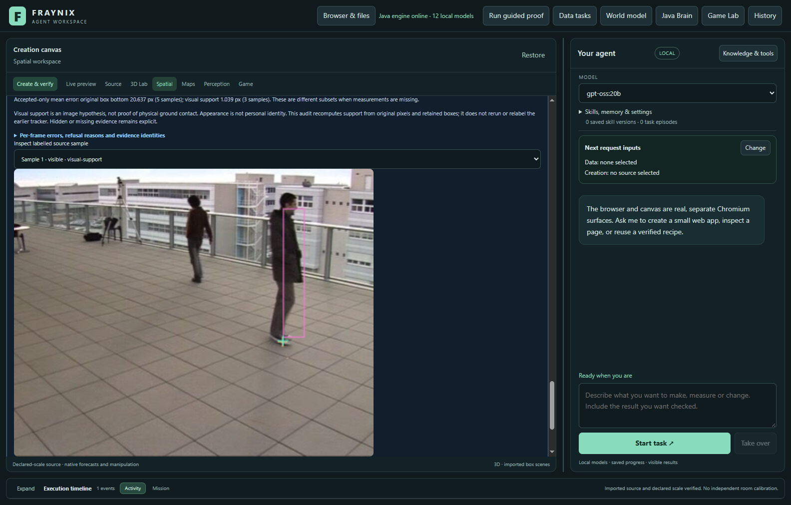
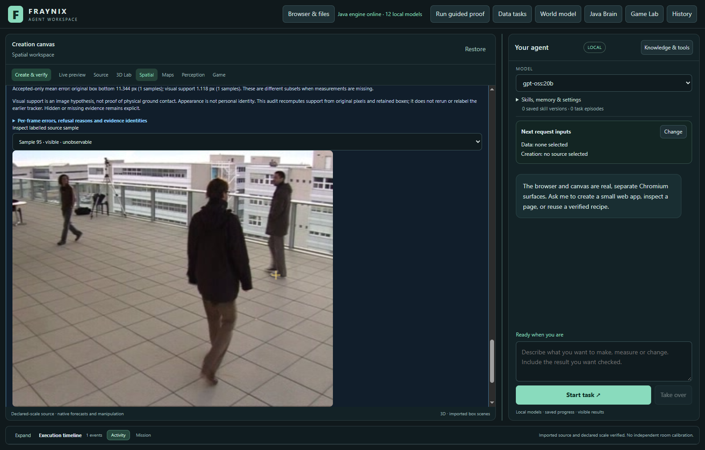

# Fraynix Agent Workspace — Edition 133

[Published and fetched verification receipt](docs/PUBLICATION_133.json) · [Release tag](https://github.com/eyeoverthink/Fraynix-Agent-Workspace/tree/readme-133)

**Java now has an explicit appearance-association candidate and a separate pixel-derived visual-support estimator. Both expose uncertainty and refusal. Saved contact comparisons recheck original images, labels, runs and outcomes after restart. Existing tracking, metric anchors and forecasting defaults remain unchanged.**

2026-11-12 · Local Java agent · Persistent world, browser, creation and observation

[Previous edition](README-132.md) · [All editions](docs/readmes/INDEX.md) · [Illustrated offline guide](docs/readmes/133/index.html) · [Contract](docs/EDITION_133_CONTRACT.md) · [Frozen implementation comparison](docs/OBSERVATION_133_LOCK.json)

Actual app with public EPFL footage. Pink marks the retained tracking box, gold the independent AI-reviewed annotation, and teal the new visual-support candidate. Source-only annotation remains a separate view without tracking overlays. No generated mockups or new private webcam footage.

## The connected application

Fraynix connects **observe → choose → act → verify → retain → evaluate reuse** in one local workspace. Java owns persistent worlds, durable goals, action validation, recovery, evidence and reusable procedures. Chat, browser, creation canvas, Game Lab and physics are working surfaces of that system. Observed motion can become a verified artifact; successful procedures retain their sources and can be inspected, retired or reactivated.

This edition improves how the app investigates physical observations. It adds handwritten Java processing and real desktop controls without a new model, paid service or runtime dependency. It does not turn appearance matches into personal identification, or visual support into certified physical contact. Native simulated state remains separate from camera estimates.

## What changed

- **Explicit association candidate.** Select `association-contact-133` for a new run. It compares frozen seed appearance and surrounding context, searches bounded scale/position alternatives, checks spatially separate competing matches and can corroborate a weaker match with local optical flow. It preserves the original appearance instead of training itself on each new guess. After loss, stronger original-appearance agreement and two successive consistent proposals are required before reacquisition.
- **Pixel-derived support.** `VisualSupport133` learns a fixed lower-object versus surrounding-color contrast from the seed. It finds connected lower-object pixels and requires their termination to lie within the image and search region. It withholds sparse, clipped, unseparated or missing support. The box bottom is never substituted when support is missing.
- **Contact estimation independent of tracker choice.** A new contact audit can evaluate the existing flow tracker's retained boxes or the explicit association candidate. The estimator does not need to replace the tracker to be useful. The ordinary box-bottom metric anchor and its uncertainty remain unchanged.
- **Evidence survives restart.** Every audit binds the exact label set, source manifest, complete original run, original tracker code and current support implementation. It checks every original image, including unlabelled frames, and recomputes its result when reopened. Up to 64 immutable audits are retained without pruning. Export writes the verified original record.
- **Readable audit overlays.** Inspect each labelled frame, see the candidate point or its refusal reason, and compare available/missing contacts beside accepted-only errors. An unsupported point on an unobservable reference remains an explicit count.

The new audit can use an earlier completed run as **stored-box evidence**. It does not rerun the earlier tracker, assert a new tracking proof or rewrite its code identity. Earlier incompatible tracking proofs remain retained and refused by their existing checks; this edition does not relabel them as current. The contact audit records `trackerReplayed: false` and preserves the original tracker-code identity.

## What the measurements establish

The fixed source set is the same five already exposed EPFL camera1 windows from edition 132: 600, 1600, 2600, 3600 and 4600. Each has 96 original images; labels use slots 1/25/50/75/95. **25 labels, 22 observable contact points and three unobservable contacts** remain in the evidence.

Development used 600/2600. The final implementation and scorer were [locked](docs/OBSERVATION_133_LOCK.json) before running the new comparison on 1600/3600/4600. No tuning followed that comparison. These are previously exposed images and retrospective AI annotations, not new trajectories, blinded human truth or held qualification. Complete target occlusion and out-of-view cases have synthetic software tests; this real subset cannot establish their general failure rates.

| Method | Available / observable | Missing | Within 3 px / observable | Accepted-only mean / px | Unsupported on unobservable references |
| --- | ---: | ---: | ---: | ---: | ---: |
| Published 132 default filtered box anchor | 21 /22 | 1 | 0 /22 | 40.974 | Not a support-point estimate |
| candidate visual support | 4 /22 | 18 | 2 /22 | 4.278 | 0 |
| default-support visual support | 8 /22 | 14 | 5 /22 | 3.275 | 0 |

The frozen comparison subset 1600/3600/4600 has 14 observable contacts. candidate: 3/14 returned, 1/14 within 3 px, mean accepted error 5.331px. default-support: 5/14 returned, 2/14 within 3 px, mean accepted error 4.617px. On all 8 samples where default-box visual support is available, the original raw box anchor averages 11.468px error and new support 3.275px. This paired subset is descriptive; it does not erase the missing contacts. The conservative association candidate misses too many targets. Contact precision improves on some visible samples, but availability is substantially lower.

The three-pixel allowance describes reviewer precision, not calibrated probability. Accepted-only errors exclude missing contacts; availability stays in every table. A visible foot-shaped region is an image hypothesis, not proof of contact with a real plane. Appearance similarity cannot certify object identity. **Neither candidate is promoted. Physical accuracy and general association remain unresolved.**

| Processing | Measured total / ms | Scope |
| --- | ---: | --- |
| candidate | 41921.7 | Five fixed 96-image windows; new tracking/filter/support |
| default-support | 1670.9 | Five fixed 96-image windows; new support on published default boxes; historical tracking excluded |

| Actual app run | Tracking / ms | Verified UI audit / ms |
| --- | ---: | ---: |
| association-contact-133 | 12955.9 | 363.5 |
| legacy-flow | 24936.6 | 1271.2 |

Source-only processing timings are measured separately from actual-app execution. New support on published default boxes does not include the historical cost of tracking those boxes. Do not compare it as a faster replacement tracker. Actual-app timings include Java execution, original-source verification and UI completion, and are reported separately.

## Try it

1. Run [Start-Agent-Workspace.ps1](scripts/Start-Agent-Workspace.ps1) with the existing Java 21 setup. [Architecture and setup](docs/ARCHITECTURE.md) remain available; no new dependency is required.
2. Open **Spatial → Real footage**, import a supported frame package or local video, and identify the source object in its first image. Seed quality matters: a partial or ambiguous seed can prevent reliable association.
3. Use **Independent labels → Open source-only view** to inspect original pixels and freeze visibility/contact labels. Mark only observable points and declare prior exposure honestly. Existing edition 132 label import/export still works.
4. Keep **Existing flow tracker**, or explicitly select **Experimental133 · appearance association & visual support**. Confirm the saved world/body binding and run tracking. The candidate records association and support evidence in the same durable observation run.
5. Select a frozen label set and completed run in the independent-label controls. Open **Visual support → Evaluate selected run & labels**. The audit recomputes support from the retained boxes and original pixels; label coordinates never enter estimation.
6. Inspect the labelled sample selector. Gold is the annotation; teal is the visual-support candidate; pink is the retained box. No teal point means support was withheld. Read availability, missing counts and unobservable references before comparing means.
7. Use **Export verified comparison** or **Recheck source & outcome**. Reopen after restart to verify the same evidence. Preserve the project and its original images; the exported audit alone is not a replacement for those source bytes.

The observation-to-artifact chat workflow remains available. This edition adds no authority to convert an uncertain visual point into native movement. The Java goal runner still requires the existing action and outcome checks.

## Validation and retained failures

Local checks passed: 222 distinct Java tests, 161 desktop checks, executable kernel integration, actual agency regression and isolated offline/package preparation. Actual app checks independently recompute contact errors, compare 190 original tracker/filter frames, export exact evidence and cold-recheck after owned-Java termination. Existing verification conditions remain intact.

The new tests cover distinct versus identical distractors, missing lower pixels, clipped support, full disappearance, two-image recovery, source dimensions, immutable audit identities, original/unlabelled-image tampering, label isolation, wrong datasets, interrupted runs and unchanged native worlds. Generated controls validate software behavior, not real-world physical accuracy.

- Default remains legacy-flow. Original600 pixels imported, existing source-only AI labels frozen through real controls before new runs; no annotations enter tracker or support estimator.
- Both methods run through the real Java observation service. All190 estimate/tracker frames match frozen development or published132 originals, with only declared body identity/description differences. Host arithmetic independently checks every available contact error; native world unchanged.
- Actual overlay, source sample selection, withheld-point display and comparison controls work at1100/1600 without page overflow. Export bytes equal the verified immutable record.
- Abrupt owned-Java termination and cold restart retain both original runs, labels, contact proofs and untouched native world. Reopening actual saved comparison recomputes the same result.

The first development compilation failed because the standalone scoring driver used a compound `var` declaration; it was corrected. Initial synthetic checks caught accumulated box shrinkage and a missed identical competitor. Search scale now stays bounded against the original seed, and competitor refinement aligns pixel sampling; the unchanged controls pass. Logs/XML are retained.

The first development candidate returned two close contact points in600 but found a plausible wrong dark-coated object after loss. Context alone did not solve that reassignment. Stronger original-appearance recovery and local-motion corroboration were developed only on600/2600; the final stricter candidate retains fewer observations. Pixel-derived support was then separated so it can improve contact estimates on the original default boxes without adopting the strict tracker. Every intermediate development output is retained. First and final implementations are committed; intermediate parameter variants were not individually frozen and are not qualification evidence.

The final algorithm/audit/scorer was locked before1600/3600/4600. Their full misses and unsupported rows remain. No post-comparison tuning or default change. All real labels are retrospective AI source review, not certified physical ground truth.

The first actual-app driver attempt stopped before tracking: its method selector was inside a collapsed section. The driver now opens that section before selecting it. The original project, failure screenshot and log remain in contact133-app-first-collapsed-control; no completed source run was repeated.

The second UI attempt revealed a production integration error before tracking: a Windows default-encoding rewrite changed Unicode text and prevented the candidate-option replacement. The three affected desktop files were reconstructed from original UTF-8 Git sources with only the intended integration edits. The locked Java candidate/audit/scorer did not change. Packaging, desktop and agency checks were rerun on the corrected UI. The failed project/screenshot/log remain in contact133-app-second-missing-option.

[Verification](docs/readmes/133/verification.json) · [Comparison and paired samples](docs/readmes/133/comparison.json) · [Actual-app evidence](docs/readmes/133/app-study.json) · [Original records](docs/readmes/133/original-evidence.json) · [Source inventory](docs/readmes/133/file-inventory.json)

CI was checked before changes and remains a separate result from local tests and publication. A pending hosted run is never counted as a pass. Publication is claimed only after main, edition133 and readme-133 are pushed and fetched with their source and evidence verified. Private projects, raw video/frame packages and dependency/browser folders remain local. Limited public screenshots are attributed to [EPFL CVLab POM](https://www.epfl.ch/labs/cvlab/data/data-pom-index-php/).

## Next steps

1. Obtain human-adjudicated association and contact labels, including ambiguous seeds, complete occlusion, similar-looking objects and actual exits/re-entries. Measure disagreements between reviewers.
2. Improve availability without allowing unsupported reassignment. Evaluate multiple appearance hypotheses and part-level evidence against the simpler controls on separate, untouched sequences.
3. Validate support geometry and uncertainty at fixed prediction horizons. Preserve the earlier coverage failures and missing samples; a narrower radius is useful only when its measured coverage remains adequate.
4. Connect supported physical tolerances and source age to durable Java goals: request a better view or withhold the action when evidence is insufficient. Continue the unified world/browser/creation interface and reusable skills rather than letting the app become disconnected experiments.

The destination remains one continuing local agent that observes, creates, tests and retains useful procedures with checkable outcomes.
