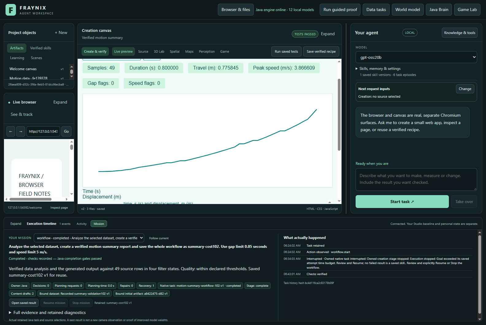

# Fraynix Agent Workspace

Edition102 measures complete local-agent workflows, keeps failures and recovery visible, and adds a verified motion-summary report with source-checked charts and retained procedures. Four of seven measured requests completed; three exhausted their drafts, including changed-input summary reuse. Generation reliability remains a measured limitation.

[Edition102: measurements, functions, results and next steps](README-102.md) · [Offline guide](docs/readmes/102/index.html) · [Previous edition](README-101.md) · [Contributor direction](README-CONTRIBUTORS.md)

Java owns durable goals, physics, tools, verification and retained procedures. Chat, browser, creation canvas, Game Lab and spatial views share those capabilities.

Published to main. [Fetched GitHub verification](docs/PUBLICATION_102.json).
