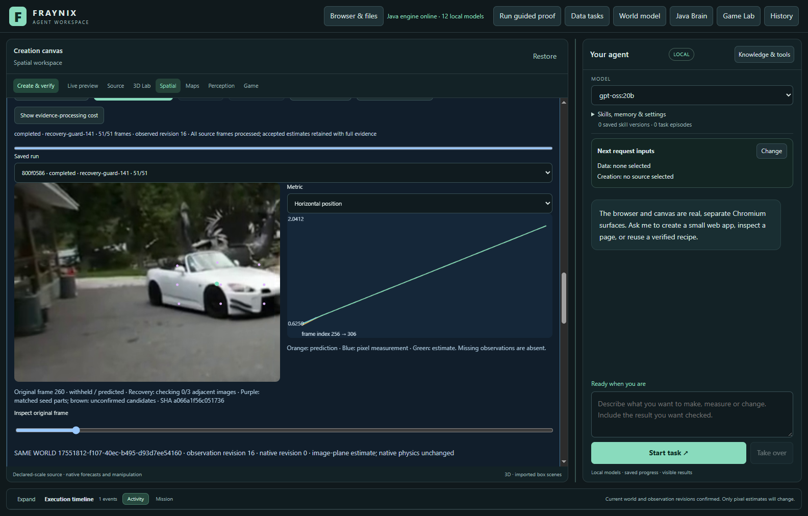
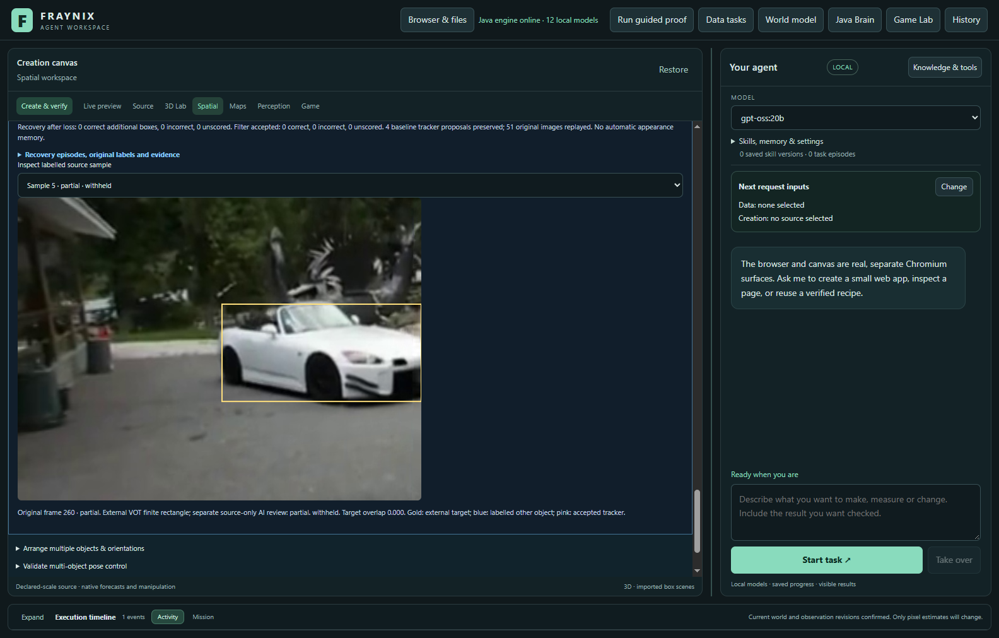
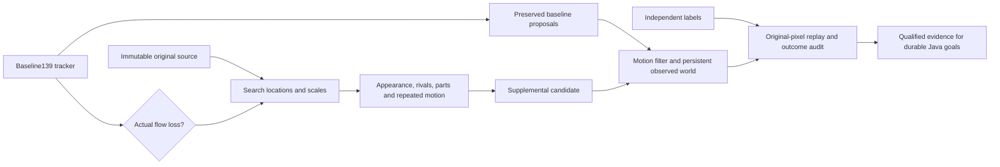

# Fraynix Agent Workspace — Edition 141

[Published and fetched verification receipt](docs/PUBLICATION_141.json) · [Release tag](https://github.com/eyeoverthink/Fraynix-Agent-Workspace/tree/readme-141)

**Recover after loss without quietly switching objects.** Fraynix connects durable chat goals, a Java brain and simulation, observed worlds, browser interaction, data and creation tools, and reusable verified procedures. Edition141 adds an explicit source-qualified recovery experiment. The underlying139 guard and default tracking remain intact.

[Previous edition](README-140.md) · [All editions](docs/readmes/INDEX.md) · [Interactive offline guide](docs/readmes/141/index.html) · [Integrated roadmap](docs/INTEGRATED_AGENT_ROADMAP.md) · [Contributor handoff](README-CONTRIBUTORS.md)



## What changed

The optional **recovery-guard-141** wraps the unchanged139 guard. Every accepted139 tracker proposal is preserved exactly. An additional recovery path becomes eligible only after genuine underlying flow loss. A warning that merely quarantines a still-tracked proposal cannot enable this path. The wrapper never resets or retrains the baseline tracker.

The new Java search compares the immutable initial appearance at eight bounded scales. It retains three separate peaks per scale, refines their position and size, and compares the strongest candidate against competitors. This prevents a large match from crowding a smaller lookalike out of the search. Source texture, existing appearance/color/scale checks and immutable spatial parts must agree. A strong correlation is evidence of similar pixels, not semantic identity.

**Three consecutive source confirmations** are required. Adjacent images must also support coherent forward/backward optical flow with sufficient inliers, stable geometry and no ambiguity. An absent, competing, unsupported or discontinuous candidate resets confirmation. There is no time-based release and no automatic admission of predictions into appearance memory.

**recovery-monitor-141** computes the same evidence while preserving every139 tracker and filter output. This is a control against139, not against the legacy default. Additional candidate measurements can affect later filter estimates, so complete filtered outcomes are also compared. Existing **legacy-flow** remains the default; all earlier experimental methods stay available.

The interface shows whether recovery is inactive, checking adjacent images, or source-confirmed. The independent outcome panel reports correct, incorrect and unscored supplemental boxes separately from filter-accepted supplemental measurements. No model weights, new runtime vision library, authority change or capacity increase is introduced.

## Fresh results

Fresh candidate versus unchanged139: **99 vs 99 correct**, **0 vs 0 wrong**, **30 vs 30 missing**, and **0 vs 0 hidden outputs**. There are 129 visible/partial references, 0 confirmed absent and 17 uncertain per method. Additional source recoveries: **0 correct, 0 incorrect, 0 unknown**. The filter accepted **0 correct, 0 incorrect, 0 unknown** of these. Default flow: 99 correct, 0 wrong, 30 missing and 0 hidden outputs. This fresh cohort does not demonstrate more correct observations without additional errors; recovery improvement remains unresolved. The candidate stays an explicit experiment. The controlled return test proves the mechanism, not general camera reliability. This cohort has no confirmed fully hidden references and no independently labelled distractors. No universal switch-free claim follows.

| Method / source | Correct / visible | Missing | Wrong overlaps | Other-object matches | Hidden outputs |
| --- | ---: | ---: | ---: | ---: | ---: |
| legacy-flow / following-255 | 4/34 | 30 | 0 | 0 | 0/0 |
| foreground-guard-139 / following-255 | 4/34 | 30 | 0 | 0 | 0/0 |
| recovery-monitor-141 / following-255 | 4/34 | 30 | 0 | 0 | 0/0 |
| recovery-guard-141 / following-255 | 4/34 | 30 | 0 | 0 | 0/0 |
| legacy-flow / person2-1 | 95/95 | 0 | 0 | 0 | 0/0 |
| foreground-guard-139 / person2-1 | 95/95 | 0 | 0 | 0 | 0/0 |
| recovery-monitor-141 / person2-1 | 95/95 | 0 | 0 | 0 | 0/0 |
| recovery-guard-141 / person2-1 | 95/95 | 0 | 0 | 0 | 0/0 |


Baseline139 accepted tracker proposals are preserved exactly. Supplemental measurements may change later filter estimates; compare complete final outcomes as well as additional raw boxes. The monitor preserves139 tracker and filter outputs.


| Source / method | Additional boxes: correct / incorrect / unknown | Filter accepted: correct / incorrect / unknown |
| --- | ---: | ---: |
| following-255 / recovery-monitor-141 | 0 / 0 / 0 | 0 / 0 / 0 |
| following-255 / recovery-guard-141 | 0 / 0 / 0 | 0 / 0 / 0 |
| person2-1 / recovery-monitor-141 | 0 / 0 / 0 | 0 / 0 / 0 |
| person2-1 / recovery-guard-141 | 0 / 0 / 0 | 0 / 0 / 0 |


| Source | Searches after loss | Qualified unique candidates | Highest recorded similarity | Recorded candidate evaluations |
| --- | ---: | ---: | ---: | ---: |
| following-255 | 47 | 0 | 0.779 | 4,133,740 |
| person2-1 | 0 | 0 | — | 0 |

These are descriptive post-run diagnostics, not new qualification criteria. Similarity is not a probability. Recorded evaluations exclude repeated work from resume and audit replay.


The main table counts accepted filtered observations. The supplemental table counts all new returned boxes and the subset accepted by the filter. Missing observations remain in the denominator. Unknown labels do not establish success. A low overlap means an inaccurate box; without independent distractor geometry it does not identify which other object was followed.

## Development and controlled tests

The recordings evaluated in edition140 are exposed development data. In current-code comparisons,139 and141 both retain **83 correct, 10 wrong and 69 missing** visible/partial observations across `cat1`, `cat2` and `group1`, with no accepted hidden output. The new recovery path adds no observations there and preserves all93 accepted139 tracker proposals. The monitor matches139 exactly on the cat1 control. Complete traces and costs are retained.

In this one sequential development pass, pixel processing across the three windows took 50.5 seconds for141 versus 45.2 seconds for139. The added search therefore cost work without an accuracy gain on these exposed cases. This is a single-pass measurement, not a repeated timing estimate or live-camera rate.

A controlled image fixture moves a textured object after disappearance and enlarges it by50%. The new path returns correctly located boxes after three confirmations while139 stays withheld. A differently scaled copy prevents supplemental acceptance; interrupted confirmation resets. The inherited139 tracker can itself select a copy in one fixture: that error remains visible, and the supplement must not add another measurement. These are synthetic mechanism tests, not proof of camera-level identity recognition.

Nine focused tests cover multi-scale search, competitors, uniform texture, repeated recovery, interruption, warning-only exclusion, dimensions, monitor equivalence, label-independent pixel replay, contradictory outcome labels, forged evidence, stopped prefixes, cold reopening and source tampering. Broader regression retains previous perception, world, goal, browser, creation, qualification and archive checks.

## Sources, visibility and limits

| Recording / target | Original frames | Stride | Visible or partial | Hidden | Uncertain | Distractor-labelled samples |
| --- | --- | ---: | ---: | ---: | ---: | ---: |
| following / 1 | 255–306 | 1 | 34 | 0 | 17 | 0 |
| person2 / 1 | 1–96 | 1 | 95 | 0 | 0 | 0 |


Three source names were fixed before access: **car3, following and person2** from [VOT-LT2018](https://www.votchallenge.net/vot2018/dataset.html). The [frozen contract](docs/EDITION_141_CONTRACT.md) selects the first eligible disappearance/return interval, or the declared first96 control if no event qualifies. Seeds must satisfy the existing minimum size. Ineligible entries are recorded and excluded without replacement searches. Every selected image is reviewed without predictions; labels are committed before fresh runs. Code, thresholds and scoring rules are not tuned on fresh results.

All148 selected source images reviewed on seven contact sheets before predictions, with original-resolution boundary checks. Following255–306 shows a white car approaching the right edge and returning into view; part of the car remains visible throughout the external NaN interval270–286, so those17 images are uncertain/unscorable, not confirmed hidden. Finite frames259–269 and287–306 have a clipped target and are labelled partial. Person2 frames1–96 show an unobstructed person walking on grass, a visible-motion control. Car3 is excluded by the frozen size rule: its first rectangle is16px wide in1280px, below.025, with no qualifying annotated disappearance interval. No replacement source, full-occlusion success claim, human adjudication or independent distractor geometry.

External rectangles and NaN annotations are independent of this tracker. Source-only AI visibility judgments are separately attributed; they are not independent human adjudication. No independent other-object rectangles are supplied, so zero labelled-other matches cannot prove switch-free tracking. Original annotations, checksums, exclusions and exact-rational normalization corrections are retained. Tiny or uncertain observations remain unscored rather than being expanded or called hidden.



## Verification and persistence

Local checks passed: 325 distinct Java tests, 161 desktop checks, kernel integration, actual agency regression and isolated offline/package preparation. 8 actual-app fresh comparisons use 584 later-frame outcomes. Exact monitor equivalence, original-pixel audit replay, independent host arithmetic, export, stop/resume and abrupt-process cold restart are verified.

- All eligible fixed source windows compared with four methods and identical pixels. Independent host overlap/distractor/supplemental-outcome arithmetic agrees with Java. Monitor preserves every139 tracker/filter output; candidate preserves every accepted139 tracker proposal. No automatic anchor admissions; defaults unchanged.
- Explicit method selection, recovery explanation, original-source overlay, independent audit UI, complete bounded export and exact stopped-prefix resume passed. Native physical world unchanged.
- Owned-process crash and cold reopen preserve exact completed-state bytes/timestamp and zero observation writes. All recorded runs/audits reverified, including original-pixel decision replay. Source modification refuses audit/export; original restoration revalidates.

Each141 decision is reconstructed from original pixels and the saved initial seed before outcome scoring. Implementation identities, source hashes, world bindings, histories and outcome checks remain mandatory. Source or decision tampering refuses verification. Completed-state restart preserves original bytes and timestamps; interrupted work resumes explicitly. Observation experiments do not silently move the native physical world.

## Measured costs

| Measured run phase | Tracking / ms | Audit with replay / ms |
| --- | ---: | ---: |
| legacy-flow / following-255 | 7320.9 | 123.9 |
| foreground-guard-139 / following-255 | 13153.4 | 18045.8 |
| recovery-monitor-141 / following-255 | 21205.2 | 27934.1 |
| recovery-guard-141 / following-255 | 28660.2 | 27924.9 |
| legacy-flow / person2-1 | 27087.1 | 251.7 |
| foreground-guard-139 / person2-1 | 60227.8 | 47118.7 |
| recovery-monitor-141 / person2-1 | 83178.9 | 49101.8 |
| recovery-guard-141 / person2-1 | 102942.4 | 48991.5 |

The entire actual-app harness took 747.3 seconds (12.5 minutes), including imports, UI inspection, repeated verified reads, export, captures, stop/resume, crash/reopen and tamper checks. The phase intervals above are subsets of this elapsed time, not additional costs to add to it. Regression/build/documentation work is separate.


These are bounded durable workflows and measured audit phases, not a live-camera speed claim. Imports, UI reads, replay, restart and export also cost time; complete harness duration includes them. Fresh windows differ from previous editions, so cross-edition duration is not a controlled performance comparison.

## Review it locally

Use JDK 21 and the prepared desktop dependencies. From the checkout:

```powershell
$env:FRAYNIX_WORKSPACE_PROJECT = Join-Path $env:LOCALAPPDATA 'Fraynix-Review-141'
.\scripts\Start-Agent-Workspace.ps1
```

After dependencies are cached, add `-Offline` to require local operation. Preserve your existing project path and stop its Java owner through the app before rebuilding that owner's installation.

1. Open **Spatial → Real footage · observed world**, choose a world, import footage and mark its initial rectangle.
2. Compare **Existing flow tracker**, **Experimental139** and **Experimental141** explicitly. **Control141** preserves139 outputs.
3. Inspect original pixels, source-part matches and recovery confirmation counts. Predictions are not measurements.
4. Under **Object identity · occlusion & recovery**, import independently prepared target/visibility labels. Compare complete outcomes and supplemental-box outcomes.
5. Reopen, reverify and export complete evidence within existing bounds. Keep the original project if an export is too large; do not discard evidence to fit a limit.

## Role in the connected application



Java continues to own durable goals, environment state, validation, recovery and evaluation. The desktop presents the world, browser and creation canvas. Better perception serves complete tasks in that shared application. Observed, predicted and unknown states must remain distinct before an action or memory admission.

## Next steps

1. **Handle partial views without inventing identity.** The car case exposes a gap between a full source template and a clipped, changing view. Develop visible-part geometry and independently verified alternate appearances on these now-exposed recordings. Preserve original anchors and competitor checks; never admit a suspect recovery as its own training example.
2. **Qualify real disappearance and return.** Freeze the next method before new recordings with complete cover, re-entry and a similar-looking competing object. Label target and distractor rectangles independently, retain uncertain boundaries, and measure every correct, wrong and missing return. This cohort contains no confirmed fully hidden images and cannot qualify full-occlusion behavior.
3. **Make the extra work earn its cost.** Measure end-to-end tracking, source replay, persistence, UI reads and reopening. Bound expensive recovery search and reuse only exact source/code-bound computation while retaining every source and outcome check. Do not trade away verification to improve a timing number.
4. **Keep the connected application central.** Durable Java world, browser and creation goals should receive clear measured, predicted and unknown states. A missing or ambiguous object should trigger observation or an explicit refusal, not silently authorize manipulation or become appearance memory. Better recovery must improve complete tasks before it becomes the default.


## Attempts and publication

CI was checked first against140 run43518090047: documentation passed while compile/test/package remained in progress. Both observed139 runs had completed successfully. Hosted CI is separate from the local checks and fetched publication.

At the later02:32UTC check,140 release run43517621284 had passed. The linked140 final-metadata run43518090047 was still in progress. Neither observation claims hosted success for the new141 code.

The first controlled run had two failures. A global peak budget missed a differently scaled copy, and an initial assertion incorrectly expected the inherited139 tracker to withhold a copy it already accepted. The corrected control separately checks that supplemental recovery adds no acceptance. Additional local size refinement alone still missed the rival in the second attempt. Retaining separate peaks at every scale fixed the search; the third six-test run passed.

The expanded nine-test fourth run caught a replay mismatch in the positive fixture. It instantiated an in-memory rectangle rather than the canonical rectangle reconstructed from saved coordinates. The fixture now uses the same canonical seed as the app; replay equality was not weakened. The fifth nine-test run and the broad325-test run passed. Original logs/XML from the attempts are retained; early uncommitted search source versions were not separately snapshotted.

Production, scorer, source selection and actual-app harness were frozen in05277fcb before fresh annotations or pixels. Source-only review and labels were committed in fbfe6783 before fresh predictions. Car3 failed the existing seed-size rule and was excluded without replacement. The original external metadata retains its supplied whitespace. The two eligible windows remain in the report regardless of their results.

No fresh-result tuning, automatic appearance admission, default change or replacement-source search is performed. Full-cover and identity-switch reliability remain unqualified by this cohort. Publication is claimed only after the final push and fetched-tree audit.


Hosted CI, local validation and fetched Git verification are distinct. Raw footage archives and private projects are excluded from publication. Exact source identities, original annotations, frozen labels, complete traces, failed attempts and attributed app screenshots are retained.

[Validation](docs/readmes/141/verification.json) · [Original evidence](docs/readmes/141/original-evidence.json) · [Comparison](docs/readmes/141/comparison.json) · [Source manifest](docs/publication141/source141.json) · [Method lock](docs/OBSERVATION_141_LOCK.json) · [Source inventory](docs/readmes/141/file-inventory.json)

[Recovery wrapper](workspace-engine/src/main/java/fraymus/workspace/LossRecovery141.java) · [Source search](workspace-engine/src/main/java/fraymus/workspace/RecoverySearch141.java) · [Pixel replay and outcome audit](workspace-engine/src/main/java/fraymus/workspace/LossRecoveryAudit141.java) · [Actual-app test](workspace-desktop/test/recovery141-integration.cjs) · [Project memory](docs/PROJECT_MEMORY.md)

Preserve defaults, private data, frozen editions and every source/outcome check. Read [AGENTS.md](AGENTS.md) before continuing.
