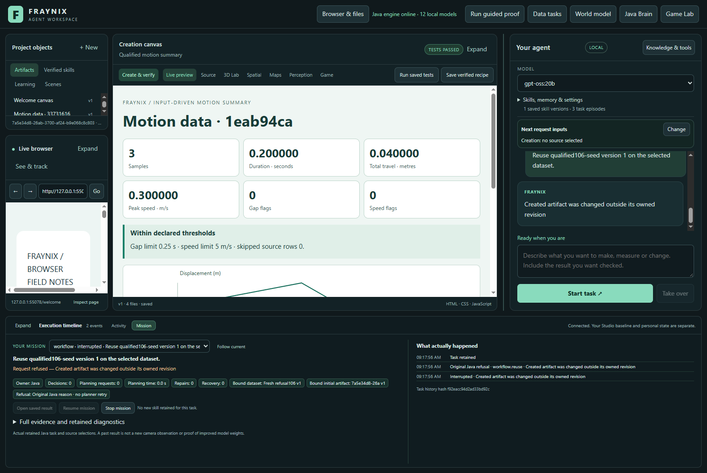

# Fraynix Agent Workspace

Edition106 preserves the original Java refusal in chat without planner retries and tests fresh numerical boundaries through verified saved procedures.

[Edition106: functions, evidence and next steps](README-106.md) · [Interactive offline guide](docs/readmes/106/index.html) · [Previous edition](README-105.md) · [Contributor direction](README-CONTRIBUTORS.md)

11 actual requests complete; three request refusals and five invalid imports behave as required. Existing source/outcome checks remain unchanged.

Java owns durable goals, tools, verification, recovery and memory. Chat, browser/canvas, spatial views and Game Lab remain integrated.

Published to main. [Fetched GitHub verification](docs/PUBLICATION_106.json).
