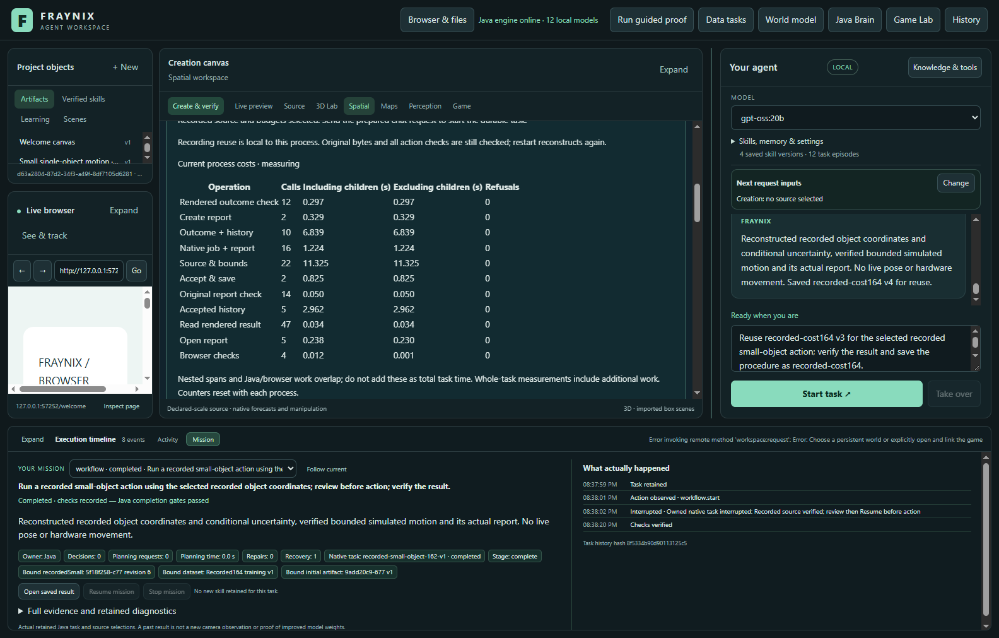
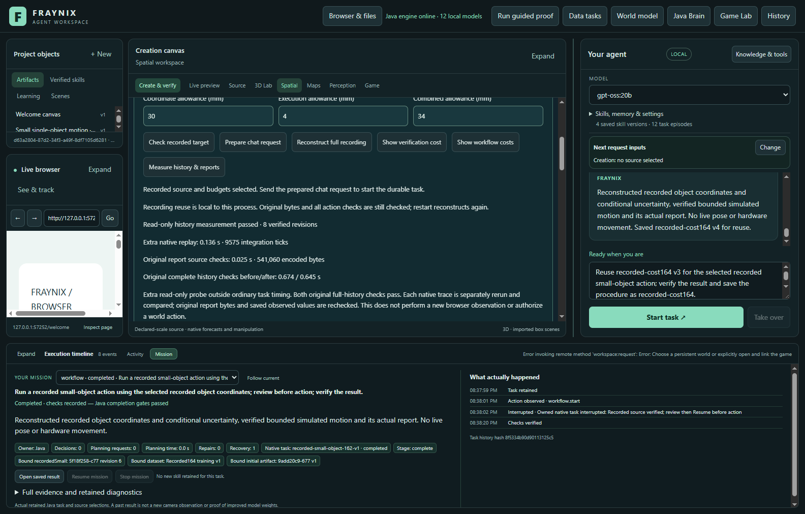
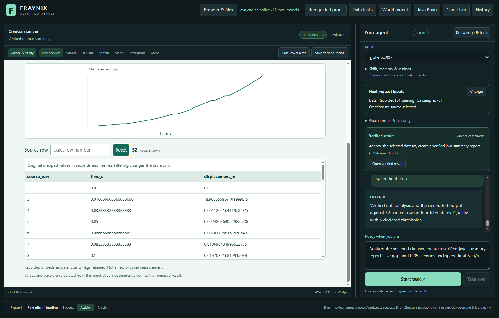

# Fraynix Agent Workspace — edition 164

[Published and fetched receipt](docs/PUBLICATION_164.json) · [Release tag](https://github.com/eyeoverthink/Fraynix-Agent-Workspace/tree/readme-164)

2026-11-17 · Physics history · Report costs · Longer mixed workflows

[Previous edition 163](README-163.md) · [Offline interactive guide](docs/readmes/164/index.html) · [All editions](docs/readmes/INDEX.md) · [Frozen measurement plan](docs/publication164/plan164.md)

Edition 164 measures complete mixed workflows across eight accepted simulated-world revisions and two fresh data reports per session. Forty durable requests complete across four sessions, including eight abrupt interruptions, sixteen saved motion-procedure versions and cold verification. Timing is diagnostic; original native/controller/report/verifier source and compiled bytes match edition 163.

The screenshot shows the actual app and its current-process timing display. An existing generic timeline notice asks for a linked game world; the recorded-action destination is selected and verified separately. It does not represent a failed recorded-action outcome. The notice remains a presentation issue.

## The application and this phase

Fraynix connects observation, simulation, browser and creation surfaces through durable Java tasks. A request can bind an input, execute a procedure, inspect an actual result, recover after interruption and retain a verified way to repeat useful work. Java owns task state and acceptance. The desktop presents the browser, world and creation surfaces together.

Edition 162 connected recorded coordinates and conditional uncertainty to a smaller controller and durable chat requests. Edition 163 reduced repeated reconstruction of unchanged recordings while preserving fresh evidence checks. Edition 164 measures the remaining costs as **one world grows through eight accepted actions**, interleaved with **two fresh data-to-report workflows**.

This is a measurement and inspection release. It does not promote a new tracker, physics controller, learning policy or physical-accuracy claim. The five native controller, physics, store, verifier and report classes have both unchanged source and byte-identical locally compiled classes compared with edition 163 ([identity receipt](docs/readmes/164/native-identity.json)). The changed recorded-parent implementation receives its own identity; earlier proofs are not relabelled.

## What was added

**Bounded Java operation timing.** Eight fixed categories wrap existing calls: recorded-source checks, accepted-history verification, native-job verification, outcome verification, acceptance, report creation, report source checks and report audit. Each wrapper preserves the original result or exception. Counters and the latest 128 events stay in the process; they reset after restart. They cannot authorize an action or substitute for evidence. These Java spans cover the recorded-motion route. The interleaved data workflows have complete-task timings and shared browser spans; not every data-analysis operation has its own timer.

**Actual browser-operation timing.** The desktop measures existing report navigation, rendered-result reads and browser checks with the same inputs, receiver and returned values. Nested asynchronous operations use the union of child intervals so overlapping children do not produce a negative exclusive time. Detached child work is identified separately. Timing can be disabled without skipping the original operation.

**Read-only history breakdown.** The new control accepts a selected world, exact revision and hash. It requires an idle, unreserved world and at most eight accepted entries. The original complete history verifier runs before and after. Between those checks, the probe independently repeats each native run, compares its full result, rebuilds and compares the report source, and audits its saved observations. It then verifies persisted and in-memory world state remained unchanged. There is a bounded checkpoint budget of 120 seconds; synchronous original checks may finish before the following budget checkpoint. The existing twelve-job world limit is unchanged.

The probe is deliberately extra work. Saved observations are rechecked against the original report; this does **not** count as a new browser observation, a new accepted revision or new camera evidence. Actual workflow acceptance still obtains and checks the rendered report in the browser.

## Complete mixed-workflow study

The fixed order is timing on A, timing off A, timing off B, timing on B. All four sessions use the same locked build, two Java processors and a 768 MiB Java heap. Edition 163's verified recording reuse remains enabled in both modes. Only the new diagnostic timing is toggled.

Every fresh project executes this itinerary:

1. Move using the historical camera end point; save motion procedure v1.
2. Reuse v1 with the generated short recording's start point. Analyze the original Delfys validation data and create a fresh, verified Java summary report.
3. Reuse v1 with the generated reverse recording's start point; save v2.
4. Reuse v2 with the camera start point. Pause before action, abruptly stop Java, restart and resume the same durable request.
5. Move using the camera end point; save v3.
6. Reuse v3 with the short recording's start point. Analyze the original Delfys training data and create another fresh verified summary.
7. Reuse v3 with the reverse recording's start point; interrupt Java before action and recover the same request again.
8. Reuse v3 with the camera start point; save v4.

Each session has ten completed parents, eight native motion children, eight accepted world revisions and four saved motion-procedure versions. Each data workflow has two completed child stages, exact original/normalized source handoff, four independently observed interactive report states and fresh calculated summaries. The data report does not change the physics world. Summary qualification and retention remain a separate gate; these runs do not save unqualified summary procedures.

Read-only probes run after history depths 2, 4, 6 and 8. They are **outside ordinary task timings**. Task totals include preparation, execution, report checks, requested skill saving and an additional original archive verification. The two interrupted task totals include restart. Whole-session time includes startup, probes, diagnostic calls and UI navigation; cold verification is separately measured. Fixture copying and post-study corruption tests are outside those totals.

### Timing on versus off

| Pair | Timing on, ten tasks s | Timing off, ten tasks s | Difference % |
| --- | ---: | ---: | ---: |
| a | 170.85 | 168.50 | +1.40 |
| b | 166.68 | 169.11 | -1.43 |

These are two small, exposed local pairs. Differences include scheduling, warm-up and storage noise as well as instrumentation. They are not an isolated timer-overhead estimate or a population speed guarantee; a negative difference is not evidence that timing makes the controller faster.

Across all four sessions, mean original full-history verification grew from **0.165s at two entries to 0.653s at eight** (3.95×). At eight entries, the separate repeated native runs averaged **0.133s**, and report rebuilding/source/saved-observation audit averaged **0.025s**. These separately repeated measurements identify work; they do not partition the original verifier's time.

| Repeated source task | Early mean complete task s | Later mean complete task s |
| --- | ---: | ---: |
| Camera end: history1 →5 | 13.29 | 17.94 |
| Generated short start: history2 →6 | 12.89 | 17.85 |

These repeated endpoints have growing history and different retained procedure ancestry. They show complete-task growth, not an isolated causal estimate of history length.

Diagnostic totals below cover the **twenty timed tasks in the two timing-enabled sessions**, joined across process restarts. Read-only probes and their separately collected counters are outside these task intervals. Counts include repeated required checks, not distinct new observations.

| Domain / operation | Calls | Including children s | Excluding children s |
| --- | ---: | ---: | ---: |
| browser / canvas.test | 56 | 5.049 | 4.750 |
| browser / canvas.navigate | 56 | 2.029 | 1.889 |
| browser / canvas.isolated | 672 | 0.632 | 0.632 |
| java / SOURCE | 196 | 95.116 | 95.116 |
| java / NATIVE_OUTCOME | 80 | 35.225 | 35.225 |
| java / HISTORY | 52 | 15.904 | 15.904 |
| java / NATIVE_JOB | 128 | 9.971 | 9.971 |
| java / NATIVE_ACCEPT | 16 | 5.909 | 5.909 |
| java / REPORT_WRITE | 16 | 3.298 | 3.298 |
| java / REPORT_AUDIT | 96 | 2.439 | 2.439 |
| java / REPORT_SOURCE | 112 | 0.405 | 0.405 |

The next optimization should be selected from these measured repeated operations and evaluated using the whole request. Diagnostic wrappers are not permission to skip an original check.

### Every complete task

| Run | Task | History | Preparation s | Execution s | Archive check s | Complete task s |
| --- | --- | ---: | ---: | ---: | ---: | ---: |
| on-a | motion-1-camera-end | 1 | 4.26 | 8.94 | 0.72 | 13.92 |
| on-a | motion-2-generated-short-start | 2 | 4.13 | 9.19 | 0.70 | 14.03 |
| on-a | summary-validation | 2 | 0.24 | 8.66 | 0.05 | 8.95 |
| on-a | motion-3-generated-reverse-start | 3 | 3.28 | 10.47 | 0.79 | 14.55 |
| on-a | motion-4-camera-start | 4 | 1.48 | 23.17 | 0.87 | 25.52 |
| on-a | motion-5-camera-end | 5 | 1.42 | 15.30 | 0.98 | 17.70 |
| on-a | motion-6-generated-short-start | 6 | 3.27 | 13.49 | 1.05 | 17.82 |
| on-a | summary-training | 6 | 0.16 | 10.03 | 0.09 | 10.28 |
| on-a | motion-7-generated-reverse-start | 7 | 1.70 | 21.74 | 1.08 | 24.52 |
| on-a | motion-8-camera-start | 8 | 4.74 | 17.57 | 1.25 | 23.56 |
| off-a | motion-1-camera-end | 1 | 3.93 | 7.70 | 0.64 | 12.26 |
| off-a | motion-2-generated-short-start | 2 | 3.20 | 8.36 | 0.71 | 12.27 |
| off-a | summary-validation | 2 | 0.10 | 7.47 | 0.06 | 7.62 |
| off-a | motion-3-generated-reverse-start | 3 | 3.41 | 10.74 | 0.83 | 14.98 |
| off-a | motion-4-camera-start | 4 | 1.41 | 22.28 | 0.88 | 24.57 |
| off-a | motion-5-camera-end | 5 | 1.51 | 15.96 | 1.00 | 18.47 |
| off-a | motion-6-generated-short-start | 6 | 3.35 | 14.11 | 1.01 | 18.48 |
| off-a | summary-training | 6 | 0.10 | 10.39 | 0.06 | 10.55 |
| off-a | motion-7-generated-reverse-start | 7 | 1.65 | 22.33 | 1.09 | 25.06 |
| off-a | motion-8-camera-start | 8 | 5.04 | 17.98 | 1.21 | 24.23 |
| off-b | motion-1-camera-end | 1 | 4.00 | 8.94 | 0.63 | 13.57 |
| off-b | motion-2-generated-short-start | 2 | 3.25 | 9.17 | 0.70 | 13.12 |
| off-b | summary-validation | 2 | 0.12 | 7.77 | 0.07 | 7.96 |
| off-b | motion-3-generated-reverse-start | 3 | 3.12 | 10.85 | 0.77 | 14.74 |
| off-b | motion-4-camera-start | 4 | 1.51 | 23.48 | 0.88 | 25.87 |
| off-b | motion-5-camera-end | 5 | 1.47 | 15.21 | 0.97 | 17.65 |
| off-b | motion-6-generated-short-start | 6 | 3.31 | 13.54 | 1.01 | 17.86 |
| off-b | summary-training | 6 | 0.23 | 10.26 | 0.06 | 10.55 |
| off-b | motion-7-generated-reverse-start | 7 | 1.62 | 20.80 | 1.10 | 23.52 |
| off-b | motion-8-camera-start | 8 | 5.01 | 18.07 | 1.19 | 24.27 |
| on-b | motion-1-camera-end | 1 | 3.93 | 8.83 | 0.63 | 13.39 |
| on-b | motion-2-generated-short-start | 2 | 3.08 | 8.34 | 0.74 | 12.16 |
| on-b | summary-validation | 2 | 0.10 | 8.72 | 0.05 | 8.86 |
| on-b | motion-3-generated-reverse-start | 3 | 3.08 | 10.59 | 0.78 | 14.45 |
| on-b | motion-4-camera-start | 4 | 1.32 | 21.50 | 0.89 | 23.71 |
| on-b | motion-5-camera-end | 5 | 1.62 | 15.34 | 0.98 | 17.94 |
| on-b | motion-6-generated-short-start | 6 | 3.15 | 13.07 | 1.02 | 17.24 |
| on-b | summary-training | 6 | 0.27 | 10.13 | 0.05 | 10.46 |
| on-b | motion-7-generated-reverse-start | 7 | 1.78 | 22.17 | 1.12 | 25.06 |
| on-b | motion-8-camera-start | 8 | 5.10 | 17.07 | 1.23 | 23.40 |

### Independent history breakdown

| Run | History | Original check s | Extra native replay s | Extra saved-report audit s | Whole probe s |
| --- | ---: | ---: | ---: | ---: | ---: |
| on-a | 2 | 0.161 | 0.034 | 0.007 | 1.435 |
| on-a | 4 | 0.330 | 0.065 | 0.014 | 2.623 |
| on-a | 6 | 0.499 | 0.098 | 0.027 | 2.891 |
| on-a | 8 | 0.657 | 0.135 | 0.025 | 4.160 |
| off-a | 2 | 0.160 | 0.051 | 0.007 | 1.498 |
| off-a | 4 | 0.315 | 0.068 | 0.013 | 2.289 |
| off-a | 6 | 0.510 | 0.101 | 0.020 | 3.228 |
| off-a | 8 | 0.668 | 0.131 | 0.025 | 3.932 |
| off-b | 2 | 0.162 | 0.035 | 0.007 | 1.828 |
| off-b | 4 | 0.337 | 0.067 | 0.013 | 2.292 |
| off-b | 6 | 0.495 | 0.098 | 0.020 | 3.044 |
| off-b | 8 | 0.662 | 0.129 | 0.024 | 3.912 |
| on-b | 2 | 0.177 | 0.035 | 0.007 | 1.595 |
| on-b | 4 | 0.354 | 0.065 | 0.013 | 2.460 |
| on-b | 6 | 0.507 | 0.100 | 0.019 | 3.010 |
| on-b | 8 | 0.674 | 0.136 | 0.025 | 4.088 |

The original-check column is one full verification before the probe; a second full verification also runs after it. Extra native replay and saved-report audit repeat component work independently. Whole probe time includes UI/request overhead, state checking and both original verifications. Do not subtract these columns to claim an unmeasured subsystem cost.

Java inclusive spans contain nested Java work. Browser and Java spans can overlap, and whole-task measurements include work outside either set of spans. Exclusive spans remove measured children only; they are not CPU utilization. The comparison joins each process epoch separately across restarts. The display shows the current process, not lifetime history.

## Exact outcome comparison and refusals

The four runs compare reconstructed sources and uncertainty, plans, every native sample and integration record, forces, contacts, outcomes and actual observed motion-report values. Only fresh scene/object/job identifiers and the scene-state hash receive fixed aliases. No numerical motion result is dropped to make comparisons agree.

Data comparisons include exact original CSV, source digest and column mapping, verified metrics, all four observed summaries, SVG-point checks and generated HTML/JavaScript bytes. Fresh artifact identities remain individually checked by the original workflow; they are not treated as content that should have the same identifier across projects. [Full comparison evidence](docs/readmes/164/comparison-evidence.json).

After each session, changing report bytes while preserving file size and timestamp must cause both archive verification and the probe to refuse. Restoring the exact original bytes must verify. Cold startup must verify all ten completed parents without creating another native action. The 198 original fixture files must remain unchanged.

86 selected Java checks and 181 desktop checks passed without failures or skips. Three halfway-time labels and exact poses passed actual Chromium checks. Four final Java/Electron sessions completed forty durable workflows: 32 motions and 8 fresh data reports. Each session preserved one world through 8 accepted revisions, 4 saved motion-procedure versions, 2 abrupt restarts, changed-report refusal and cold verification. One historical camera episode, two generated recordings and two original Delfys data files are distinct inputs. No new physical measurement or model inference is claimed; new physical validation remains pending.

Two development failures were retained. The first compilation rejected a lambda that captured a reassigned job; an unchanged final local reference fixed the capture. The first focused probe run then rejected valid persisted state because in-memory timestamp objects were compared directly with parsed JSON text. Comparing the same persisted JSON representation fixed this diagnostic mismatch; no original verifier, numeric tolerance or acceptance threshold changed. The corrected six focused Java checks and four host timing checks passed, followed by the full selected regression suite. All four final actual-app sessions used the pretrial locked method; no failed trial was removed or relabelled.

Focused checks cover nested and concurrent timing, unchanged values and exceptions, disabled timing with no clock reads, bounded retention, result isolation, stale revision, a pending world, changed disk state, forged native traces, altered report source and the eight-entry diagnostic limit. The actual-app study uses the visible chat composer, controls, real Java execution and browser-rendered reports. Local checks and hosted CI status are separate records.

Hosted CI was checked before implementation and again before publication. The latest edition 163 runs were still in progress at both checks; no hosted-green claim is made. The archived CI receipts preserve those observations.

## Using the new controls

Open **Spatial → measured alignment → Recorded object → durable small-object task · 164**. Choose a completed recording, independently labelled endpoint and compatible world, review the allowances, prepare the request and send it through chat. “Review before action” pauses before simulation; resume the same request after interruption.

**Show workflow costs** displays counts, inclusive/exclusive time and refusals in the current Java and desktop processes. **Measure history & reports** runs the read-only breakdown for the selected world. **Show verification cost** and **Reconstruct full recording** remain available from edition 163.

For an instrumentation comparison, start the app with `FRAYNIX_WORKSPACE_COSTS164=off`; leaving it unset enables diagnostics. This setting disables timers only. Source checks, verification, physical action limits, report checks and outcome acceptance still execute. Diagnostic counters are not persisted as evidence. Study receipts separately retain the measured timings.

## What the evidence does and does not establish

The inputs include **one exposed historical camera episode, two existing generated sequences and two original data files** ([dataset provenance](docs/datasets/delfys75-013/README.md)). Repeating them is useful for cost and recovery checks but creates no additional independent physical evidence. The recorded point is a tracked image centre projected onto a measured plane. Box geometry, height and mass remain authored; conditional allowances are not calibrated probabilities. Nothing here moves hardware or establishes a current lighter pose.

Prepared procedural requests make **zero model calls**. This demonstrates integrated Java-owned execution through chat, recovery and checks, not new language-model intelligence or weight training. Fresh physical validation remains pending at the user's request.

## Source and evidence map

| Component | Responsibility |
| --- | --- |
| [WorkflowCost164.java](workspace-engine/src/main/java/fraymus/workspace/WorkflowCost164.java) | Bounded operation timing, isolated status and process identity |
| [HistoryCosts164.java](workspace-engine/src/main/java/fraymus/workspace/HistoryCosts164.java) | Read-only full-history checks and exact repeated native/report breakdown |
| [RecordedSmall162.java](workspace-engine/src/main/java/fraymus/workspace/RecordedSmall162.java) | Original source-to-controller contract with measured verification calls |
| [WorkflowRunner.java](workspace-engine/src/main/java/fraymus/workspace/WorkflowRunner.java) | Durable execution, report checks and diagnostic access |
| [report-cost164.cjs](workspace-desktop/report-cost164.cjs) | Actual browser-operation timing, including overlapping child calls |
| [recorded162.js](workspace-desktop/renderer/recorded162.js) | Integrated history and cost controls |
| [study164.cjs](docs/publication164/study164.cjs) | Ten-task actual-app session with two interruptions and read-only probes |
| [compare164.py](docs/publication164/compare164.py) | Exact result comparisons and complete measured costs |

[Original evidence index](docs/readmes/164/original-evidence.json) · [Validation](docs/readmes/164/verification.json) · [Frozen method](docs/WORKFLOW_COST_164_LOCK.json) · [Obsidian map](docs/obsidian/172-history-report-costs.canvas) · [Source inventory](docs/readmes/164/file-inventory.json). Numbered editions and snapshots 001–163 remain unchanged.

## Next gates

Source/bounds checks consumed 95.12 seconds across the twenty timing-enabled tasks, the largest measured Java category. Use these measurements to target repeated source and history verification work. Establish an exact source-and-implementation-bound reuse boundary, exercise mutations before and after access, then compare complete mixed workflows with reuse enabled and disabled. Continue to run every required source and outcome check; a faster component is useful only if the full request improves.

The application direction remains one connected local agent: observe, propose, act, inspect, recover and retain useful procedures. Real-world accuracy is a separate workstream requiring fresh independently labelled motion, calibrated contact and height, and occlusion tests. This edition improves our ability to measure the cost of the connected loop without claiming that missing evidence.
