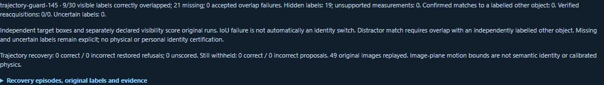
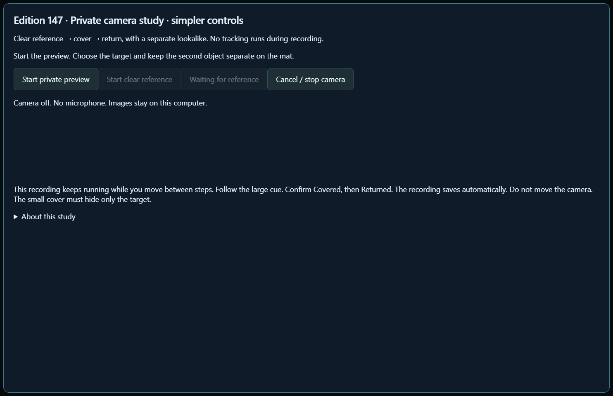

# Fraynix Agent Workspace — edition 147

[Published and fetched verification receipt](docs/PUBLICATION_147.json) · [Release tag](https://github.com/eyeoverthink/Fraynix-Agent-Workspace/tree/readme-147)

**Test the same object through cover and return, with a separate lookalike in view.** This edition evaluates the existing Java tracking methods against fresh source evidence. It adds a private, manually paced recording instrument for review; it does not introduce a new tracker or promote an experimental default.

**The new camera sequence qualifies for comparison, but useful return recovery failed.** The 24-frame unobscured donor tracked 23/23 scored frames correctly and admitted one independently checked appearance. All three unchanged methods—145, monitor 146 and guard 146—then produced 9/30 correct visible measurements, 21 missing, 0/19 unsupported hidden-frame measurements and 0 accepted matches to the labelled red lighter. All nine correct measurements occurred before cover; **0/21 visible return frames recovered**.

This closes the missing-source/reference gap from 146, not the recovery-capability gap. The full-cover event is source frames 38–56, followed by return 57; evaluation uses 28–77 and the causal donor uses 1–24. No reference-dependent comparison is unavailable. The guarded method adds no benefit on this sequence, because no supplemental proposal passes the earlier confirmation layer. It is not promoted; defaults remain unchanged.

The post-comparison traces show 42/42 target-region hypotheses overlapping the correct lighter across 21 return frames, per method (initial seed and one retained reference). None passes the existing uniqueness requirement or gains a confirmation. That is a diagnostic lead, not proof of which physical distractor caused the veto, and not permission to relax the checks. The next method needs to distinguish genuine competing objects from ambiguous appearance matches while retaining wrong-object rejection.

The user confirmed covering and returning the same black lighter. Source review shows an essentially stationary return; the red comparison is similar in shape but different in color. This is one fixed-camera, approximately 1 Hz test with manually reviewed image-plane boxes—not calibrated geometry, identical-object recognition, displaced-return qualification or general camera reliability. Camera pixels remain private.

[Previous edition](README-146.md) · [Offline guide](docs/readmes/147/index.html) · [All editions](docs/readmes/INDEX.md) · [Contributor handoff](README-CONTRIBUTORS.md) · [Architecture](docs/ARCHITECTURE.md) · [Integrated roadmap](docs/INTEGRATED_AGENT_ROADMAP.md)

## The connected application

Fraynix is a local agent workspace connecting durable chat goals, a Java physics world, Game Lab, browser observations, data analysis and verified creation procedures. Java maintains state, execution, recovery and outcome checks. The desktop supplies the browser, canvas and controls. Local models choose and explain actions through installed tools. The destination remains one observable system that creates, tests and retains useful procedures from measured outcomes.

The camera is one evidence source for that system. Following a visible region is not enough to establish that it is the same physical object. A durable task must retain the distinction between a measurement, prediction and unresolved identity. Default `legacy-flow`, action permissions, private worlds and every existing frame, dataset, run and export limit remain intact.

## What changed in this edition

- A source-only recorder opens inside an isolated instance of the app. The user starts and confirms physical actions with large buttons. Clear-reference and final-return sample counts advance automatically; COVER and UNCOVER cues wait for user confirmation.
- One continuous camera timeline preserves the clear reference, covering, full cover and return. Actual timestamps, every captured sample and cue changes are saved locally. Cues never substitute for reviewed source labels.
- Source eligibility is checked before tracking: a causal unobscured reference, complete occlusion, return, a separately labelled lookalike and disjoint source images.
- Existing `trajectory-guard-145`, `return-monitor-146` and `return-guard-146` are compared on identical footage. All original pixel, source, code, outcome and recovery checks remain required.
- Documentation captures contain actual app results while hiding private camera pixels.

The recorder is an edition review/test instrument, not a new production camera mode. Its source and exact launch procedure are retained so the study can be repeated. No transformer, cloud inference, image generator or new library is needed for this recording and comparison.

*Actual recorder UI, captured before preview in the synthetic-device lifecycle check. This illustrates controls, not physical tracking performance.*

## Source protocol and its limits

The [method and public-source contract](docs/EDITION_147_CONTRACT.md) was frozen before any fresh source images. The user then chose their webcam; the [separate webcam contract](docs/EDITION_147_WEBCAM.md) and [initial capture/preparation lock](docs/publication147/webcam-lock147.json) and [prospective revision 2](docs/publication147/WEBCAM_REVISION_2.md) were frozen before webcam access. The public protocol remains separate; unexecuted public candidates are not counted as tested footage.

For the webcam, use two distinct similar objects and a small cover under a fixed camera. Revision 2 records once per second; the rejected first attempt used about two samples per second. The acquisition cadence differs, so this is not a claim of equal temporal difficulty. Source-only review selects the earliest qualifying complete-cover event, including ten earlier samples and twenty samples after return. The reference contains 24 earlier disjoint samples, starts fully unobscured and contains at least twelve fully visible scored examples. Every selected frame and cover boundary is reviewed before predictions. App admission of verified appearances remains a separate requirement.

| Source / role | Original samples | Visible / partial | Fully covered |
| --- | --- | ---: | ---: |
| black-lighter-webcam-1 / reference-source | 1–24 | 23 / 0 | 0 |
| black-lighter-webcam-28 / evaluation | 28–77 | 30 / 0 | 19 |

Webcam rectangles and visibility are explicitly attributed to source-only AI review, independent of tracker predictions. User confirmation establishes the intended physical objects and performed actions; it does not make the rectangles instrumented ground truth. Approximately one-hertz sampling, image-plane bounds, partial views and similar appearances limit conclusions. This study is not a proof of semantic identity, calibrated real-world accuracy or reliable operation on arbitrary cameras.

## Results, including failures and unavailable comparisons

| Source / method | Correct / visible | Missing | Wrong overlap | Hidden outputs | Other-object matches |
| --- | ---: | ---: | ---: | ---: | ---: |
| black-lighter-webcam-28 / trajectory-guard-145 | 9/30 | 21 | 0 | 0/19 | 0 |
| black-lighter-webcam-28 / return-monitor-146 | 9/30 | 21 | 0 | 0/19 | 0 |
| black-lighter-webcam-28 / return-guard-146 | 9/30 | 21 | 0 | 0/19 | 0 |

Correct means an accepted measurement overlaps the independently labelled visible target by at least 0.5 IoU. Missing observations remain in every denominator. Wrong overlap alone does not establish an identity switch; matches to the explicitly labelled second object are reported separately. Accepted output while the target is fully covered remains an unsupported measurement. Source eligibility, verified appearance admission, completed execution and useful recovery are separate outcomes.

| Source / method | New146 refused correct / incorrect | Accepted supplemental correct / incorrect |
| --- | ---: | ---: |
| black-lighter-webcam-28 / trajectory-guard-145 | 0 / 0 | 0 / 0 |
| black-lighter-webcam-28 / return-monitor-146 | 0 / 0 | 0 / 0 |
| black-lighter-webcam-28 / return-guard-146 | 0 / 0 | 0 / 0 |

The unchanged 146 check may withhold a legitimate return as well as a wrong object. Newly withheld correct proposals are reported alongside wrong proposals prevented. A refusal-only system does not demonstrate useful recovery. Monitor146 must preserve the preceding method's output exactly; original baseline continuity and already-supported restorations stay intact.

## Repeat the private camera study

1. Prepare the existing app with Java21 and the desktop dependencies. Use an isolated review project; do not change a private working project.
2. Launch `node workspace-desktop/test/webcam147-recorder-v2.cjs`. The review window contains the study controls. Camera access starts only through **Start private preview**.
3. Identify the target and separate lookalike. Click **Start clear reference**, leaving both visible and hands away until the large cue says **COVER THE BLACK LIGHTER**.
4. Cover only the black lighter and click **Black lighter covered; hand away**. When the large cue says **UNCOVER**, reveal that same lighter, move it slightly and click **Black lighter returned; hand away**. Leave the red lighter visible and still.
5. Keep both objects visible. After 24 return samples, recording saves and the camera stops automatically; no final click is required. Incomplete attempts remain preserved.
6. Review original frames, record source-only labels and hashes, check source eligibility, and commit those inputs before running the frozen comparison harness. Never turn predictions into reference labels.

Private raw samples remain in ignored local storage. Existing application imports still accept at most 96frames; longer raw recordings are source archives, not expanded app capacity. No private camera pixels are included in the published screenshots or evidence bundle. Git verifies the published receipts, labels and source hashes; repeating original-pixel replay also requires authorized access to the local camera files.

## Verification, recovery and cost

374 distinct Java checks and 161 desktop checks passed, plus kernel, agency, offline preparation and package verification. 4 actual app runs across 1 private study project(s), with separate unfinished-process recovery. Source eligibility and useful recovery remain distinct from execution checks. Hosted CI is reported separately.

- Separate donor runs precede all fixed evaluation windows. Retention with zero eligible examples is refused and recorded; reference-dependent cases remain unavailable without replacement. Eligible cases compare three methods on identical pixels. Fresh real footage and generated trajectory controls are reported separately; no-reference cases retain an explicit baseline run and unavailability records. Independent host overlap/distractor/supplemental-outcome arithmetic agrees with Java. Monitor146 preserves every145 tracker/filter output; candidate preserves139 baseline and145 competed restorations, independently scoring additional146 refusals without a warning. No automatic anchor admissions; defaults unchanged.
- Explicit method selection, recovery explanation, original-source overlay, independent audit UI, complete bounded export and exact stopped-prefix resume passed. Native physical world unchanged.
- Owned-process crash and cold reopen preserve exact completed-state bytes/timestamp and zero observation writes. All recorded runs/audits reverified, including original-pixel decision replay. Donor and evaluation source modification independently refuse audit/export; original restoration revalidates.
- Killed only the owned Java process during a labelled camera occlusion after observed loss and while unfinished
- Cold reopen retained the exact committed prefix and interrupted status
- Resume reconstructed pre-loss motion and return decisions from original pixels before continuing
- Complete trace and independent outcome audit exactly match the uninterrupted run
- Native world unchanged; Additional observation run uses the existing capacity without expansion

| Source / method | Tracking ms | Replay/audit ms |
| --- | ---: | ---: |
| black-lighter-webcam-28 / trajectory-guard-145 | 38358.5 | 61909.0 |
| black-lighter-webcam-28 / return-monitor-146 | 43594.2 | 61942.7 |
| black-lighter-webcam-28 / return-guard-146 | 51435.7 | 61966.4 |

Complete black-lighter-webcam comparison workflow: 528.8s, 4 runs, 8042456 exported bytes. Includes checks, UI, source replay and retained retry intervals.

Separate interrupted-process check: 125.4s. Camera-free screenshot review: 189.0s.

- Both predecessor146 CI runs 43640231088 and 43640421227 completed successfully. Initial pending status and later connector receipts are preserved separately.
- The public benchmark candidates remained unexecuted after the user chose a private webcam. They are not counted as tested sources.
- The first physical capture, attempt-LqxrwK, reached its storage limit without completion. Source-only inspection also found at least 48 consecutive covered samples, above the frozen32-sample ceiling. It was rejected before any tracker prediction and is preserved intact.
- Revision 2 was frozen separately before the new capture: one sample per second, visible modal controls, automatic COVER/UNCOVER cues and automatic final save. Two explicitly synthetic camera lifecycle checks passed; neither is physical tracking evidence. An unused zero-frame UI attempt is preserved.
- The completed physical capture, attempt-98Fe5G, contains 84 original samples and 6, 569, 882 camera-image bytes. Source-only labels and hashes were committed at 57e95cc9 before tracking. Selected donor 1–24 and evaluation 28–77 have disjoint image bytes; fully covered38–56; first visible return 57.
- The user confirmed the performed actions. Pixel review shows an essentially stationary return, rather than a substantial change of location. The red comparison shares the lighter shape but differs in color. These limits remain explicit.
- Camera pixels and pixel-containing app captures remain private. Only numeric receipts, attributed source labels, hashes and camera-free actual app result images are published.

- The first camera-free documentation capture was blocked by the existing Content Security Policy when adding a style tag. The failed receipt is preserved. The helper now hides media through element display properties; no CSP or production security setting was changed.

- The separate process-interruption check passed: killed only the owned Java process after 10 committed frames during source-labelled cover; reopened as interrupted with 10 frames; completed 49 with the exact uninterrupted trace and outcome audit.

CI was checked before work. Its initial and final states are recorded separately from local verification. [GitHub Actions](https://github.com/eyeoverthink/Fraynix-Agent-Workspace/actions) and the publication receipt identify the actual pushed revision; prepared files or a local commit are never described as a completed push.

## What comes next

1. Diagnose the failed return before changing thresholds. The exposed traces find strong target-region matches but fail the existing uniqueness check. Retain competing-region geometry and determine whether genuine distinct objects or ambiguous partial matches caused the veto. Develop on this now-exposed sequence, then freeze changes before fresh footage; preserve wrong-object rejection and every source/outcome check.
2. Test a genuinely moved return, using new footage with measured displacement and a same-color comparison object. Keep source labels independent of predictions and record failures as well as successes.
3. Measure useful recovery and full cost together: correct returns withheld, wrong objects accepted, hidden-frame outputs, time to recover, source replay, saves, restart and export. Reuse exact source/code-bound computations only when equivalent checks are demonstrated; do not loosen defaults based on one stationary scene.
4. Connect qualified observations to one durable chat request that creates a verified observed-object report or working artifact. Carry measured, predicted and unknown states into the output; stop physical actions when identity remains unresolved. Keep the integrated Java world/browser/creation system central.

Progress remains tied to the unified application: qualified observations should support a durable chat request that produces a verified report or working artifact. Java must preserve uncertainty and source evidence through that task. More vivid demonstrations or more accepted boxes do not replace measured correctness, useful recovery and restart durability.
