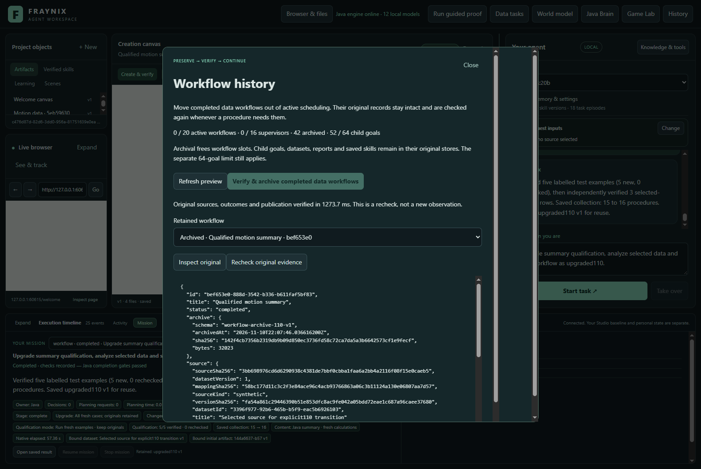

# Fraynix Agent Workspace

Edition 110 archives completed workflow history while keeping its original evidence verifiable. Java retains exact records, checks their sources and outcomes before reuse, and frees active workflow slots without deleting child goals or saved procedures.

[Edition 110: functions, measurements and next steps](README-110.md) | [Interactive offline guide](docs/readmes/110/index.html) | [Previous edition 109](README-109.md) | [Contributor direction](README-CONTRIBUTORS.md)

Use **History** to preview completed work, verify and archive it, inspect original records, and recheck their evidence. The actual study archived 42 records, completed six fresh requests, recovered an abruptly interrupted task and retained 21 procedures. Five requests correctly refused invalid evidence or insufficient capacity. All 134 Java tests, 148 desktop checks and 20 altered-evidence controls passed.

Java owns durable goals, tools, worlds, verification, recovery and memory. Chat, browser/canvas, spatial views and Game Lab remain integrated. This release archives completed data/creation workflows and qualification supervisors; other workflow families and child goals remain in their original stores.

**Next:** preserve completed child-goal evidence outside active scheduling. The unchanged 64-goal limit remains visible; this edition does not claim unlimited memory or model training.
