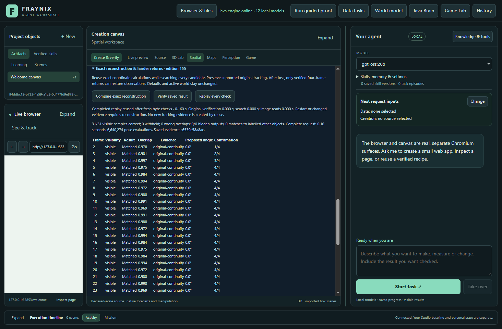
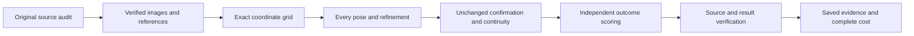

# Fraynix Agent Workspace — edition 155

[Published and fetched receipt](docs/PUBLICATION_155.json) · [Release tag](https://github.com/eyeoverthink/Fraynix-Agent-Workspace/tree/readme-155)

**Reconstruct the evidence. Repeat fewer calculations. Keep every check.** 2026-11-17.

[Previous: edition 154](README-154.md) · [All editions](docs/readmes/INDEX.md) · [Offline guide](docs/readmes/155/index.html) · [Validation](docs/readmes/155/verification.json)

Edition 155 reconstructs exactly the same evidence while reusing coordinate calculations. The exposed camera trace remains 34/42 correct observations, 8 withheld, 0 wrong overlaps and 0/30 hidden outputs, identical to 154. All eight app comparisons reproduce exact reference evidence. 7/7 harder generated cases meet their separate behavioral targets. Complete paired costs include the original verification. Defaults remain unchanged.

## The application and this edition

Fraynix remains one local agent workspace with a Java runtime, persistent world, physics, Game Lab, browser, creation canvas, durable goals and retained procedures. The long-term aim is an agent that can observe, propose, act and verify within that shared environment. Observations need to remain trustworthy when a view is interrupted, and their verification needs to be affordable enough to use in a larger task. This edition addresses that cost without changing the meaning of a successful check.

The change is written directly in Java. It adds no dependency, GPU requirement or model service. The explicit comparison uses one bounded worker when requested. Existing library and desktop dependencies remain part of the application; the project is not dependency-free. No LLM training or new local-model evaluation is claimed here. The model selector visible in screenshots is an existing app control, not evidence of a model invocation during these tests.

The user selected recorded tests. The earlier black/red lighter recording is exposed regression material. Seven newly rendered sequences provide harder, source-labelled controls, not fresh camera footage. Historical tracker implementations, appearance admission, native world state and the default `legacy-flow` method remain unchanged. The new comparison is explicit and does not authorize physical actions or promote a tracker into default use.

## Use the actual controls

1. Start the Java workspace through its existing Windows launcher and select the intended private project. Keep each running project under its own owner; do not share its database with another app instance.
2. Open **Spatial**, then **Object identity · occlusion & recovery**. Select a completed, independently labelled comparison whose original images and reference evidence are still available.
3. Open **Exact reconstruction & harder returns · edition 155** and click **Compare exact reconstruction**. The app shows source verification and frame progress while the bounded background calculation runs.
4. Read the result table: original continuity, confirmed return or withheld; matched or incorrect overlap; proposed image angle; and four-frame confirmation count. A proposed angle is not calibrated physical orientation.
5. Use **Verify saved result** to reopen unchanged evidence. The process-local cache still rechecks all source and implementation bytes. Use **Replay every check** to explicitly reconstruct, even when a completed result is already in memory.
6. Restarting clears the process-local cache. The first saved-result check after restart must rebuild the evidence. Missing source history is refused without recreating an empty replacement.

The panel reports original-verification, search and image-read costs separately. Completion is shown only after original sources, results and final fingerprints verify. Closing the owned service interrupts its worker; cancellation cannot produce a completed receipt. A source change or mismatch is a refusal, not an instruction to silently revise the proof.

## What was expensive

The prior complete camera profile spent about 125 seconds on original verification and 88 seconds on rotation search. Image reading took about one second. Removing redundant history reads helped, but the full workload still needed over three minutes. These measured phases guided the work: reducing search arithmetic offers a useful saving while leaving the original audit intact.

For every angle and scale, the old search repeatedly calculates the pixel coordinates for the same grid columns and rows. The new path calculates each column's 64 x coordinates and each row's 64 image offsets once for that angle. Each candidate then samples precisely those pixels and performs the same correlation arithmetic. One angle's arrays are retained at a time; they do not accumulate across frames or become an appearance memory.

The grid uses repeated floating-point addition, exactly like the original traversal. It preserves the order of additions and subtractions before integer conversion. It preserves normalized boundary tests, sample validity, score accumulation order, all angles and scales, all global proposals, refinement order, competing-object checks and candidate counts. This matters because an apparently equivalent algebraic rewrite can cross a pixel boundary or change a tie.

This is a computational optimization, not a narrower search. It does not select an area using an annotation, skip difficult frames, weaken a threshold, parallelize work across cores or trust old scores. The original 153 implementation remains available for comparison. The 154 continuity selector remains unchanged: current motion and full-object support can preserve an uninterrupted original track, but loss closes that segment. A later return must earn the existing four adjacent confirmations.

## Harder continuity and return tests

| Source | Original correct | Nested 153 correct | Edition 155 correct | Withheld | Wrong / hidden / other | Full request s | Warm median s |
| --- | ---: | ---: | ---: | ---: | --- | ---: | ---: |
| reversing-motion | 31/31 | 28/31 | 31/31 | 0 | 0 / 0 of 0 / 0 | 5.83 | 0.160 |
| long-cover-return | 5/18 | 12/18 | 15/18 | 3 | 0 / 0 of 12 / 0 | 3.97 | 0.152 |
| partial-before-return | 5/22 | 12/22 | 15/22 | 7 | 0 / 0 of 5 / 0 | 3.90 | 0.141 |
| double-return | 5/25 | 16/25 | 19/25 | 6 | 0 / 0 of 12 / 0 | 5.47 | 0.143 |
| wrong-only | 5/5 | 2/5 | 5/5 | 0 | 0 / 0 of 22 / 0 | 3.10 | 0.144 |
| near-copy-only | 5/5 | 2/5 | 5/5 | 0 | 0 / 0 of 22 / 0 | 3.02 | 0.143 |
| copy-veto | 5/15 | 2/15 | 5/15 | 10 | 0 / 0 of 12 / 0 | 3.18 | 0.141 |
| exposed150-camera | 11/42 | 31/42 | 34/42 | 8 | 0 / 0 of 30 / 0 | 185.24 | 0.148 |

The nested 153 column is the confirmation component already used in 154. Its difference from the combined result measures the existing continuity policy; it is not a tracking gain introduced by 155. The optimization must reproduce the complete reference result exactly.

The complete camera trace, scores, source identities and candidate counts equal published154. Accuracy remains34/42, including the same23/30 confirmed returned frames. Eight observations remain withheld: seven returned frames and one earlier partial view. Coordinate optimization adds no new acceptance or physical-accuracy claim. 11 original camera boxes remain numerically unchanged.

The new controls use fixed, previously unused rendered patterns and these conditions:

| Sequence | Added difficulty | Behavioral target |
| --- | --- | --- |
| Reversing motion | Fractional movement changes direction | Preserve all valid visible observations |
| Long cover return | Twelve fully hidden samples, then a shifted 103° return | Recover without an unsupported hidden observation |
| Partial before return | An opaque cover leaves only part visible before a complete −43° return | Keep identity checks and recover the later complete view |
| Double return | Two loss episodes, with −103° and 137° returns | Rebuild confirmation after each loss |
| Wrong only | Different texture at the expected return site | Do not accept the substitute |
| Near copy only | Similar pattern with a changed quadrant | Do not accept partial resemblance as identity |
| Copy veto | Original-looking patterns at two different sites | Retain the ambiguity veto |

The source generator records rendered geometry before tracking. An independent Python calculation checks schedules and bounding extents using a different geometric formulation. All source labels are imported before baseline or experimental tracking. Labels score the completed trace and never provide the return location to the search. For partial views, the external box denotes the known full extent of the rendered target; covered pixels are not claimed to have been observed.

Software equivalence and useful behavior are separate gates. Every optimized result must equal the complete reference result, including withheld frames, failures, scores and candidate counts. The separate behavioral targets above can fail even when exact reconstruction passes. The [qualification receipt](docs/readmes/155/qualification.json) records each target's actual outcome. A successful optimization does not erase an earlier tracking limitation. Identical-looking substitution after invisible motion still cannot be resolved from appearance alone; a differently coloured red lighter is not a strong same-colour lookalike test.

## Complete costs, including verification

On the exposed camera, the first complete request took **185.241 seconds**; explicit full replay **226.620 seconds**; cold restarted verification **186.584 seconds**. Three unchanged warm readings had a median of **0.148 seconds**.

| Complete forced comparison | Original coordinates median s | Grid coordinates median s | Pairs | Ratio |
| --- | ---: | ---: | ---: | ---: |
| generated | 5.425 | 4.789 | 3 | 1.133 |
| camera | 212.842 | 180.930 | 2 | 1.176 |

Three alternating pairs measure the generated direction-reversal case; two pairs measure the exposed camera. Each of the six other generated cases also has one complete reference/grid pair. All produce identical complete evidence and unchanged project inventories. Java 21, two active processors and a 768 MiB heap. These repeated local measurements do not guarantee a universal speed advantage. [Every timing](docs/readmes/155/qualification.json), including phase costs, remains available.

Each paired measurement opens new stores before the timed forced request. The timed work includes the original audit, source setup, per-image checks, global search, refinement, confirmation, independent scoring, final fingerprints and saved-result comparison. Store construction, importing data, creating the baseline tracking run, process startup and screenshot capture are separate costs. The reference path and optimized path alternate; there is no best-run selection. Actual app requests and command-line pairs are separate experiments. App timings vary between requests, so the initial request alone is not used to establish the saving.

The same-process warm cache is a different workload. Its eight entries remain bounded to 4 MB of serialized content each. Every use verifies saved-receipt identity, rehashes relevant source and implementation bytes before and after the operation, and returns detached data. File size and modification time are never substitutes for content. A forged summary with a recomputed receipt checksum must reproduce the actual computation. Cold or forced verification still reconstructs. These timings do not establish live-camera frame rate.

## Verification and retained evidence

44 selected Java checks and 164 desktop checks passed, with no failures or skipped cases. Seven new generated app comparisons and one exposed-camera comparison passed visible-control, forced-replay, cold-restart and source-integrity checks. Complete reference/grid-search evidence matches exactly. Independent geometry and exact-evidence gates passed; harder behavioral targets and measured cost benefit are reported separately. These are scoped checks, not a rerun of every historical capability. Recorded tests only.

The new arithmetic tests compare every sampled score in grids with fractional steps, border positions, unusual dimensions and the maximum supported image dimensions. Complete historical and optimized tracker traces are compared through movement, loss, wrong returns, valid returns and copies. Additional checks cover retained references, uniform frames, invalid dimensions, bounded grid inputs and cancellation.

Service tests preserve source and outcome checks: cold reopening, explicit forced replay, same-size/time source corruption, missing-history refusal, forged outcomes, detached cache results, changed labels leaving the trace unchanged, background-worker bounds and cancellation. Regression includes the earlier continuity, rotation, evidence and path checks. The entire historical five-hour application suite is not represented by this selected local regression.

The actual Electron/Java studies operate the visible controls, take three warm readings per case, force a complete replay, close and restart their own application, alter and restore an original image byte, and verify that the private source namespaces and native world state remain unchanged. Screenshots show the real controls and results. Private camera pixels are excluded; public receipts contain measurements and source identities rather than reconstructible private appearance arrays.

The first nine Java checks passed, followed by 44 selected regression checks. An exposed six-frame camera search probe produced exact traces in 9.517 seconds through the reference path and 5.425 seconds through the grid path; this development probe excludes full reconstruction. A trailing-whitespace commit check was corrected before freezing. Method and qualification gates were committed at 5ce752d8 before rendering the new sources. The first study launcher stopped on a normal Java stderr startup notice before any source generation or app study; native exit-code handling was corrected and the passed tests were retained. The next launcher correctly refused an installed JAR older than a whitespace-only source edit; an explicit rebuild refreshed the installed artifacts before source generation. The documentation reader was corrected to read the original UTF-16 desktop log; the original log bytes remain unchanged. The first generated and camera application attempts passed their execution checks; no failed reserved app attempt was omitted.

CI was checked before work. Edition 154's publication runs were still running at that check; the preceding edition 153 runs had succeeded. Hosted CI status is reported separately at publication. The original private camera sources remain necessary for reproducing their checks; public summaries cannot replace those originals.

## Source map, continuity and next steps

| Responsibility | Implementation |
| --- | --- |
| Bounded coordinate plan, complete search | [RotationSearch155](workspace-engine/src/main/java/fraymus/workspace/RotationSearch155.java) |
| Unchanged return rules with optimized search | [RotationReturn155](workspace-engine/src/main/java/fraymus/workspace/RotationReturn155.java) |
| Preserve supported original observations | [ContinuityReturn154](workspace-engine/src/main/java/fraymus/workspace/ContinuityReturn154.java) |
| Original verification, scoring, receipts and jobs | [ContinuityExperiment155](workspace-engine/src/main/java/fraymus/workspace/ContinuityExperiment155.java) |
| Complete paired measurements | [ReplayMeasure155](docs/publication155/ReplayMeasure155.java) |
| Frozen study plan and gates | [Plan](docs/publication155/plan155.md), [qualification](docs/publication155/qualify155.py), [method lock](docs/OBSERVATION_155_LOCK.json) |

The [offline guide](docs/readmes/155/index.html) provides case filtering, actual screenshot selection, component links and searchable source inventory without a CDN. The [Obsidian note](docs/obsidian/163-exact-reconstruction.md) and [canvas](docs/obsidian/163-exact-reconstruction.canvas) keep the change connected to the repository's broader architecture. Earlier README editions and frozen evidence remain unchanged.

The next work should follow the measured remainder: reduce original-verification reconstruction costs without changing its conclusions, test any unresolved harder-return behavior against independent labels, and connect qualified observations to durable tasks in the unified world/browser/creation workflow. An observation should carry its source, uncertainty and limitations into that task. Faster computation is useful when it makes a verified action affordable; it does not itself establish better perception, consciousness, general intelligence or physical safety.
