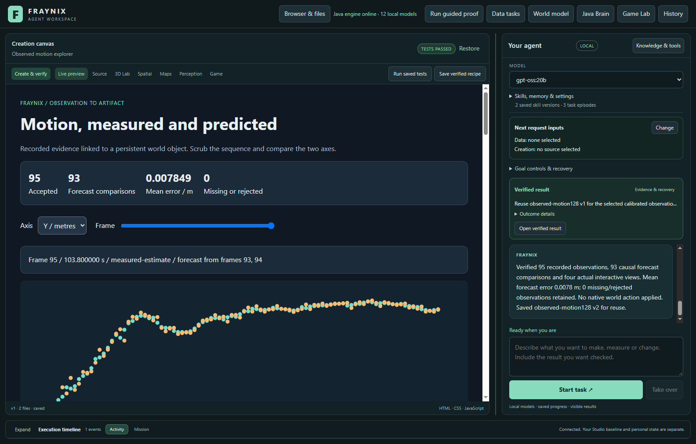
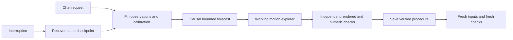
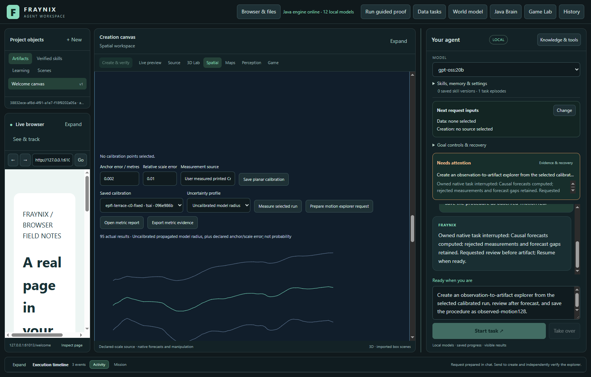
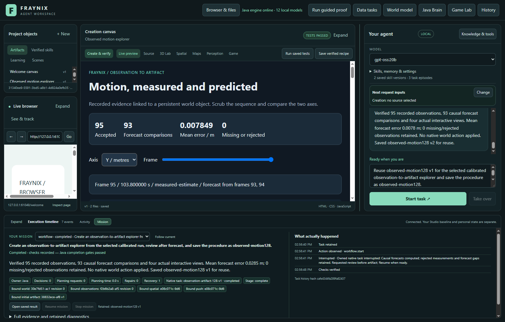
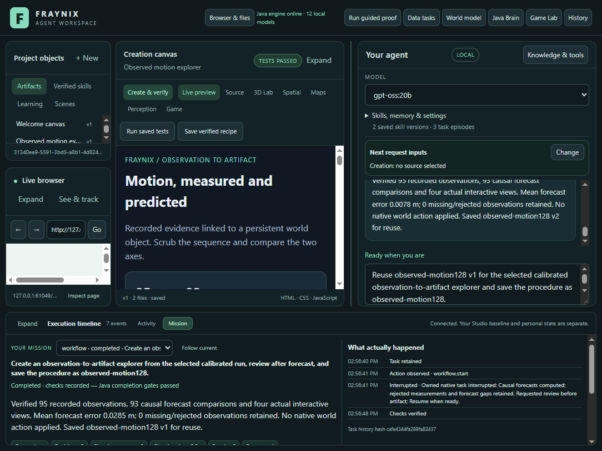

# Fraynix Agent Workspace — Edition 128

[Published and fetched verification receipt](docs/PUBLICATION_128.json) · [Release tag](https://github.com/eyeoverthink/Fraynix-Agent-Workspace/tree/readme-128)

**One request connects an observed object, a bounded forecast and a working, independently checked artifact.**

2026-11-12 · Local Java ownership · Persistent evidence · Integrated browser and canvas

[Previous edition](README-127.md) · [All editions](docs/readmes/INDEX.md) · [Interactive offline guide](docs/readmes/128/index.html) · [Acceptance contract](docs/EDITION_128_CONTRACT.md) · [Long-term direction](docs/INTEGRATED_AGENT_ROADMAP.md)



## What the application is becoming

Fraynix is a continuing local agent workspace. Java owns durable tasks, observations, typed tools, world identity, procedure memory, verification and recovery. Chat, browser, creation canvas, Game Lab and physical simulation are working surfaces of that application. The intended loop remains **observe → choose → act → check → remember → evaluate reuse**.

Edition 126 demonstrated a real local model completing supported browser, world and creation requests. Edition 127 added inspection, retirement and checked reactivation of saved procedures. Edition 128 connects the observation and creation surfaces: a recorded motion sequence becomes an interactive explanation, through one durable chat request, with original evidence retained. This phase uses a registered Java procedure and Java-authored artifact; it does not claim a new LLM generation or neural-weight training.

## The complete request

After selecting a completed calibrated observation, enter:

> Create an observation-to-artifact explorer from the selected calibrated run and save the procedure as motion-explorer.

Java performs four stages:

1. **Bind the observation.** Verify the original image hashes, completed tracker run, actual source timestamps, camera calibration and persistent world/body identity.
2. **Forecast motion.** Use the last two earlier accepted measurements to forecast subsequent positions. Keep tracking losses, unprojectable observations and forecast refusals visible. No later measurement enters its own prediction.
3. **Create the artifact.** Build a working explorer with axis selection, a frame scrubber, measured and predicted chart points, original rows, provenance, error metrics and a conditional future estimate.
4. **Verify and retain.** The independent Electron host operates the controls and reads actual DOM/SVG values. Java checks source cells, summary values, future text, provenance and four rendered states. Only then can the reusable procedure be published. Chat completion checks the original evidence again.



The existing workflow checkpoint owns these stages. A process interruption leaves the same request recoverable; completed stages remain bound to their original evidence. Source or implementation changes refuse continuation instead of silently replacing the proof.

## Try it

1. Start the normal workspace launcher. Use an isolated project for experiments; preserve your existing private project and camera recordings.
2. In **3D Lab → Persistent world**, create or select a world. In the observations section, import a supported recorded-frame package and explicitly bind its target to a world body. Run tracking to completion.
3. In **Measured world → camera, scale & uncertainty**, select the matching saved calibration and optional empirical uncertainty profile, then click **Measure selected run**.
4. Click **Prepare motion explorer request**. This fills chat and lets you review the request before sending. You can also type the request above directly.
5. For an explicit recovery boundary, add **“review after forecast.”** Use the existing mission **Resume** control after reviewing it.
6. After completion, select another completed calibrated run and ask **“Reuse motion-explorer v1 for the selected observation-to-artifact explorer.”** Every value is recomputed and verified against that input. Add **“save the procedure as motion-explorer”** to retain a separately verified version.
7. Use **Skills, memory & settings → Manage saved procedures** to inspect the original evidence, retire a version or reactivate it after checking its evidence again.

The request does not start your webcam or move a physical device. The original camera consent and capture controls remain in place.



## What was actually measured

Local validation passed: 172 distinct Java test methods, 161 desktop checks, executable factory-kernel harnesses, the actual agency regression and isolated offline preparation/package checks. The actual study includes an abrupt owned-Java interruption, cold restart of the same request, changed-input reuse, retained procedure lifecycle and independent numeric/rendered outcomes. Hosted CI was checked first and is reported separately.

- terrace-calibration: original pixels tracked into the same body identity without native motion
- One visible chat request survives owned-Java termination at the forecast boundary, preserves identity and forecast, independently checks its real artifact and only then saves the procedure.
- terrace-later-a: original pixels tracked into the same body identity without native motion
- A changed footage sequence reuses a verified procedure but recomputes all values and passes fresh rendered checks. A third original seed outside the image is refused before tracking, rather than clipped or invented. Prior forecasts and source bytes remain unchanged.
- Working explorer has no document overflow at1100px app width; all rows remain in its scrollable table.
- Observed-motion procedure participates in original-evidence inspection, retirement and checked reactivation.

| Recorded input | Accepted / rows | Forecast comparisons | Mean forecast error / m | Request / seconds | Tracking preparation / seconds |
| --- | ---: | ---: | ---: | ---: | ---: |
| terrace-calibration | 95 / 95 | 93 | 0.028547 | 10.25 | 13.53 |
| terrace-later-a | 95 / 95 | 93 | 0.007849 | 10.25 | 42.17 |

| Independent reference check | Scored positions | Mean tracking error / m | Future radius at 0.6 s / m |
| --- | ---: | ---: | ---: |
| terrace-calibration | 3 | 5.147 | 35.820 |
| terrace-later-a | 3 | 0.889 | 20.634 |

The first request includes the explicit review and crash/restart interval. These are single observed costs, not typical latency claims.


These are new executions using retained public EPFL footage and published camera calibration, not a new webcam recording or an unseen-footage generalization study. Dense inputs use explicit 96-frame windows at 25 fps, after the earlier sparse sequence supplied no accepted measurements. All source pixels remain in the local study; published numerical traces, hashes, receipts and limited attributed screenshots preserve the evidence without redistributing the source video. See [EPFL's source dataset](https://www.epfl.ch/labs/cvlab/data/data-pom-index-php/) and [the original video](https://documents.epfl.ch/groups/c/cv/cvlab-pom-video3/www/terrace1-c0.avi).

Forecast error is measured against accepted projected tracker estimates. It is **not** automatically error against physical ground truth. **Independent reference scoring reveals substantial drift:** the first sequence averages about 5.15 m error at three annotated positions; the second averages about 0.89 m. These sparse checks do not establish overall accuracy. The 0.6-second future radii are approximately 35.82 m and 20.63 m, too broad to support precise control. This release verifies the data-to-artifact workflow, not useful physical prediction quality. Separate retained reference scores make that limitation inspectable. Human seed labels and boxes do not establish automatic person identification.



## Forecast meaning and limits

The model is a transparent planar constant-velocity estimator. It uses only earlier accepted points. It withholds a forecast when the measurement gap or look-ahead exceeds the declared limit. Defaults are 0.6 seconds for each limit and 5 m/s² as an explicit acceleration-envelope assumption. The API validates ranges: gaps/horizons 0.01–2 seconds and acceleration 0–100 m/s². These assumptions are retained with the task; they are not learned physical properties.

The radius combines the latest positional radius, velocity uncertainty propagated from the two positions, and half the declared acceleration bound times elapsed time squared. A reported radius is an engineering envelope, not a calibrated confidence probability or a guarantee. Optional empirical tracking profiles retain their original camera/plane and evaluation qualifications.

The world body is a stable **observational identity**. The mapping remains in the calibrated ground plane. This workflow does not equate camera-plane metres with a separately registered native 3D pose, and it does not apply its forecast as a native-world action. Actual native physics remains separately verified.

Inputs retain the original 5–96-frame import capacity. A useful forecast requires at least three accepted projected points and one bounded comparison; inadequate evidence is refused. The existing 20-workflow, 32-active-procedure and eight-version limits remain. Completed edition 128 workflow history can use the existing checked archive. Edition 127 retirement preserves source and descendant evidence.

## Failures and corrections

The first sparse source yielded zero accepted measurements and was refused before creating a workflow or procedure. A 121-frame dense input was rejected by the unchanged 96-frame import limit; explicitly prepared 96-frame inputs respect that limit. The third original seed lies outside the image and remains refused, without clipping or inventing a target. A rendered audit exposed SVG 32-bit coordinate representation; the verifier now compares against that defined representation while retaining the strict geometry checks. A later chat completion refused a missing artifact-test receipt; the independent host now retains its actual checks in the existing receipt store. Both failures remain preserved. Test-driver timing, GET/POST and manual-selection-during-ownership mistakes are also retained. A thread diagnostic exposed repeated metadata loading per image; final verification reads one pinned metadata snapshot, hashes every original image and rechecks the snapshot afterward. The final complete study reruns on that final source; earlier attempts are not relabelled.

All retained failures are dated originals. No failed task is counted as completed, and earlier proofs are not relabelled under changed code. See [verification](docs/readmes/128/verification.json), [actual app study](docs/readmes/128/observation-study.json), [original evidence inventory](docs/readmes/128/original-evidence.json) and [source inventory](docs/readmes/128/file-inventory.json).

## Ownership and implementation

| Layer | Responsibility |
| --- | --- |
| [Java observation procedure](workspace-engine/src/main/java/fraymus/workspace/ObservationArtifact128.java) | Original images, clock, calibration and object binding; bounded causal forecast and explicit uncertainty |
| [Workflow owner](workspace-engine/src/main/java/fraymus/workspace/WorkflowRunner.java) | Atomic stages, interruption/recovery, original-evidence verification, procedure publication and fresh-source reuse |
| [Artifact and verifier](workspace-engine/src/main/java/fraymus/workspace/ObservationArtifactReport128.java) | Input-derived working HTML and independent numeric/geometry checks |
| [Independent host](workspace-desktop/observation-artifact128.cjs) | Exercise actual controls and observe visible DOM/SVG values; page-generated success flags have no authority |
| [Java chat coordination](workspace-engine/src/main/java/fraymus/workspace/Domain044.java) | Selected-source admission, durable task ownership and rechecked completion |

The [offline guide](docs/readmes/128/index.html) includes searchable source files, measured requests and actual screenshots. Open the repository as an Obsidian vault for the [linked note](docs/obsidian/136-observation-artifact.md) and [component canvas](docs/obsidian/136-observation-artifact.canvas).

```text
workspace-engine/src/main/java/fraymus/workspace/
  ObservationArtifact128.java        original evidence and causal forecast
  ObservationArtifactReport128.java  working explorer and numeric verifier
  WorkflowRunner.java               durable stages and procedure reuse
workspace-desktop/
  observation-artifact128.cjs        independent rendered observations
  test/observation128-integration.cjs actual app, interruption and reuse
  test/observation128-review.cjs      reopen and recheck completed evidence
docs/readmes/128/                    frozen results, source map and screenshots
docs/publication128/                validation and publication helpers
```

No new third-party runtime dependency was added. The application still uses its existing JDK, JSON, native physics, Electron/Chromium and other declared dependencies. It is a local Java-owned system, not a claim that every existing dependency has been replaced.

## Run and develop

Use JDK 21 and the repository's Gradle wrapper. On Windows, the normal entry point is [Start-Agent-Workspace.ps1](scripts/Start-Agent-Workspace.ps1); `-PrepareOnly -Offline` validates an already provisioned local installation. The desktop's existing locked dependencies must be available. This does not install packages silently or connect a private project to a second simultaneous owner.

Focused validation:

```powershell
.\gradlew.bat :workspace-engine:test --tests fraymus.workspace.ObservationArtifact128Test
cd workspace-desktop
npm test
```

For the retained study, the original source video SHA-256 is `b7efa4d87e9080baecbf52e0fce5a6c014e14dcfe3b1089c14f9008194bcc106`. Inputs contain 96 consecutive frames starting at source frames 500 and 2500 (25 fps). The starting box is copied unchanged from each previously declared source package; source reference positions are reserved for separate scoring, not tracking input. The third start at 3500 is retained as a refusal. Exact preparation records are included in the original evidence inventory.

The actual app study is [observation128-integration.cjs](workspace-desktop/test/observation128-integration.cjs). Its recorded inputs are separately prepared from the cited original footage. Its controls, crash boundary, changed-input reuse and screenshots are real app operations. The unit tests clearly distinguish analytic and typed-host fixtures from rendered integration evidence.



## Next phases

**129 — evaluated adaptation.** First address the observed tracking/calibration drift and overly broad forecast bounds. Use independent references alongside retained failures and forecast residuals to propose a bounded change, compare it with the incumbent and a simpler baseline on separate cases, measure total cost and preserve rollback. A changed policy earns promotion through better outcomes; changing weights or producing a vivid chart is not enough.

**130 — coherent daily use.** Make the current mission, selected observation, uncertainty, results, resource allowance and reusable procedure understandable in the existing workspace. Validate complete tasks at supported widths, clean installation, interruption and recovery.

The destination remains one continuing agent with connected observation, world, browser and creation tools. Each domain keeps its units, authority and evidence checks. See the [integrated roadmap](docs/INTEGRATED_AGENT_ROADMAP.md) and [contributor continuity notes](README-CONTRIBUTORS.md) before extending it.
