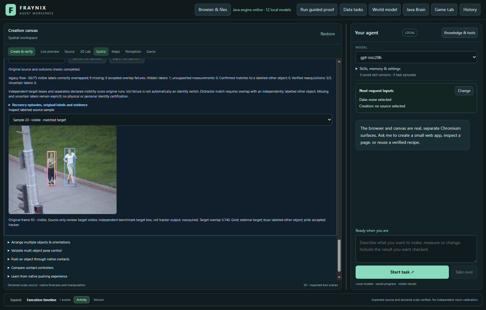
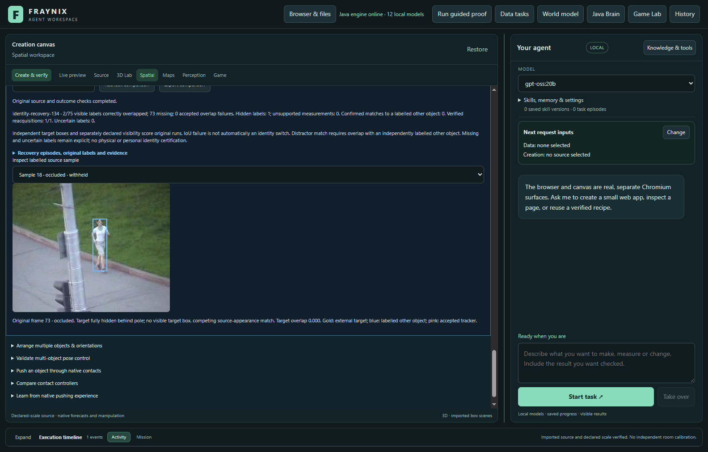

# Fraynix Agent Workspace — Edition 134

[Published and fetched verification receipt](docs/PUBLICATION_134.json) · [Release tag](https://github.com/eyeoverthink/Fraynix-Agent-Workspace/tree/readme-134)

**Independent object labels now expose when a track is missing, on target, or matched to another labelled object. Java adds an explicit recovery candidate, immutable comparisons, source-image overlays and restart checks. The new candidate failed the real-footage comparison and is not promoted. Existing defaults remain unchanged.**

2026-11-12 · Local Java agent · Observe, act, verify and retain

[Previous edition](README-133.md) · [All editions](docs/readmes/INDEX.md) · [Illustrated offline guide](docs/readmes/134/index.html) · [Contract](docs/EDITION_134_CONTRACT.md) · [Frozen method](docs/OBSERVATION_134_LOCK.json)

Original OTB footage in the actual app. Gold is the externally labelled target, blue a separately labelled other runner, and pink an accepted tracking box. A missing pink box is a withheld measurement. These are source-backed comparisons, not generated mockups.

## The application and this step

Fraynix is one local workspace connecting **observe → choose → act → verify → retain → evaluate reuse**. Java owns continuing worlds, goals, action checks, recovery, evidence and reusable procedures. Browser, chat, canvas, Game Lab, physics and observation are working surfaces of that system. Existing observation-to-artifact requests and procedure inspection/retirement remain available.

This edition adds handwritten Java recovery and independent association measurement without a new model, runtime dependency or online inference service. It does not establish semantic recognition, personal identity, physical ground contact or general visual competence. Camera estimates still cannot silently become native physical actions.

## Implemented functions

- **Explicit `identity-recovery-134` choice.** A frozen RGB descriptor scores three horizontal object parts, using appearance correlation, absolute color agreement and color histograms. The weakest part contributes to the score. Templates never update from guessed identities. Search remains bounded in scale; after loss it searches the image and requires two successive consistent proposals. Spatial competitors can refuse an ambiguous match. Local optical flow can corroborate a sufficiently strong visible match. Pending or failed association has no current box.
- **Independent association labels.** Import exact source-bound target boxes, separately declared visibility, and optional boxes for other objects. Visibility states include visible, partial, fully occluded, out of view and uncertain. Hidden/uncertain targets cannot carry an invented visible target box. Annotator, method, prior exposure and provenance are required. Labels never enter the tracker, filter or world controller.
- **Immutable association audit.** Every comparison binds original labels, dataset, complete run, tracker implementation and recomputed outcome. Every original image is checked, including unlabelled images. Frame ordering and object bindings are checked throughout the run. Original stored evidence is never silently rewritten under new code. There are 64 retained label sets and 64 audits, without pruning.
- **Separate error categories.** A correct box needs intersection-over-union (IoU) of at least 0.5 with the independent target box. A confirmed match to another labelled object needs other-object IoU of at least 0.5 and target IoU below 0.2, or no visible target. A low target overlap alone is not called an identity switch. Missing measurements remain in the denominator.
- **Recovery inspection.** The app shows per-image boxes, visibility, refusal reasons, accepted overlap and recovery episodes. After a labelled hidden interval, it records the first visible sample and first verified target match—or retains an unresolved recovery. Export and reopening recheck the same original evidence.

All thresholds are heuristics, not calibrated probabilities. The new method is deliberately explicit; `legacy-flow` and forecasting defaults stay intact. Edition 133's support estimator and earlier failed qualification records are preserved.

## Independent footage and label limits

The source is the authors' [Visual Tracker Benchmark](https://rvlab.snu.ac.kr/research/tracker_benchmark): **Jogging**, both externally annotated targets, and **Lemming**. Original ZIPs and JPEG bytes remain local. Exact original annotation files, hashes and provenance are retained in [source records](docs/publication134/source134.json).

The algorithm and scorer were frozen before viewing these selected pixels. No tuning followed their results. Jogging uses original images 1, 5, …, 305; Lemming uses 1, 6, …, 476. This respects the unchanged 96-image source limit. Intervening images were not tracked or scored. The two Jogging targets share one recording, so three tasks are not three independent recordings or standard full-frame-rate benchmark scores.

**Benchmark boxes were supplied outside this project. Visibility was separately reviewed by Codex from source images before any tracking predictions, with the external boxes as identity references. It was not independently adjudicated by a human.** The reviewer saw published sequence attributes but no evaluation outputs before freezing labels. Source-only crops revealed that Lemming retains a small visible eye during the apparent disappearance; those samples are **partial**, not fully occluded. One sampled Jogging target is fully hidden behind the pole. This set does not test complete out-of-frame returns; generated controls test large-displacement re-entry. Broader real occlusion and re-entry evidence remains needed.

There are **247 later-image labels: 246 visible/partial and one fully hidden**. Annotation conversion uses the benchmark's one-based XYWH convention, normalized to image corners and clipped at image boundaries. No scale, contact point or metric camera accuracy is inferred from these boxes.

## Measured outcome: candidate not promoted

| Method | Correct / visible | Missing | Confirmed other-object matches | Unsupported while hidden | Correct reacquisitions |
| --- | ---: | ---: | ---: | ---: | ---: |
| legacy-flow | 83 / 246 | 163 | 0 | 0 / 1 | 6 / 6 |
| association-contact-133 | 23 / 246 | 223 | 0 | 0 / 1 | 0 / 0 |
| identity-recovery-134 | 7 / 246 | 239 | 0 | 0 / 1 | 3 / 3 |

| Source / target | Existing flow correct | Edition 133 correct | Edition 134 correct | Visible labels |
| --- | ---: | ---: | ---: | ---: |
| jogging-1 | 66 | 9 | 2 | 75 |
| jogging-2 | 6 | 10 | 2 | 76 |
| lemming-1 | 11 | 4 | 3 | 95 |

The existing tracker recovers Jogging target 1 at sample 23 (original frame 93), four sampled intervals after first visibility at sample 19 (frame 77). Neither experimental candidate recovers after that labelled occlusion. Edition 134 has three correct reacquisition events elsewhere, but only 7/246 visible samples measured overall versus 83/246 for the existing tracker and 23/246 for edition 133. No thresholds changed after these results. **This is a failed candidate comparison, not a tracking improvement or proof of switch-free recovery.**

All accepted estimates in this small set met the target overlap threshold. Zero confirmed distractor matches does **not** prove reliable identity: the strict candidate returned very few measurements, and Lemming has no independently labelled distractor boxes. The two candidates fail to recover after the one labelled full occlusion; the simpler existing method succeeds. The remaining physical-accuracy gap is unchanged.

| Method | Standalone processing total / ms |
| --- | ---: |
| legacy-flow | 20292.6 |
| association-contact-133 | 27066.5 |
| identity-recovery-134 | 32180.7 |

| Actual app task | Tracking / ms | Verified audit / ms |
| --- | ---: | ---: |
| jogging-1 / identity-recovery-134 | 12529.7 | 494.7 |
| jogging-1 / legacy-flow | 13095.1 | 810.7 |
| jogging-2 / identity-recovery-134 | 30274.9 | 1181.3 |
| lemming-1 / identity-recovery-134 | 57032.6 | 1498.7 |

Standalone measurements include original-source tracking and filtering. Actual-app timings also include durable run storage and source verification; they are separate workloads. No skipped images, failed attempts or missing measurements are converted into zero-cost successes.

## Try it in the existing app

1. Start [Start-Agent-Workspace.ps1](scripts/Start-Agent-Workspace.ps1) with the existing Java 21 setup. No new runtime package is required.
2. Open **Spatial → Real footage**, import a supported source package, and bind its first-image target to an existing world body. Native world state remains separate from observations.
3. Inspect original images using **Independent labels → Open source-only view**. Prepare/import association labels with exact dataset, object, frame and image hashes. The [sample label files](docs/publication134/jogging-1-labels.json) show the row format; add the actual imported dataset ID and dataset hash. Exported labels already include their complete source binding.
4. Open **Object identity → Import source-bound labels** before comparing tracking output. Declare external boxes and any separate visibility review honestly. Recheck or export the frozen set. A correction creates a new identity and preserves the old set.
5. Keep **Existing flow tracker**, or explicitly choose **Experimental 134 · identity-preserving recovery**. Run the selected method, then choose **Refresh runs** in Object identity.
6. Select the completed run and frozen labels, then **Compare identity & recovery**. Inspect the source-sample selector, missing counts, overlap failures, labelled other-object matches and recovery episodes. Gold/blue are references; pink is accepted tracking output.
7. **Export comparison** or **Recheck comparison**. After restart, reopen the same project and recheck retained evidence. Exported JSON does not replace the original project/source images.

## Validation and retained evidence

Local checks passed: 237 distinct Java tests, 161 desktop checks, executable kernel integration, actual agency regression and isolated offline/package preparation. Four actual app runs match all 323 frozen tracker/filter samples, verify overlap independently, export original evidence and cold-recheck after owned-Java termination. Every existing source/outcome condition remains intact.

- External OTB boxes plus source-only AI visibility frozen through actual import controls before each tracking task. Labels never enter tracking. Existing legacy-flow default remains selected initially.
- Four actual Java runs: three candidate sources and the simpler default on Jogging1. Every tracker/filter frame equals frozen standalone evidence; independent host overlap and distractor arithmetic match. Native world remains unchanged.
- Source overlays, hidden/partial states and recovery results displayed at1100/1600 without page overflow. Label and audit exports match their immutable records; exact label reimport preserves identity.
- Abrupt owned-Java termination and cold restart retain all four original runs, labels, association proofs and untouched native world. Reopening actual saved comparison recomputes the same result.

Generated controls cover different and identical distractors, disappearance, a large return away from the old location, an impostor at the old location, interrupted confirmation, unchanged appearance, clipped support, wrong source/dimensions, source tampering and interruption/recovery. They validate software behavior; they do not override the poor real-footage result.

The focused Java controls passed before new footage was opened. Source-only review corrected a tempting misclassification before labels were frozen: the Lemming target retains a visible eye, so those samples are partial rather than fully occluded. Original benchmark annotation bytes are preserved with an explicit Git text rule.

The frozen real-footage comparison failed to show useful recovery improvement: the new method measures only 7/246 visible samples, the prior candidate 23/246 and the incumbent 83/246. The incumbent alone recovers after the labelled full occlusion. No method was retuned, no missing samples were removed, and no defaults were changed.

[Verification](docs/readmes/134/verification.json) · [All nine comparisons](docs/readmes/134/comparison.json) · [Actual app](docs/readmes/134/app-study.json) · [Original records](docs/readmes/134/original-evidence.json) · [Source inventory](docs/readmes/134/file-inventory.json)

CI was checked before implementation: edition 133's setup and documentation passed while compile/test/package remained in progress. Hosted CI remains a separate result from local tests and fetched publication. Publication is claimed only after actual push and fetched-source verification. Private projects, raw JPEG/ZIP packages, browser profiles and dependency folders remain local. Limited app screenshots are attributed to the Visual Tracker Benchmark authors, Yi Wu, Ming-Hsuan Yang and Jongwoo Lim.

## Next

1. Preserve the incumbent's useful continuity. Investigate why fixed part appearance rejects normal pose/color changes instead of simply lowering recovery thresholds.
2. Develop a bounded appearance bank from independently checked observations; compare it with the unchanged simpler controller. Track template provenance and refuse contamination from ambiguous matches.
3. Use new, human-adjudicated full-occlusion and out-of-frame-return sequences with similar-looking distractors. Measure missed recovery, incorrect association and total sensing/computation cost together.
4. Carry source age, uncertainty and supported measurement tolerances into durable Java world goals. Request another view or withhold action when the evidence is inadequate. Keep browser, world, creation and reusable skills connected in one daily-use app.

The destination remains a continuing local agent whose useful behavior improves through verified outcomes, not through relabelled failures.
