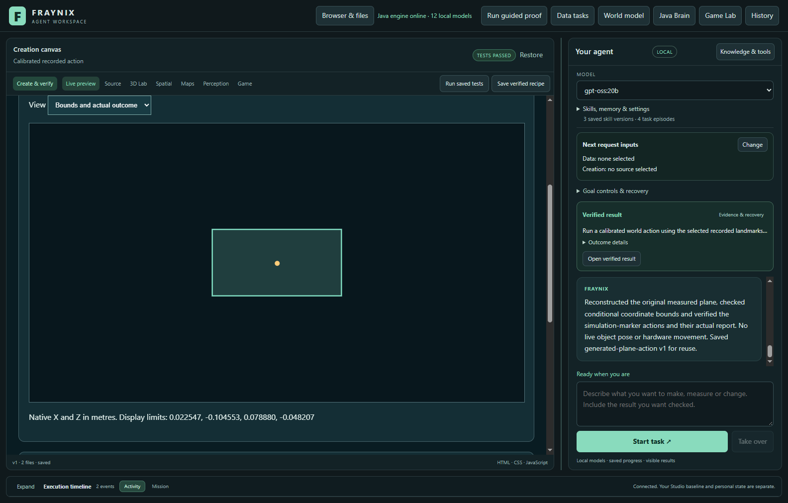
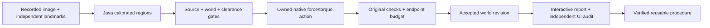

# Fraynix Agent Workspace — edition 159

[Published and fetched receipt](docs/PUBLICATION_159.json) · [Release tag](https://github.com/eyeoverthink/Fraynix-Agent-Workspace/tree/readme-159)

2026-11-17 · Local Java orchestration · Recorded calibrated actions · Defaults preserved

[Previous edition 158](README-158.md) · [Offline interactive guide](docs/readmes/159/index.html) · [All editions](docs/readmes/INDEX.md) · [Development plan](docs/publication159/plan159.md)

Edition159 connects an original measured plane to a durable Java request that checks coordinate allowances, executes actual bounded native motion and verifies the committed result and interactive report. Recorded sources, simulation states and unresolved physical uncertainty stay distinct. Existing defaults are unchanged.

## The application and its direction

Fraynix remains one local agent workspace: a persistent Java runtime coordinates observations, durable goals, the simulated world, browser, creation canvas, data tools and reusable procedures. Its original game engine is an experimental environment in that system. Each addition must make a complete task possible and preserve what actually happened.

Edition 158 connected verified recorded observations to world inspection, browser checks and a working artifact. Edition 159 adds a deliberately narrow next bridge: original measured plane coordinates can guide actual bounded simulation actions. It does not turn an unrelated tracker recording into calibrated physical authority. Open-ended chat and known Java procedures remain distinct; these trials use the registered Java procedure and make zero model-inference or weight-training claims.

No new dependency, model download or GPU requirement is introduced. Existing native physics, graphics, JSON and desktop dependencies remain in use. “Java-owned logic” does not mean those dependencies disappeared.

## A complete request

> Run a calibrated world action using the selected recorded landmarks; verify the actual outcome and save the procedure as calibrated-plane-action.

1. Select the original measured registration, a separate destination world, an actual marker and a withheld printed-grid landmark.
2. Java rereads the source image and metadata, checks hashes, reconstructs the homography and similarity fit, and verifies the historical world binding.
3. It projects a declared image-localization rectangle into metres and adds explicitly retained error allowances. A rectangle outside the measured image polygon or across a projective horizon is refused.
4. It checks current world revision, movement limit, error budget, native route and uncertainty-expanded clearance before starting an owned child goal.
5. The existing native controller applies bounded forces and torques. Every body, contact/pose trace, original wrench ledger, release and actual rendered native report remains subject to the original checks.
6. The requested endpoint and combined-error budgets must pass **before the accepted world advances**. A failed simulation or budget check retains evidence; it cannot publish a successful procedure.
7. Java creates an HTML/JSON report. The desktop operates all three chart modes and reads actual table cells, source/uncertainty labels and SVG coordinates; Java independently compares them with the original calculation and committed result.
8. Completion can retain a reusable procedure. Reuse requires explicit source, world revision and marker selections and reconstructs the original procedure ancestry.

## What the coordinates mean

The recorded 041 reference contains four printed-grid fitting corners, three separate check intersections and two tape marks. Its visible fitted rectangle is **10 × 8 inches**, within the user's **12 × 12-inch mat**. Native placement of that plane is declared, not a measured room pose.

The reference's maximum independent grid discrepancy is about **0.384 mm**; its tape-length discrepancy is about **2.404 mm**. Neither number alone establishes physical tracking accuracy. Original image bytes and annotations stay pinned, including the distinction between the two 041 recording sessions.

For each selected check landmark, the region includes:

- The extrema of the projected pixel rectangle.
- A declared annotation allowance, never below the original value.
- The maximum independent grid discrepancy and the independent tape discrepancy.
- The original relative-scale allowance applied at the projected distance.

The X/Z rectangle and its radial allowance are **conditional geometric budgets**. They assume the declared input allowances bound the relevant errors; they are not empirically calibrated coverage probabilities. Unknown object height, parallax, lens effects outside the checked reference, calibration drift and live camera changes remain unresolved. Y is the declared plane; the simulated marker's height comes from its authored box geometry.

No hidden or lost object position is invented. The unrelated 158/157 tracker sources keep their original unknown positional accuracy. No hardware, live webcam or automatic object recognition is authorized by this procedure.

## Controller compatibility and honest limits

The existing verified pose controller requires at least two dynamic boxes, each at least 0.2 m wide. Two such boxes cannot occupy the closely spaced check locations on this mat. The UI therefore selects **one measured reference marker and one explicit return marker**. The return marker is lifted and returned to its initial authored pose by the original two-body controller; it is not a second measured reference. Its complete motion is still verified.

For larger measured planes, the typed workflow also accepts two distinct measured markers when all geometry and clearance checks pass. The generated larger-plane trial exercises that path. This release does not silently shrink native bodies, scale the mat or bypass collision checks.

The default new-task limits are 2 pixels of localization allowance, 3 mm annotation allowance, 15 mm maximum coordinate radius, 0.75 m endpoint displacement, 50 mm execution tolerance, 65 mm combined allowance, 6 N force and 0.5 Nm torque. These are explicit task limits, not a claim of 50 mm physical accuracy. Existing tracker and controller defaults stay unchanged. The report displays the actual result, which may be substantially smaller than the allowed limit.

## Measured results

| Task | Measured markers | Coordinate radius mm | Actual simulation error mm | Combined mm | Task span s |
| --- | ---: | ---: | ---: | ---: | ---: |
| exposed041-grid0 | 1 | 11.555 | 0.185 | 11.741 | 14.46 |
| exposed041-grid2-reuse | 1 | 14.235 | 0.220 | 14.455 | 9.76 |
| generated-larger-plane-two-references | 2 | 22.277 | 0.129 | 22.323 | 10.29 |

100 selected Java checks and 171 desktop checks passed, with no failures or skips. Three actual Java/Electron tasks passed source, native-action, rendered-outcome, recovery and cold-verification checks. This is scoped validation, not a rerun of every historical capability.

Task span includes verification, repeated report inspection and deliberate recovery where used; it is not a throughput benchmark. The camera reference is exposed historical evidence. The larger generated plane is labelled synthetic. These are new workflow executions, not new footage or an accuracy promotion.

Development retained two compile failures, initial tests that refused undersized native bodies and an inconsistent perspective fixture, and a native goal/world read race corrected by reading under the existing goal lock. The first regression passed 98 Java and 171 desktop checks. A stricter native endpoint test was then added and passed: out-of-budget motion cannot advance the accepted world. Final regression passed 99 Java checks, plus one independent uncertainty-clearance test (100 total), and 171 desktop checks. All three locked app trials passed on their first attempt. Report screenshots were recaptured with the chart in view; original overview captures and receipts are retained. No new camera recording, tracker promotion, physical-accuracy certification or LLM-training claim is made.

## Review it in the app

Use JDK 21 and the project's existing Node.js LTS setup. Run [Start-Agent-Workspace.ps1](scripts/Start-Agent-Workspace.ps1); it checks the existing Java owner, prepares the engine and verifies the desktop dependency cache before launch. `-PrepareOnly` prepares without launching; `-Offline` requires dependencies already cached. Use a separate project path when evaluating copied evidence; do not point a new build at an active older database.

1. Open **Spatial → Measured mat alignment**.
2. Open **Recorded plane → checked simulation action ·159** and load references/worlds.
3. Select the original registration, destination world, reference marker, recorded check and return marker. A fresh world can be imported through the existing spatial-scene tools.
4. Inspect **Conditional error and movement budgets**, then **Check bounds and route**. Preview performs no action.
5. Click **Prepare chat request**, review it and send it. Add **“review before action”** to stop at the verified pre-action checkpoint.
6. Resume through task history. A changed source, different world head, foreign child or stale host claim is refused.
7. Review the completed artifact, switch between **bounds**, **actual outcome** and **both**, and inspect the retained procedure in Skills.

Only recorded source metadata and numeric results appear in public screenshots. Original camera pixels remain private. The exact exposed-camera trial requires the owner's original source directory; a public clone alone cannot reproduce those private bytes.

## Persistence and failure handling

The parent request, original calibration, conditional bounds, exact world revision and child intent are persisted before actuation. The native child uses a deterministic workflow/stage identity. Restart before action revalidates the same source. Restart after a completed native child reuses its verified result rather than moving the bodies again. Cancellation and a failed rendered report cannot publish a procedure.

The workflow retains the existing 20-task capacity, 1200-second deadline, 60-second host claims and at most three explicit resumes. Procedure inspection, retirement, reactivation and archived original verification retain their established checks. A failed endpoint budget prevents a new accepted world revision; the original failed run remains available for diagnosis.

## Source, tests and evidence

- [Java mapping and conditional bounds](workspace-engine/src/main/java/fraymus/workspace/CalibratedPlane159.java)
- [Action admission and endpoint checks](workspace-engine/src/main/java/fraymus/workspace/CalibratedAction159.java)
- [Durable workflow](workspace-engine/src/main/java/fraymus/workspace/WorkflowRunner.java)
- [Actual report and independent comparator](workspace-engine/src/main/java/fraymus/workspace/CalibratedReport159.java)
- [Desktop chart observations](workspace-desktop/calibrated159.cjs)
- [Application study](docs/publication159/study159.cjs)
- [Validation receipt](docs/readmes/159/verification.json), [original logs and failed attempts](docs/readmes/159/original-evidence.json), [source inventory](docs/readmes/159/file-inventory.json)

Run the selected Java and desktop regression/build sequence with `python -X utf8 docs/publication159/validate159.py`. Output paths deliberately refuse overwriting earlier receipts. The application study is locked before execution and uses a separate private project copy. Hosted [GitHub CI](https://github.com/eyeoverthink/Fraynix-Agent-Workspace/actions) is reported separately from local results.

## Next

1. Measure actual localization errors on separate, independently labelled planar footage and assess coverage on held-out sequences.
2. Detect camera/reference changes before transferring a calibration across frames; preserve unknown height and contact explicitly.
3. Add a separately tested single-marker/smaller-object native action path, retaining existing engine identities and historical evidence.
4. Connect moving-object estimates to short, reversible simulation actions only when identity, current calibration and remaining correction authority justify them.
5. Measure complete task cost and compare simple control against recalled procedures. Retain a learned improvement only after new outcome evaluations earn it.

The destination stays one persistent, local Java agent system that can observe, propose, act, create, verify and remember—while keeping observations, assumptions, predictions and actual outcomes distinct.

Publication audit caught Git line-ending normalization of the method lock. The original Windows bytes and their study hash remain in the evidence archive. The corrected audit checks that exact raw hash and separately compares its normalized text with the committed Git blob. No experimental input, result or check was relabelled; the failed release log is retained.
