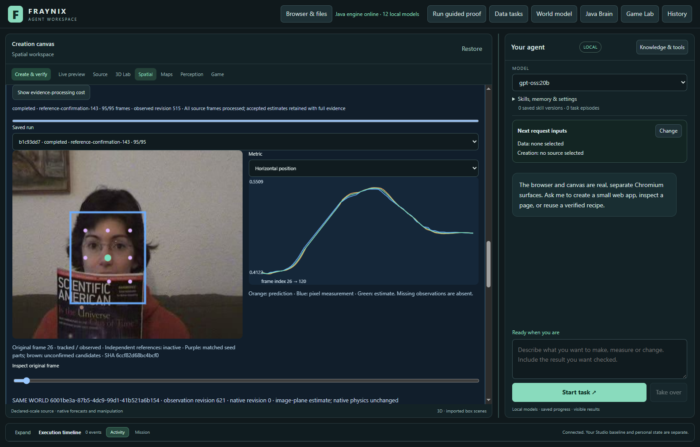
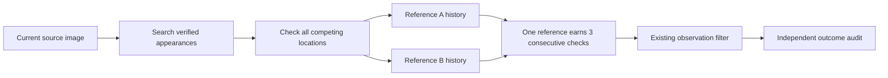
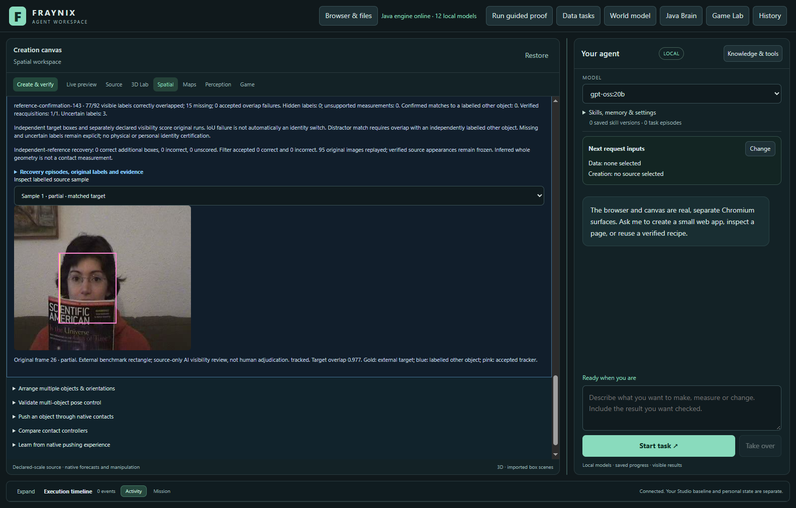
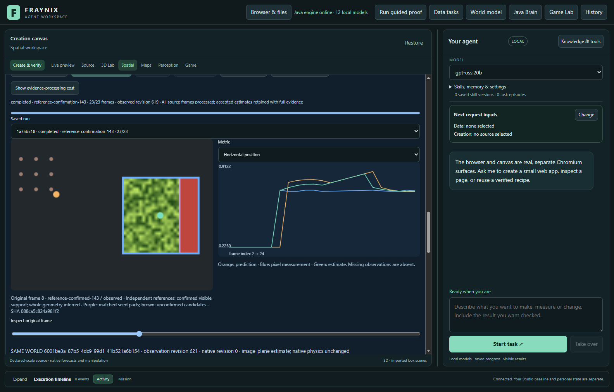
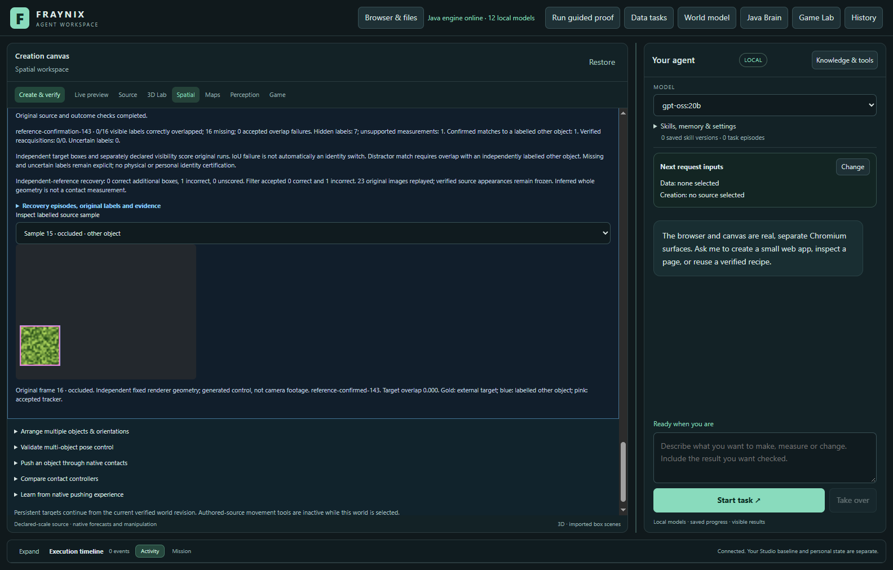

# Fraynix Agent Workspace — Edition 143

[Published and fetched verification receipt](docs/PUBLICATION_143.json) · [Release tag](https://github.com/eyeoverthink/Fraynix-Agent-Workspace/tree/readme-143)

**Independent confirmation for verified appearances.** Fraynix connects durable chat goals with a Java brain, simulation, observed worlds, browser interaction, data processing, creation tools and reusable verified procedures. This edition develops one perception mechanism within that connected application.

[Previous edition](README-142.md) · [All editions](docs/readmes/INDEX.md) · [Offline guide](docs/readmes/143/index.html) · [Integrated roadmap](docs/INTEGRATED_AGENT_ROADMAP.md) · [Contributor handoff](README-CONTRIBUTORS.md)

## What changed

The optional **reference-confirmation-143** method keeps a separate confirmation history for the original appearance and each of up to six independently verified full-view examples. In edition142, two valid references could alternate as the best match and reset the sole confirmation counter. The new method searches and verifies each reference independently. One reference must earn all three consecutive confirmations; counts never move between references.

Each appearance uses the existing full-region and four fixed 75%-visible masks, textured correlation, RGB agreement and bounded scale/location search. Every appearance contributes to competing-location rejection. A reference is not allowed to declare a unique match merely because its own descriptor has no competitor. Missing, ambiguous or broken adjacent motion resets its history. The chosen output is the strongest fully confirmed reference; no weighted vote or pooled identity claim is used.

The candidate preserves all accepted foreground-guard139 proposals. Only actual underlying flow loss enables supplemental recovery, and baseline acceptance clears the supplemental histories. The baseline is never reset or retrained. **reference-monitor-143** performs the searches while preserving139 tracker/filter output. **reference-seed-143** keeps source provenance checks but disables imported descriptors. The unchanged **partial-reference-142** method is a separate comparison. **legacy-flow remains the default**.

The existing137 reference store rechecks original donor pixels, labels, implementation and outcomes. Descriptors come from independent full-view rectangles. Partial, uncertain or wrong donor observations remain excluded. Source and evaluation images must be disjoint; the operator's same-object declaration is not semantic identity proof. No target predictions enter memory. Visible support and inferred whole geometry remain distinct; neither establishes depth, metric scale or physical contact.

No new weights, external vision runtime, capacity increase, action authority or default change.

This diagram shows the supplemental path after loss. The accepted baseline path remains intact. Histories reset on missing, ambiguous or incoherent evidence; their counts are never pooled.

## Measured results

**Paired eligible real footage:** candidate 77/92 correct, 15 missing, 0 wrong overlaps and 0 hidden outputs; guard139 77 correct, 15 missing, 0 wrong and 0 hidden outputs. Previous142: 77 correct, 0 wrong, 15 missing. Seed-only control: 77 correct, 0 wrong. Additional raw recoveries: 0 correct, 0 incorrect, 0 unscored. There are 0 confirmed absent and 3 uncertain reference samples per method. This real cohort does not establish a recovery gain without added errors.

**Generated controls:** candidate 12/32 correct, 0 low-overlap visible outputs, 1 output while the target was hidden and 1 labelled-other matches. Guard139: 0 correct; previous142: 1 correct, 0 wrong and 1 hidden outputs; seed-only: 0 correct. Additional raw boxes: 12 correct, 1 incorrect and 0 unscored. Generated controls do not establish camera reliability. **Defaults remain unchanged; no promotion.**

**Eligibility refusal:** Coupon donor tracking was correct on 23/23 references, but existing motion/appearance admission produced no verified examples. All four reference-dependent methods are unavailable on Coupon; its139 baseline remains in the full table. Paired totals compare only cases completed by every method. No replacement source or relaxed admission. 4 unavailable method/source combinations are retained, not counted as successful trials.

**Identity remains unresolved:** in the generated competing-copy case, both142 and143 accept the labelled copy once while the target is hidden. The new method improves confirmation continuity, but this failure prevents interpreting its repeated matches as identity proof. The optional method is not promoted.

| Method / source | Correct / visible | Missing | Wrong overlaps | Other-object matches | Hidden outputs |
| --- | ---: | ---: | ---: | ---: | ---: |
| real-camera / foreground-guard-139 / faceocc1-25 | 77/92 | 15 | 0 | 0 | 0/0 |
| real-camera / partial-reference-142 / faceocc1-25 | 77/92 | 15 | 0 | 0 | 0/0 |
| real-camera / reference-monitor-143 / faceocc1-25 | 77/92 | 15 | 0 | 0 | 0/0 |
| real-camera / reference-seed-143 / faceocc1-25 | 77/92 | 15 | 0 | 0 | 0/0 |
| real-camera / reference-confirmation-143 / faceocc1-25 | 77/92 | 15 | 0 | 0 | 0/0 |
| real-camera / foreground-guard-139 / coupon-25 | 89/93 | 4 | 0 | 0 | 0/0 |
| generated-control / foreground-guard-139 / generated-partial | 0/16 | 16 | 0 | 0 | 0/7 |
| generated-control / partial-reference-142 / generated-partial | 1/16 | 15 | 0 | 0 | 0/7 |
| generated-control / reference-monitor-143 / generated-partial | 0/16 | 16 | 0 | 0 | 0/7 |
| generated-control / reference-seed-143 / generated-partial | 0/16 | 16 | 0 | 0 | 0/7 |
| generated-control / reference-confirmation-143 / generated-partial | 12/16 | 4 | 0 | 0 | 0/7 |
| generated-control / foreground-guard-139 / generated-twin | 0/16 | 16 | 0 | 0 | 0/7 |
| generated-control / partial-reference-142 / generated-twin | 0/16 | 16 | 0 | 1 | 1/7 |
| generated-control / reference-monitor-143 / generated-twin | 0/16 | 16 | 0 | 0 | 0/7 |
| generated-control / reference-seed-143 / generated-twin | 0/16 | 16 | 0 | 0 | 0/7 |
| generated-control / reference-confirmation-143 / generated-twin | 0/16 | 16 | 0 | 1 | 1/7 |

Unavailable reference trials: coupon-25 / partial-reference-142 — No independently supported fully visible examples in this audit; coupon-25 / reference-monitor-143 — No independently supported fully visible examples in this audit; coupon-25 / reference-seed-143 — No independently supported fully visible examples in this audit; coupon-25 / reference-confirmation-143 — No independently supported fully visible examples in this audit

Real footage and generated controls are separate. Missing measurements remain in the denominator. Low target overlap is an inaccurate box, not automatically an identity switch. A confirmed other-object match requires a separately labelled competitor. Uncertain labels cannot establish success.

“Correct” means an accepted estimate has at least 0.5 intersection-over-union with the independent target rectangle. This is an image-box criterion, not precise geometry or real-world accuracy. A confirmed competitor match needs at least 0.5 overlap with its labelled box and less than 0.2 target overlap (or an independently absent target).

The exposed edition142 reference-switching failure is a development regression, not fresh qualification. It now passes with independent histories. The results below come from the separately fixed new images and controls; misses and wrong outputs remain visible.

| Source / method | Additional boxes: correct / incorrect / unknown | Filter accepted: correct / incorrect / unknown |
| --- | ---: | ---: |
| faceocc1-25 / partial-reference-142 | 0 / 0 / 0 | 0 / 0 / 0 |
| faceocc1-25 / reference-monitor-143 | 0 / 0 / 0 | 0 / 0 / 0 |
| faceocc1-25 / reference-seed-143 | 0 / 0 / 0 | 0 / 0 / 0 |
| faceocc1-25 / reference-confirmation-143 | 0 / 0 / 0 | 0 / 0 / 0 |
| generated-partial / partial-reference-142 | 2 / 0 / 0 | 1 / 0 / 0 |
| generated-partial / reference-monitor-143 | 0 / 0 / 0 | 0 / 0 / 0 |
| generated-partial / reference-seed-143 | 0 / 0 / 0 | 0 / 0 / 0 |
| generated-partial / reference-confirmation-143 | 12 / 0 / 0 | 12 / 0 / 0 |
| generated-twin / partial-reference-142 | 0 / 1 / 0 | 0 / 1 / 0 |
| generated-twin / reference-monitor-143 | 0 / 0 / 0 | 0 / 0 / 0 |
| generated-twin / reference-seed-143 | 0 / 0 / 0 | 0 / 0 / 0 |
| generated-twin / reference-confirmation-143 | 0 / 1 / 0 | 0 / 1 / 0 |

Additional raw boxes include measurements the filter later refuses. Supplemental measurements can influence later filter estimates; preserving baseline tracker proposals does not imply identical candidate filter history. The monitor must preserve both.

## Sources and experimental design

All 240 selected original camera frames inspected on ten source-only contact sheets, plus 23 original full-resolution boundary/detail frames before predictions. OTB rectangles are external annotations; visibility is AI review, not independent human adjudication. FaceOcc1 contains partial book cover, return and renewed side cover; uncertain boundaries retained. Coupon is page turning on the tracked booklet with hand overlap, not an independently established competing identity. No complete target disappearance or independently boxed lookalike occurs in these fixed camera windows. Exact occlusion/copy geometry is tested separately in generated controls.

| Recording / target | Original frames | Stride | Visible or partial | Hidden | Uncertain | Distractor-labelled samples |
| --- | --- | ---: | ---: | ---: | ---: | ---: |
| real-camera / reference-source / faceocc1-1 | 1–24 | 1 | 22 | 0 | 1 | 0 |
| real-camera / evaluation / faceocc1-25 | 25–120 | 1 | 92 | 0 | 3 | 0 |
| real-camera / reference-source / coupon-1 | 1–24 | 1 | 23 | 0 | 0 | 0 |
| real-camera / evaluation / coupon-25 | 25–120 | 1 | 93 | 0 | 2 | 0 |
| generated-control / reference-source / generated-reference | 1–24 | 1 | 23 | 0 | 0 | 0 |
| generated-control / evaluation / generated-partial | 1–24 | 1 | 16 | 7 | 0 | 0 |
| generated-control / evaluation / generated-twin | 1–24 | 1 | 16 | 7 | 0 | 19 |

[OTB source: SNU Robot Vision Lab](https://rvlab.snu.ac.kr/research/tracker_benchmark/). FaceOcc1 and Coupon were fixed before source access. Frames 1–24 supply separate reference windows; frames 25–120 are the fixed real-footage evaluation windows. Original JPEGs and annotation bytes are unchanged; archive digests and ZIP integrity checks are retained. External benchmark geometry and AI source-only visibility/competitor labels are attributed separately. No independent human adjudication is claimed.

The image-freshness check compares exact JPEG hashes with earlier source and label manifests. Its `frames` counts are distinct hashes, so repeated identical JPEGs count once there; the tracking tables retain every frame. This check does not detect differently encoded copies.

Generated tests use new fixed textures, renderer-derived rectangles, two cover intervals and a competing copy. The copy remains visible during the second cover, explicitly testing whether appearance alone confuses another object for the absent target. They use the same donor audit, retention, durable tracking and outcome checks as footage. They establish controlled software behavior, not general camera reliability.

Implementation, thresholds, source selection, scorer and app harness were frozen before new annotations/pixels. Labels were committed before evaluation. No tuning on fresh outcomes. A donor-box representation assertion was corrected after source review but before evaluation: exact canonical arithmetic replaces exact raw-corner comparison; no tracker, threshold, scorer or label changed. The harness also records a zero-example donor refusal and leaves its four dependent trials unavailable, without substituting data or weakening admission. Original locks, refusals and amendments are retained. Bounded windows are not a complete benchmark. Severe occlusion, arbitrary pose change, off-image whole geometry, identity ambiguity and physical accuracy remain limitations.

Illustrative independently labelled partial-cover frame from the completed FaceOcc1 evaluation. See the recorded frame and outcome; this screenshot alone does not establish a recovery gain.

These generated controls are separate from the real camera results. Selected frames illustrate completed evidence; the full tables include every scored frame.

## Verification and recovery

Local checks passed: 343 distinct Java tests, 161 desktop checks, kernel integration, actual agency regression and isolated offline/package preparation. Three donor-source comparisons, with earlier failed-attempt runs preserved (2 retained sets) and 16 evaluation runs use 800 evaluation-frame outcomes; donor outcomes are counted separately. Exact monitor equivalence, original-pixel audit replay, independent host arithmetic, export, stop/resume and abrupt-process cold restart are verified.

- Separate donor runs precede all fixed evaluation windows. Retention with zero eligible examples is refused and recorded; reference-dependent cases remain unavailable without replacement. Eligible cases compare five methods and identical pixels. Real footage and generated occlusion/copy controls are reported separately. Independent host overlap/distractor/supplemental-outcome arithmetic agrees with Java. Monitor preserves every139 tracker/filter output; candidate preserves every accepted139 tracker proposal. No automatic anchor admissions; defaults unchanged.
- Explicit method selection, recovery explanation, original-source overlay, independent audit UI, complete bounded export and exact stopped-prefix resume passed. Native physical world unchanged.
- Owned-process crash and cold reopen preserve exact completed-state bytes/timestamp and zero observation writes. All recorded runs/audits reverified, including original-pixel decision replay. Donor and evaluation source modification independently refuse audit/export; original restoration revalidates.

Focused checks reproduce the exposed reference-switching failure, verify positive recovery without pooling counts, and exercise seed-only ablation, competing copies, absent texture, interrupted confirmation, warning-only refusal, monitor equivalence, duplicate/malformed references, contradictory outcome labels, forged traces and donor-source tampering. Every candidate decision is replayed from original pixels before independent scoring.

The first focused attempt passed all ten tests, including a reproduction of the exposed edition142 alternating-reference failure and positive recovery with separate histories. It also verified refusal after interrupted confirmation or competing copies, original-pixel replay, contradictory independent outcomes, malformed/duplicate references, warning-only refusal and source tampering. No fresh footage or new control textures were viewed during development. Broad and actual-app results are retained separately.

The first actual-app attempt stopped after the first donor audit: the host compared uncanonicalized corners with the retained x+width/y+height representation (0.8159722222222222 versus 0.8159722222222221). The harness-only amendment compares exact canonical corners using existing Java Box arithmetic. No tolerance or outcome rule changed; all 61 other locked files, source pixels and labels remain unchanged. Original failed attempt is retained; no evaluation run had started. See [amendment](docs/publication143/harness-amendment143.json).

The next attempt reached Coupon donor retention: 23/23 correct observations but zero eligible appearance admissions. Existing production correctly refused retention. The harness now retains that refusal, runs only139 for this fixed source, and records four reference-dependent methods as unavailable. No replacement source, fabricated example, relaxed criteria or outcome tuning. All source labels and production/scoring bytes remain frozen. Paired comparisons retain equal case coverage; full baseline/refusal rows remain visible.

Hosted CI is separate from local validation and fetched publication. Historical receipts retain their original implementation identity.

The retained trace shows zero supplemental searches on FaceOcc1: its withheld observations did not satisfy the actual underlying-flow-loss trigger. This camera case checks baseline preservation, not successful camera recovery. The generated return has16 unique-search frames and12 confirmed outputs despite8 adjacent best-reference switches; the copy case has3 unique-search frames and1 wrong confirmation. These are descriptive diagnostics, not new qualification rules.

## Processing costs

| Measured run phase | Tracking / ms | Audit with replay / ms |
| --- | ---: | ---: |
| real-camera / foreground-guard-139 / faceocc1-25 | 28212.1 | 11589.9 |
| real-camera / partial-reference-142 / faceocc1-25 | 47517.8 | 12218.2 |
| real-camera / reference-monitor-143 / faceocc1-25 | 73544.6 | 12811.2 |
| real-camera / reference-seed-143 / faceocc1-25 | 94091.1 | 12527.5 |
| real-camera / reference-confirmation-143 / faceocc1-25 | 119472.5 | 13011.6 |
| real-camera / foreground-guard-139 / coupon-25 | 125062.7 | 10070.6 |
| generated-control / foreground-guard-139 / generated-partial | 34235.4 | 6479.1 |
| generated-control / partial-reference-142 / generated-partial | 44579.9 | 23784.8 |
| generated-control / reference-monitor-143 / generated-partial | 50611.0 | 34187.1 |
| generated-control / reference-seed-143 / generated-partial | 41616.9 | 13846.5 |
| generated-control / reference-confirmation-143 / generated-partial | 53634.7 | 34015.6 |
| generated-control / foreground-guard-139 / generated-twin | 38388.9 | 6646.9 |
| generated-control / partial-reference-142 / generated-twin | 49340.5 | 24500.5 |
| generated-control / reference-monitor-143 / generated-twin | 55990.1 | 34268.6 |
| generated-control / reference-seed-143 / generated-twin | 46791.3 | 14298.2 |
| generated-control / reference-confirmation-143 / generated-twin | 58078.3 | 34266.4 |
| donor audit (retained) / faceocc1-1 | 2532.1 | 271.8 |
| donor audit (retention refused) / coupon-1 | 3570.5 | 127.8 |
| donor audit (retained) / generated-reference | 3954.3 | 213.9 |

The actual-app interval across retained attempts and resumptions was 1698.9 seconds (28.3 minutes), including imports, UI inspection, repeated verified reads, export, captures, stop/resume, crash/reopen and tamper checks. The phase intervals above are subsets of this elapsed time, not additional costs to add to it. This wall-clock interval includes time between failed-attempt resumptions; it is not an uninterrupted benchmark. Regression/build/documentation work is separate.

| Source | Searches after loss | Qualified unique candidates | Highest recorded similarity | Max confirmations / adjacent reference switches | Position evaluations / descriptor-region comparisons |
| --- | ---: | ---: | ---: | ---: | ---: |
| faceocc1-25 | 0 | 0 | — | 0 / 0 | 0 / 0 |
| generated-partial | 23 | 16 | 0.997 | 3 / 8 | 5,285,281 / 27,848,150 |
| generated-twin | 23 | 3 | 0.997 | 3 / 0 | 5,362,456 / 28,234,025 |

These are descriptive post-run diagnostics, not new qualification criteria. Similarity is not a probability. Recorded evaluations exclude repeated work from resume and audit replay.

Recorded search counts exclude repeated replay/restart work. Similarity is not probability. Future optimization must retain every source/outcome check and measure complete workflows.

Methods run in a fixed order while the evidence collection grows. These are elapsed workflow measurements, not an isolated or randomized speed comparison between algorithms. Later runs can pay for more accumulated state and repeated verification. No responsiveness improvement is claimed.

## Review in the app

1. Start with `scripts/Start-Agent-Workspace.ps1` using Java 21. `-PrepareOnly -Offline` checks local preparation. Keep private projects separate from evaluation projects.
2. Open **3D / World**, choose a saved world and import source footage. Import independent labels in **Object identity · occlusion & recovery**.
3. Audit a completed appearance-continuity run and retain its supported full-view appearances.
4. Import separate evaluation footage. Under **Verified reference appearances**, choose the set and explain the shared-object relationship.
5. Explicitly select independent reference confirmation or a control, confirm the world/footage binding and start. Inspect visible support, inferred rectangle, independent audit and complete export.
6. Missing or changed evidence, source overlap, incompatible code and ambiguous matches must refuse or withhold. Keep these checks intact.

## Application direction

The goal remains a local agent that observes, plans, acts, verifies and retains useful procedures across interruption. Java owns durable goals, world state and verification. Browser, canvas, data and creation tools turn those goals into working artifacts. Perception improvements must earn their role through measured task outcomes.

# Next steps

1. **Separate appearance confirmation from identity continuity.** The fresh generated return improves from one accepted correct measurement with142 to12 with143, but both accept the labelled copy once while the target is hidden. Develop a bounded continuity/ambiguity constraint on this now-exposed failure; preserve the result and freeze the next change before new held-out tests. Repetition and a high match score are not identity proof.
2. **Qualify complete occlusion and return on real footage.** The eligible FaceOcc1 window stays at77/92correct with15missing and no gain; no actual underlying-flow loss occurred, so the supplemental search never ran. Coupon yields no verified donor appearances despite23/23correct donor tracking; retain this legitimate refusal and investigate admission evidence without lowering standards or manufacturing examples. Use new independently labelled camera intervals with actual disappearance, return and competing objects; preserve uncertain labels.
3. **Reduce repeated evidence work only with measured benefit.** Include reference verification, search, original-pixel replay, durable writes, reopening and export. Compare full workflows under equal collection sizes and preserve every source/code/outcome check. The fixed-order timings here are not an isolated speed comparison.
4. **Connect qualified observations to durable goals.** World, browser and creation tasks must distinguish observed support, inferred geometry and unknown identity. Better box overlap must improve complete tasks before changing defaults or granting action authority. Keep the unified Java application as the destination.

## Evidence and implementation

[Verification](docs/readmes/143/verification.json) · [Actual app study](docs/readmes/143/app-study.json) · [Comparisons and timings](docs/readmes/143/comparison.json) · [Original evidence](docs/readmes/143/original-evidence.json) · [Source inventory](docs/readmes/143/file-inventory.json) · [Frozen protocol](docs/EDITION_143_CONTRACT.md) · [Source review](docs/publication143/source143.json)

[Per-reference search](workspace-engine/src/main/java/fraymus/workspace/ReferenceSearch143.java) · [Independent confirmation controller](workspace-engine/src/main/java/fraymus/workspace/AppearanceConfirmation143.java) · [Pixel replay and scoring](workspace-engine/src/main/java/fraymus/workspace/ConfirmationAudit143.java) · [Verified reference resolver](workspace-engine/src/main/java/fraymus/workspace/ReferenceMemory137.java). Earlier edition snapshots remain immutable.
