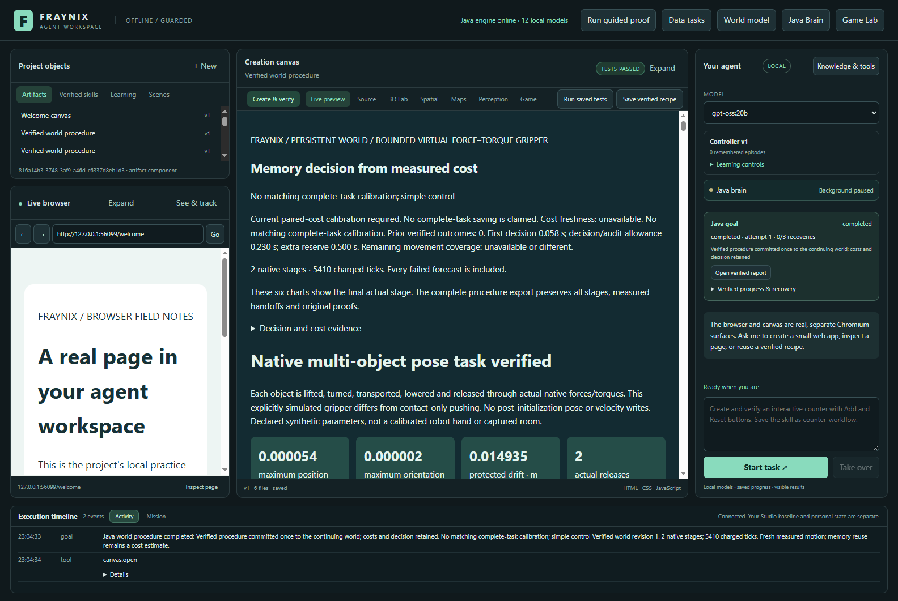

# Fraynix Agent Workspace

Default adaptive requests now require evidence that remembered procedures repay their extra work. 12/12 fresh evaluation tasks completed, with 3 explicit recoveries and 3 saved skills.

[Edition098: benefit-aware memory](README-098.md) · [Interactive offline results](docs/readmes/098/index.html) · [Previous edition](README-097.md) · [Contributor direction](README-CONTRIBUTORS.md)

One integrated local workspace: Java owns durable goals, physics, tools, verification and remembered procedures. Chat, browser, creation canvas, original Game Lab and native spatial views share those capabilities.

Published to main with original evidence and screenshots. [Fetched GitHub verification](docs/PUBLICATION_098.json).
