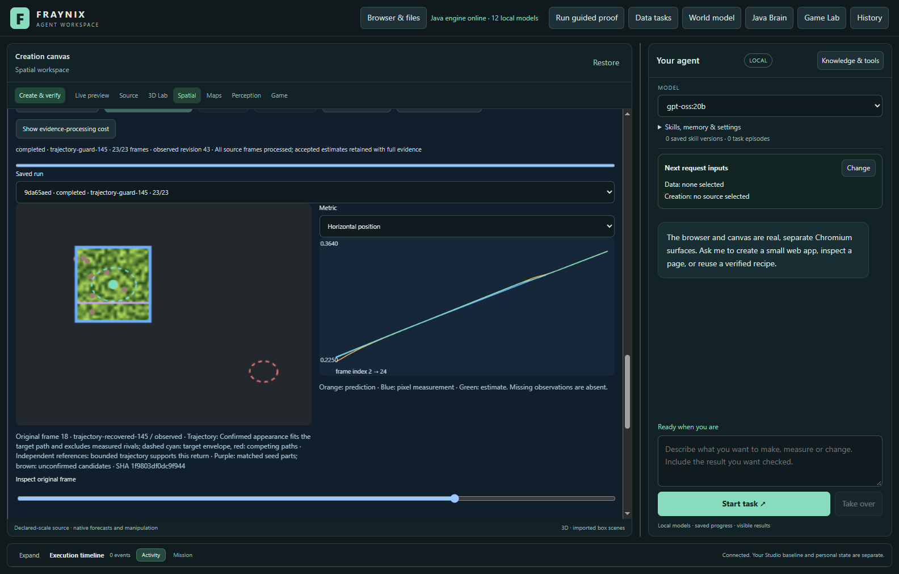
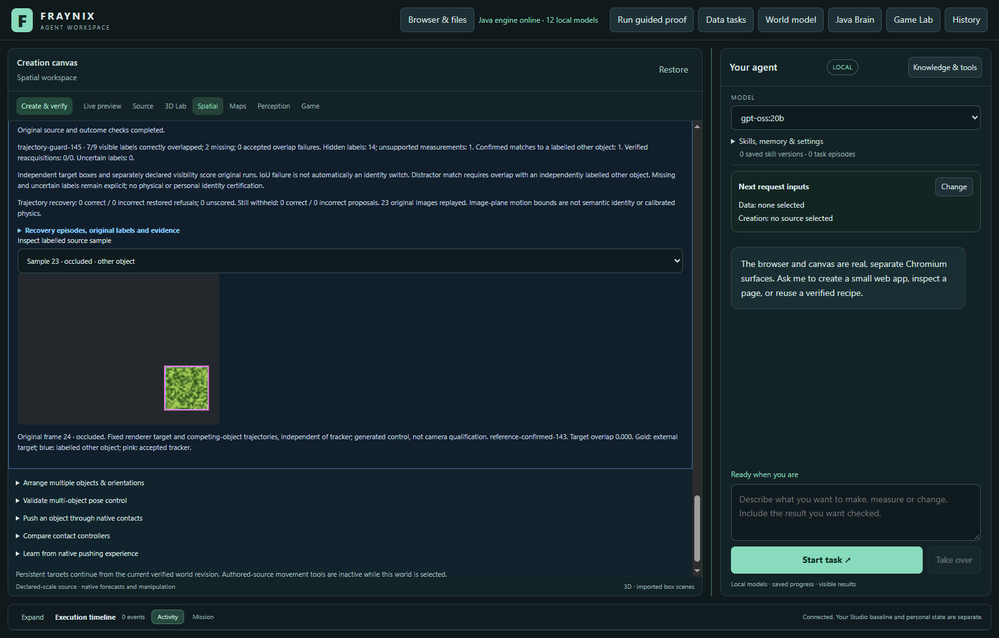
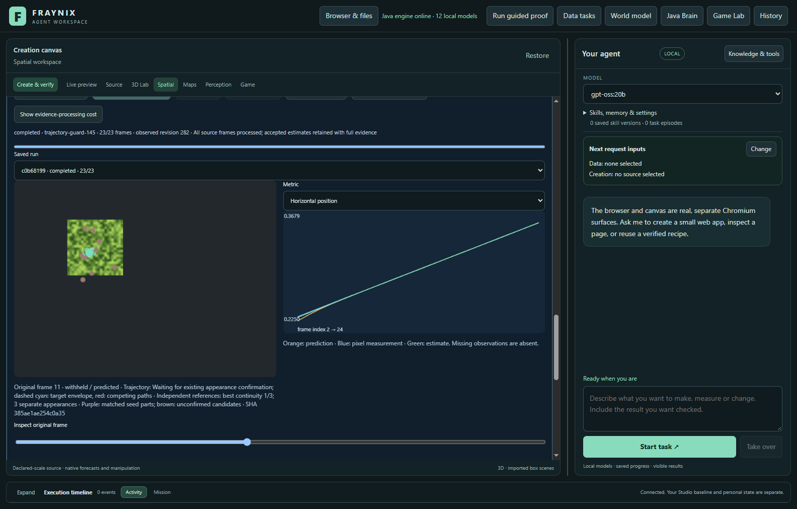
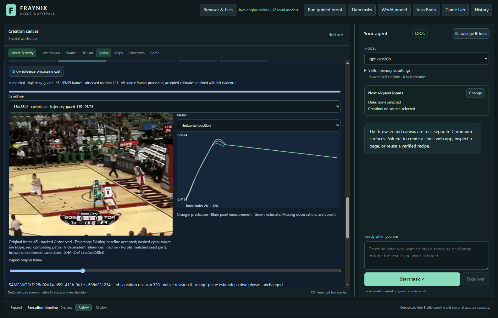

# Fraynix Agent Workspace — edition 145

[Published and fetched verification receipt](docs/PUBLICATION_145.json) · [Release tag](https://github.com/eyeoverthink/Fraynix-Agent-Workspace/tree/readme-145)

**Recover a return only when its measured path supports it.** Edition 145 adds an optional Java trajectory check around the unchanged edition 144 ambiguity guard. An appearance must still pass the existing confirmation checks; then its return must fit motion observed before loss and remain separated from measured competing paths.

**Measured result:** the actual app restores two extra correct measurements in an already-exposed development control, improving 6/21 to 8/21. The fresh camera and generated comparisons show no gain, and one fresh copy error remains. This is a bounded experimental capability, **not a promoted default or sustained-recovery claim**. All original verification and limits remain in place.

[Previous edition](README-144.md) · [Interactive offline guide](docs/readmes/145/index.html) · [Edition history](docs/readmes/INDEX.md) · [Contributor handoff](README-CONTRIBUTORS.md) · [Architecture](docs/ARCHITECTURE.md) · [Integrated roadmap](docs/INTEGRATED_AGENT_ROADMAP.md)

This screenshot is an actual app view of an already-exposed development regression. It demonstrates the mechanism through real donor verification and original-pixel replay; it is **not fresh qualification**. Fresh camera and generated results below remain separate, including all failures and missing observations.

## The connected application

Fraynix is a local Java agent workspace for durable chat goals, a persistent physics world, Game Lab, browser observations, data analysis and verified creation procedures. Java maintains execution state, evidence, recovery and outcome checks. Local models choose and explain actions through the installed tools; the desktop presents their results. The destination is one observable system that can create, test and retain useful procedures from measured outcomes.

This tracking work improves the evidence available to that system. It does not establish semantic identity, calibrated physical accuracy or unrestricted action authority. Better tracking must eventually improve complete world, browser and creation tasks before it becomes a default. Existing project data, capacities, permissions and `legacy-flow` remain unchanged.

## What changed

1. **Keep the original refusal.** The existing 144 guard still records ambiguous appearances. Its original decision remains in the trace, even when the new method supplies additional evidence.
2. **Anchor motion in observations before loss.** At most five adjacent accepted baseline measurements fit the target's path. A minimum of four is required. Predictions and recovered boxes never extend that anchor.
3. **Retain competing paths.** The existing appearance search algorithm is reproduced in a separate Java component to expose strong spatial alternatives. Up to eight rival paths retain at most five measurements each. Missing rivals keep their histories; conflicting associations and capacity overflow refuse recovery.
4. **Require a bounded separation test.** A fully confirmed appearance must fit the target envelope and exclude every retained rival envelope. Path intersections, excessive uncertainty, unmeasured motion or expired evidence refuse the override. There is no timer that clears ambiguity.
5. **Verify both benefit and cost.** Original pixels replay the full trajectory decision before independent labels score restored, incorrect, unknown and still-withheld proposals. The app shows target and rival envelopes alongside the original frame and motion chart.

The target and rivals use explicit image-plane assumptions per processed frame: maximum speed 0.08, fit residual 0.01, age 12, envelope radius `0.015 + residual*(1+age) + 0.0005*age²`, maximum radius 0.12, and candidate size ratios 0.75–1.35. These are **uncalibrated bounds**, not probability coverage or real-world physics. Details and separation margins are retained in the trace.

“Measured” here means an accepted baseline tracker box, not ground-truth identity. An existing baseline error can still contaminate the fitted path; independent outcome labels evaluate that risk afterward and never enter the controller. Camera motion, abrupt turns and unseen identical copies remain unresolved.

Explicit choices: `ambiguity-guard-144` for comparison, `trajectory-monitor-145` for identical 144 outputs with diagnostics, and `trajectory-guard-145` for bounded restoration. Every accepted 144 tracker proposal remains intact, including the original 139 baseline. Additional boxes may affect subsequent filter estimates. No appearance is automatically admitted to memory.

## Measured results

Fresh eligible camera comparisons (4 bounded chunks from two fixed source windows): guard145 91/238 correct versus144 91/238; wrong overlaps 0 versus 0, hidden outputs 0 versus 0. Raw restorations of144 refusals: {'returned': 0, 'correct': 0, 'incorrect': 0, 'unknown': 0}.

Fresh generated controls (4 cases): guard145 43/60 correct versus144 43/60; wrong overlaps 0 versus 0, hidden outputs 1 versus 1, labelled-other matches 1 versus 1. Raw restorations: {'returned': 0, 'correct': 0, 'incorrect': 0, 'unknown': 0}. Generated geometry does not establish camera reliability.

basketball-25: restored 0 correct / 0 incorrect / 0 unknown raw proposals. Filter-accepted restorations: 0 correct / 0 incorrect / 0 unknown; still withheld 0 correct / 0 incorrect / 0 unknown parent proposals.

girl2-385: restored 0 correct / 0 incorrect / 0 unknown raw proposals. Filter-accepted restorations: 0 correct / 0 incorrect / 0 unknown; still withheld 0 correct / 0 incorrect / 0 unknown parent proposals.

trajectory-return: restored 0 correct / 0 incorrect / 0 unknown raw proposals. Filter-accepted restorations: 0 correct / 0 incorrect / 0 unknown; still withheld 0 correct / 0 incorrect / 0 unknown parent proposals.

copy-remains: restored 0 correct / 0 incorrect / 0 unknown raw proposals. Filter-accepted restorations: 0 correct / 0 incorrect / 0 unknown; still withheld 0 correct / 0 incorrect / 0 unknown parent proposals.

crossing-copy: restored 0 correct / 0 incorrect / 0 unknown raw proposals. Filter-accepted restorations: 0 correct / 0 incorrect / 0 unknown; still withheld 0 correct / 1 incorrect / 0 unknown parent proposals.

turning-return: restored 0 correct / 0 incorrect / 0 unknown raw proposals. Filter-accepted restorations: 0 correct / 0 incorrect / 0 unknown; still withheld 0 correct / 0 incorrect / 0 unknown parent proposals.

basketball-120: restored 0 correct / 0 incorrect / 0 unknown raw proposals. Filter-accepted restorations: 0 correct / 0 incorrect / 0 unknown; still withheld 0 correct / 0 incorrect / 0 unknown parent proposals.

girl2-480: restored 0 correct / 0 incorrect / 0 unknown raw proposals. Filter-accepted restorations: 0 correct / 0 incorrect / 0 unknown; still withheld 0 correct / 0 incorrect / 0 unknown parent proposals.

basketball-25 activation: 0 frames with retained ambiguity; 0 also had a valid pre-loss target forecast; 0 qualified overrides.

girl2-385 activation: 0 frames with retained ambiguity; 0 also had a valid pre-loss target forecast; 0 qualified overrides.

trajectory-return activation: 0 frames with retained ambiguity; 0 also had a valid pre-loss target forecast; 0 qualified overrides.

copy-remains activation: 0 frames with retained ambiguity; 0 also had a valid pre-loss target forecast; 0 qualified overrides.

crossing-copy activation: 16 frames with retained ambiguity; 11 also had a valid pre-loss target forecast; 0 qualified overrides.

turning-return activation: 0 frames with retained ambiguity; 0 also had a valid pre-loss target forecast; 0 qualified overrides.

basketball-120 activation: 0 frames with retained ambiguity; 0 also had a valid pre-loss target forecast; 0 qualified overrides.

girl2-480 activation: 0 frames with retained ambiguity; 0 also had a valid pre-loss target forecast; 0 qualified overrides.

Defaults remain unchanged; no promotion. Motion bounds are uncalibrated image-plane assumptions. Unseen identical copies, camera movement, intersecting paths and long gaps remain limits; extra raw proposals can still be refused by the shared filter.

| Source / method | Correct / visible | Missing | Wrong overlaps | Hidden outputs | Other-object matches |
| --- | ---: | ---: | ---: | ---: | ---: |
| real-camera / basketball-25 / ambiguity-guard-144 | 25/95 | 70 | 0 | 0/0 | 0 |
| real-camera / basketball-25 / trajectory-monitor-145 | 25/95 | 70 | 0 | 0/0 | 0 |
| real-camera / basketball-25 / trajectory-guard-145 | 25/95 | 70 | 0 | 0/0 | 0 |
| real-camera / girl2-385 / ambiguity-guard-144 | 18/95 | 77 | 0 | 0/0 | 0 |
| real-camera / girl2-385 / trajectory-monitor-145 | 18/95 | 77 | 0 | 0/0 | 0 |
| real-camera / girl2-385 / trajectory-guard-145 | 18/95 | 77 | 0 | 0/0 | 0 |
| generated-control / trajectory-return / ambiguity-guard-144 | 14/21 | 7 | 0 | 0/2 | 0 |
| generated-control / trajectory-return / trajectory-monitor-145 | 14/21 | 7 | 0 | 0/2 | 0 |
| generated-control / trajectory-return / trajectory-guard-145 | 14/21 | 7 | 0 | 0/2 | 0 |
| generated-control / copy-remains / ambiguity-guard-144 | 7/9 | 2 | 0 | 1/14 | 1 |
| generated-control / copy-remains / trajectory-monitor-145 | 7/9 | 2 | 0 | 1/14 | 1 |
| generated-control / copy-remains / trajectory-guard-145 | 7/9 | 2 | 0 | 1/14 | 1 |
| generated-control / crossing-copy / ambiguity-guard-144 | 6/9 | 3 | 0 | 0/14 | 0 |
| generated-control / crossing-copy / trajectory-monitor-145 | 6/9 | 3 | 0 | 0/14 | 0 |
| generated-control / crossing-copy / trajectory-guard-145 | 6/9 | 3 | 0 | 0/14 | 0 |
| generated-control / turning-return / ambiguity-guard-144 | 16/21 | 5 | 0 | 0/2 | 0 |
| generated-control / turning-return / trajectory-monitor-145 | 16/21 | 5 | 0 | 0/2 | 0 |
| generated-control / turning-return / trajectory-guard-145 | 16/21 | 5 | 0 | 0/2 | 0 |
| real-camera / basketball-120 / ambiguity-guard-144 | 24/24 | 0 | 0 | 0/0 | 0 |
| real-camera / basketball-120 / trajectory-monitor-145 | 24/24 | 0 | 0 | 0/0 | 0 |
| real-camera / basketball-120 / trajectory-guard-145 | 24/24 | 0 | 0 | 0/0 | 0 |
| real-camera / girl2-480 / ambiguity-guard-144 | 24/24 | 0 | 0 | 0/0 | 0 |
| real-camera / girl2-480 / trajectory-monitor-145 | 24/24 | 0 | 0 | 0/0 | 0 |
| real-camera / girl2-480 / trajectory-guard-145 | 24/24 | 0 | 0 | 0/0 | 0 |

Correct means a filter-accepted tracker measurement overlaps the independently labelled visible target by at least 0.5 IoU. Hidden outputs are accepted measurements while the target is labelled absent. Low overlap alone is not proof of an identity switch; overlaps with independently marked competing objects are reported separately. Missing and uncertain observations stay explicit. See the [full comparison](docs/readmes/145/comparison.json) and [original app study](docs/readmes/145/app-study.json).

## Restoration and refusal costs

| Source / method | Additional correct / incorrect / unknown | Withheld correct / incorrect / unknown | Filter accepted correct / incorrect |
| --- | ---: | ---: | ---: |
| basketball-25 / ambiguity-guard-144 | 0 / 0 / 0 | 0 / 0 / 0 | 0 / 0 |
| basketball-25 / trajectory-monitor-145 | 0 / 0 / 0 | 0 / 0 / 0 | 0 / 0 |
| basketball-25 / trajectory-guard-145 | 0 / 0 / 0 | 0 / 0 / 0 | 0 / 0 |
| girl2-385 / ambiguity-guard-144 | 0 / 0 / 0 | 0 / 0 / 0 | 0 / 0 |
| girl2-385 / trajectory-monitor-145 | 0 / 0 / 0 | 0 / 0 / 0 | 0 / 0 |
| girl2-385 / trajectory-guard-145 | 0 / 0 / 0 | 0 / 0 / 0 | 0 / 0 |
| trajectory-return / ambiguity-guard-144 | 8 / 0 / 0 | 0 / 0 / 0 | 8 / 0 |
| trajectory-return / trajectory-monitor-145 | 8 / 0 / 0 | 0 / 0 / 0 | 8 / 0 |
| trajectory-return / trajectory-guard-145 | 8 / 0 / 0 | 0 / 0 / 0 | 8 / 0 |
| copy-remains / ambiguity-guard-144 | 1 / 12 / 0 | 0 / 0 / 0 | 1 / 1 |
| copy-remains / trajectory-monitor-145 | 1 / 12 / 0 | 0 / 0 / 0 | 1 / 1 |
| copy-remains / trajectory-guard-145 | 1 / 12 / 0 | 0 / 0 / 0 | 1 / 1 |
| crossing-copy / ambiguity-guard-144 | 0 / 0 / 0 | 0 / 1 / 0 | 0 / 0 |
| crossing-copy / trajectory-monitor-145 | 0 / 0 / 0 | 0 / 1 / 0 | 0 / 0 |
| crossing-copy / trajectory-guard-145 | 0 / 0 / 0 | 0 / 1 / 0 | 0 / 0 |
| turning-return / ambiguity-guard-144 | 10 / 0 / 0 | 0 / 0 / 0 | 10 / 0 |
| turning-return / trajectory-monitor-145 | 10 / 0 / 0 | 0 / 0 / 0 | 10 / 0 |
| turning-return / trajectory-guard-145 | 10 / 0 / 0 | 0 / 0 / 0 | 10 / 0 |
| basketball-120 / ambiguity-guard-144 | 0 / 0 / 0 | 0 / 0 / 0 | 0 / 0 |
| basketball-120 / trajectory-monitor-145 | 0 / 0 / 0 | 0 / 0 / 0 | 0 / 0 |
| basketball-120 / trajectory-guard-145 | 0 / 0 / 0 | 0 / 0 / 0 | 0 / 0 |
| girl2-480 / ambiguity-guard-144 | 0 / 0 / 0 | 0 / 0 / 0 | 0 / 0 |
| girl2-480 / trajectory-monitor-145 | 0 / 0 / 0 | 0 / 0 / 0 | 0 / 0 |
| girl2-480 / trajectory-guard-145 | 0 / 0 / 0 | 0 / 0 / 0 | 0 / 0 |

Raw supplemental boxes, downstream filter acceptance and final visible-target totals are different measurements. The new `restored` counts isolate proposals refused by 144 and recovered by 145. Still withholding a correct return is a cost. A fallback 139 run has no supplemental trajectory mechanism; its recovery columns are zero and it does not qualify 145.

Already-exposed development replay through the actual app (not fresh qualification):

- exposed-return / ambiguity-guard-144: 6/21 correct, 0 hidden outputs, restored {}.
- exposed-return / trajectory-monitor-145: 6/21 correct, 0 hidden outputs, restored {'correct': 0, 'incorrect': 0, 'returned': 0, 'unknown': 0}.
- exposed-return / trajectory-guard-145: 8/21 correct, 0 hidden outputs, restored {'correct': 2, 'incorrect': 0, 'returned': 2, 'unknown': 0}.
- exposed-copy / ambiguity-guard-144: 6/9 correct, 0 hidden outputs, restored {}.
- exposed-copy / trajectory-monitor-145: 6/9 correct, 0 hidden outputs, restored {'correct': 0, 'incorrect': 0, 'returned': 0, 'unknown': 0}.
- exposed-copy / trajectory-guard-145: 6/9 correct, 0 hidden outputs, restored {'correct': 0, 'incorrect': 0, 'returned': 0, 'unknown': 0}.

The [exposed development study](docs/readmes/145/exposed-app-study.json) passes the original unit-test pixels through actual donor retention, separately imported evaluation pixels, all three methods, independent outcome checks and full export. Descriptors are not injected into the production workflow. Positive development results do not replace or improve the reported fresh outcomes.

## Fresh sources and evaluation discipline

The implementation, audit, UI, source protocol, generator and actual-app harness were frozen at `5922cb69` before fresh source pixels or annotations. The [contract](docs/EDITION_145_CONTRACT.md), [method lock](docs/OBSERVATION_145_LOCK.json), [selection record](docs/publication145/source-selection145.json) and [source manifest](docs/publication145/source145.json) retain the exact choices. Development used exposed previous patterns; no fresh outcome tuned the method or changed the selected windows.

The first app attempt refused the 120-frame camera packs at the existing 96-frame limit, after donor verification and before any camera evaluation. The [capacity amendment](docs/publication145/capacity-amendment145.json) preserves this failure and partitions each fixed window into 96 and 25 frames with one overlapping seed. All 119 planned scored transitions remain; labels and pixels are unchanged. The extra chunks use a separate isolated project with repeated donor verification, preserving the 24-run limit. This introduces a fresh source-labelled starting box at the boundary and is **not uninterrupted 120-frame tracking**. The frozen production code, scorer and main harness remain unchanged; the added tail harness is committed before tail evaluation. Original pre-partition manifests and labels remain available.

Fresh recorded sources come from the [original OTB benchmark](https://rvlab.snu.ac.kr/research/tracker_benchmark/): Basketball donor frames 1–24 and evaluation 25–144; Girl2 donor 1–24 and evaluation 385–504. Original annotation rectangles are supplemented by attributed source-only AI visibility and competitor review before predictions. This is not independent human adjudication. Uncertain identities and boundaries remain uncertain.

Source review covered all 288 camera frames on 12 sheets and 24 full-resolution details. These fixed camera windows contain no confirmed complete disappearance and return: they measure continuity through nearby people, partial overlap and changing poses. Competing visible extents are independently marked on 17 selected source frames, not exhaustively across every image. Zero marked-object matches therefore does not prove universal identity preservation. The original benchmark target rectangles remain unchanged, including their narrow treatment of extremities. Camera occlusion qualification remains unresolved.

This is the real recorded source inside the application. The displayed frame is illustrative; the complete chunk retained 25/95 correct measurements and 70 missing observations in both methods. The continuous estimate is not a substitute for the missing measurements.

The four generated controls use fixed, independently rendered target and competitor trajectories: separated return, copy remaining after loss, crossing copy and a legitimate return that turns away from the prediction. The last case measures refusal cost. Generated geometry is not camera qualification. An unseen identical copy and an original object can produce the same pixels; this edition does not solve that observability limit.

| Source | Role | Domain | Frames | Visible/partial | Hidden | Uncertain |
| --- | --- | --- | ---: | ---: | ---: | ---: |
| basketball-1 | reference-source | real-camera | 24 | 23 | 0 | 0 |
| basketball-25 | evaluation | real-camera | 96 | 95 | 0 | 0 |
| girl2-1 | reference-source | real-camera | 24 | 23 | 0 | 0 |
| girl2-385 | evaluation | real-camera | 96 | 95 | 0 | 0 |
| generated-reference | reference-source | generated-control | 24 | 23 | 0 | 0 |
| trajectory-return | evaluation | generated-control | 24 | 21 | 2 | 0 |
| copy-remains | evaluation | generated-control | 24 | 9 | 14 | 0 |
| crossing-copy | evaluation | generated-control | 24 | 9 | 14 | 0 |
| turning-return | evaluation | generated-control | 24 | 21 | 2 | 0 |
| basketball-120 | evaluation | real-camera | 25 | 24 | 0 | 0 |
| girl2-480 | evaluation | real-camera | 25 | 24 | 0 | 0 |

A donor without admissible verified appearances is refused. Its dependent comparisons remain unavailable, with an existing 139 baseline run on the fixed evaluation window. No fabricated reference or easier replacement source is substituted. Original image bytes and donor/evaluation separation are checked before use. Raw camera archives remain local; public evidence includes hashes, annotations, provenance and illustrative app screenshots. No private webcam recording is published.

## Review it in the application

1. Run `Launch-Agent-Workspace.bat` from the Java checkout with its Java 21 and desktop prerequisites. Offline preparation is available through `scripts/Start-Agent-Workspace.ps1 -PrepareOnly -Offline`.
2. Use an isolated project for experiments. In the spatial workspace, select a saved world and import a frame pack.
3. Retain reference appearances from an independently labelled, audited donor run. A correctly tracked donor does not automatically guarantee admissible examples.
4. Select separate evaluation footage, the verified reference set, a same-object declaration and an explicit method. The declaration is not identity proof.
5. Track, inspect original frames and open the independent outcome audit. Dashed cyan marks the target envelope; red marks rival envelopes. The explanation distinguishes incomplete appearance confirmation, unsupported motion, competing paths and a bounded restoration.
6. Export the complete evidence. Resume reconstructs observations from original pixels; changed source or code evidence is refused rather than relabelled.

The [offline guide](docs/readmes/145/index.html) provides method comparisons, screenshots and linked implementation files without running another experiment.

## Verification and retained attempts

360 distinct Java checks, 161 desktop checks, kernel integration, agency regression, offline preparation and package/build verification passed. Actual app: 29 fresh-comparison/donor runs plus 7 separately reported exposed-development runs and one active-ambiguity interruption check. Original source/outcome verification, replay, monitor equality, baseline preservation, stopped-prefix resume, abrupt restart, complete smaller-project export, large-project capacity refusal and tamper refusal.

- Separate donor runs precede all fixed evaluation windows. Retention with zero eligible examples is refused and recorded; reference-dependent cases remain unavailable without replacement. Eligible cases compare three methods on identical pixels. Fresh real footage and generated trajectory controls are reported separately; no-reference cases retain an explicit baseline run and unavailability records. Independent host overlap/distractor/supplemental-outcome arithmetic agrees with Java. Monitor preserves every144 tracker/filter output; candidate preserves every accepted144 tracker proposal, including all139 baseline proposals. No automatic anchor admissions; defaults unchanged.
- Explicit method selection, recovery explanation, original-source overlay, independent audit UI, complete-world export refused at existing20MB transport limit, and exact stopped-prefix resume passed; separate small-project positive export required. Native physical world unchanged.
- Owned-process crash and cold reopen preserve exact completed-state bytes/timestamp and zero observation writes. All recorded runs/audits reverified, including original-pixel decision replay. Donor and evaluation source modification independently refuse audit/export; original restoration revalidates.
- Explicit method selection, recovery explanation, original-source overlay, independent audit UI, complete bounded export and exact stopped-prefix resume passed. Native physical world unchanged.
- Killed only the owned Java process while ambiguity was latched and the run was unfinished
- Cold reopen retained the exact committed prefix and interrupted status
- Resume reconstructed the ambiguity state from original pixels before continuing
- Complete trace and independent outcome audit exactly match the uninterrupted run
- Native world unchanged; Additional observation run uses the existing capacity without expansion

The focused tests cover separated paths, copy rejection, crossing conflicts, stale and missing evidence, bounded capacity, unchanged monitor/filter behavior, real pixel-level restoration, original-source replay, forged evidence and source/export tampering. Broader regressions retain durable goals, skills, browser outcomes, creation, physics and observation checks.

The separate [interruption receipt](docs/readmes/145/restart-check.json) repeats the already-exposed development return, interrupts only the owned Java process with ambiguity retained, then compares the resumed trace and audit with the uninterrupted execution. The fresh return did not produce the required ambiguity latch, so it cannot qualify that interruption precondition. It is not an additional independent fresh sample. [Diagnostics](docs/readmes/145/diagnostics.json) retain accepted and refused intervals and verify that restored estimates never become target anchors.

The main study's complete-world export was refused at the unchanged 20 MB desktop transport limit because it includes related camera history. The [export amendment](docs/publication145/export-amendment145.json) preserves that failed attempt and requires successful complete export in the smaller exposed-regression project. No history is pruned or limit increased, and the main continuation still checks all original source, outcome, monitor, baseline, stop/resume, cold-reopen and tamper conditions. Its only harness change recognizes that exact capacity refusal.

The first focused development run failed two of nine checks because the new trajectory envelope expired before the existing appearance confirmations finished. Its original failure log/XML and development trace are retained. Before any fresh source access, the new envelope was corrected and the second focused run passed all nine checks. The final frozen version also adds a capacity-overflow test. Existing appearance thresholds, confirmation counts and baseline behavior were not relaxed. See the development note for the explicit image-plane assumptions. All later validation and app attempts remain in the original evidence record.

The first actual-app attempt refused the planned120-frame camera pack at the unchanged96-frame limit, after three donor runs and before evaluation. The original result/log are retained. Amendment5535c984 partitions both exact windows into96+25 frames with one shared boundary seed, preserving all original scored transitions, pixels and labels. Extra chunks use a separate project within the24-run limit. This changes initialization at the boundary and is reported explicitly; frozen production/scorer/main harness remain unchanged. No outcome-driven source replacement or tuning.

The resumed actual app reached the fresh return control and then correctly refused its complete-world export at the unchanged20MB desktop limit. Original result/log retained. Amendmenta8156950 changes only the main continuation's export assertion to require that exact refusal, while a separate small exposed-development project must pass complete export and active-ambiguity restart. No source/algorithm/scorer tuning, pruning, or limit increase. The fresh return had no ambiguity latch, so the active-latch restart uses the separately reported existing development fixture; it is not fresh qualification.

CI was checked before implementation. Hosted CI is separate from local verification; the publication receipt and [GitHub Actions](https://github.com/eyeoverthink/Fraynix-Agent-Workspace/actions) report its actual status. Local tests or a successful push do not imply that a hosted job has finished.

## Complete workflow costs

| Source / method | Tracking ms | Audit/replay ms |
| --- | ---: | ---: |
| basketball-25 / ambiguity-guard-144 | 34152.7 | 19471.5 |
| basketball-25 / trajectory-monitor-145 | 52710.0 | 19694.0 |
| basketball-25 / trajectory-guard-145 | 77884.3 | 20691.5 |
| girl2-385 / ambiguity-guard-144 | 99026.2 | 22860.9 |
| girl2-385 / trajectory-monitor-145 | 118661.9 | 22996.2 |
| girl2-385 / trajectory-guard-145 | 139035.2 | 23556.6 |
| trajectory-return / ambiguity-guard-144 | 45175.5 | 20985.2 |
| trajectory-return / trajectory-monitor-145 | 46221.9 | 20801.4 |
| trajectory-return / trajectory-guard-145 | 57577.9 | 20692.8 |
| copy-remains / ambiguity-guard-144 | 46835.3 | 17105.6 |
| copy-remains / trajectory-monitor-145 | 48416.5 | 17126.4 |
| copy-remains / trajectory-guard-145 | 50216.5 | 17248.1 |
| crossing-copy / ambiguity-guard-144 | 52358.9 | 18650.6 |
| crossing-copy / trajectory-monitor-145 | 59974.1 | 29851.1 |
| crossing-copy / trajectory-guard-145 | 60054.5 | 29927.5 |
| turning-return / ambiguity-guard-144 | 56495.5 | 18810.8 |
| turning-return / trajectory-monitor-145 | 58911.2 | 19162.5 |
| turning-return / trajectory-guard-145 | 60591.9 | 19123.6 |
| basketball-120 / ambiguity-guard-144 | 5840.1 | 4943.4 |
| basketball-120 / trajectory-monitor-145 | 7088.6 | 4877.2 |
| basketball-120 / trajectory-guard-145 | 10862.0 | 5138.3 |
| girl2-480 / ambiguity-guard-144 | 10559.0 | 6004.0 |
| girl2-480 / trajectory-monitor-145 | 12621.8 | 6024.2 |
| girl2-480 / trajectory-guard-145 | 13413.3 | 6134.5 |

Complete app interval: 2465.9 seconds, including imports, source verification, UI reads, exports, screenshots, stop/resume, restart and tamper checks. Includes any retained failed-attempt/resume gaps. Phase timings are subsets, not additive costs. Fixed-order measurements are not an isolated speed comparison.

Separate capacity-partition app interval: 149.6 seconds, including repeated donor verification and all remaining camera transitions in an isolated project. Main and tail studies use 21 and 8 runs respectively; neither changes the24-run limit. Camera chunks restart from source geometry at their boundary; no claim of uninterrupted120-frame tracking.

Separate active-ambiguity interruption check: 83.0 seconds, outside the comparison interval above.

Already-exposed development app interval: 572.7 seconds, including genuine donor verification, full export and all provenance checks. This is regression cost, excluded from fresh outcome totals.

Exposed exposed-return / ambiguity-guard-144: tracking 14701.4 ms; audit 24260.0 ms.

Exposed exposed-return / trajectory-monitor-145: tracking 25403.4 ms; audit 43245.2 ms.

Exposed exposed-return / trajectory-guard-145: tracking 33239.8 ms; audit 43172.9 ms.

Exposed exposed-copy / ambiguity-guard-144: tracking 18271.0 ms; audit 22837.8 ms.

Exposed exposed-copy / trajectory-monitor-145: tracking 28305.3 ms; audit 40058.2 ms.

Exposed exposed-copy / trajectory-guard-145: tracking 28862.1 ms; audit 39984.5 ms.

Separate read-only documentation review: 254.8 seconds to reopen and reverify selected completed evidence, capture source/trajectory views, and confirm zero saved-state writes. Excluded from fresh comparison timing.

The explicit experiment performs an additional spatial search while ambiguity is retained. That cost is included; this edition makes no isolated speedup claim. Original reference validation, source replay, persistence, export and restart remain required. No verification is skipped to improve a timing number.

## Source and evidence

- [Java controller](workspace-engine/src/main/java/fraymus/workspace/TrajectoryRecovery145.java), [trajectory gate](workspace-engine/src/main/java/fraymus/workspace/TrajectoryGate145.java), [spatial search](workspace-engine/src/main/java/fraymus/workspace/TrajectorySearch145.java) and [independent replay/outcome audit](workspace-engine/src/main/java/fraymus/workspace/TrajectoryAudit145.java).
- [Unchanged conservative guard](workspace-engine/src/main/java/fraymus/workspace/AmbiguityGuard144.java), [appearance confirmations](workspace-engine/src/main/java/fraymus/workspace/AppearanceConfirmation143.java) and [verified reference resolver](workspace-engine/src/main/java/fraymus/workspace/ReferenceMemory137.java).
- [Focused tests](workspace-engine/src/test/java/fraymus/workspace/TrajectoryRecovery145Test.java), [fixed generator](workspace-engine/src/test/java/fraymus/workspace/TrajectoryFixtures145.java) and [actual-app study](workspace-desktop/test/trajectory145-integration.cjs).
- [Validation](docs/readmes/145/verification.json), [original evidence inventory](docs/readmes/145/original-evidence.json), [source inventory](docs/readmes/145/file-inventory.json) and [linked system map](docs/obsidian/153-trajectory-continuity.canvas).

Historical editions 001–144 stay frozen. Publication targets `eyeoverthink/Fraynix-Agent-Workspace` main, edition145 and annotated `readme-145`, followed by fetched source/evidence verification. The unified Java application remains the destination.

## Next steps

1. **Check continuity even when no strong rival was detected.** The fresh copy-remains case bypassed the ambiguity latch and retained one wrong accepted measurement. Develop on this now-exposed failure, test both legitimate returns and copies, then freeze before new sources. Preserve baseline continuity and quantify any correct returns lost; a missing rival is not identity evidence. Do not promote145 or loosen thresholds based on its fresh results.
2. **Qualify real occlusion and return deliberately.** Define source-only event-selection criteria before testing, then use genuinely new footage containing full cover, re-entry, a competing similar object, camera motion and a turn. Label target/competitors before predictions. The145 fixed camera windows contain no complete disappearance, and their many missing observations remain unresolved. Development replay and generated geometry are not camera qualification.
3. **Make verification and search cost sustainable.** Measure and reuse exact source/code-bound computations while retaining every source and outcome check. Avoid duplicate spatial searches where equivalent evidence can be shared. Forecast complete-world export size before collection; preserve the existing limits and history. Report total task cost, including donor admission, replay, saves, restart and export.
4. **Return qualified observations to useful durable goals.** Keep the unified Java world/browser/creation application central. A goal must distinguish measured support, predicted position and unknown identity, and stop or request new evidence when identity is unresolved. Demonstrate a complete task benefit before changing defaults or granting any additional action authority.
