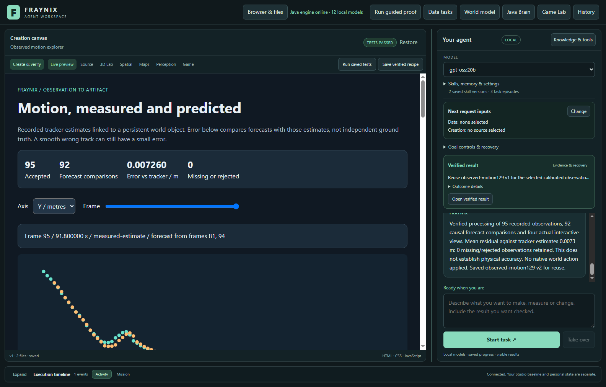
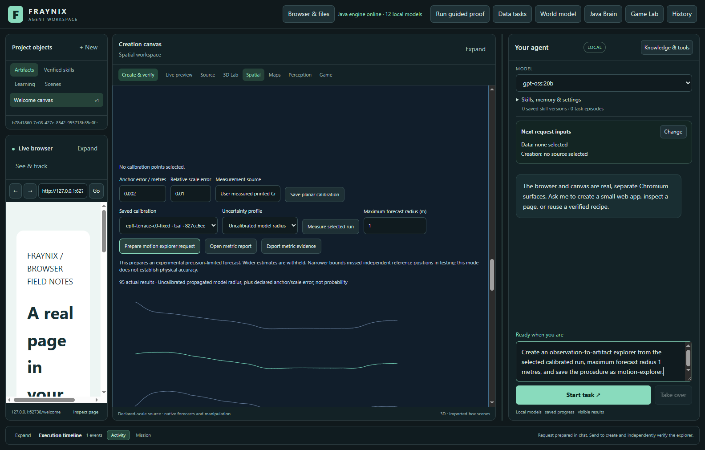
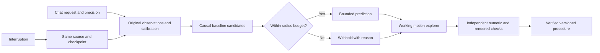
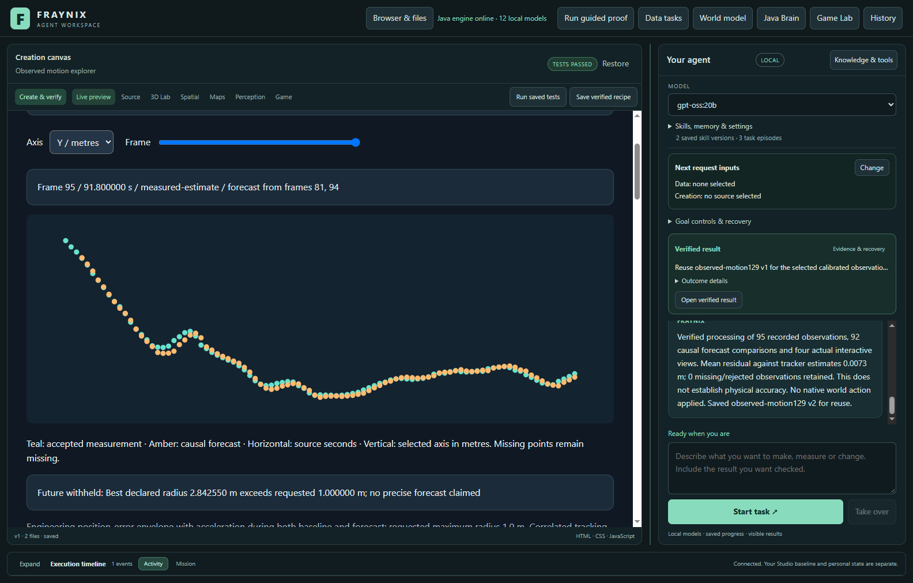
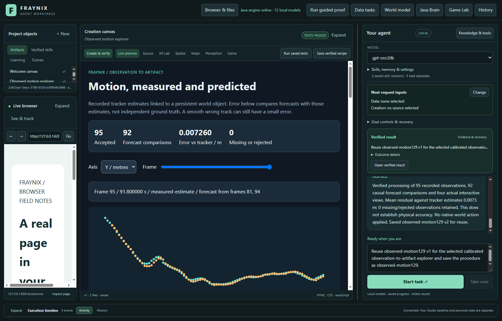

# Fraynix Agent Workspace — Edition 129

[Published and fetched verification receipt](docs/PUBLICATION_129.json) · [Release tag](https://github.com/eyeoverthink/Fraynix-Agent-Workspace/tree/readme-129)

**Measure tracking against independent references. Keep the proven default. Withhold forecasts that cannot meet the requested precision.**

2026-11-12 · Java-owned tasks, evidence and recovery · Local browser, canvas and world

[Previous edition](README-128.md) · [All editions](docs/readmes/INDEX.md) · [Interactive offline guide](docs/readmes/129/index.html) · [Acceptance contract](docs/EDITION_129_CONTRACT.md) · [Integrated direction](docs/INTEGRATED_AGENT_ROADMAP.md)



## The application and its direction

Fraynix is one continuing local agent workspace. Java owns durable goals, observations, typed tools, world identity, procedure memory, verification and recovery. Chat, browser, creation canvas, Game Lab and physics simulation are connected surfaces. The intended loop remains **observe → choose → act → check → remember → evaluate reuse**.

Edition 126 demonstrated a real local model completing supported browser, world and creation requests. Edition 127 added procedure inspection, retirement and checked reactivation. Edition 128 connected a calibrated recorded observation to a verified working artifact, but independent references exposed tracking drift and broad prediction bounds. Edition 129 addresses those measurements without hiding the unsuccessful experiment. These changes use handwritten Java, existing dependencies and transparent algorithms; they add no external tracking service, neural training or fresh model call.

## What changed

- **Explicit precision:** choose a maximum forecast radius in the existing measured-world panel. The prepared chat request retains it through interruption, verification and saved-procedure reuse.
- **Experimental longer causal baselines:** choose the smallest valid engineering envelope among earlier accepted positions in a bounded history. Acceleration during both the baseline and the future interval is included.
- **Honest withholding:** a forecast wider than the chosen limit has no claimed position. It exposes the reason and best available bound, rather than clipping its uncertainty.
- **Controlled tracking experiment:** an optional scale-aware flow candidate keeps feature patches within the target's image scale. It failed promotion. The existing flow tracker remains the default; the experimental option is labelled in the actual UI and recorded per run.
- **Implementation identity:** tracker proofs now include nested and supporting implementation classes. Old incompatible proofs require explicit fresh runs; no evidence is relabelled under changed code.

## Try the complete request

1. Start the normal workspace launcher. Preserve your private project; use an isolated project for experiments.
2. Open **3D Lab → Persistent world**, select a saved world, import a supported recorded-frame package and bind its subject to a world body. Keep **Existing flow tracker** selected unless deliberately evaluating the experimental candidate. Confirm selection, then track the original pixels.
3. Under **Measured world → camera, scale & uncertainty**, select the matching calibration and measure the completed run. Choose **Maximum forecast radius (m)**; the default is one metre.
4. Click **Prepare motion explorer request**, review it in chat and send:

> Create an observation-to-artifact explorer from the selected calibrated run, maximum forecast radius 1 metres, and save the procedure as motion-explorer.

5. Add **“review after forecast”** to pause before artifact creation. Resume the same request from its mission controls; interruption retains the source, policy and checkpoint.
6. Select another completed compatible observation and ask **“Reuse motion-explorer v1 for the selected calibrated observation-to-artifact explorer and save the procedure as motion-explorer.”** Values are recomputed from fresh inputs and independently checked before saving v2.
7. Inspect, retire or reactivate versions through **Manage saved procedures**. Original source and descendant evidence remain intact.

Ordinary requests without an explicit maximum forecast radius retain the original adjacent-point policy. The prepared request explicitly opts into the experimental mode. Its one-metre input is a starting requirement, not a learned tolerance.

The radius is a task requirement, not a statement that the tracker is accurate to that distance. If no bounded comparison is possible, admission refuses before reserving a workflow. Invalid explicit precision requests are refused rather than silently replaced by defaults. This workflow does not start the webcam or actuate a physical device.





## Tracking experiment: failed promotion, retained evidence

We compared the original flow tracker, a simpler frozen appearance tracker and an unchanged scale-aware candidate. Each received the same original pixels and first-frame seed. Later reference annotations were opened only after tracking finished. Losses count separately from conditional accepted error.

Development exposed severe foreground occlusion: the original problematic window averaged about 5.15 m error at its three reference positions, while the candidate lost almost all observations. It did not solve this failure. The source camera's mathematical projection was checked against twenty independently forward-projected points using separate rotation products and radial-distortion bisection; this checks conventions and arithmetic, not physical calibration accuracy.

The candidate was locked before five fresh windows. The original gate required a strict reduction in errors above two metres; both trackers had zero, so the gate failed. We retained that failure, predeclared a separate five-window confirmation with a non-increase condition, and left the candidate unchanged. Confirmation required more reference positions within one metre; both had nine, so it also failed. There was no third attempt or post-confirmation tuning.

| Cohort / method | Accepted references /15 | Within 1 m | Over 2 m | Mean accepted error /m | Tracking /s |
| --- | ---: | ---: | ---: | ---: | ---: |
| held / flow | 15 | 9 | 0 | 0.789 | 5.337 |
| held / fixed | 4 | 0 | 4 | 4.206 | 5.798 |
| held / scale-aware | 15 | 11 | 0 | 0.724 | 4.504 |
| confirm / flow | 15 | 9 | 1 | 1.068 | 5.935 |
| confirm / fixed | 5 | 0 | 0 | 1.464 | 4.721 |
| confirm / scale-aware | 15 | 9 | 1 | 1.007 | 5.133 |


Each cohort has fifteen sparse reference positions, only three per window. Frames are correlated and use one fixed EPFL camera. The frozen appearance baseline loses most targets; its accepted-only mean cannot be compared without its missing observations. No result establishes general recognition, automatic person identity or robust occlusion recovery. The candidate remains available only as an explicit experiment, not a promoted default. [First lock](docs/OBSERVATION_129_CANDIDATE_LOCK.json) · [Confirmation lock](docs/OBSERVATION_129_CONFIRMATION_LOCK.json) · [All decisions](docs/readmes/129/cohort-decisions.json).

## Forecast mathematics and actual limits

Let the earlier and latest accepted positions be separated by `d` seconds, with positional radii `r_a` and `r_b`. For look-ahead `h` and declared acceleration bound `A`, the new radius is:

```text
radius = r_b + h * (r_a + r_b) / d + A * h * (d + h) / 2
prediction = b + (b - a) * h / d
```

The additional `A*h*d/2` term accounts for acceleration while estimating velocity. Only earlier accepted points enter the baseline; rejected predictions never become measured training data. The default baseline window, forecast horizon and maximum gap are each 0.6 seconds; default acceleration bound is 5 m/s². History is bounded to 96 positions and the declared window. A gap clears obsolete baseline history. Choose the narrowest valid envelope and withhold it if it exceeds the requested radius; do not shrink the bound itself.

| Policy across 10 incumbent windows | Available forecasts | Mean available radius /m | Independent covered / available | Mean independent error /m |
| --- | ---: | ---: | ---: | ---: |
| legacy-adjacent | 930 / 950 | 1.692 | 28 / 30 | 0.925 |
| bounded-budget-1m | 865 / 950 | 0.684 | 16 / 30 | 0.925 |
| bounded-diagnostic-100m | 930 / 950 | 0.730 | 16 / 30 | 0.925 |


**The narrower policy is not promoted as an accuracy improvement.** Independent coverage fell from 28/30 to 16/30 reference positions while mean reference error stayed about 0.925 m. The system keeps the original policy for ordinary requests; the new mode is an explicit experiment. No bounds are declared statistically calibrated from this study.

These are engineering envelopes conditional on measurement radii, camera assumptions and the acceleration bound. They are **not calibrated probabilities**. Smooth tracking bias can violate their assumptions without producing a large self-residual. Forecast residuals against tracker estimates and independent grid-reference errors are reported separately. Narrower intervals do not repair wrong object associations. The grid has250 mm cells (±125 mm per axis); independent coverage includes its half-diagonal and is still a limited reference check.



## What passed in the connected application

Local validation passed: 184 distinct Java test methods, 161 desktop checks, executable factory-kernel harnesses, the actual agency regression and isolated offline preparation/package checks. The actual study includes an abrupt owned-Java interruption, cold restart of the same request, changed-input reuse, retained procedure lifecycle and independent numeric/rendered outcomes. Hosted CI was checked first and is reported separately.

- held-1200: original pixels tracked into the same body identity without native motion
- One visible chat request survives owned-Java termination at the forecast boundary, preserves identity and forecast, independently checks its real artifact and only then saves the procedure.
- The first completed source-bound task and original clock remain unchanged after the driver-only navigation correction; fresh rendered checks still match.
- held-2200: original pixels tracked into the same body identity without native motion
- Explicit experimental choice persists in the second source. Reuse retains the chosen 1m precision limit; every available forecast respects it and the wider final prediction is withheld. This does not certify the measured positions.
- Working explorer has no document overflow at1100px app width; all rows remain in its scrollable table.
- Observed-motion procedure participates in original-evidence inspection, retirement and checked reactivation.

| Recorded input | Accepted / rows | Forecast comparisons | Mean residual vs tracker / m | Request / seconds | Tracking preparation / seconds |
| --- | ---: | ---: | ---: | ---: | ---: |
| held-1200 | 95 / 95 | 66 | 0.012104 | 11.18 | 17.24 |
| held-2200 | 95 / 95 | 92 | 0.007260 | 13.92 | 52.16 |

| Independent reference check | Scored positions | Mean tracking error / m | Best future radius, WITHHELD / m |
| --- | ---: | ---: | ---: |
| held-1200 | 3 | 0.905 | 4.386 |
| held-2200 | 3 | 0.668 | 2.843 |

The first request includes the explicit review and crash/restart interval. These are single observed costs, not typical latency claims.


The UI demonstration reuses two already evaluated windows; it is not an extra held evaluation. The first request uses the incumbent; the second explicitly selects the candidate. Both use a one-metre forecast budget and withhold the wider final prediction. A working artifact is a software outcome, not proof of physical accuracy. The body remains an observational identity in a calibrated plane; no camera estimate is silently applied as a native 3D pose.



## Verification, compatibility and retained failures

Both predeclared tracking promotion gates failed; the original protocols and all 30 held method executions are retained. The first candidate lost nearly every observation in the foreground-occluded development case. The first focused test run had one failing test assertion because the public workflow view intentionally omits its definition; the corrected test reads the retained artifact definition, preserving the original failure. A source review also caught a chat helper that would discard initial precision settings; the corrected routing and new/reused-request checks are verified on final source. Independent forecast coverage also fell from28/30 to16/30 under narrower envelopes. This is not improved accuracy: ordinary requests retain the original policy, while the precision-limited mode requires an explicit request and remains experimental. The first actual app run recovered the same request but refused its chart: one SVG coordinate was parsed one float step away from the mathematically expected value. The renderer now writes explicit IEEE single-precision coordinates, preserving the existing strict verifier. A fresh source-bound complete study follows; the earlier unfinished task remains retained. A later driver tried selecting the experimental tracker while the artifact tab was visible; the corrected navigation continues the same project, rechecks the already completed first task and preserves its original timing. Visual review then clarified the chart and chat wording: residuals are against tracked estimates, not ground truth. A complete final-source run repeats both tasks after that presentation change; earlier successful and unsuccessful runs remain distinct. The final driver also waits for the actual host task lease to become idle before manual import, after an early import was correctly refused during cleanup. Continuation rechecks the completed first task without replacing its original timing. The final tests and actual study are reported separately. No failed attempt counts as success or is relabelled under a newer source.

All original pixel hashes, source clocks, camera definitions, stable body bindings, numeric source-cell checks, rendered chart checks, procedure ancestry and checkpoint ownership remain required. The independent host exercises actual axis/frame controls and reads DOM/SVG values; page-provided success flags cannot authorize completion. Compatible current-source procedures can be reused with fresh inputs. Changed implementation identities refuse incompatible historical execution; frozen prior editions and their original evidence remain untouched.

The existing 5–96-frame import,20-workflow,32-active-procedure and eight-version limits remain unchanged. No new runtime library is introduced. Private user projects and original footage stay local. Published numerical evidence includes losses and failed attempts; limited dated screenshots are attributed to [EPFL CVLab](https://www.epfl.ch/labs/cvlab/data/data-pom-index-php/), with the [original Terrace recording](https://documents.epfl.ch/groups/c/cv/cvlab-pom-video3/www/terrace1-c0.avi) identified by hash. The first-frame seed uses human ground annotations and a height assumption; it is not semantic detection.

[Verification](docs/readmes/129/verification.json) · [Actual app study](docs/readmes/129/observation-study.json) · [Numerical comparison](docs/readmes/129/forecast-comparison.json) · [Original evidence](docs/readmes/129/original-evidence.json) · [Source inventory](docs/readmes/129/file-inventory.json)

## Implementation and reproduction

| Component | Responsibility |
| --- | --- |
| [ObservationForecast129](workspace-engine/src/main/java/fraymus/workspace/ObservationForecast129.java) | Causal envelopes, precision budget, withholding and chat settings |
| [ObservationMethods129](workspace-engine/src/main/java/fraymus/workspace/ObservationMethods129.java) | Explicit tracking choice and complete implementation identity |
| [ScaleAwareFlow129](workspace-engine/src/main/java/fraymus/workspace/ScaleAwareFlow129.java) | Locked experimental tracker; failed promotion |
| [ObservationArtifact128](workspace-engine/src/main/java/fraymus/workspace/ObservationArtifact128.java) | Original source binding and policy dispatch |
| [WorkflowRunner](workspace-engine/src/main/java/fraymus/workspace/WorkflowRunner.java) | Durable stages, verification and saved-procedure reuse |
| [Actual app study](workspace-desktop/test/observation129-integration.cjs) | Real UI, tracking, process interruption, fresh-input reuse and outcome checks |

Use Java21 and the project's Gradle wrapper. The existing desktop dependencies are unchanged. For a local experimental checkout, use a separate project directory; never silently share a private database between checkouts.

```powershell
.\scripts\Start-Agent-Workspace.ps1 -PrepareOnly -Offline
.\gradlew.bat :workspace-engine:test --tests fraymus.workspace.ObservationForecast129Test --tests fraymus.workspace.Tracking129Test
python docs/publication129/validate129.py java
python docs/publication129/validate129.py desktop
python docs/publication129/validate129.py package
```

The recorded research preparation scripts require the already downloaded EPFL source and decoder. They refuse changed locked sources and existing output folders. The actual app driver requires explicitly prepared media and verifies the installed build receipt. Do not rerun successful research to search for a better result; retain each original attempt. See [contract](docs/EDITION_129_CONTRACT.md), [offline guide](docs/readmes/129/index.html) and [Obsidian note](docs/obsidian/137-tracking-precision.md).

## Next

Edition 130 should make the continuing mission easier to use: show source age, tracking loss, precision requirement, withheld predictions, active work and saved procedures together in the existing workspace. Continue checking whole browser/world/creation requests and recovery. A later tracking proposal needs independent object-association evidence and genuinely new footage before promotion; more smoothing alone will not establish accuracy. The destination remains one coherent local agent with evidence, memory and useful creation—not an indefinite tracker-only branch.
