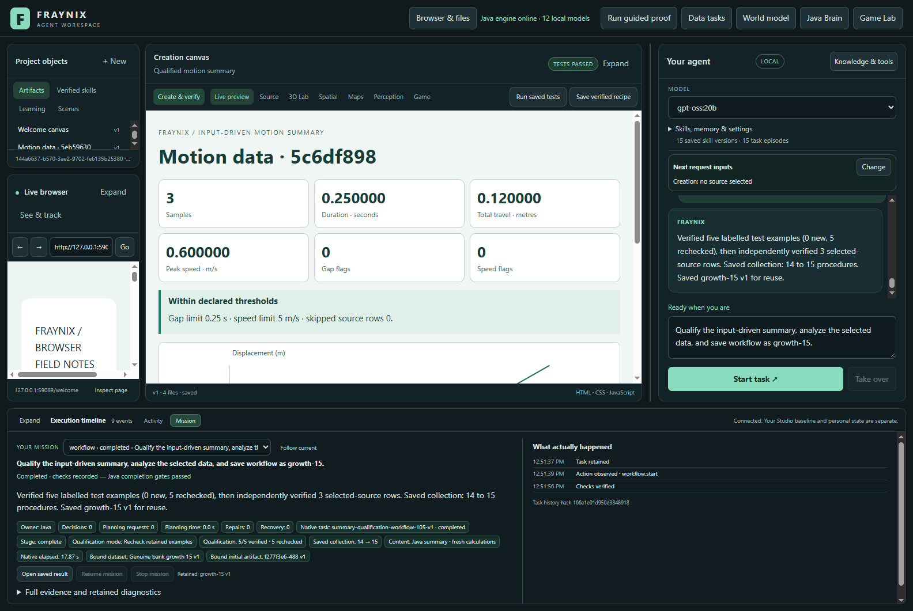

# Fraynix Agent Workspace

Edition109 measures maintenance as genuine saved procedures fill the existing workflow capacity, preserving every source and outcome check.

[Edition109: measurements, functions and next steps](README-109.md) | [Interactive offline guide](docs/readmes/109/index.html) | [Previous edition](README-108.md) | [Contributor direction](README-CONTRIBUTORS.md)

Thirty actual workflows complete, including abrupt recovery; six refuse correctly. All342 Java engine classes remain unchanged.

Java owns durable goals, tools, worlds, verification, recovery and memory. Chat, browser/canvas, spatial views and Game Lab remain integrated.

Published to main. [Fetched GitHub verification](docs/PUBLICATION_109.json).
