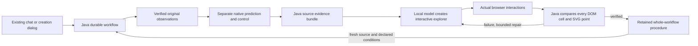
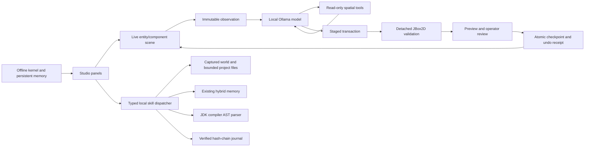

## Edition139 — published and fetched back

2026-11-13. Isolated J:/Codex-Work/fraynix-workspace-edition139 from7e66b0c8. CI checked FIRST;138 hosted run pending, documentation subsequently passed while full compile/tests continued. Method/scorer frozen e7bd0ff7 before fresh pixels/annotations. Source-only cohort clarifications512fe0e1/0c7c40ff; sources/labels d84ccd12; strict-format/small-box and exact-rational normalization cc1d50a8/20db8d29 before predictions. Actual tested source/build in docs/readmes/139/verification.json. Release 319b3e5bf00200ec89758907493940701de7fe1d; annotated readme-139. Main, edition139 and tag pushed atomically and fetched. Verified 1675 canonical sources, 49020 frozen hashes across139 editions and 212 original evidence entries. See docs/PUBLICATION_139.json.

Optional foreground-guard-139 adds immutable textured seed parts, spatial consensus and relative foreground/background motion to138 appearance checks. Two structural disagreements may withhold before flow loss. Unique original-source recovery remains two-image confirmed and spatially supported. Monitor-only139 preserves every incumbent output exactly. Original pixels replay every decision before independent scoring. No automatic appearance admission, model weights, semantic identity, default/capacity/authority change or new runtime dependency.

Five fresh VOT-LT2018 source windows: ballet/bicycle/bird1 exits and returns, bike1 continuous-motion control, car1 central-structure cover/return.362 source images,357 later samples per method;201 scored visible/partial,85 confirmed absent (4 obstruction,81 outside view),71 uncertain/unscorable.14 visible external boxes below existing minimum remain unscored; exact rational normalization corrects only floating representation at the1/40 boundary. External rectangles/NaN labels plus separate AI source review, not independent human adjudication; no distractor geometry. Candidate 43/201 correct vsdefault119/201; wrong0 vs8; missing158 vs74; hidden outputs0 vs0. Warnings useful4, false5, missed wrong4. No promotion; report all losses and costs. Uncertain boundaries break the frozen recovery-episode scorer and cannot support invented delay claims.

Exposed138 development: correct122→72; wrong132→1; missing78→259; hidden1→0. The false withholding cost is material. Synthetic initial attempts failed due resampling aliasing and recovery search selecting a smaller wrong candidate; corrected before source freeze, with every attempt preserved.

301 Java tests;161 desktop checks; kernel/agency/offline/package validation. Actual app20runs, independent host arithmetic, exact monitor equivalence, pixel replay, full export, stopped-prefix resume, owned-process crash/cold restart with identical completed bytes/timestamps and zero observation writes. Source tampering refuses audit/export; restoration revalidates. Native world unchanged. Hosted CI separate from local tests and fetched publication.

## Next steps

1. **Reduce false withholding before adding more autonomy.** Use these now-exposed failures for development: separate genuine replacement or background drift from normal scale, pose and lighting changes. Keep the immutable source anchor; any additional appearance example must pass the existing independent admission checks. Freeze the next candidate before new evaluation.
2. **Make disappearance and return measurable.** Use larger targets, complete obstruction, re-entry and labelled lookalikes. Obtain independent visibility and target-identity review, retain uncertain boundaries, and measure correct recovery alongside false recovery and missing observations. Four confidently covered car images cannot establish general occlusion handling.
3. **Earn back the added processing cost.** Profile full tracking, persistence and original-pixel replay. Compare any optimization on identical histories and interrupted tasks, retaining every source and outcome check. Faster computation without useful observations is insufficient.
4. **Keep the connected application central.** Feed only qualified measurements into durable Java world, browser and creation goals. Clearly separate observed position, predicted position and unknown state. A missing or suspect measurement must not silently authorize a physical action or become appearance memory.

Unified Java world/browser/creation goals remain central. No agents or overlapping heavy jobs. Shared node junction read-only. Preserve private projects and frozen001–139. Publish only Fraynix-Agent-Workspace and fetch/audit. Never tune on fresh outcomes, relabel incompatible historical proofs or rerun passed expensive tests without new cause.

## Edition139 — locally verified; publication preparation

2026-11-13. Isolated J:/Codex-Work/fraynix-workspace-edition139 from7e66b0c8. CI checked FIRST;138 hosted run pending, documentation subsequently passed while full compile/tests continued. Method/scorer frozen e7bd0ff7 before fresh pixels/annotations. Source-only cohort clarifications512fe0e1/0c7c40ff; sources/labels d84ccd12; strict-format/small-box and exact-rational normalization cc1d50a8/20db8d29 before predictions. Actual tested source/build in docs/readmes/139/verification.json. No139 publication claimed until push and fetched audit complete.

Optional foreground-guard-139 adds immutable textured seed parts, spatial consensus and relative foreground/background motion to138 appearance checks. Two structural disagreements may withhold before flow loss. Unique original-source recovery remains two-image confirmed and spatially supported. Monitor-only139 preserves every incumbent output exactly. Original pixels replay every decision before independent scoring. No automatic appearance admission, model weights, semantic identity, default/capacity/authority change or new runtime dependency.

Five fresh VOT-LT2018 source windows: ballet/bicycle/bird1 exits and returns, bike1 continuous-motion control, car1 central-structure cover/return.362 source images,357 later samples per method;201 scored visible/partial,85 confirmed absent (4 obstruction,81 outside view),71 uncertain/unscorable.14 visible external boxes below existing minimum remain unscored; exact rational normalization corrects only floating representation at the1/40 boundary. External rectangles/NaN labels plus separate AI source review, not independent human adjudication; no distractor geometry. Candidate 43/201 correct vsdefault119/201; wrong0 vs8; missing158 vs74; hidden outputs0 vs0. Warnings useful4, false5, missed wrong4. No promotion; report all losses and costs. Uncertain boundaries break the frozen recovery-episode scorer and cannot support invented delay claims.

Exposed138 development: correct122→72; wrong132→1; missing78→259; hidden1→0. The false withholding cost is material. Synthetic initial attempts failed due resampling aliasing and recovery search selecting a smaller wrong candidate; corrected before source freeze, with every attempt preserved.

301 Java tests;161 desktop checks; kernel/agency/offline/package validation. Actual app20runs, independent host arithmetic, exact monitor equivalence, pixel replay, full export, stopped-prefix resume, owned-process crash/cold restart with identical completed bytes/timestamps and zero observation writes. Source tampering refuses audit/export; restoration revalidates. Native world unchanged. Hosted CI separate from local tests and fetched publication.

## Next steps

1. **Reduce false withholding before adding more autonomy.** Use these now-exposed failures for development: separate genuine replacement or background drift from normal scale, pose and lighting changes. Keep the immutable source anchor; any additional appearance example must pass the existing independent admission checks. Freeze the next candidate before new evaluation.
2. **Make disappearance and return measurable.** Use larger targets, complete obstruction, re-entry and labelled lookalikes. Obtain independent visibility and target-identity review, retain uncertain boundaries, and measure correct recovery alongside false recovery and missing observations. Four confidently covered car images cannot establish general occlusion handling.
3. **Earn back the added processing cost.** Profile full tracking, persistence and original-pixel replay. Compare any optimization on identical histories and interrupted tasks, retaining every source and outcome check. Faster computation without useful observations is insufficient.
4. **Keep the connected application central.** Feed only qualified measurements into durable Java world, browser and creation goals. Clearly separate observed position, predicted position and unknown state. A missing or suspect measurement must not silently authorize a physical action or become appearance memory.

Unified Java world/browser/creation goals remain central. No agents or overlapping heavy jobs. Shared node junction read-only. Preserve private projects and frozen001–139. Publish only Fraynix-Agent-Workspace and fetch/audit. Never tune on fresh outcomes, relabel incompatible historical proofs or rerun passed expensive tests without new cause.

## Edition138 — published and fetched back

2026-11-13. Isolated J:/Codex-Work/fraynix-workspace-edition138; parent5ee114d6. CI checked FIRST,137 hosted run pending at start. Method/scorer freeze22818761, source-only clarification71ae5444, sources/labels57dc95fc, exact original annotation/lock bytes a4e3bb23 all before fresh predictions. Actual tested source/artifacts in docs/readmes/138/verification.json. Release 4af0b8ac7256518c7fae92bdc28b9eebd3d8426c; annotated readme-138. Main, edition138 and tag pushed atomically and fetched. Verified 1666 canonical sources, 48784 frozen hashes across138 editions and 158 original evidence entries. See docs/PUBLICATION_138.json.

Explicit drift-guard-138 checks accepted flow proposals against immutable source color/spatial/foreground/background evidence and competing appearances. Suspect measurements withheld before flow reports loss; unique strong source matches require two consecutive images to recover. Monitor-only control preserves incumbent tracker/filter outputs exactly. Original pixels replay every decision before separate independent outcome scoring. No automatic target admission, weights, person recognition, default/capacity/authority changes or new runtime dependencies. Existing137 verified reference sets retained;138 uses only its original seed.

Four fixed windows from three fresh public OTB recordings,355 later frames per method:332 visible/partial,1 confidently hidden,22 uncertain. Two Skating2 targets share footage; Liquor stride3. External benchmark target/reciprocal skater boxes; source-only AI visibility and10 later bottle distractor samples, NOT human adjudication. New guard122/332 correct versus default122/332; wrong overlaps130 vs132; missing80 vs78; labelled-other matches0 vs0. Warnings useful2, false0, missed wrong134. Report all costs; no promotion. Physical accuracy and broad complete-occlusion recovery remain unresolved.

293 Java checks;161 desktop checks; kernel/agency and isolated offline/package preparation. Actual app12runs, independent host arithmetic, exact monitor equivalence, original-pixel replay, export, stop/resume exact prefix, owned-process crash/cold restart with exact bytes/timestamps and zero observation writes. Changed source refuses audit/export; restoration revalidates. Native world unchanged. Original attempts and source/results retained; hosted CI separate.

## Next steps

1. Detect gradual foreground drift that preserves similar colors. Develop spatial-part and foreground/background motion checks against the now-exposed138 failures, freeze the candidate, then evaluate on genuinely new footage. This study removed only two wrong overlaps and added no correct observations; it does not justify broader autonomous use or a default change.
2. Collect independently reviewed complete occlusion/return and similar-object crossings. Keep uncertain visibility explicit, report missing observations, and measure warning delay, false alarms and correct recovery. One confidently hidden sample and sparse bottle distractor labels are insufficient for general recovery claims.
3. Profile complete tracking, persistence and original-pixel audit costs. Reuse only immutable, source-bound evidence where every source and outcome check remains intact. Then connect qualified observations and supported appearance memories back to durable Java world/browser/creation goals.

Unified Java world/browser/creation goals remain central. No agents/overlapping heavy jobs. Shared node junction read-only; preserve private projects and frozen001–138. Publish only Fraynix-Agent-Workspace, fetch/audit. Never relabel old proofs, tune on fresh outcomes, or rerun passed heavy tests without new cause.

## Edition138 — locally verified; publication preparation

2026-11-13. Isolated J:/Codex-Work/fraynix-workspace-edition138; parent5ee114d6. CI checked FIRST,137 hosted run pending at start. Method/scorer freeze22818761, source-only clarification71ae5444, sources/labels57dc95fc, exact original annotation/lock bytes a4e3bb23 all before fresh predictions. Actual tested source/artifacts in docs/readmes/138/verification.json. No138 publication claimed until actual push and fetched audit pass.

Explicit drift-guard-138 checks accepted flow proposals against immutable source color/spatial/foreground/background evidence and competing appearances. Suspect measurements withheld before flow reports loss; unique strong source matches require two consecutive images to recover. Monitor-only control preserves incumbent tracker/filter outputs exactly. Original pixels replay every decision before separate independent outcome scoring. No automatic target admission, weights, person recognition, default/capacity/authority changes or new runtime dependencies. Existing137 verified reference sets retained;138 uses only its original seed.

Four fixed windows from three fresh public OTB recordings,355 later frames per method:332 visible/partial,1 confidently hidden,22 uncertain. Two Skating2 targets share footage; Liquor stride3. External benchmark target/reciprocal skater boxes; source-only AI visibility and10 later bottle distractor samples, NOT human adjudication. New guard122/332 correct versus default122/332; wrong overlaps130 vs132; missing80 vs78; labelled-other matches0 vs0. Warnings useful2, false0, missed wrong134. Report all costs; no promotion. Physical accuracy and broad complete-occlusion recovery remain unresolved.

293 Java checks;161 desktop checks; kernel/agency and isolated offline/package preparation. Actual app12runs, independent host arithmetic, exact monitor equivalence, original-pixel replay, export, stop/resume exact prefix, owned-process crash/cold restart with exact bytes/timestamps and zero observation writes. Changed source refuses audit/export; restoration revalidates. Native world unchanged. Original attempts and source/results retained; hosted CI separate.

## Next steps

1. Detect gradual foreground drift that preserves similar colors. Develop spatial-part and foreground/background motion checks against the now-exposed138 failures, freeze the candidate, then evaluate on genuinely new footage. This study removed only two wrong overlaps and added no correct observations; it does not justify broader autonomous use or a default change.
2. Collect independently reviewed complete occlusion/return and similar-object crossings. Keep uncertain visibility explicit, report missing observations, and measure warning delay, false alarms and correct recovery. One confidently hidden sample and sparse bottle distractor labels are insufficient for general recovery claims.
3. Profile complete tracking, persistence and original-pixel audit costs. Reuse only immutable, source-bound evidence where every source and outcome check remains intact. Then connect qualified observations and supported appearance memories back to durable Java world/browser/creation goals.

Unified Java world/browser/creation goals remain central. No agents/overlapping heavy jobs. Shared node junction read-only; preserve private projects and frozen001–138. Publish only Fraynix-Agent-Workspace, fetch/audit. Never relabel old proofs, tune on fresh outcomes, or rerun passed heavy tests without new cause.

## Edition137 — published and fetched back

2026-11-13. Isolated D:/Codex-Work/fraynix-workspace-edition137; parent72a3b969. CI checked FIRST, documentation passed and engine job pending at start. Method/scorer6764ffb8, incumbent archival comparisonc65d3640, frozen docs/OBSERVATION_137_LOCK.json before camera evaluation. Actual tested source/artifacts in docs/readmes/137/verification.json. Release 61f62eaae6a5832b259ae8b3ac4277f2fa19bb7b; annotated readme-137. Main, edition137 and tag pushed atomically and fetched. Verified 1657 canonical sources, 48607 frozen hashes across137 editions and 191 original evidence entries. See docs/PUBLICATION_137.json.

Explicit verified-memory-137 resolves an immutable135 reference set through original source pixels, independent fully-visible reference boxes, proposal/audit/code and dataset checks. Chronologically spread at most6 examples; full source evidence preserved. Reject same dataset or any shared source-image hash, multiple objects, missing declaration, changed sources/code and recursive references. Operator same-target declaration is not semantic identity proof. Frozen target run cannot admit its own predictions. Existing incumbent accepted measurements intact; after loss use unique strong match and two consecutive images. Seed-only137 exact search ablation. No default promotion, weights, person recognition or native actuation.

Four current-code earlier135 runs retain 16 independently supported examples, 11 camera. Later136 windows: candidate189/380 correct, seed-only189/380, incumbent189/380; imported recoveries0. Automatic target admissions0 by construction. Previously exposed recordings, not unseen footage; three camera windows plus rendered Bird1. Source-only AI visibility/external boxes, no new human-adjudicated complete occlusion or distractor cohort. Retention works; general physical accuracy remains unresolved.

Completed observation startup validates/hashes but performs no write. Running tasks marked interrupted once. Recursive copy only of parsed JSON trees, full postmutation validation/canonical checksum/serialized reparse and forced atomic move retained before cache publication. Same24MB/16datasets/24runs/2048revisions limits. All source/outcome checks remain. Controlled identical1/3/6 histories:36read hashes and9write/persisted pairs equal. Six-run cold open751.0→235.9ms; median transaction write798.6→592.6ms. Some reads regress. One cold sample/three repeats; no general speed or realtime-camera claim.

289 Java checks; 161 desktop checks; kernel/agency integration and offline package preparation. Actual app16runs/1520samples, all380 incumbent outputs match published136 originals, separate host overlap arithmetic, reference UI, bounded exports, stop/resume exact prefix, owned-process crash and cold reopen with exact bytes/timestamp and zero observation writes. Source modification refuses audit/export; original restoration revalidates. Original attempts retained; hosted CI separate.

Next: fresh independently adjudicated camera complete occlusion/return and similar distractors; stronger foreground evidence and measured recovery gain; profile full tasks and immutable per-frame evidence to reduce repeated writes without removing checks. Unified Java world/browser/creation goals remain central. No agents/overlapping heavy work; shared node junction read-only; private projects and frozen001–137 preserved. Publish only Fraynix-Agent-Workspace, fetch and audit. Never relabel historical code-incompatible proofs or repeat expensive passed tests without cause.

## Edition137 — locally verified; publication preparation

2026-11-13. Isolated D:/Codex-Work/fraynix-workspace-edition137; parent72a3b969. CI checked FIRST, documentation passed and engine job pending at start. Method/scorer6764ffb8, incumbent archival comparisonc65d3640, frozen docs/OBSERVATION_137_LOCK.json before camera evaluation. Actual tested source/artifacts in docs/readmes/137/verification.json. No137 publication claimed until actual push and fetched audit pass.

Explicit verified-memory-137 resolves an immutable135 reference set through original source pixels, independent fully-visible reference boxes, proposal/audit/code and dataset checks. Chronologically spread at most6 examples; full source evidence preserved. Reject same dataset or any shared source-image hash, multiple objects, missing declaration, changed sources/code and recursive references. Operator same-target declaration is not semantic identity proof. Frozen target run cannot admit its own predictions. Existing incumbent accepted measurements intact; after loss use unique strong match and two consecutive images. Seed-only137 exact search ablation. No default promotion, weights, person recognition or native actuation.

Four current-code earlier135 runs retain 16 independently supported examples, 11 camera. Later136 windows: candidate189/380 correct, seed-only189/380, incumbent189/380; imported recoveries0. Automatic target admissions0 by construction. Previously exposed recordings, not unseen footage; three camera windows plus rendered Bird1. Source-only AI visibility/external boxes, no new human-adjudicated complete occlusion or distractor cohort. Retention works; general physical accuracy remains unresolved.

Completed observation startup validates/hashes but performs no write. Running tasks marked interrupted once. Recursive copy only of parsed JSON trees, full postmutation validation/canonical checksum/serialized reparse and forced atomic move retained before cache publication. Same24MB/16datasets/24runs/2048revisions limits. All source/outcome checks remain. Controlled identical1/3/6 histories:36read hashes and9write/persisted pairs equal. Six-run cold open751.0→235.9ms; median transaction write798.6→592.6ms. Some reads regress. One cold sample/three repeats; no general speed or realtime-camera claim.

289 Java checks; 161 desktop checks; kernel/agency integration and offline package preparation. Actual app16runs/1520samples, all380 incumbent outputs match published136 originals, separate host overlap arithmetic, reference UI, bounded exports, stop/resume exact prefix, owned-process crash and cold reopen with exact bytes/timestamp and zero observation writes. Source modification refuses audit/export; original restoration revalidates. Original attempts retained; hosted CI separate.

Next: fresh independently adjudicated camera complete occlusion/return and similar distractors; stronger foreground evidence and measured recovery gain; profile full tasks and immutable per-frame evidence to reduce repeated writes without removing checks. Unified Java world/browser/creation goals remain central. No agents/overlapping heavy work; shared node junction read-only; private projects and frozen001–137 preserved. Publish only Fraynix-Agent-Workspace, fetch and audit. Never relabel historical code-incompatible proofs or repeat expensive passed tests without cause.

## Edition136 — published and fetched back

2026-11-13. Isolated S:/Codex-Work/fraynix-workspace-edition136, parent2b68dd34. CI checked FIRST: linked43398780691 had1030 engine tests,1 failed,2 skipped. Correct unpublished-procedure refusal had an obsolete test exception expectation; corrected type/message without weakening refusal or publication assertions. Method/scorer17fdb4ab, locke7ff6cb4, later labels and exact bytes9a52ceb9 before suffix predictions. Actual tested source/build in docs/readmes/136/verification.json. Release 0b42140a2bc5014fe82df4371652c7cadf3e2d20; annotated readme-136. Main, edition136 and tag pushed atomically and fetched. Verified 1643 canonical sources, 48406 frozen hashes across136 editions and 285 original evidence entries. See docs/PUBLICATION_136.json.

Optional seed-anchored-136 preserves accepted incumbent outputs and135 behavior; adds fresh direct forward/reverse reconstruction against immutable first source, strong flow and0.75 box overlap before admission. Audit checks seed identity, stored geometry/motion conditions and external references. Defaults legacy-flow/filter/forecast unchanged. API retains appearance135 key with new schema. No model weights, semantic person identity, private capture or native actuation.

Known development four95-sample windows: prior46 admissions18 correct/28 wrong; new0. Later same-recording four95-sample windows: prior58 admissions37 correct/21 wrong; new3 correct rendered/0 wrong, no camera admission. All760 outputs per method exactly match incumbent, including errors; no bank recoveries. New guard prevents49 observed wrong proposals but also52 correct ones. Useful camera learning remains UNQUALIFIED; no promotion. Later camera partial leaf/caliper/tree/post cover; Bird1 rendered visible flight. No new complete occlusion/out-of-frame return; recordings already source-reviewed, NOT independent unseen videos. External OTB boxes plus AI visibility, no independent human adjudication or distractor labels.

Observation store reads/hashes ALL current state bytes every access under lock; only exact raw identity reuses parsed/validated structure. Writes clone, validate, serialize/reparse, atomically persist before installing detached cache. Every source image, history, code and outcome check remains. No timestamp shortcut or pruning/capacity change. Same-size/time corruption, forged signed history, external writer, failed write, alias and restart tests pass. Cost counters are current-process diagnostics only.

Controlled published135 vs136 identical1/3/6-run states:all36 result hashes equal. Six-run summary median408.2ms→20.1ms; full run264.4→36.8ms. Cold open534.5→748.4ms regresses. Three repeats per operation, not universal speed or realtime camera proof. Anchor tracking costs more:later49.7s vsprior17.4s, incumbent11.8s. Full writes/audits remain expensive.

281 distinct Java tests, 161 desktop checks, kernel and actual agency integration, offline/package prep. Six actual UI runs570 frozen samples, independent host arithmetic, export/refusal, stop/resume exact prefix and cold restart with original proof rechecks. Native world untouched. Original attempts, full comparisons and costs archived. Hosted CI separate from local/fetched success.

Next: useful foreground/reference evidence with separated evaluation; genuinely new human-adjudicated camera complete occlusion/return and distractor labels; cold-open/write cost while retaining checks. Keep unified Java durable world/browser/creation goals central. No agents or overlapping heavy work. Shared node junction read-only. Preserve private projects and frozen001–136. Publish only Fraynix-Agent-Workspace, fetch/audit, never repeat passed expensive tests without cause.

## Edition136 — locally verified; publication preparation

2026-11-13. Isolated S:/Codex-Work/fraynix-workspace-edition136, parent2b68dd34. CI checked FIRST: linked43398780691 had1030 engine tests,1 failed,2 skipped. Correct unpublished-procedure refusal had an obsolete test exception expectation; corrected type/message without weakening refusal or publication assertions. Method/scorer17fdb4ab, locke7ff6cb4, later labels and exact bytes9a52ceb9 before suffix predictions. Actual tested source/build in docs/readmes/136/verification.json. No136 publication claimed until actual push and fetched audit pass.

Optional seed-anchored-136 preserves accepted incumbent outputs and135 behavior; adds fresh direct forward/reverse reconstruction against immutable first source, strong flow and0.75 box overlap before admission. Audit checks seed identity, stored geometry/motion conditions and external references. Defaults legacy-flow/filter/forecast unchanged. API retains appearance135 key with new schema. No model weights, semantic person identity, private capture or native actuation.

Known development four95-sample windows: prior46 admissions18 correct/28 wrong; new0. Later same-recording four95-sample windows: prior58 admissions37 correct/21 wrong; new3 correct rendered/0 wrong, no camera admission. All760 outputs per method exactly match incumbent, including errors; no bank recoveries. New guard prevents49 observed wrong proposals but also52 correct ones. Useful camera learning remains UNQUALIFIED; no promotion. Later camera partial leaf/caliper/tree/post cover; Bird1 rendered visible flight. No new complete occlusion/out-of-frame return; recordings already source-reviewed, NOT independent unseen videos. External OTB boxes plus AI visibility, no independent human adjudication or distractor labels.

Observation store reads/hashes ALL current state bytes every access under lock; only exact raw identity reuses parsed/validated structure. Writes clone, validate, serialize/reparse, atomically persist before installing detached cache. Every source image, history, code and outcome check remains. No timestamp shortcut or pruning/capacity change. Same-size/time corruption, forged signed history, external writer, failed write, alias and restart tests pass. Cost counters are current-process diagnostics only.

Controlled published135 vs136 identical1/3/6-run states:all36 result hashes equal. Six-run summary median408.2ms→20.1ms; full run264.4→36.8ms. Cold open534.5→748.4ms regresses. Three repeats per operation, not universal speed or realtime camera proof. Anchor tracking costs more:later49.7s vsprior17.4s, incumbent11.8s. Full writes/audits remain expensive.

281 distinct Java tests, 161 desktop checks, kernel and actual agency integration, offline/package prep. Six actual UI runs570 frozen samples, independent host arithmetic, export/refusal, stop/resume exact prefix and cold restart with original proof rechecks. Native world untouched. Original attempts, full comparisons and costs archived. Hosted CI separate from local/fetched success.

Next: useful foreground/reference evidence with separated evaluation; genuinely new human-adjudicated camera complete occlusion/return and distractor labels; cold-open/write cost while retaining checks. Keep unified Java durable world/browser/creation goals central. No agents or overlapping heavy work. Shared node junction read-only. Preserve private projects and frozen001–136. Publish only Fraynix-Agent-Workspace, fetch/audit, never repeat passed expensive tests without cause.

## Edition 135 — published and fetched back

2026-11-13. Isolated S:/Codex-Work/fraynix-workspace-edition135; parent da90a8d0. Frozen algorithm/scorer 4f3b719f, lock2f4bac45 before fresh pixels; source-only amendment b0223316 before extra sources; labels92839255 before predictions. Raw originally evaluated CRLF source-label/lock bytes restored to Git d492ff12, with declared whitespace4e3cff54; no label values or method changed. Actual tested source/build in docs/readmes/135/verification.json. Release d90ee94ede85d5b443b0e81a265427490900eb01; annotated readme-135. Main, edition135 and tag pushed atomically and fetched. Verified 1632 canonical sources, 48151 frozen hashes across135 editions and 215 original evidence entries. See docs/PUBLICATION_135.json.

Explicit appearance-continuity-135 preserves incumbent accepted outputs, adds bounded6-example provenance with motion-cycle/coverage/color checks and two-confirmation recovery only after loss. continuity-no-bank-135 is the ablation. Default legacy-flow, filter and forecast unchanged. Independent AppearanceAudit135 scores admitted examples using external labels never seen by tracking. VerifiedAppearances135 is separate POST-EVALUATION curation: immutable64-set/1MB bound, original source/audit/code rechecks, descriptors rebuilt from independent fully visible reference boxes, exact numeric JSON export. No automatic training/import feedback; no person recognition or native actuation.

Fresh fixed windows: Tiger2 59–154, Box439–534, David3 57–152 (camera partial cover) and Bird1 97–192 (RENDERED cloud disappearance/return). Four96-image windows,380 later labels:327 visible/partial,33 hidden,20 uncertain. External OTB boxes; source-only AI visibility, not human adjudication. No independent distractor labels, no real full out-of-frame return. Frozen scorer breaks recovery episodes at uncertainty; no claimed delay across uncertain reveal. All source/labels frozen before predictions; no outcome tuning.

All380 candidate/control tracker/filter outputs exactly match incumbent, including drift. Every method86/327 correct,96 missing,145 wrong overlaps; camera67/285, rendered19/42. No bank recoveries.46 motion-admitted examples:18 independently correct,28 incorrect. Automatic bank FAILED qualification; defaults kept. Separate post-evaluation export retains16 fully visible supported appearances (11 camera,5 rendered), not a remedy to the failed admission rule or proof of useful learned recovery. First synthetic twin-search failure and all subsequent results retained.

252 distinct Java checks across broad249 and3 new export tests, 161 desktop checks, kernel integration, actual agency regression and isolated offline/package checks. Six actual UI runs reproduce570 frozen samples with independent overlap/admission arithmetic, source overlays, UI export, stop/resume prefix preservation and cold restart after owned-Java termination. All four curated sets reverify; native world unchanged. Hosted CI separate. No LLM calls, weights, private camera or project changes.

Observed actual 95-frame task times grow from 32.5 seconds to 422.7 seconds across the six-run history; workloads differ, so cause needs profiling. This does not demonstrate live camera throughput. Preserve all source/outcome checks while investigating repeated verification and history cost.

Next: foreground/identity evidence against known drift, then new held-out camera full occlusion/return with independently adjudicated target/distractor labels. Curated bank reuse must be explicit, provenance checked and evaluated on different footage. Keep unified Java world/browser/creation goals central; improve physical accuracy before increasing authority. No delegation or overlapping heavy work. Shared node junction read-only. Preserve private projects and frozen001–135. Publish only Fraynix-Agent-Workspace and audit fetched Git. Never rerun passed expensive checks without new cause.

## Edition 135 — locally verified; publication preparation

2026-11-13. Isolated S:/Codex-Work/fraynix-workspace-edition135; parent da90a8d0. Frozen algorithm/scorer 4f3b719f, lock2f4bac45 before fresh pixels; source-only amendment b0223316 before extra sources; labels92839255 before predictions. Raw originally evaluated CRLF source-label/lock bytes restored to Git d492ff12, with declared whitespace4e3cff54; no label values or method changed. Actual tested source/build in docs/readmes/135/verification.json. No135 push claimed until actual push and fetched audit pass.

Explicit appearance-continuity-135 preserves incumbent accepted outputs, adds bounded6-example provenance with motion-cycle/coverage/color checks and two-confirmation recovery only after loss. continuity-no-bank-135 is the ablation. Default legacy-flow, filter and forecast unchanged. Independent AppearanceAudit135 scores admitted examples using external labels never seen by tracking. VerifiedAppearances135 is separate POST-EVALUATION curation: immutable64-set/1MB bound, original source/audit/code rechecks, descriptors rebuilt from independent fully visible reference boxes, exact numeric JSON export. No automatic training/import feedback; no person recognition or native actuation.

Fresh fixed windows: Tiger2 59–154, Box439–534, David3 57–152 (camera partial cover) and Bird1 97–192 (RENDERED cloud disappearance/return). Four96-image windows,380 later labels:327 visible/partial,33 hidden,20 uncertain. External OTB boxes; source-only AI visibility, not human adjudication. No independent distractor labels, no real full out-of-frame return. Frozen scorer breaks recovery episodes at uncertainty; no claimed delay across uncertain reveal. All source/labels frozen before predictions; no outcome tuning.

All380 candidate/control tracker/filter outputs exactly match incumbent, including drift. Every method86/327 correct,96 missing,145 wrong overlaps; camera67/285, rendered19/42. No bank recoveries.46 motion-admitted examples:18 independently correct,28 incorrect. Automatic bank FAILED qualification; defaults kept. Separate post-evaluation export retains16 fully visible supported appearances (11 camera,5 rendered), not a remedy to the failed admission rule or proof of useful learned recovery. First synthetic twin-search failure and all subsequent results retained.

252 distinct Java checks across broad249 and3 new export tests, 161 desktop checks, kernel integration, actual agency regression and isolated offline/package checks. Six actual UI runs reproduce570 frozen samples with independent overlap/admission arithmetic, source overlays, UI export, stop/resume prefix preservation and cold restart after owned-Java termination. All four curated sets reverify; native world unchanged. Hosted CI separate. No LLM calls, weights, private camera or project changes.

Next: foreground/identity evidence against known drift, then new held-out camera full occlusion/return with independently adjudicated target/distractor labels. Curated bank reuse must be explicit, provenance checked and evaluated on different footage. Keep unified Java world/browser/creation goals central; improve physical accuracy before increasing authority. No delegation or overlapping heavy work. Shared node junction read-only. Preserve private projects and frozen001–135. Publish only Fraynix-Agent-Workspace and audit fetched Git. Never rerun passed expensive checks without new cause.

## Edition 134 — published and fetched back

2026-11-12. Isolated S:/Codex-Work/fraynix-workspace-edition134; parent dcfa037f. Candidate/audit/scorer source c1c163bf, lock 48c3ae37 before selected OTB pixels; source labels 3e45395d before predictions. Original annotation line endings preserved. Actual tested source/build receipt in docs/readmes/134/verification.json. Release 08a650c73eed6ddbd4cdc94800d57d2e97e9bde9; annotated readme-134. Main, edition134 and tag pushed atomically and fetched. Verified 1621 canonical sources, 47933 frozen hashes across134 editions and 157 original evidence entries. See docs/PUBLICATION_134.json.

Explicit identity-recovery-134 uses frozen three-part RGB appearance, bounded scales, whole-image recovery search, spatial competitors and two-image confirmation after loss. No appearance updates, person recognition or native actuation. Existing legacy-flow/forecast/defaults and earlier candidates unchanged. New AssociationAudit134 imports immutable independent target boxes plus separately declared visibility/other objects.64 label sets/64 audits, no pruning. Every original image and complete trace binding is checked; labels never guide tracking. Original run/label/source/code identities and recomputed outcomes survive export and restart; changed code proofs are refused, not relabelled.

Three fixed sampled tasks from two OTB recordings: Jogging targets 1/2 (77 images each, stride 4) and Lemming first 476 source images (96 images, stride 5).247 later labels:246 visible/partial and one fully hidden. External benchmark boxes; Codex source-only AI visibility before predictions, not independent human adjudication. Lemming retains an eye during cover and is partial, not fully occluded. No real full out-of-frame re-entry in this cohort. All images/labels fixed before runs; no tuning afterward.

Candidate FAILED: 7/246 correctly matched visible samples versus incumbent 83/246 and prior candidate 23/246. All returned measurements in this small set meet IoU0.5; zero confirmed labelled-other matches is not proof of reliable identity because most targets are missing and Lemming distractors are not labelled. Incumbent alone recovers after the full occlusion, at sample23/source93, four sampled intervals after visibility returns. Candidate has three correct reacquisitions elsewhere, not success on the labelled full-occlusion episode. Keep defaults; general association and physical accuracy unresolved.

237 Java checks, 161 desktop checks, kernel integration, actual agency regression and isolated package verification. Actual app four runs/323 tracker-filter samples equal frozen traces; independent host overlap/distractor checks, source overlays, exact label/audit export and reimport, owned-Java termination and cold restart pass. Private projects untouched. Original evidence retained; hosted CI checked first and reported separately. No new LLM calls or weight training.

Next: preserve incumbent continuity; investigate pose/color changes rejected by frozen parts, bounded appearance-bank provenance and contamination refusal, then fresh independently human-adjudicated full occlusion/out-of-frame returns with similar distractors. Keep the unified Java world/browser/creation mission and source age/uncertainty gates central. No delegation or overlapping heavy studies. Shared node junction read-only. Preserve private owners and frozen editions 001–134. Publish only Fraynix-Agent-Workspace and audit fetched Git; never repeat passed heavy tests without new cause.

## Edition 134 — locally verified; publication preparation

2026-11-12. Isolated S:/Codex-Work/fraynix-workspace-edition134; parent dcfa037f. Candidate/audit/scorer source c1c163bf, lock 48c3ae37 before selected OTB pixels; source labels 3e45395d before predictions. Original annotation line endings preserved. Actual tested source/build receipt in docs/readmes/134/verification.json. No 134 push claimed until actual push/fetched audit pass.

Explicit identity-recovery-134 uses frozen three-part RGB appearance, bounded scales, whole-image recovery search, spatial competitors and two-image confirmation after loss. No appearance updates, person recognition or native actuation. Existing legacy-flow/forecast/defaults and earlier candidates unchanged. New AssociationAudit134 imports immutable independent target boxes plus separately declared visibility/other objects.64 label sets/64 audits, no pruning. Every original image and complete trace binding is checked; labels never guide tracking. Original run/label/source/code identities and recomputed outcomes survive export and restart; changed code proofs are refused, not relabelled.

Three fixed sampled tasks from two OTB recordings: Jogging targets 1/2 (77 images each, stride 4) and Lemming first 476 source images (96 images, stride 5).247 later labels:246 visible/partial and one fully hidden. External benchmark boxes; Codex source-only AI visibility before predictions, not independent human adjudication. Lemming retains an eye during cover and is partial, not fully occluded. No real full out-of-frame re-entry in this cohort. All images/labels fixed before runs; no tuning afterward.

Candidate FAILED: 7/246 correctly matched visible samples versus incumbent 83/246 and prior candidate 23/246. All returned measurements in this small set meet IoU0.5; zero confirmed labelled-other matches is not proof of reliable identity because most targets are missing and Lemming distractors are not labelled. Incumbent alone recovers after the full occlusion, at sample23/source93, four sampled intervals after visibility returns. Candidate has three correct reacquisitions elsewhere, not success on the labelled full-occlusion episode. Keep defaults; general association and physical accuracy unresolved.

237 Java checks, 161 desktop checks, kernel integration, actual agency regression and isolated package verification. Actual app four runs/323 tracker-filter samples equal frozen traces; independent host overlap/distractor checks, source overlays, exact label/audit export and reimport, owned-Java termination and cold restart pass. Private projects untouched. Original evidence retained; hosted CI checked first and reported separately. No new LLM calls or weight training.

Next: preserve incumbent continuity; investigate pose/color changes rejected by frozen parts, bounded appearance-bank provenance and contamination refusal, then fresh independently human-adjudicated full occlusion/out-of-frame returns with similar distractors. Keep the unified Java world/browser/creation mission and source age/uncertainty gates central. No delegation or overlapping heavy studies. Shared node junction read-only. Preserve private owners and frozen editions 001–134. Publish only Fraynix-Agent-Workspace and audit fetched Git; never repeat passed heavy tests without new cause.

## Edition133 — published and fetched back

2026-11-12. Isolated S:/Codex-Work/fraynix-workspace-edition133; parent62c62fda. Candidate/audit/scorer locked11bbeea7 before comparison1600/3600/4600. Actual tested source and binary receipt in docs/readmes/133/verification.json. Release 6ac1a79fc1847dfb38f78ba29e73aae569df9ba6; annotated readme-133. Main, edition133 and tag pushed atomically and fetched. Verified 1610 canonical sources, 47761 frozen hashes across133 editions and 211 original evidence entries. See docs/PUBLICATION_133.json.

Explicit association-contact-133: frozen seed/context appearance, bounded scale/search, competing-match refusal, local optical-flow corroboration, strong two-image recovery after loss. New VisualSupport133 uses frozen lower-object contrast and connected support pixels; withholds clipping, insufficient separation, sparse/missing support, never defaults to box bottom. It also works on default tracker boxes through ContactAudit133. Source-only132 labels and original frames are scorer-only. New audit binds full original run/code, dataset, labels, current support implementation and recomputed outcomes; every original image/frame checked, including unlabelled samples.64 immutable records, no pruning; export and cold restart. Earlier stored boxes may be rescored, with trackerReplayed=false and original code identity retained; this is not a new tracking proof. Existing metric anchors, filter, forecast and legacy-flow default unchanged. Older incompatible tracking proofs never relabelled.

All25 labels/22 visible contacts/3 unobservable from previously exposed EPFL camera1. Development600/2600; code locked before the new implementation comparison1600/3600/4600; no tuning afterward. Retrospective AI labels, not blinded human truth, independent metrology or new trajectories. Default-box support available 8/22, within3px 5/22, mean accepted 3.275px; strict association support 4/22, within3px 2/22, mean 4.278px. Missing contacts remain in denominator. Precision improves on a subset but availability drops; candidate is unpromoted. Full real occlusion/re-entry rates remain unmeasured. Physical accuracy/general association unresolved; preserve129 coverage failure and130/131/132 limits.

222 Java checks, 161 desktop checks, kernel integration, actual agency regression, isolated package checks. Actual app two95-frame source runs match frozen/published numeric evidence; independent contact arithmetic, visible audit/overlay, export and abrupt owned-Java termination/cold restart recheck pass. Original attempts and full evidence retained in docs/readmes/133/original-evidence.json. Hosted CI checked FIRST and reported separately. No new LLM calls, weights, private capture or native actuation. Original public pixels and private projects remain local.

Next: independent human association/contact review, ambiguous seed and full occlusion/re-entry sequences, measured availability improvement without unsupported reassignment, then calibrated physical tolerances and source-age in durable Java goals. Keep the connected world/browser/creation app, skills and cohesive daily-use interface central. No delegation or overlapping heavy studies. Node junction read-only; preserve private projects and frozen001–133. Publish only Fraynix-Agent-Workspace and verify fetched publication; do not repeat passed heavy checks without new cause.

## Edition133 — locally verified; publication preparation

2026-11-12. Isolated S:/Codex-Work/fraynix-workspace-edition133; parent62c62fda. Candidate/audit/scorer locked11bbeea7 before comparison1600/3600/4600. Actual tested source and binary receipt in docs/readmes/133/verification.json. No133 push claimed until actual push/fetched audit pass.

Explicit association-contact-133: frozen seed/context appearance, bounded scale/search, competing-match refusal, local optical-flow corroboration, strong two-image recovery after loss. New VisualSupport133 uses frozen lower-object contrast and connected support pixels; withholds clipping, insufficient separation, sparse/missing support, never defaults to box bottom. It also works on default tracker boxes through ContactAudit133. Source-only132 labels and original frames are scorer-only. New audit binds full original run/code, dataset, labels, current support implementation and recomputed outcomes; every original image/frame checked, including unlabelled samples.64 immutable records, no pruning; export and cold restart. Earlier stored boxes may be rescored, with trackerReplayed=false and original code identity retained; this is not a new tracking proof. Existing metric anchors, filter, forecast and legacy-flow default unchanged. Older incompatible tracking proofs never relabelled.

All25 labels/22 visible contacts/3 unobservable from previously exposed EPFL camera1. Development600/2600; code locked before the new implementation comparison1600/3600/4600; no tuning afterward. Retrospective AI labels, not blinded human truth, independent metrology or new trajectories. Default-box support available 8/22, within3px 5/22, mean accepted 3.275px; strict association support 4/22, within3px 2/22, mean 4.278px. Missing contacts remain in denominator. Precision improves on a subset but availability drops; candidate is unpromoted. Full real occlusion/re-entry rates remain unmeasured. Physical accuracy/general association unresolved; preserve129 coverage failure and130/131/132 limits.

222 Java checks, 161 desktop checks, kernel integration, actual agency regression, isolated package checks. Actual app two95-frame source runs match frozen/published numeric evidence; independent contact arithmetic, visible audit/overlay, export and abrupt owned-Java termination/cold restart recheck pass. Original attempts and full evidence retained in docs/readmes/133/original-evidence.json. Hosted CI checked FIRST and reported separately. No new LLM calls, weights, private capture or native actuation. Original public pixels and private projects remain local.

Next: independent human association/contact review, ambiguous seed and full occlusion/re-entry sequences, measured availability improvement without unsupported reassignment, then calibrated physical tolerances and source-age in durable Java goals. Keep the connected world/browser/creation app, skills and cohesive daily-use interface central. No delegation or overlapping heavy studies. Node junction read-only; preserve private projects and frozen001–133. Publish only Fraynix-Agent-Workspace and verify fetched publication; do not repeat passed heavy checks without new cause.

## Edition132 — published and fetched back

2026-11-12. Isolated S:/Codex-Work/fraynix-workspace-edition132; parent434616ec. Java annotation/audit source65e790b5; actual tested source in docs/readmes/132/verification.json. Release 76a43643293a987a839a52fc865696dd1b226017; annotated readme-132. Main, edition132 and tag pushed atomically and fetched. Verified 1600 canonical sources, 47562 frozen hashes across132 editions and 141 original evidence entries. See docs/PUBLICATION_132.json.

Source-only image annotation, separate visibility/contact states, immutable source/frame/image bindings, declared annotator/provenance/exposure and pixel allowance. Unknown/hidden contact has no invented coordinates. Export/import verifies the original set identity. Audit accepts only the same completed dataset/object binding; source pixels, trace, implementation, optional clock/geometry and recomputed outcomes checked on read.64 labels/64 audits retained, no pruning. The initial UI audit recheck exceeded30 seconds because each image reread the growing history. The final source checks that history once per immutable dataset snapshot and still hashes every original image, including unlabelled frames. Two completed tracker runs and old audit identities are preserved; newly computed audit identities must match their original numbers. Labels never enter tracking, filtering, forecasts, fitting or native actuation. All defaults and earlier failed promotion/coverage evidence unchanged.

25 fixed sample slots across already exposed EPFL camera1 windows600/1600/2600/3600/4600, ordinals1/25/50/75/95.22 observable contacts,3 unobservable. Retrospective AI source-image annotations with prior aggregate-result exposure declared, not blinded human truth, fresh trajectories or independent metrology. No fully occluded/out-of-view target samples in this real subset; those refusal paths have synthetic software tests only. Default available 21/22, within3px 0/22, mean accepted filtered error 40.974px; candidate 13/22, within3px 0/22, mean 22.667px. Missing contacts stay in the denominator. No promotion or uncertainty fit. Shared-calibration metre errors are contact comparisons, not camera certification. Physical accuracy remains unresolved. Window2600 has large horizontal contact disagreement; box-height changes alone cannot correct it. All950 numeric tracker/estimate frames match the original published131 traces exactly, with object identity/description differences declared.

210 distinct Java methods, 161 desktop checks, kernel integration, actual agency regression, isolated offline/package checks. Real app contact click/freeze, all labels frozen before new tracking,10 serial runs, independent host arithmetic, export/import and same-evidence cold restart after owned-Java termination. Private projects untouched, no new LLM call, weight training, camera capture or native motion. Original attempts and sources retained in docs/readmes/132/original-evidence.json. Hosted CI checked first and reported separately; local pass/push is not hosted success.

Next: human adjudication and independent identity/contact sequences including full occlusion; explicit contact estimator that can withhold, separately evaluated fixed-horizon uncertainty, then justified physical tolerances in durable world goals. Keep the connected Java world/browser/creation app and daily-use mission/source/skills layout central. No delegation or overlapping heavy studies. Node junction read-only. Preserve private projects and frozen001–132. Publish only Fraynix-Agent-Workspace; never relabel proofs or repeat passed heavy checks without new cause.

## Edition132 — locally verified; publication preparation

2026-11-12. Isolated S:/Codex-Work/fraynix-workspace-edition132; parent434616ec. Java annotation/audit source65e790b5; actual tested source in docs/readmes/132/verification.json. No132 push claimed until actual push and fetched audit pass.

Source-only image annotation, separate visibility/contact states, immutable source/frame/image bindings, declared annotator/provenance/exposure and pixel allowance. Unknown/hidden contact has no invented coordinates. Export/import verifies the original set identity. Audit accepts only the same completed dataset/object binding; source pixels, trace, implementation, optional clock/geometry and recomputed outcomes checked on read.64 labels/64 audits retained, no pruning. The initial UI audit recheck exceeded30 seconds because each image reread the growing history. The final source checks that history once per immutable dataset snapshot and still hashes every original image, including unlabelled frames. Two completed tracker runs and old audit identities are preserved; newly computed audit identities must match their original numbers. Labels never enter tracking, filtering, forecasts, fitting or native actuation. All defaults and earlier failed promotion/coverage evidence unchanged.

25 fixed sample slots across already exposed EPFL camera1 windows600/1600/2600/3600/4600, ordinals1/25/50/75/95.22 observable contacts,3 unobservable. Retrospective AI source-image annotations with prior aggregate-result exposure declared, not blinded human truth, fresh trajectories or independent metrology. No fully occluded/out-of-view target samples in this real subset; those refusal paths have synthetic software tests only. Default available 21/22, within3px 0/22, mean accepted filtered error 40.974px; candidate 13/22, within3px 0/22, mean 22.667px. Missing contacts stay in the denominator. No promotion or uncertainty fit. Shared-calibration metre errors are contact comparisons, not camera certification. Physical accuracy remains unresolved. Window2600 has large horizontal contact disagreement; box-height changes alone cannot correct it. All950 numeric tracker/estimate frames match the original published131 traces exactly, with object identity/description differences declared.

210 distinct Java methods, 161 desktop checks, kernel integration, actual agency regression, isolated offline/package checks. Real app contact click/freeze, all labels frozen before new tracking,10 serial runs, independent host arithmetic, export/import and same-evidence cold restart after owned-Java termination. Private projects untouched, no new LLM call, weight training, camera capture or native motion. Original attempts and sources retained in docs/readmes/132/original-evidence.json. Hosted CI checked first and reported separately; local pass/push is not hosted success.

Next: human adjudication and independent identity/contact sequences including full occlusion; explicit contact estimator that can withhold, separately evaluated fixed-horizon uncertainty, then justified physical tolerances in durable world goals. Keep the connected Java world/browser/creation app and daily-use mission/source/skills layout central. No delegation or overlapping heavy studies. Node junction read-only. Preserve private projects and frozen001–132. Publish only Fraynix-Agent-Workspace; never relabel proofs or repeat passed heavy checks without new cause.

## Edition131 — published and fetched back

2026-11-12. Isolated S:/Codex-Work/fraynix-workspace-edition131; parent a4e50e71. Production candidate locked630c3201, execution protocol/UI d50b718a and binary identity db5fa077 before camera1 decode. Final tested source in docs/readmes/131/verification.json. Release 45ef3b2917758312ab25bf69796cc443932bd805; annotated readme-131. Main, edition131 and tag pushed atomically and fetched. Verified 1593 canonical sources, 47413 frozen hashes across131 editions and 235 original evidence entries. See docs/PUBLICATION_131.json.

Strict normalized-box parser and observation filter remain unchanged. Producers now withhold invalid boxes; Adaptive local refinement respects the same minimum. The exposed130 collapsed-box execution2400 completes with all3 references, mean1.037m, which is software completion rather than certified physical accuracy. New explicit renewing-flow-131 replenishes accepted8..11 landmarks and allows at most24 appearance recovery attempts. Strong, bounded proposals require a second image with consistent flow; no current measurement while pending, hidden or ambiguous. Synthetic large-return recovery passes; initial weak-match refusal and diagnostic sweep are preserved. Two-image fallback adds no reference availability on exposed camera0 development. Renewal fixes starvation in4600; other losses persist.

New camera1 pixels, fixed windows600/1600/2600/3600/4600, locked before decode. Same recorded event/people as camera0, not independent trajectories/population. First eligible seed only; later ground references are scorer-only. Original130 binary separately replayed. Gate passed: False. Candidate 9/15 available, 7 within1m, mean accepted 0.6279581820324712; patched default 14/15, 8 within1m, mean accepted 0.9450960168836068. All missing/failures remain in denominator. No tuning after this cohort. Legacy-flow and ordinary adjacent forecasts remain defaults. No bound fitting/clipping, no semantic identification, no new model call or weight training, no private webcam capture or native physical actuation. Earlier129 coverage loss and130 provenance correction/failed qualification remain intact.

202 distinct Java methods, 161 desktop checks, executable kernel integration, agency regression, isolated offline/package preparation and actual app verification. Initial agency launch before package creation failed and is retained; installed package then passes. Reference-only metadata refused by strict import; supported export continues from existing tasks with original clocks. Review selects the saved world and awaits actual frame painting; failed/stale attempts retained. Same-task abrupt Java interruption/cold recovery, actual artifact independent audit, fresh-input reuse, procedure lifecycle, saved physical audit/restart. Read original sources/timings and failures in docs/readmes/131/original-evidence.json; never treat local success or pushed Git as hosted CI success. Original video/frame packs and private projects stay local; limited screenshots attributed.

Next: independent association/occlusion labels and genuinely new trajectories; quantify false reacquisition and contact-anchor error, then separately fit/evaluate uncertainty at fixed horizons before linking physical tolerances to active world goals. Return to coherent daily-use layout without losing the connected Java-owned world/browser/creation application. No delegation or overlapping heavy studies. Node junction read-only. Preserve private projects and frozen001–131. Publish only Fraynix-Agent-Workspace; never relabel proofs or repeat passed heavy studies without new cause.

## Edition131 — locally verified; publication preparation

2026-11-12. Isolated S:/Codex-Work/fraynix-workspace-edition131; parent a4e50e71. Production candidate locked630c3201, execution protocol/UI d50b718a and binary identity db5fa077 before camera1 decode. Final tested source in docs/readmes/131/verification.json. No131 push claimed until actual push and fetched audit pass.

Strict normalized-box parser and observation filter remain unchanged. Producers now withhold invalid boxes; Adaptive local refinement respects the same minimum. The exposed130 collapsed-box execution2400 completes with all3 references, mean1.037m, which is software completion rather than certified physical accuracy. New explicit renewing-flow-131 replenishes accepted8..11 landmarks and allows at most24 appearance recovery attempts. Strong, bounded proposals require a second image with consistent flow; no current measurement while pending, hidden or ambiguous. Synthetic large-return recovery passes; initial weak-match refusal and diagnostic sweep are preserved. Two-image fallback adds no reference availability on exposed camera0 development. Renewal fixes starvation in4600; other losses persist.

New camera1 pixels, fixed windows600/1600/2600/3600/4600, locked before decode. Same recorded event/people as camera0, not independent trajectories/population. First eligible seed only; later ground references are scorer-only. Original130 binary separately replayed. Gate passed: False. Candidate 9/15 available, 7 within1m, mean accepted 0.6279581820324712; patched default 14/15, 8 within1m, mean accepted 0.9450960168836068. All missing/failures remain in denominator. No tuning after this cohort. Legacy-flow and ordinary adjacent forecasts remain defaults. No bound fitting/clipping, no semantic identification, no new model call or weight training, no private webcam capture or native physical actuation. Earlier129 coverage loss and130 provenance correction/failed qualification remain intact.

202 distinct Java methods, 161 desktop checks, executable kernel integration, agency regression, isolated offline/package preparation and actual app verification. Initial agency launch before package creation failed and is retained; installed package then passes. Reference-only metadata refused by strict import; supported export continues from existing tasks with original clocks. Review selects the saved world and awaits actual frame painting; failed/stale attempts retained. Same-task abrupt Java interruption/cold recovery, actual artifact independent audit, fresh-input reuse, procedure lifecycle, saved physical audit/restart. Read original sources/timings and failures in docs/readmes/131/original-evidence.json; never treat local success or pushed Git as hosted CI success. Original video/frame packs and private projects stay local; limited screenshots attributed.

Next: independent association/occlusion labels and genuinely new trajectories; quantify false reacquisition and contact-anchor error, then separately fit/evaluate uncertainty at fixed horizons before linking physical tolerances to active world goals. Return to coherent daily-use layout without losing the connected Java-owned world/browser/creation application. No delegation or overlapping heavy studies. Node junction read-only. Preserve private projects and frozen001–131. Publish only Fraynix-Agent-Workspace; never relabel proofs or repeat passed heavy studies without new cause.

## Edition130 — published and fetched back

2026-11-12. Isolated S:/Codex-Work/fraynix-workspace-edition130; parent18259fc8. Candidate locked3e591ddd; runtime/audit e6a591d4; final tested build is retained in docs/readmes/130/verification.json. Release 5c619c0a6e491c814b01ca34a9302143b73f8f9b; annotated readme-130. Main, edition130 and tag pushed atomically and fetched. Verified 1580 canonical sources, 47158 frozen hashes across130 editions and 200 original evidence entries. See docs/PUBLICATION_130.json.

User explicitly prioritized physical accuracy ahead of the layout pass. Preserve129's failed promotion and28/30→16/30 coverage finding; it is not superseded or relabelled. Both legacy-flow and ordinary adjacent-point forecasting remain defaults. New object-flow-130 is an explicit per-run option. Its frozen seed/context colour evidence supports retained optical-flow landmarks, replenishing only with sufficient tracked support. Initial development source lost 10/15 reference observations and is retained. Revised code was locked before the first 130 dense comparison, but subsequent provenance review found037 sparse overlap in 700/2700/3700. Preserve that correction; the first comparison is not held qualification. Unchanged candidate then locked before conservative confirmation 2000/2300/2400/4600/4800, excluding all edition 037 declared intervals and all128/129/first 130 dense windows. Confirmation FAILED: incumbent 10/15 accepted, 6 within 1 m,mean 0.963 m; candidate 6/15,5 within 1 m,mean 0.642 m. On five common references, candidate worse 0.707 m versus 0.569 m. Incumbent 2400 throws collapsed-box exception; no partial trace invented and three references remain unavailable. Physical accuracy unresolved. Same fixed camera, no generalization or recognition claim. Candidate remains explicit unpromoted research.

PhysicalAudit130 accepts 1..96 later independent declared planar references and scores actual accepted measurements separately from forecasts. Missing references stay in denominator. Centre coverage and explicit reference allowance are separate; radius never silently widened. Audit builds forecasts before scoring reference positions; no fitting/default/world change. Immutable source/clock/geometry/trace/code hashes and original references persist; reads recompute the original outcome and reject changed evidence. Capacity 64 distinct audits, no pruning. One-step checks at sparse reference timestamps are not a guarantee for the full 0.6 second horizon. Existing calibration profiles and prior records untouched.

192 distinct Java methods, 161 desktop checks, kernel harnesses, actual agency regression, offline preparation/package and actual app workflow verified. Same-task abrupt owned-Java kill/recovery, fresh-source reuse, original procedure lifecycle and saved audit recheck after another cold restart. No new model call, weight training, private webcam recording or native physical actuation. Numerical experiments and app demonstration scopes are separate. Raw public footage stays local; limited screenshots attributed. Hosted CI checked first and reported separately, not assumed passed. Original failures and complete final records are in docs/readmes/130/original-evidence.json.

Next: independent association/occlusion and contact-anchor measurements, then separate fitted uncertainty and different-camera/horizon evaluation. Keep explicit choices until stronger qualification. Connect supported physical tolerance to action refusal/observation requests, then resume coherent daily-use layout. Overall destination is one continuing local Java agent with connected world/browser/creation and durable verified procedures. No delegation or overlapping heavy studies. Node junction read-only. Preserve private projects and frozen 001–130. Publish only Fraynix-Agent-Workspace; never relabel prior proofs. Do not repeat passed heavy studies without new cause.

## Edition130 — locally verified; publication preparation

2026-11-12. Isolated S:/Codex-Work/fraynix-workspace-edition130; parent18259fc8. Candidate locked3e591ddd; runtime/audit e6a591d4; final tested build is retained in docs/readmes/130/verification.json. No130 push claimed until actual push and fetched audit pass.

User explicitly prioritized physical accuracy ahead of the layout pass. Preserve129's failed promotion and28/30→16/30 coverage finding; it is not superseded or relabelled. Both legacy-flow and ordinary adjacent-point forecasting remain defaults. New object-flow-130 is an explicit per-run option. Its frozen seed/context colour evidence supports retained optical-flow landmarks, replenishing only with sufficient tracked support. Initial development source lost 10/15 reference observations and is retained. Revised code was locked before the first 130 dense comparison, but subsequent provenance review found037 sparse overlap in 700/2700/3700. Preserve that correction; the first comparison is not held qualification. Unchanged candidate then locked before conservative confirmation 2000/2300/2400/4600/4800, excluding all edition 037 declared intervals and all128/129/first 130 dense windows. Confirmation FAILED: incumbent 10/15 accepted, 6 within 1 m,mean 0.963 m; candidate 6/15,5 within 1 m,mean 0.642 m. On five common references, candidate worse 0.707 m versus 0.569 m. Incumbent 2400 throws collapsed-box exception; no partial trace invented and three references remain unavailable. Physical accuracy unresolved. Same fixed camera, no generalization or recognition claim. Candidate remains explicit unpromoted research.

PhysicalAudit130 accepts 1..96 later independent declared planar references and scores actual accepted measurements separately from forecasts. Missing references stay in denominator. Centre coverage and explicit reference allowance are separate; radius never silently widened. Audit builds forecasts before scoring reference positions; no fitting/default/world change. Immutable source/clock/geometry/trace/code hashes and original references persist; reads recompute the original outcome and reject changed evidence. Capacity 64 distinct audits, no pruning. One-step checks at sparse reference timestamps are not a guarantee for the full 0.6 second horizon. Existing calibration profiles and prior records untouched.

192 distinct Java methods, 161 desktop checks, kernel harnesses, actual agency regression, offline preparation/package and actual app workflow verified. Same-task abrupt owned-Java kill/recovery, fresh-source reuse, original procedure lifecycle and saved audit recheck after another cold restart. No new model call, weight training, private webcam recording or native physical actuation. Numerical experiments and app demonstration scopes are separate. Raw public footage stays local; limited screenshots attributed. Hosted CI checked first and reported separately, not assumed passed. Original failures and complete final records are in docs/readmes/130/original-evidence.json.

Next: independent association/occlusion and contact-anchor measurements, then separate fitted uncertainty and different-camera/horizon evaluation. Keep explicit choices until stronger qualification. Connect supported physical tolerance to action refusal/observation requests, then resume coherent daily-use layout. Overall destination is one continuing local Java agent with connected world/browser/creation and durable verified procedures. No delegation or overlapping heavy studies. Node junction read-only. Preserve private projects and frozen 001–130. Publish only Fraynix-Agent-Workspace; never relabel prior proofs. Do not repeat passed heavy studies without new cause.

## Edition129 — published and fetched back

2026-11-12. Isolated S:/Codex-Work/fraynix-workspace-edition129; parent4b941ac6. Final production0a514d57; SVG serialization4e9cbb97; explicit opt-in422e6fb5; navigation correction03b6fd53. Release 5dd3d2740f0e935e82768fa51f776d0e2ee181e0; annotated readme-129. Main, edition129 and tag pushed atomically and fetched. Verified 1566 canonical sources, 46940 frozen hashes across129 editions and 316 original evidence entries. See docs/PUBLICATION_129.json.

Tracking is evaluated against separate sparse ground references. The unchanged scale-aware candidate failed BOTH locked promotion gates; keep legacy-flow as default. First five-window cohort:15/15 accepted each, within1m9→11, mean0.789→0.724m, severe errors0→0, so strict severe-reduction gate failed. Separate confirmation:15/15 accepted each, within1m9→9, mean1.068→1.007m, severe errors1→1, so strict useful-count gate failed. Do not tune on either held cohort or call the experiment promoted. Foreground-occluded development remains unsolved. Frozen appearance baseline loses most subjects. Twenty independent forward-projected camera points check algebra/conventions, not physical accuracy.

Independent forecast coverage fell28/30→16/30 as envelopes narrowed; position error stayed about0.925m. This is NOT improved physical accuracy. Ordinary chat retains adjacent-point forecasting; an explicit maximum forecast radius opts into the experimental policy. Do not promote it or claim calibrated coverage.

Functional change: in that explicit mode, Java selects a causal earlier baseline with the smallest engineering envelope, including acceleration during baseline AND forecast. Chat and measured-world UI retain an explicit maximum forecast radius(default1m), withhold wider predictions without clipping, preserve rejected observations, source/clock/geometry/body evidence, recovery, independent DOM/numeric checks and versioned procedure lifecycle. Experimental tracking is an explicit per-run UI choice; source identity includes nested/supporting tracker classes. Old incompatible evidence requires fresh explicit runs, never relabelling.

184 distinct Java methods, 161 desktop checks, kernel harnesses, actual agency regression and offline/package checks passed. Actual UI demonstrates incumbent and explicit candidate sources, SAME-task abrupt Java interruption/cold recovery, fresh-input saved-procedure reuse and retained precision budget. Wider final forecast withheld; available one-step forecasts remain within selected budget. That does NOT certify object associations, ground truth, probability coverage or native physical control. No new LLM call, camera recording or training claim. First test bug, routing correction, original SVG rounding audit refusal, driver-only hidden-control timeout and both failed research gates are preserved. Explicit float serialization keeps the strict verifier unchanged; the completed first task is rechecked and its original clock retained during driver continuation. Final visual wording explicitly distinguishes tracker residuals from physical accuracy; complete final-source tasks and review rerun after that change; final evidence is separately source-bound. See README-129 and docs/readmes/129/original-evidence.json. Hosted CI is reported separately; never infer success from local tests or push.

Destination remains one continuing local Java agent with connected browser/world/creation/observation surfaces. Next130: coherent daily use, active mission/source age/uncertainty/withholding/skills visible together, whole-app requests and restart. Future tracking promotion requires fresh independent association/occlusion evidence; smoothing alone is insufficient. Preserve private projects and frozen001–129. No delegation or overlapping heavy/inference studies. Node junction read-only. Publish only to Fraynix-Agent-Workspace. Read integrated roadmap and edition129 contract; do not repeat passed studies without a new concern.

## Edition129 — locally verified; publication preparation

2026-11-12. Isolated S:/Codex-Work/fraynix-workspace-edition129; parent4b941ac6. Final production0a514d57; SVG serialization4e9cbb97; explicit opt-in422e6fb5; navigation correction03b6fd53. Do not claim pushed until actual push and fetched audit succeed.

Tracking is evaluated against separate sparse ground references. The unchanged scale-aware candidate failed BOTH locked promotion gates; keep legacy-flow as default. First five-window cohort:15/15 accepted each, within1m9→11, mean0.789→0.724m, severe errors0→0, so strict severe-reduction gate failed. Separate confirmation:15/15 accepted each, within1m9→9, mean1.068→1.007m, severe errors1→1, so strict useful-count gate failed. Do not tune on either held cohort or call the experiment promoted. Foreground-occluded development remains unsolved. Frozen appearance baseline loses most subjects. Twenty independent forward-projected camera points check algebra/conventions, not physical accuracy.

Independent forecast coverage fell28/30→16/30 as envelopes narrowed; position error stayed about0.925m. This is NOT improved physical accuracy. Ordinary chat retains adjacent-point forecasting; an explicit maximum forecast radius opts into the experimental policy. Do not promote it or claim calibrated coverage.

Functional change: in that explicit mode, Java selects a causal earlier baseline with the smallest engineering envelope, including acceleration during baseline AND forecast. Chat and measured-world UI retain an explicit maximum forecast radius(default1m), withhold wider predictions without clipping, preserve rejected observations, source/clock/geometry/body evidence, recovery, independent DOM/numeric checks and versioned procedure lifecycle. Experimental tracking is an explicit per-run UI choice; source identity includes nested/supporting tracker classes. Old incompatible evidence requires fresh explicit runs, never relabelling.

184 distinct Java methods, 161 desktop checks, kernel harnesses, actual agency regression and offline/package checks passed. Actual UI demonstrates incumbent and explicit candidate sources, SAME-task abrupt Java interruption/cold recovery, fresh-input saved-procedure reuse and retained precision budget. Wider final forecast withheld; available one-step forecasts remain within selected budget. That does NOT certify object associations, ground truth, probability coverage or native physical control. No new LLM call, camera recording or training claim. First test bug, routing correction, original SVG rounding audit refusal, driver-only hidden-control timeout and both failed research gates are preserved. Explicit float serialization keeps the strict verifier unchanged; the completed first task is rechecked and its original clock retained during driver continuation. Final visual wording explicitly distinguishes tracker residuals from physical accuracy; complete final-source tasks and review rerun after that change; final evidence is separately source-bound. See README-129 and docs/readmes/129/original-evidence.json. Hosted CI is reported separately; never infer success from local tests or push.

Destination remains one continuing local Java agent with connected browser/world/creation/observation surfaces. Next130: coherent daily use, active mission/source age/uncertainty/withholding/skills visible together, whole-app requests and restart. Future tracking promotion requires fresh independent association/occlusion evidence; smoothing alone is insufficient. Preserve private projects and frozen001–129. No delegation or overlapping heavy/inference studies. Node junction read-only. Publish only to Fraynix-Agent-Workspace. Read integrated roadmap and edition129 contract; do not repeat passed studies without a new concern.

## Edition128 — published and fetched back

2026-11-12. Isolated S:/Codex-Work/fraynix-workspace-edition128; parent86886289; final production b983874b. Release 55b055add7f0705da36aa20140a65fff30d340d9; annotated readme-128. Main, edition128 and tag pushed atomically and fetched. Verified 1551 canonical sources, 46632 frozen hashes across128 editions and 259 original evidence entries. See docs/PUBLICATION_128.json.

One Java-owned observation-to-artifact request binds a completed recorded tracker run, calibrated plane/clock and persistent body. It pins original pixels and metadata, computes causal bounded forecasts, creates a working local HTML explorer and independently checks actual source cells, metrics, future estimates and four rendered axis/frame views. Recovery retains the same owner/checkpoint and source identity. Saving uses the existing qualified procedure registry; reuse requires fresh source bindings and fresh outcomes. Retirement/reactivation and historical proofs remain intact. No native world action, new model calls, new webcam study or neural training claim.

172 distinct Java methods, 161 desktop checks, executable kernel harnesses, actual agency regression and isolated offline/package receipt passed. The final actual Electron study processes two 96-frame windows from the existing public EPFL recording: each has 95 accepted observations and 93 causal comparisons. First request includes an abrupt owned-Java kill and cold restart of the SAME task; the second reuses v1 with different recorded data and saves v2. Independent reference means are about 5.15 m and 0.89 m over only three annotated positions each; future radii at 0.6 s are about 35.82 m and 20.63 m. Thus software completion passes but accurate physical prediction does NOT. Prioritize tracking/calibration drift and decision-useful uncertainty next. A third out-of-bounds seed remains refused. Final UI review reopens the SAME completed project and verifies both historical contracts and actual artifact controls unchanged. Original sparse-input, capacity, SVG representation, missing receipt and driver failures remain retained. Final source fixes repeated metadata reads while still hashing every original image and rechecking the pinned snapshot. See README-128 and docs/readmes/128/original-evidence.json. Hosted CI is separate; never claim it passed while pending.

Destination: one continuing local Java agent with connected world, browser, canvas and observation surfaces. Next129: bounded adaptation proposed from measured failures, compared with the incumbent and simpler control on unseen cases before promotion; then130: coherent daily use. Preserve private projects, frozen001–128, source ancestry and all verification. No delegation or overlapping heavy/inference work. Node dependency junction remains read-only. Publish only to Fraynix-Agent-Workspace. Read docs/INTEGRATED_AGENT_ROADMAP.md and docs/EDITION_128_CONTRACT.md. Do not repeat passed studies without a new concern.

## Edition128 — locally verified; publication preparation

2026-11-12. Isolated S:/Codex-Work/fraynix-workspace-edition128; parent86886289; final production b983874b. Do not claim pushed until actual push and fetched audit succeed.

One Java-owned observation-to-artifact request binds a completed recorded tracker run, calibrated plane/clock and persistent body. It pins original pixels and metadata, computes causal bounded forecasts, creates a working local HTML explorer and independently checks actual source cells, metrics, future estimates and four rendered axis/frame views. Recovery retains the same owner/checkpoint and source identity. Saving uses the existing qualified procedure registry; reuse requires fresh source bindings and fresh outcomes. Retirement/reactivation and historical proofs remain intact. No native world action, new model calls, new webcam study or neural training claim.

172 distinct Java methods, 161 desktop checks, executable kernel harnesses, actual agency regression and isolated offline/package receipt passed. The final actual Electron study processes two 96-frame windows from the existing public EPFL recording: each has 95 accepted observations and 93 causal comparisons. First request includes an abrupt owned-Java kill and cold restart of the SAME task; the second reuses v1 with different recorded data and saves v2. Independent reference means are about 5.15 m and 0.89 m over only three annotated positions each; future radii at 0.6 s are about 35.82 m and 20.63 m. Thus software completion passes but accurate physical prediction does NOT. Prioritize tracking/calibration drift and decision-useful uncertainty next. A third out-of-bounds seed remains refused. Final UI review reopens the SAME completed project and verifies both historical contracts and actual artifact controls unchanged. Original sparse-input, capacity, SVG representation, missing receipt and driver failures remain retained. Final source fixes repeated metadata reads while still hashing every original image and rechecking the pinned snapshot. See README-128 and docs/readmes/128/original-evidence.json. Hosted CI is separate; never claim it passed while pending.

Destination: one continuing local Java agent with connected world, browser, canvas and observation surfaces. Next129: bounded adaptation proposed from measured failures, compared with the incumbent and simpler control on unseen cases before promotion; then130: coherent daily use. Preserve private projects, frozen001–128, source ancestry and all verification. No delegation or overlapping heavy/inference work. Node dependency junction remains read-only. Publish only to Fraynix-Agent-Workspace. Read docs/INTEGRATED_AGENT_ROADMAP.md and docs/EDITION_128_CONTRACT.md. Do not repeat passed studies without a new concern.

## Edition127 - published and fetched back

2026-11-12. Isolated S:/Codex-Work/fraynix-workspace-edition127; parent7369b946. Release fdffd9f50c248e4f40462853dd7d3d67217e304a; annotated readme-127. Main, edition127 and tag pushed atomically and fetched. Verified 1544 canonical sources, 46392 frozen hashes across127 editions and 316 original evidence entries. See docs/PUBLICATION_127.json.

Java-owned saved-procedure inspection, retirement and reactivation are implemented in the existing UI. Separate lifecycle entity in the SAME atomic checkpoint; original procedure/source payloads unchanged. Historical lookup remains available; new task choices and direct execution refuse retired entries. Reactivation reconstructs original goal/workflow contracts and checks evidence, compatibility, executable graph dependencies and capacity. A full inspection receipt and chained event are retained.32 active,512 retired,eight versions/name,32 changes/managed procedure; bounded JSON. No deletion, automatic adaptation, new LLM calls or weight-training claim. Explicit controls remain outside model authority; running/interrupted work must finish or cancel first.

147 distinct Java methods,161 desktop checks, executable kernel harnesses, actual agency regression, offline preparation/package receipt. Actual Electron data/4D geometry/qualified Java summary workflow, full32 capacity, fresh v2 descendant and owned-Java crash/cold restart passed. Native graph regression keeps original physics and labelled unit-host observations distinct. Source/report/default/ancestry, stale snapshot, version/history limits, failed atomic write and interruption checks remain strict. First unit test expected a legitimate v2 import to invalidate immutable v1; corrected test also corrupts original content and refuses it. Original failure retained. Initial UI study had mojibake introduced by file encoding; final UI reopens the SAME project after correction and preserves earlier captures. Original evidence remains dated. See README-127 and docs/readmes/127/original-evidence.json. Hosted CI is separate and was pending at the prepublication check.

Destination: one continuing local Java agent with connected world/browser/canvas/observation surfaces. Next128 observation-to-artifact mission,129 evaluated bounded adaptation,130 coherent daily use. Preserve private projects and frozen001-126; do not relabel old motion proofs under a new engine or repeat successful studies without a reason. No delegation or overlapping heavy/inference work. Read docs/INTEGRATED_AGENT_ROADMAP.md and docs/EDITION_127_CONTRACT.md. Publish only to Fraynix-Agent-Workspace, not historical Chandra/component destinations.

## Edition127 - locally verified; publication preparation

2026-11-12. Isolated S:/Codex-Work/fraynix-workspace-edition127; parent7369b946. Do not claim pushed until the actual push and fetched audit succeed.

Java-owned saved-procedure inspection, retirement and reactivation are implemented in the existing UI. Separate lifecycle entity in the SAME atomic checkpoint; original procedure/source payloads unchanged. Historical lookup remains available; new task choices and direct execution refuse retired entries. Reactivation reconstructs original goal/workflow contracts and checks evidence, compatibility, executable graph dependencies and capacity. A full inspection receipt and chained event are retained.32 active,512 retired,eight versions/name,32 changes/managed procedure; bounded JSON. No deletion, automatic adaptation, new LLM calls or weight-training claim. Explicit controls remain outside model authority; running/interrupted work must finish or cancel first.

147 distinct Java methods,161 desktop checks, executable kernel harnesses, actual agency regression, offline preparation/package receipt. Actual Electron data/4D geometry/qualified Java summary workflow, full32 capacity, fresh v2 descendant and owned-Java crash/cold restart passed. Native graph regression keeps original physics and labelled unit-host observations distinct. Source/report/default/ancestry, stale snapshot, version/history limits, failed atomic write and interruption checks remain strict. First unit test expected a legitimate v2 import to invalidate immutable v1; corrected test also corrupts original content and refuses it. Original failure retained. Initial UI study had mojibake introduced by file encoding; final UI reopens the SAME project after correction and preserves earlier captures. Original evidence remains dated. See README-127 and docs/readmes/127/original-evidence.json. Hosted CI is separate and was pending at the prepublication check.

Destination: one continuing local Java agent with connected world/browser/canvas/observation surfaces. Next128 observation-to-artifact mission,129 evaluated bounded adaptation,130 coherent daily use. Preserve private projects and frozen001-126; do not relabel old motion proofs under a new engine or repeat successful studies without a reason. No delegation or overlapping heavy/inference work. Read docs/INTEGRATED_AGENT_ROADMAP.md and docs/EDITION_127_CONTRACT.md. Publish only to Fraynix-Agent-Workspace, not historical Chandra/component destinations.

## Edition126 — published and fetched back

2026-11-12. Isolated S:/Codex-Work/fraynix-workspace-edition126; parent246c70d2; final productiona381d5a6 (two Java17-compatible kernel indexing calls); actual model sourceab01c83d; A/B results on46e21739; browser context correction14ef2cb0. Release 7983b99508599d3a43dea5b32ca7a576b4c1de54; annotated readme-126. Main, edition126 and tag pushed atomically and fetched. Verified 1537 canonical sources, 46133 frozen hashes across126 editions and 662 original evidence entries. See docs/PUBLICATION_126.json.

Real local gpt-oss:20b, CPU-only four threads, serial work. Six actual chat requests: three browser tasks including owned-process interruption/recovery, two persistent-world arrangements and one generated calculator. Java owns task continuity and verification. Explicit browser criteria are immutable objective input; a separate trusted host reads actual DOM values, Java compares them, and checked episodes retain the original frames/journal. Public learning endpoints cannot fabricate browser completion. Historical results are dated, not fresh observations. World/native and creation verifiers remain unchanged. Direct browser baselines omit durable admission; artifact replay reuses generated files and is not fresh generation.

119 distinct successful Java checks,161 desktop checks, actual agency regression, isolated offline preparation/package receipt, independent native targets/rotation/speed, page text/exactly-one submission and calculator decimal/reset checks. Failed fixtures, admission, numeric witness-event naming and collapsed-settings driver attempts preserved. Cancelled read-loop recovery remains unsuccessful. A later forced crash exposed a complete pending witness append; exact-prefix/owner checks now recover only that complete append and retain before/pending bytes. Partial or conflicting records still refuse. The SAME task resumed but the model duplicated submission, so that attempt remains cancelled. Finalab01c83d independently checks after every mutation and stops at the first passing declared outcome; final recovery is a new attempt, separately measured; the final planner restores the unchanged-read bound and supplies only current actionable references. Completed A/B were reverified in the SAME project before continuing; no failed record or original clock replaced. See README-126, docs/EDITION_126_CONTRACT.md and docs/readmes/126/original-evidence.json. Hosted CI is separate; do not imply success while pending.

The destination remains one continuing local Java agent with connected world/browser/canvas/observation surfaces. No general intelligence, unrestricted website competence, weight training, cross-scene learning or automatic procedure adaptation claimed. Next127: compatible procedure lifecycle (inspect, retire, reactivate, preserve descendants), then128 observation-to-artifact,129 evaluated adaptation,130 daily use. Preserve private projects and frozen001–126. No delegation or overlapping heavy/inference studies. Existing24 active chat tasks/512 archive limit unchanged; prior component repos remain historical.

## Edition126 — locally verified; publication preparation

2026-11-12. Isolated S:/Codex-Work/fraynix-workspace-edition126; parent246c70d2; final productiona381d5a6 (two Java17-compatible kernel indexing calls); actual model sourceab01c83d; A/B results on46e21739; browser context correction14ef2cb0. Do not claim publication until actual push/fetched audit succeeds.

Real local gpt-oss:20b, CPU-only four threads, serial work. Six actual chat requests: three browser tasks including owned-process interruption/recovery, two persistent-world arrangements and one generated calculator. Java owns task continuity and verification. Explicit browser criteria are immutable objective input; a separate trusted host reads actual DOM values, Java compares them, and checked episodes retain the original frames/journal. Public learning endpoints cannot fabricate browser completion. Historical results are dated, not fresh observations. World/native and creation verifiers remain unchanged. Direct browser baselines omit durable admission; artifact replay reuses generated files and is not fresh generation.

119 distinct successful Java checks,161 desktop checks, actual agency regression, isolated offline preparation/package receipt, independent native targets/rotation/speed, page text/exactly-one submission and calculator decimal/reset checks. Failed fixtures, admission, numeric witness-event naming and collapsed-settings driver attempts preserved. Cancelled read-loop recovery remains unsuccessful. A later forced crash exposed a complete pending witness append; exact-prefix/owner checks now recover only that complete append and retain before/pending bytes. Partial or conflicting records still refuse. The SAME task resumed but the model duplicated submission, so that attempt remains cancelled. Finalab01c83d independently checks after every mutation and stops at the first passing declared outcome; final recovery is a new attempt, separately measured; the final planner restores the unchanged-read bound and supplies only current actionable references. Completed A/B were reverified in the SAME project before continuing; no failed record or original clock replaced. See README-126, docs/EDITION_126_CONTRACT.md and docs/readmes/126/original-evidence.json. Hosted CI is separate; do not imply success while pending.

The destination remains one continuing local Java agent with connected world/browser/canvas/observation surfaces. No general intelligence, unrestricted website competence, weight training, cross-scene learning or automatic procedure adaptation claimed. Next127: compatible procedure lifecycle (inspect, retire, reactivate, preserve descendants), then128 observation-to-artifact,129 evaluated adaptation,130 daily use. Preserve private projects and frozen001–126. No delegation or overlapping heavy/inference studies. Existing24 active chat tasks/512 archive limit unchanged; prior component repos remain historical.

## Edition 125 — published and fetched back

2026-11-12 America/Los_Angeles. Isolated S:/Codex-Work/fraynix-workspace-edition125; parent 63db5798. Packaged source 0ecd3517dfed79d1e70eda8a490f4c6e68423b07. CI checked first: edition 124 main/release and edition 123 main/release were pending; hosted success is separate from local verification. Release 67f432ad1b88ccf5b1910d9dd554ad40db035e8d; annotated readme-125. Main, edition125 and tag pushed atomically and fetched. Verified 1525 canonical sources, 45615 frozen hashes across125 editions and 1314 original evidence entries. See docs/PUBLICATION_125.json.

GameCosts125 wraps unchanged GameChoices124/GameTask115 and contact122. Java records admission, execution, measurement, recovery and verification work. First verified terminal clock never resets; later checks stay separate. Same-boot monotonic time is comparable only without interruption. Across-restart wall spans and unknown pending work remain descriptive, never zero or calibrated timing. Legacy tasks have no invented clock. Existing source, asset, component, engine, owner, session, action and outcome checks remain authoritative. Limits remain 24 game tasks and 256 retained reviews. Checked local records are not administrator-proof attestation.

Independent review requires three later explicit direct and full trials with exact conditions, excluding original calibration IDs and recovered/automatic timings. Matched invalid evidence or failed/damaged outcomes prevents a favorable certification. Original budget failure is not completion. Empirical benefit/time ranges plus original decision-and-run excess are not statistical confidence or causal overhead. Reports bind original snapshots, complete cohort and cutoff; later trials do not rewrite history. Reopening rechecks sources. Altered metrics, omission with recomputed metrics and changed cost evidence are refused.

Final dataset: 53 actual workflows (26 development, 14 reserved, 13 software), separate from the retained 13-workflow earlier-source preflight. development/known-return: optional strategy was selected. development/no-gain: no consistent extra benefit. reserved/fresh-wait: no consistent extra benefit. reserved/fresh-return: unestablished. Original budget task failed or was damaged; no successful optional-action claim. software/known-return: optional strategy was selected. No reserved tuning. 214 distinct Java methods across retained invocations, 168 desktop checks, 18 prior courses finishing without damage, six transformed hardware references/four refusals plus original reference regression. Fifteen actual app requests, deliberate owned-process crash/recovery, saved-review reopening and failed-course refusal. Zero model calls for these explicit Java routes. Actual screenshots/chart/interactive guide, raw original records and full source inventory retained. Preserve private projects and frozen editions 001–124. No delegation or heavy-test overlap.

The destination remains one local Java agent with connected browser, creation, physics and observation surfaces. Next 126: real local-model selection across supported world/browser/creation tasks, wrong-tool/refusal cases, direct baseline and complete costs. Then 127 procedure lifecycle; 128 observation-to-artifact mission; 129 evaluated candidate adaptation; 130 coherent daily use. These are planned, not shipped. The integrated roadmap supersedes older contact-only next-phase proposals. No general cross-scene transfer, automatic policy promotion, neural training or new skill admission is claimed by 125. Read README-125.md, docs/EDITION_125_CONTRACT.md and docs/INTEGRATED_AGENT_ROADMAP.md. Preserve negative outcomes.

Visible validation retained an initial driver property-access error and a subsequent real stale-refresh race. Seven original completed requests and their clocks were reverified and reused in the same project. Late task-list replies now respect the current view generation. Before/after real UI diagnostics and repeated 168 desktop checks cover that presentation-only fix. Native/Java studies remain on unchanged 7de593a6; see verification sourceScopes and original failed attempts. Never erase those failures or imply the initial driver passed.

## Edition 125 — implemented and locally validated; publication preparation

2026-11-12 America/Los_Angeles. Isolated S:/Codex-Work/fraynix-workspace-edition125; parent 63db5798. Packaged source 0ecd3517dfed79d1e70eda8a490f4c6e68423b07. CI checked first: edition 124 main/release and edition 123 main/release were pending; hosted success is separate from local verification. Publication preparation; do not claim pushed until fetched audits pass.

GameCosts125 wraps unchanged GameChoices124/GameTask115 and contact122. Java records admission, execution, measurement, recovery and verification work. First verified terminal clock never resets; later checks stay separate. Same-boot monotonic time is comparable only without interruption. Across-restart wall spans and unknown pending work remain descriptive, never zero or calibrated timing. Legacy tasks have no invented clock. Existing source, asset, component, engine, owner, session, action and outcome checks remain authoritative. Limits remain 24 game tasks and 256 retained reviews. Checked local records are not administrator-proof attestation.

Independent review requires three later explicit direct and full trials with exact conditions, excluding original calibration IDs and recovered/automatic timings. Matched invalid evidence or failed/damaged outcomes prevents a favorable certification. Original budget failure is not completion. Empirical benefit/time ranges plus original decision-and-run excess are not statistical confidence or causal overhead. Reports bind original snapshots, complete cohort and cutoff; later trials do not rewrite history. Reopening rechecks sources. Altered metrics, omission with recomputed metrics and changed cost evidence are refused.

Final dataset: 53 actual workflows (26 development, 14 reserved, 13 software), separate from the retained 13-workflow earlier-source preflight. development/known-return: optional strategy was selected. development/no-gain: no consistent extra benefit. reserved/fresh-wait: no consistent extra benefit. reserved/fresh-return: unestablished. Original budget task failed or was damaged; no successful optional-action claim. software/known-return: optional strategy was selected. No reserved tuning. 214 distinct Java methods across retained invocations, 168 desktop checks, 18 prior courses finishing without damage, six transformed hardware references/four refusals plus original reference regression. Fifteen actual app requests, deliberate owned-process crash/recovery, saved-review reopening and failed-course refusal. Zero model calls for these explicit Java routes. Actual screenshots/chart/interactive guide, raw original records and full source inventory retained. Preserve private projects and frozen editions 001–124. No delegation or heavy-test overlap.

The destination remains one local Java agent with connected browser, creation, physics and observation surfaces. Next 126: real local-model selection across supported world/browser/creation tasks, wrong-tool/refusal cases, direct baseline and complete costs. Then 127 procedure lifecycle; 128 observation-to-artifact mission; 129 evaluated candidate adaptation; 130 coherent daily use. These are planned, not shipped. The integrated roadmap supersedes older contact-only next-phase proposals. No general cross-scene transfer, automatic policy promotion, neural training or new skill admission is claimed by 125. Read README-125.md, docs/EDITION_125_CONTRACT.md and docs/INTEGRATED_AGENT_ROADMAP.md. Preserve negative outcomes.

Visible validation retained an initial driver property-access error and a subsequent real stale-refresh race. Seven original completed requests and their clocks were reverified and reused in the same project. Late task-list replies now respect the current view generation. Before/after real UI diagnostics and repeated 168 desktop checks cover that presentation-only fix. Native/Java studies remain on unchanged 7de593a6; see verification sourceScopes and original failed attempts. Never erase those failures or imply the initial driver passed.

## Edition124 — published and fetched back

2026-11-12 America/Los_Angeles. Isolated S:/Codex-Work/fraynix-workspace-edition124; parent1d328f37. Source 1d36ccc2404041a23111b1ed4f7b04cf7e31d236. CI checked first:123 main43231743693/release43231218250 and122 still running; no hosted success claimed. Release b7b82fdd45ba40b6d1fabdd59aff2ab5d0bafb89; annotated readme-124. Main, edition124 and tag pushed atomically and fetched. Verified 1515 canonical sources, 44758 frozen hashes across124 editions and 1552 original evidence entries. See docs/PUBLICATION_124.json.

Opt-in pickupStrategy=budget plus explicit pickupBudgetSeconds=0..120 means estimated extra elapsed request seconds per additional pickup, not a total task deadline. Default full/manual modes unchanged. GameChoices124 wraps unchanged GameTask115; contact122 controls and all source/asset/component/engine/owner/session/action/frame/outcome gates retained. Require3 current safe direct+3 alternative observations, exact geometry/seed and context/renderer; seven-day freshness. Retain all matching failures. Nonpositive minimum pickup benefit, timing ratio>1.5 or missing evidence abstains. Cost counts worst observed extra time, twice observed range, measured admission and completion-check reserve, plus0.25s recording reserve. Empirical engineering bound, not probability or guarantee.

Clock admission to first verified terminal outcome; final timing-write/later audits/shutdown excluded and external re-audit costs separate. Restarted timings and budget-chosen runs cannot calibrate. Legacy repeated start cannot invent a clock. Source-linked decisions reverified on resume/completion; changed renderer blocks before learned AI actions.24 game-task limit unchanged. Checked local records are not administrator-proof attestation.

40 final native workflows (27dev,4reserved,9software), plus earlier development/reserved passes retained separately; admission interruption cannot execute without its decision receipt; legacy failed-recipe message preserved and final development remeasured; second completion-check reserve added before reserved tests and fresh calibration. development/supported-wait allowance30: full, pickups1, first verified27.85s. development/supported-return allowance30: full, pickups1, first verified39.63s. development/no-gain allowance30: direct, pickups1, first verified31.17s. reserved/fresh-wait allowance30: direct, pickups0, first verified20.14s. reserved/fresh-return allowance30: direct, pickups1, first verified36.17s. software/supported-return allowance30: full, pickups1, first verified41.01s. No reserved tuning. 204 distinct Java methods,168 desktop checks,18 prior courses finish without damage, hardware references6/four refusals plus original reference tests.12 actual chat requests, own-process crash/recovery and impossible-course refusal;0 model calls. Actual screenshots/chart/offline guide, originals and source inventory retained. Private worlds/frozen001–123 preserved; no delegation or heavy-test overlap.

No general cross-scene transfer, hard deadline, neural training or skill admission. Next125: evaluate predicted vs actual extra cost, late checks/recovery and useful opportunities missed by abstention. Then126: moving shells, reversals and changing supports. Read README-124, acceptance contract and publication receipt. Never replace negative outcomes with a success narrative.

## Edition124 — implemented and locally validated; publication preparation

2026-11-12 America/Los_Angeles. Isolated S:/Codex-Work/fraynix-workspace-edition124; parent1d328f37. Source 1d36ccc2404041a23111b1ed4f7b04cf7e31d236. CI checked first:123 main43231743693/release43231218250 and122 still running; no hosted success claimed. Publication preparation; do not claim pushed until fetched audits pass.

Opt-in pickupStrategy=budget plus explicit pickupBudgetSeconds=0..120 means estimated extra elapsed request seconds per additional pickup, not a total task deadline. Default full/manual modes unchanged. GameChoices124 wraps unchanged GameTask115; contact122 controls and all source/asset/component/engine/owner/session/action/frame/outcome gates retained. Require3 current safe direct+3 alternative observations, exact geometry/seed and context/renderer; seven-day freshness. Retain all matching failures. Nonpositive minimum pickup benefit, timing ratio>1.5 or missing evidence abstains. Cost counts worst observed extra time, twice observed range, measured admission and completion-check reserve, plus0.25s recording reserve. Empirical engineering bound, not probability or guarantee.

Clock admission to first verified terminal outcome; final timing-write/later audits/shutdown excluded and external re-audit costs separate. Restarted timings and budget-chosen runs cannot calibrate. Legacy repeated start cannot invent a clock. Source-linked decisions reverified on resume/completion; changed renderer blocks before learned AI actions.24 game-task limit unchanged. Checked local records are not administrator-proof attestation.

40 final native workflows (27dev,4reserved,9software), plus earlier development/reserved passes retained separately; admission interruption cannot execute without its decision receipt; legacy failed-recipe message preserved and final development remeasured; second completion-check reserve added before reserved tests and fresh calibration. development/supported-wait allowance30: full, pickups1, first verified27.85s. development/supported-return allowance30: full, pickups1, first verified39.63s. development/no-gain allowance30: direct, pickups1, first verified31.17s. reserved/fresh-wait allowance30: direct, pickups0, first verified20.14s. reserved/fresh-return allowance30: direct, pickups1, first verified36.17s. software/supported-return allowance30: full, pickups1, first verified41.01s. No reserved tuning. 204 distinct Java methods,168 desktop checks,18 prior courses finish without damage, hardware references6/four refusals plus original reference tests.12 actual chat requests, own-process crash/recovery and impossible-course refusal;0 model calls. Actual screenshots/chart/offline guide, originals and source inventory retained. Private worlds/frozen001–123 preserved; no delegation or heavy-test overlap.

No general cross-scene transfer, hard deadline, neural training or skill admission. Next125: evaluate predicted vs actual extra cost, late checks/recovery and useful opportunities missed by abstention. Then126: moving shells, reversals and changing supports. Read README-124, acceptance contract and publication receipt. Never replace negative outcomes with a success narrative.

## Edition123 — published and fetched back

2026-11-12 America/Los_Angeles. Isolated S:/Codex-Work/fraynix-workspace-edition123; parent98d0724b. Source 13908322dc55b9703e29748597a0e4bc265fef19. CI checked first:122 main43200530305/release43200200568 running, previous121 completed successfully. Release 2083ce78e4f1f1f8d36f61b88e58199f03d04762; annotated readme-123. Main, edition123 and tag pushed atomically and fetched. Verified 1508 canonical sources, 43845 frozen hashes across123 editions and 1281 original evidence entries. See docs/PUBLICATION_123.json.

Same contact122 controller, explicit full/no-wait/no-return/direct pickup choices in durable chat and integrated Game Lab. Defaults unchanged. No physics or body writes. All source/asset/component/engine/owner/session/action/frame/outcome checks retained; new checks bind request strategy and prove disabled actions stayed disabled. Failed traces may be verified for measurement with completionCertified=false; ordinary completion verification still refuses them. Existing history limit24 unchanged. Self-model capability description corrected from stale120 to current123 choices.

72 complete repeated workflows:36 development,24 two predeclared fresh scenes,12 software-rendering repeats. Three repetitions/four approaches; rotated order occupies three of four positions, not complete counterbalancing. Every task starts fresh, includes real simple comparison, construction, native trial, saves, source/outcome verification and shutdown. Simulation ticks and workNanos are not full cost. UI costs and report writing separate. Pilot excluded but preserved. No reserved tuning. development/supported-return: threshold 8.2823477 seconds per extra pickup. development/supported-wait: threshold 6.2294188 seconds per extra pickup. reserved/fresh-return: threshold unestablished seconds per extra pickup. reserved/fresh-wait: threshold 6.1787805 seconds per extra pickup. software/fresh-return: threshold unestablished seconds per extra pickup.

195 distinct Java methods,168 desktop checks,18 prior course executions finish without damage. Six transformed reference images/four refusals per renderer plus original reference regression. Six actual app requests, owned-process crash/recovery, impossible-course refusal,0 model calls. Actual screenshots/chart/offline guide and exact original records retained. Private worlds/frozen001-122 preserved; no delegation or overlapping heavy checks.

No statistical confidence claim from three runs, automatic value policy, neural learning, user utility assignment or skill admission. Next124: explicit user time allowances, uncertainty-aware cost estimates and abstention on new scenes; include estimation cost before changing defaults. Next125: richer contact uncertainty. Read README-123, contract and publication receipt. Preserve all measured negatives.

## Edition123 — implemented and locally validated; publication preparation

2026-11-12 America/Los_Angeles. Isolated S:/Codex-Work/fraynix-workspace-edition123; parent98d0724b. Source 13908322dc55b9703e29748597a0e4bc265fef19. CI checked first:122 main43200530305/release43200200568 running, previous121 completed successfully. Publication preparation; do not claim pushed until fetched audits pass.

Same contact122 controller, explicit full/no-wait/no-return/direct pickup choices in durable chat and integrated Game Lab. Defaults unchanged. No physics or body writes. All source/asset/component/engine/owner/session/action/frame/outcome checks retained; new checks bind request strategy and prove disabled actions stayed disabled. Failed traces may be verified for measurement with completionCertified=false; ordinary completion verification still refuses them. Existing history limit24 unchanged. Self-model capability description corrected from stale120 to current123 choices.

72 complete repeated workflows:36 development,24 two predeclared fresh scenes,12 software-rendering repeats. Three repetitions/four approaches; rotated order occupies three of four positions, not complete counterbalancing. Every task starts fresh, includes real simple comparison, construction, native trial, saves, source/outcome verification and shutdown. Simulation ticks and workNanos are not full cost. UI costs and report writing separate. Pilot excluded but preserved. No reserved tuning. development/supported-return: threshold 8.2823477 seconds per extra pickup. development/supported-wait: threshold 6.2294188 seconds per extra pickup. reserved/fresh-return: threshold unestablished seconds per extra pickup. reserved/fresh-wait: threshold 6.1787805 seconds per extra pickup. software/fresh-return: threshold unestablished seconds per extra pickup.

195 distinct Java methods,168 desktop checks,18 prior course executions finish without damage. Six transformed reference images/four refusals per renderer plus original reference regression. Six actual app requests, owned-process crash/recovery, impossible-course refusal,0 model calls. Actual screenshots/chart/offline guide and exact original records retained. Private worlds/frozen001-122 preserved; no delegation or overlapping heavy checks.

No statistical confidence claim from three runs, automatic value policy, neural learning, user utility assignment or skill admission. Next124: explicit user time allowances, uncertainty-aware cost estimates and abstention on new scenes; include estimation cost before changing defaults. Next125: richer contact uncertainty. Read README-123, contract and publication receipt. Preserve all measured negatives.

## Edition122 — published and fetched back

2026-11-12 America/Los_Angeles. Isolated S:/Codex-Work/fraynix-workspace-edition122; parent cdc5bdcb. Source f271e30006e032e3ce0c553d8840be72754c5aad. CI first:121 main43137995452 and release43137761304 both SUCCESS. Release 5624de073acb0846928f6e397628ff0417fccb10; annotated readme-122. Main, edition122 and tag pushed atomically and fetched. Verified 1499 canonical sources, 43082 frozen hashes across122 editions and 1180 original evidence entries. See docs/PUBLICATION_122.json.

Retained seeds109/113 descending enemy-contact deaths and157 supported-edge stall reproduced under121, then finished without damage undercontact122. All eight development cases finish. EnemyLanding122 evaluates up to three ordinary horizontal choices for60 ticks, current terrain and up to64 observed enemies. It only overrides toward predicted supported contact-free landing; old descending stomp alignment is not used by122. Actual collision/finish remains authoritative. No physics or transform writes. Supported stationary contact with missing grounded probe admits the existing bounded retreat, with ground-behind and original three-attempt/deadline limits. Grounded flags untouched. Original policies remain explicit; general AI Play/challenge tasks use contact122 after gates; old nonchallenge safe117.

All85 older course executions finish0damage:71 previous regressions plus14 edition121 courses. Original24 pickups and all three earlier reserved return benefits remain. Prior reserved scenes are now regressions. Fresh eight declared before tuning:122 8/8 finishes,7 pickups,0 damage,0 deaths;121 7/8,6 pickups,0 damage,1 deaths. Software repeats: 8/8,7 pickups,0 damage,0 deaths. No reserved controller tuning. Initial reserved inputs exceeded the existing 72-tile bound or placed a turtle over a generated gap; both rejected attempts are retained. Fixture-only corrections admitted the original intents; repeated first cases are not additional unseen evidence. Retain every result and do not infer general safety from this set.

188 distinct Java methods,168 desktop checks,seven actual requests with abrupt own-process restart and actual failed-challenge refusal. Six transformed image cases/four refusals per renderer plus original reference regression. GameEvidence122 adds bounded forecast/edge checks to all prior source/asset/component/engine/owner/session/action/frame/outcome gates. Old proofs stay engine-bound. Zero model calls in explicit Java routes; no new weight training or skill-bank admission. Actual screenshots/charts/offline guide and raw/hash archives retained. Private worlds and frozen001-122 preserved; no delegation/heavy overlap.

Next123: repeated complete cost and optional-goal value, preserve return-disabled/simple comparisons and negative cases. Next124: richer contact uncertainty with new reserved reversals, moving shells and changing support. Forecasts approximate short current-velocity enemy motion; do not claim full future interaction simulation. Read README-122.md, contract and publication receipt before continuing.

## Edition122 — implemented and locally validated; publication preparation

2026-11-12 America/Los_Angeles. Isolated S:/Codex-Work/fraynix-workspace-edition122; parent cdc5bdcb. Source f271e30006e032e3ce0c553d8840be72754c5aad. CI first:121 main43137995452 and release43137761304 both SUCCESS. Publication preparation; do not claim pushed until fetched audits pass.

Retained seeds109/113 descending enemy-contact deaths and157 supported-edge stall reproduced under121, then finished without damage undercontact122. All eight development cases finish. EnemyLanding122 evaluates up to three ordinary horizontal choices for60 ticks, current terrain and up to64 observed enemies. It only overrides toward predicted supported contact-free landing; old descending stomp alignment is not used by122. Actual collision/finish remains authoritative. No physics or transform writes. Supported stationary contact with missing grounded probe admits the existing bounded retreat, with ground-behind and original three-attempt/deadline limits. Grounded flags untouched. Original policies remain explicit; general AI Play/challenge tasks use contact122 after gates; old nonchallenge safe117.

All85 older course executions finish0damage:71 previous regressions plus14 edition121 courses. Original24 pickups and all three earlier reserved return benefits remain. Prior reserved scenes are now regressions. Fresh eight declared before tuning:122 8/8 finishes,7 pickups,0 damage,0 deaths;121 7/8,6 pickups,0 damage,1 deaths. Software repeats: 8/8,7 pickups,0 damage,0 deaths. No reserved controller tuning. Initial reserved inputs exceeded the existing 72-tile bound or placed a turtle over a generated gap; both rejected attempts are retained. Fixture-only corrections admitted the original intents; repeated first cases are not additional unseen evidence. Retain every result and do not infer general safety from this set.

188 distinct Java methods,168 desktop checks,seven actual requests with abrupt own-process restart and actual failed-challenge refusal. Six transformed image cases/four refusals per renderer plus original reference regression. GameEvidence122 adds bounded forecast/edge checks to all prior source/asset/component/engine/owner/session/action/frame/outcome gates. Old proofs stay engine-bound. Zero model calls in explicit Java routes; no new weight training or skill-bank admission. Actual screenshots/charts/offline guide and raw/hash archives retained. Private worlds and frozen001-122 preserved; no delegation/heavy overlap.

Next123: repeated complete cost and optional-goal value, preserve return-disabled/simple comparisons and negative cases. Next124: richer contact uncertainty with new reserved reversals, moving shells and changing support. Forecasts approximate short current-velocity enemy motion; do not claim full future interaction simulation. Read README-122.md, contract and publication receipt before continuing.

## Edition121 — published and fetched back

2026-11-11 America/Los_Angeles. Isolated S:/Codex-Work/fraynix-workspace-edition121, parent6999d1a3; production26cad633. Source edc744f2b5311fe7c2e02a36270b0cad19f37a7f. CI checked first:119 main43104121657 FAILED Load055 interruption assertion;120 main43115922490/release43115639334 pending. Original log/XML retained. The120 note's43104121687 was a transcription error, corrected here without rewriting frozen history. Load055 interruption test now coordinates at a real durable native checkpoint; retained partial trace, restart and forgery checks remain. A final repeat exposed a second interrupt from test cleanup during stopped-state persistence; cleanup now waits after one cancellation and three fresh native repeats retain the assertions. Original failed attempt archived. Release 572969f3f91f01ae5e0ae7a56bb8a61195e0eb9d; annotated readme-121. Main, edition121 and tag pushed atomically and fetched. Verified 1492 canonical sources, 42165 frozen hashes across121 editions and 1305 original evidence entries. See docs/PUBLICATION_121.json.

Native enemy wall reversals observed by identity with bounded64 live records/16 events. Nearby30-tick reversal uncertainty and observed wall obstruction refuse linear wait forecasts. No physics edits. revisit121 and return-disabled observe121 share all other behavior. Extended2.75-unit supported return retains240-tick/three-start/once-object limits and braking/floor/risk gates. First prototype stalled during reversal braking; next bumped block but jumped over collectible. Both original failures retained.121 resets local recovery during opposite-direction braking and excludes collectible bodies from wall jumping. Actual development seed127 now returns, collects and finishes without damage; same-controller return-disabled and120 finish without the item. Return cost is extra, not a speedup.

Eight development:1216/8 finishes,4 pickups,2 deaths/0damage;120 and return-disabled6/8,3 pickups,2 deaths. Late-near-guard/late-turtle deaths remain, and simple control wins one of them. All71 older courses finish0damage; original24 pickups retained. Fixed policy before reserved:121 5/6 finishes,5 pickups,0 deaths/0damage;120 5/6,2 pickups,0 deaths. Software same cases: 5/6,5 pickups,0 deaths/0damage. The reserved turtle-reversal course stalls under all three AI variants after collecting its item; that item is counted but the course is not certified. No reserved tuning. General AI Play/challenges use revisit121; old nonchallenge safe117; explicit120 and older policies preserved.

181 distinct Java methods,168 desktop checks,five actual visible requests with abrupt owned-process recovery; reference6 cases/4 refusals per renderer. GameEvidence121 adds motion/return bounds alongside every source/asset/component/engine/owner/session/action/frame/outcome check. Zero model calls for explicit Java routes; no new model training or skill-bank admission. Actual screenshots/charts/offline guide and original archives retained. Preserve private worlds, prior Java owners33224/37676 and frozen001–121. No delegation; heavy checks serial.

Next122: investigate late-enemy airborne landing/contact timing and the reserved turtle stall using retained failures, new reserved cases and simple control. Then estimate optional return value from repeated complete costs and user task preference. Do not claim general return optimality, general recognition or neural learning from these fixed policies. Read README-121.md, contract and publication receipt before continuing.

## Edition121 — implemented and locally validated; publication preparation

2026-11-11 America/Los_Angeles. Isolated S:/Codex-Work/fraynix-workspace-edition121, parent6999d1a3; production26cad633. Source edc744f2b5311fe7c2e02a36270b0cad19f37a7f. CI checked first:119 main43104121657 FAILED Load055 interruption assertion;120 main43115922490/release43115639334 pending. Original log/XML retained. The120 note's43104121687 was a transcription error, corrected here without rewriting frozen history. Load055 interruption test now coordinates at a real durable native checkpoint; retained partial trace, restart and forgery checks remain. A final repeat exposed a second interrupt from test cleanup during stopped-state persistence; cleanup now waits after one cancellation and three fresh native repeats retain the assertions. Original failed attempt archived. Publication preparation; do not claim pushed until fetched audits pass.

Native enemy wall reversals observed by identity with bounded64 live records/16 events. Nearby30-tick reversal uncertainty and observed wall obstruction refuse linear wait forecasts. No physics edits. revisit121 and return-disabled observe121 share all other behavior. Extended2.75-unit supported return retains240-tick/three-start/once-object limits and braking/floor/risk gates. First prototype stalled during reversal braking; next bumped block but jumped over collectible. Both original failures retained.121 resets local recovery during opposite-direction braking and excludes collectible bodies from wall jumping. Actual development seed127 now returns, collects and finishes without damage; same-controller return-disabled and120 finish without the item. Return cost is extra, not a speedup.

Eight development:1216/8 finishes,4 pickups,2 deaths/0damage;120 and return-disabled6/8,3 pickups,2 deaths. Late-near-guard/late-turtle deaths remain, and simple control wins one of them. All71 older courses finish0damage; original24 pickups retained. Fixed policy before reserved:121 5/6 finishes,5 pickups,0 deaths/0damage;120 5/6,2 pickups,0 deaths. Software same cases: 5/6,5 pickups,0 deaths/0damage. The reserved turtle-reversal course stalls under all three AI variants after collecting its item; that item is counted but the course is not certified. No reserved tuning. General AI Play/challenges use revisit121; old nonchallenge safe117; explicit120 and older policies preserved.

181 distinct Java methods,168 desktop checks,five actual visible requests with abrupt owned-process recovery; reference6 cases/4 refusals per renderer. GameEvidence121 adds motion/return bounds alongside every source/asset/component/engine/owner/session/action/frame/outcome check. Zero model calls for explicit Java routes; no new model training or skill-bank admission. Actual screenshots/charts/offline guide and original archives retained. Preserve private worlds, prior Java owners33224/37676 and frozen001–121. No delegation; heavy checks serial.

Next122: investigate late-enemy airborne landing/contact timing and the reserved turtle stall using retained failures, new reserved cases and simple control. Then estimate optional return value from repeated complete costs and user task preference. Do not claim general return optimality, general recognition or neural learning from these fixed policies. Read README-121.md, contract and publication receipt before continuing.

## Edition121 — implemented and locally validated; publication preparation

2026-11-11 America/Los_Angeles. Isolated S:/Codex-Work/fraynix-workspace-edition121, parent6999d1a3; production26cad633. Source 6062bc343fb36212a6d13af6a2a05edfbe6a5c72. CI checked first:119 main43104121657 FAILED Load055 interruption assertion;120 main43115922490/release43115639334 pending. Original log/XML retained. The120 note's43104121687 was a transcription error, corrected here without rewriting frozen history. Load055 interruption test now coordinates at a real durable native checkpoint; retained partial trace, restart and forgery checks remain. Publication preparation; do not claim pushed until fetched audits pass.

Native enemy wall reversals observed by identity with bounded64 live records/16 events. Nearby30-tick reversal uncertainty and observed wall obstruction refuse linear wait forecasts. No physics edits. revisit121 and return-disabled observe121 share all other behavior. Extended2.75-unit supported return retains240-tick/three-start/once-object limits and braking/floor/risk gates. First prototype stalled during reversal braking; next bumped block but jumped over collectible. Both original failures retained.121 resets local recovery during opposite-direction braking and excludes collectible bodies from wall jumping. Actual development seed127 now returns, collects and finishes without damage; same-controller return-disabled and120 finish without the item. Return cost is extra, not a speedup.

Eight development:1216/8 finishes,4 pickups,2 deaths/0damage;120 and return-disabled6/8,3 pickups,2 deaths. Late-near-guard/late-turtle deaths remain, and simple control wins one of them. All71 older courses finish0damage; original24 pickups retained. Fixed policy before reserved:121 5/6 finishes,5 pickups,0 deaths/0damage;120 5/6,2 pickups,0 deaths. Software same cases: 5/6,5 pickups,0 deaths/0damage. The reserved turtle-reversal course stalls under all three AI variants after collecting its item; that item is counted but the course is not certified. No reserved tuning. General AI Play/challenges use revisit121; old nonchallenge safe117; explicit120 and older policies preserved.

181 distinct Java methods,168 desktop checks,five actual visible requests with abrupt owned-process recovery; reference6 cases/4 refusals per renderer. GameEvidence121 adds motion/return bounds alongside every source/asset/component/engine/owner/session/action/frame/outcome check. Zero model calls for explicit Java routes; no new model training or skill-bank admission. Actual screenshots/charts/offline guide and original archives retained. Preserve private worlds, prior Java owners33224/37676 and frozen001–121. No delegation; heavy checks serial.

Next122: investigate late-enemy airborne landing/contact timing and the reserved turtle stall using retained failures, new reserved cases and simple control. Then estimate optional return value from repeated complete costs and user task preference. Do not claim general return optimality, general recognition or neural learning from these fixed policies. Read README-121.md, contract and publication receipt before continuing.

## Edition120 — published and fetched back

2026-11-11, America/Los_Angeles. Isolated S:/Codex-Work/fraynix-workspace-edition120, parent483acb44. Source a3d508d4d59540e64b89f301c839e1324631add2. CI checked first:119 main43104121687/release43103791637 pending; hosted results remain separate. Release 0a7d5d02d85f323153762bc5cd07096b4d39f533; annotated readme-120. Main, edition120 and tag pushed atomically and fetched. Verified 1485 canonical sources, 41244 frozen hashes across120 editions and 1463 original evidence entries. See docs/PUBLICATION_120.json.

Two supported119 reserved pickups are now collected through bounded waiting and actual clearance; the unsupported gap pickup stays refused. Seven final development finishes,3 pickups/0damage versus recover1197 finishes/0pickups/0damage. All54 older courses finish without damage, including24 original pickup successes. Fixed controller before six reserved courses: 6/6 finishes, 3 pickups/0 damage/0 deaths; software repeat 6/6, 3 pickups/0 damage. No reserved tuning. General AI Play and declared challenges use opportunity120; old non-challenge tasks keep safe117; explicit historical policies retained.

OpportunityTiming120 estimates bounded enemy clearance, never success. PickupOpportunity120 holds normal input only with observed support and fresh safety checks,180 ticks/wait,360 total,3 starts and once/object. Nearby return admission checks continuous ground and forward braking room,1.75-unit reach,240 ticks/return and3 starts. Permanent refusal remains authoritative after prior waiting. Useful return collection is UNPROVEN: original early probe spent28 return ticks without collecting; braking support refuses it. Four extra development probes finish/0damage/0pickups. Failed fixture, first prototype, original unhelpful return and all comparisons retained. GameEvidence120 validates counters/decisions/deadlines alongside original source/asset/candidate/engine/owner/session/action/image/outcome checks. Task engine identity also binds evidence helpers. Physics unchanged.

174 distinct Java methods,168 desktop checks,five actual visible requests,abrupt owned-process recovery,actual waiting/collection and final default verified. Six transformed reference cases/four refusals per renderer preserve original scope. Zero model calls in explicit Java task routes; no new model training or procedure admission. First five-request review passed functionally but its waiting screenshot showed an older display frame. Original attempt retained; capture waits for display frames. Second review exposed an ownership-denied message during the resume/open race; UI now displays waiting without retrying mutation, and handles a closed frame between trials. Unexpected errors still propagate; three focused UI tests added. Final five-request review repeats with this display correction and unchanged Java control/verification. Actual screenshots, motion chart and offline guide inspected. Preserve private worlds, Java owners33224/37676 and frozen001–120. No delegation; heavy checks serial.

Next121: measure observation value under enemy reversals, moving pickups and constrained platforms; construct genuinely useful return opportunities with a fresh reserved set, compare actual collection/survival/full costs, and keep permanent structural refusals. Broader image components and procedure lifecycle remain later work. Read README-120.md, contract and publication receipt before continuing; do not infer general learning from these fixed policies.

## Edition120 — implemented and locally validated; publication preparation

2026-11-11, America/Los_Angeles. Isolated S:/Codex-Work/fraynix-workspace-edition120, parent483acb44. Source a3d508d4d59540e64b89f301c839e1324631add2. CI checked first:119 main43104121687/release43103791637 pending; hosted results remain separate. Publication preparation; do not claim pushed until fetched audits pass.

Two supported119 reserved pickups are now collected through bounded waiting and actual clearance; the unsupported gap pickup stays refused. Seven final development finishes,3 pickups/0damage versus recover1197 finishes/0pickups/0damage. All54 older courses finish without damage, including24 original pickup successes. Fixed controller before six reserved courses: 6/6 finishes, 3 pickups/0 damage/0 deaths; software repeat 6/6, 3 pickups/0 damage. No reserved tuning. General AI Play and declared challenges use opportunity120; old non-challenge tasks keep safe117; explicit historical policies retained.

OpportunityTiming120 estimates bounded enemy clearance, never success. PickupOpportunity120 holds normal input only with observed support and fresh safety checks,180 ticks/wait,360 total,3 starts and once/object. Nearby return admission checks continuous ground and forward braking room,1.75-unit reach,240 ticks/return and3 starts. Permanent refusal remains authoritative after prior waiting. Useful return collection is UNPROVEN: original early probe spent28 return ticks without collecting; braking support refuses it. Four extra development probes finish/0damage/0pickups. Failed fixture, first prototype, original unhelpful return and all comparisons retained. GameEvidence120 validates counters/decisions/deadlines alongside original source/asset/candidate/engine/owner/session/action/image/outcome checks. Task engine identity also binds evidence helpers. Physics unchanged.

174 distinct Java methods,168 desktop checks,five actual visible requests,abrupt owned-process recovery,actual waiting/collection and final default verified. Six transformed reference cases/four refusals per renderer preserve original scope. Zero model calls in explicit Java task routes; no new model training or procedure admission. First five-request review passed functionally but its waiting screenshot showed an older display frame. Original attempt retained; capture waits for display frames. Second review exposed an ownership-denied message during the resume/open race; UI now displays waiting without retrying mutation, and handles a closed frame between trials. Unexpected errors still propagate; three focused UI tests added. Final five-request review repeats with this display correction and unchanged Java control/verification. Actual screenshots, motion chart and offline guide inspected. Preserve private worlds, Java owners33224/37676 and frozen001–120. No delegation; heavy checks serial.

Next121: measure observation value under enemy reversals, moving pickups and constrained platforms; construct genuinely useful return opportunities with a fresh reserved set, compare actual collection/survival/full costs, and keep permanent structural refusals. Broader image components and procedure lifecycle remain later work. Read README-120.md, contract and publication receipt before continuing; do not infer general learning from these fixed policies.

## Edition120 — implemented and locally validated; publication preparation

2026-11-11, America/Los_Angeles. Isolated S:/Codex-Work/fraynix-workspace-edition120, parent483acb44. Source 1b1cbea35f787d40b0e19122a55b986e3fc6467c. CI checked first:119 main43104121657/release43103791637 pending; hosted results remain separate. Publication preparation; do not claim pushed until fetched audits pass.

Two supported119 reserved pickups are now collected through bounded waiting and actual clearance; the unsupported gap pickup stays refused. Seven final development finishes,3 pickups/0damage versus recover1197 finishes/0pickups/0damage. All54 older courses finish without damage, including24 original pickup successes. Fixed controller before six reserved courses: 6/6 finishes, 3 pickups/0 damage/0 deaths; software repeat 6/6, 3 pickups/0 damage. No reserved tuning. General AI Play and declared challenges use opportunity120; old non-challenge tasks keep safe117; explicit historical policies retained.

OpportunityTiming120 estimates bounded enemy clearance, never success. PickupOpportunity120 holds normal input only with observed support and fresh safety checks,180 ticks/wait,360 total,3 starts and once/object. Nearby return admission checks continuous ground and forward braking room,1.75-unit reach,240 ticks/return and3 starts. Permanent refusal remains authoritative after prior waiting. Useful return collection is UNPROVEN: original early probe spent28 return ticks without collecting; braking support refuses it. Four extra development probes finish/0damage/0pickups. Failed fixture, first prototype, original unhelpful return and all comparisons retained. GameEvidence120 validates counters/decisions/deadlines alongside original source/asset/candidate/engine/owner/session/action/image/outcome checks. Task engine identity also binds evidence helpers. Physics unchanged.

174 distinct Java methods,165 desktop checks,five actual visible requests,abrupt owned-process recovery,actual waiting/collection and final default verified. Six transformed reference cases/four refusals per renderer preserve original scope. Zero model calls in explicit Java task routes; no new model training or procedure admission. First five-request review passed functionally but its waiting screenshot showed an older display frame. Original attempt retained; capture waits for display frames and full five-request review repeats with unchanged production code. Actual screenshots, motion chart and offline guide inspected. Preserve private worlds, Java owners33224/37676 and frozen001–120. No delegation; heavy checks serial.

Next121: measure observation value under enemy reversals, moving pickups and constrained platforms; construct genuinely useful return opportunities with a fresh reserved set, compare actual collection/survival/full costs, and keep permanent structural refusals. Broader image components and procedure lifecycle remain later work. Read README-120.md, contract and publication receipt before continuing; do not infer general learning from these fixed policies.

## Edition119 — published and fetched back

2026-11-11, America/Los_Angeles. Isolated S:/Codex-Work/fraynix-workspace-edition119, parent b154e9ea. Source ea9644e0cf0540a75ee4764302de49cae69896a3. CI checked first:118 main43095307410 queued, release43095071023 running; final hosted CI remains separate. Release 97501130526e84f944d2458ebde3e30d0c96cdb1; annotated readme-119. Main, edition119 and tag pushed atomically and fetched. Verified 1475 canonical sources, 40211 frozen hashes across119 editions and 1138 original evidence entries. See docs/PUBLICATION_119.json.

Fresh baseline reproduces seed8 contact stall and seed23 death after pickup decline. Actual displacement and opposing/support contacts reveal the stall despite reported downward velocity. ContactObserver119/ContactRecovery119 use bounded observed retreat and ordinary jump input; no physics, transform, collider or outcome changes. First prototype clears seed8 but lodges at the question-block corner; retained. Final policy adds supported-drop observation and bounded wait for rear threats. At most3 contact attempts; wait180/retreat90/jump90 ticks; jump held up to28. Opportunity deferral is at most3 per object,60 ticks apart; no false failed-motor learning. Backward stomp chase of a passed enemy removed only in recover119. Old explicit policies preserved.

Both retained failures finish with1 pickup and0 damage. Six development courses finish,5 pickups/0damage; one pickup remains uncollected. Old18 challenge courses finish/0damage; old24 courses retain24 finishes/24pickups/0damage. Final repeat of reserved cases: recover119 6/6, 3 pickups/0 damage/0 deaths; software repeat 6/6, 0 damage. First fixed policy evaluated before default promotion. Later code inspection found a changed optional goal could redirect observations during a committed retreat; direction binding and real native support fixtures correct it. Original reserved results remain separately archived; final hardware/software repetitions and all42 regressions use the correction and are not newly unseen evidence. General AI Play and explicit challenge tasks now use recover119. Old non-challenge task recipes explicitly keep safe117. All evidence and pickup tradeoffs retained. GameEvidence119 strengthens bounded counter/deferral checks while original source/asset/candidate/engine/owner/session/action/image/outcome checks and limits remain.

164 distinct Java methods,165 desktop checks, five actual requests, abrupt own-process recovery and visible final default checked. Both corrected tasks, low-clearance refusal and failed challenge retained. Six transformed references/four refusals per renderer preserve original image scope. Zero model calls in the five Java-routed requests, no new training or procedure admission. The first actual review caught history defaulting to restored UUID order; chronological display fixes the latest-task selection without changing controller/evidence. Original attempt retained and complete visible review repeated. Actual screenshots, native chart and offline desktop/mobile guide checked. Preserve private worlds, Java owners33224/37676 and frozen001–119; no delegation, heavy checks serial. Next120: measure waiting/revisiting value under richer enemy motion, restricted retreat and low ceilings; improve collection only when safety and complete cost justify it. Broader image components and procedure lifecycle follow with fresh verification.

## Edition119 — implemented and locally validated; publication preparation

2026-11-11, America/Los_Angeles. Isolated S:/Codex-Work/fraynix-workspace-edition119, parent b154e9ea. Source ea9644e0cf0540a75ee4764302de49cae69896a3. CI checked first:118 main43095307410 queued, release43095071023 running; final hosted CI remains separate. Publication preparation; do not claim pushed until fetched audits pass.

Fresh baseline reproduces seed8 contact stall and seed23 death after pickup decline. Actual displacement and opposing/support contacts reveal the stall despite reported downward velocity. ContactObserver119/ContactRecovery119 use bounded observed retreat and ordinary jump input; no physics, transform, collider or outcome changes. First prototype clears seed8 but lodges at the question-block corner; retained. Final policy adds supported-drop observation and bounded wait for rear threats. At most3 contact attempts; wait180/retreat90/jump90 ticks; jump held up to28. Opportunity deferral is at most3 per object,60 ticks apart; no false failed-motor learning. Backward stomp chase of a passed enemy removed only in recover119. Old explicit policies preserved.

Both retained failures finish with1 pickup and0 damage. Six development courses finish,5 pickups/0damage; one pickup remains uncollected. Old18 challenge courses finish/0damage; old24 courses retain24 finishes/24pickups/0damage. Final repeat of reserved cases: recover119 6/6, 3 pickups/0 damage/0 deaths; software repeat 6/6, 0 damage. First fixed policy evaluated before default promotion. Later code inspection found a changed optional goal could redirect observations during a committed retreat; direction binding and real native support fixtures correct it. Original reserved results remain separately archived; final hardware/software repetitions and all42 regressions use the correction and are not newly unseen evidence. General AI Play and explicit challenge tasks now use recover119. Old non-challenge task recipes explicitly keep safe117. All evidence and pickup tradeoffs retained. GameEvidence119 strengthens bounded counter/deferral checks while original source/asset/candidate/engine/owner/session/action/image/outcome checks and limits remain.

164 distinct Java methods,165 desktop checks, five actual requests, abrupt own-process recovery and visible final default checked. Both corrected tasks, low-clearance refusal and failed challenge retained. Six transformed references/four refusals per renderer preserve original image scope. Zero model calls in the five Java-routed requests, no new training or procedure admission. The first actual review caught history defaulting to restored UUID order; chronological display fixes the latest-task selection without changing controller/evidence. Original attempt retained and complete visible review repeated. Actual screenshots, native chart and offline desktop/mobile guide checked. Preserve private worlds, Java owners33224/37676 and frozen001–119; no delegation, heavy checks serial. Next120: measure waiting/revisiting value under richer enemy motion, restricted retreat and low ceilings; improve collection only when safety and complete cost justify it. Broader image components and procedure lifecycle follow with fresh verification.

## Edition118 — published and fetched back

2026-11-11, America/Los_Angeles. Release cbb21c4af98f90d71a407ac153fd7c9f6f6908a9; annotated readme-118. Main, edition118 and tag pushed atomically and fetched. Verified 1466 canonical sources, 39377 frozen hashes across118 editions and 1018 original evidence entries. Declared original enemies/obstacles, observed support/clearance/threat decisions, ordinary input-only control. Development12/12 versus safe1179/12/simple2/12; five pickups/seven declined/zero damage. Original24 courses retain finishes and24 pickups. Reserved risk118 4/6 with0 damage; software repeat and all counterexamples retained. General AI Play and old tasks retain safe117 because risk118 regressed a reserved case; new challenge tasks explicitly bind risk118. Challenge chat requires actual AI finish after retained simple comparison; no challenge terrain repairs. Old gate, engine/source/outcome checks and limits preserved. 154 Java methods,165 desktop checks, four actual requests, own-process abrupt recovery and desktop/mobile guide pass. First UI visual review caught a blank resumed view despite completed task checks. Read-only attachment waiting fixes it; original screenshot retained and full UI replay checks a decoded frame plus skip reason. Actual native enemy motion/contacts and risk reasons retained with failed prototypes. Six transformed references/four refusals per renderer; no expanded recognition or model training. Zero model calls. CI checked first; remote result separate. Preserve private owners33224/37676, original projects and frozen001–118. No delegation; heavy checks serial. Next: contact/displacement recovery for the reserved gap-to-step stall, followed by reconsideration of deferred pickups with bounded retries, then broader challenges/image components and procedure lifecycle. See docs/PUBLICATION_118.json.

## Edition118 — implemented and locally validated; publication preparation

2026-11-11, America/Los_Angeles. Isolated S:/Codex-Work/fraynix-workspace-edition118, source e2b7d2965c48fd2020397123b1d27f2758e8ce43, parent757f8d9d. CI checked first:117 main43073284552 still running. New declared construction clones original Goomba/Turtle/terrain/block components. PickupObserver118/PickupSafety118 read terrain support, clearance, obstruction and actual enemy motion. Small-player approach timing avoids the early-jump prototype failure. Ordinary inputs only; original physics untouched. Declined opportunities are transient, not motor-failure lessons. Original policies remain. Reserved regression prevents general promotion: general AI Play and old tasks retain safe117; challenge tasks explicitly bind risk118. Complete baseline and both prototypes retained.

Development risk11812/12 versus safe1179/12/simple2/12; five pickups, seven declined, zero damage. Previous24 layouts preserve finishes,24 pickups, zero damage. Reserved hardware risk118 4/6, damage0; safe117 5/6. Software repeats risk118 4/6, damage0. Retain any counterexample. Challenge chat keeps simple failure but requires actual AI finish; no terrain repair. Old recipe gate unchanged. Candidate/source/asset/engine/session/action/image/repair/outcome checks and task/skill limits remain. Self model describes actual challenge fields. Six transformed references/four refusals per renderer retained; no expanded image support.

154 distinct Java methods,165 desktop checks, four actual chat requests, own-process abrupt interruption and explicit resume, actual enemy/pickup-decision screenshots and desktop/mobile guide. Zero model calls or new training. Failed AI challenge remains failed; forged completion refused. First UI interaction checks passed but visual review caught a blank resumed view. Read-only attachment waiting fixes it without weakening ownership; original image retained and complete UI replay checked the decoded live frame and actual reason. Preserve private owners33224/37676, original projects and frozen001–117; no delegation, heavy checks serial. Finish full publication/fetched audits before claiming pushed. Next: contact/displacement recovery for the reserved gap-to-step stall, followed by reconsideration of deferred pickups with bounded retries; broader obstacles and explicit image components, then procedure lifecycle under unchanged32 slots.

## Edition117 — published and fetched back

2026-11-11, America/Los_Angeles. Release faf795ff3c9f24521c7c61c5f4c9ac634c752b4d; annotated readme-117. Main, edition117 and tag pushed atomically and fetched. Verified 1455 canonical sources, 38636 frozen hashes across117 editions and 719 original evidence entries. Wider seed15 stall reproduced with contacts/displacement. Bounded falling-mushroom intercept prevents its failed approach without changing physics. Hardware: safe117 finishes24/24, pickups24, damage0; landing116 22/24 and5 pickups. All12 old regressions retained; reserved six repeat on software rendering. Six transformed images per renderer now require both controls to finish, with four required refusals. Actual chat reports verified collection/damage. 144 Java methods,165 desktop checks, four actual requests, abrupt recovery and desktop/mobile guide pass. Original baseline and skipped test invocation retained; Gradle native inputs corrected. Zero model calls, no general enemy safety, jam escape, image recognition or training claim. CI checked first; current remote result separate. Preserve private owners33224/37676, original projects and frozen001–117. No delegation; heavy checks serial. Next: obstacle/enemy variation, risky pickups and separate corner recovery; then explicit image components and procedure lifecycle. See docs/PUBLICATION_117.json.

## Edition117 — implemented and locally validated; publication preparation

2026-11-11, America/Los_Angeles. Isolated S:/Codex-Work/fraynix-workspace-edition117, source 25160a51aa31e56fad46f4cd0c60953985e31db8, parent e015b692. CI checked first:116 main43056641370 was still running; setup/software renderer/docs passed and tests pending. Do not claim remote CI success from local validation. Reproduced seed15 five-tile-gap stall with original landing116: jumping over a falling mushroom produces a slow gap approach and corner jam. Read-only contacts and displacement distinguish actual movement from requested velocity. New owned Java Pursuit117 uses a bounded0.2s intercept and defers optional jump while the mushroom descends; unchanged edge and landing guards continue. This prevents the recorded jam; arbitrary already-wedged escape remains unproven.

Declared hardware comparison: safe117 finishes24/24, collects24, damage0; landing116 finishes22/24 with5 pickups. All12 old regression finishes preserved. Six wider development and six reserved cases included; reserved six repeat on software rendering. Six transformed references per renderer now require both simple and safe117 completion, one pickup and zero damage; four fresh image refusals per renderer and existing corruption/unknown-image checks remain. No added enemy challenge, so zero damage is scoped. Legacy115 and landing116 remain explicit baselines. Actual chat derives pickup/damage counts from verified native trial. Physics, transforms, source/outcome checks and limits unchanged.

144 distinct Java methods,165 desktop checks, four visible requests: completed 63.804s; completed 43.375s; interrupted 10.117s; completed 41.767s. Own Java abrupt interruption, explicit resume, distinct new session and retained partial trial verified. Actual powered-up frame and desktop screenshots retained. The skipped native test invocation exposed missing Gradle inputs; root game JAR/runtime dependencies/assets/levels/study options now invalidate native tests. Original skipped invocation and actual rerun retained. Zero model calls, no new model training. Preserve private owners33224/37676, projects and frozen001–116. No delegation; heavy checks serial. Finish publication and fetched audit before claiming pushed. Next: obstacle/enemy/risky-pickup decisions and separate jam recovery, then broader explicit image components and procedure lifecycle under unchanged32 slots.

## Edition116 — published and fetched back

2026-11-11, America/Los_Angeles. Release 8ce5ad752e6dc42bc73af5af37ec3970a9d35c26; annotated readme-116. Main, edition116 and tag pushed atomically and fetched. Verified 1449 canonical sources, 38150 frozen hashes across116 editions and 330 original evidence entries. CI first:115 had one failing native reference test. Reproduced invalid GLSL330 dynamic sampler indexing with the pinned software renderer; literal sampler branches and explicit shader exceptions fix it without changing image matching. Shader bytes bind current engine identity. Input-only landing prediction and committed edge crossings finish12/12 hardware layouts versus5/12 original and12/12 simple; revised pickups2 versus7 original. The reserved six layouts repeat on software rendering. Six fresh references and four required refusals pass on each renderer. Their wider seed15 five-tile gap remains an AI counterexample: simple finishes6/6 reconstructed courses, revised5/6; keep this distinct from the narrower12-layout comparison. 143 distinct Java methods,165 desktop checks, four actual UI requests, abrupt recovery and desktop/mobile guide pass. Original CI failure and unsuccessful controller prototype retained. Zero model calls, no general recognition/training claim, unchanged procedure limits. Next: wider-gap contact recovery and safe power-up pursuit without losing finishes, broader declared image components and explicit procedure lifecycle. Preserve private runtimes33224/37676, original projects and frozen001–116. No delegation; heavy checks serial. See docs/PUBLICATION_116.json. New remote CI is reported separately.

## Edition116 — implemented and locally validated; publication preparation

2026-11-11, America/Los_Angeles. Isolated checkout S:/Codex-Work/fraynix-workspace-edition116, source 6a302ae4c2b0f5b410a2f6e69ec25f426d25f8b8, parent main2eae6260. CI checked first:115 failed one of863 engine tests (two skipped);114 passed. Exact failure reproduced using the CI-pinned Mesa package in a private Java installation. Nonconstant GLSL330 sampler indexing failed and disabled assertions masked it. Literal sampler branches in both shaders plus explicit shader failures fix rendering; unchanged115 matching and refusals pass. Shader bytes now bind runtime evidence. No recognition threshold weakened.

Final bounded input-only landing forecasts and edge commitments finish12/12 declared hardware layouts versus5/12 original and12/12 simple. Pickups2 versus7 original; retain that tradeoff. Reserved six layouts repeat on software rendering. Six new actual cropped/shifted/scaled references per renderer reconstruct independent candidates; four additional unsupported images per renderer refuse. Wider reference seed15 with a five-tile gap remains a controller counterexample: simple wins, revised stalls near x5.142/y0.539. Reference completion is6/6 simple and5/6 AI, distinct from the narrower12-case comparison. Preserve original CI logs, malformed frames and failed seed4 prototype; never relabel them as final evidence.

143 distinct Java methods and165 desktop checks pass. Four actual UI requests: completed 65.817s; completed 45.168s; interrupted 10.039s; completed 44.118s. Own-process abrupt interruption resumes through the visible Mission control in a fresh native session; old partial trial remains. Actual screenshots wait for a decoded tick0 review frame. Zero model calls; local gpt-oss:20b catalog availability only, no new inference/training claim. Existing limits and procedure-bank admission rules unchanged. All original private projects and Java owners33224/37676 remain untouched. No delegation; heavy checks serial. Next: wider-gap landing/contact recovery, safer optional collection, then explicit procedure lifecycle and broader supported images. Finish documentation hashes, main/tag push and fetched verification before claiming publication. New remote CI reported separately.

## Edition115 - published and fetched back

2026-11-10, America/Los_Angeles. Release 8e17a75267dae287cf08a6ae3a0c7ef30e43e717; annotated readme-115. Main, edition115 and tag pushed atomically and fetched. Verified 1441 canonical source files, 37904 frozen hashes across 115 editions and 294 original evidence entries. Durable Java chat constructs separate levels, performs actual playtests, permits at most two observed-gap repairs, preserves interrupted trials and resumes in a fresh session. Known-sprite PNG reconstruction feeds the same constructor and outcome gate. 79 relevant Java methods, 165 desktop checks, four actual UI requests, abrupt recovery and desktop/mobile guide pass. Simple control succeeds on repaired seed0; existing AI fails there and succeeds on seed3. Preserve that counterexample. Original image-matching failures and both earlier UI attempts remain; final capture waits for an actual decoded frame after restart. Zero model calls, no general image-recognition or model-training claim. No procedure-bank admission; 32 active slots unchanged. Next: broaden image/layout evidence, improve the measured controller failure, then explicit procedure retirement/reactivation. Preserve private runtimes 33224/37676, all original projects and frozen editions 001-115. No delegation; heavy checks serial. See docs/PUBLICATION_115.json. Remote CI is reported separately.

## Edition115 — implementation and final validation complete

2026-11-10, America/Los_Angeles. Continue the Java app in S:/Codex-Work/fraynix-workspace-edition115; explicit publication target Fraynix-Agent-Workspace. Runtime source 9cf80c63933df0dd3d35cf4c606323bccdffe583. One existing chat task now owns construction, actual playtests, up to two observed-gap repairs, fresh-session recovery, evidence verification and reopening the final candidate for review. Known-sprite PNG reconstruction enters the same checked path. Final four actual UI requests passed: repair 55.320 s, abrupt recovery 43.414 s, expected no-repair failure 9.970 s, image reconstruction 40.622 s. Simple control wins the repaired seed0 course; existing AI fails there and succeeds on seed3. Keep the counterexample. 79 relevant Java methods and 165 desktop checks pass; original failed matcher iterations and earlier UI trial remain. Native/resized/sky-cropped references pass; occluded player, unknown foreground and changed original PNG refuse. Zero model calls; no generic image recognition, training or saved-skill admission claim. Original 32-procedure capacity unchanged. Preserve private runtimes 33224/37676, original projects and frozen editions 001–114. No delegation; heavy checks serial. Documentation, main/tag publication and fetched verification are being finalized; do not claim publication until the receipt exists.

## Edition114 — published and fetched back

2026-11-10. Release 2db1a24fbef0fe5184056aadbff84a0c4bb3fb49; annotated readme-114. Main, edition114 and tag pushed atomically and fetched. Verified 1435 canonical source files, 37700 frozen hashes across114 editions and 63 original114 evidence entries. New Java source-based constructor saves separate candidates and opens them in the existing embedded Game Lab. Actual114-object course completed via input controls at tick384, then reopened with stable player identity and fresh initial state.38 Java methods,165 desktop checks, actual runtime/UI and desktop/mobile guide pass. Source/asset/candidate corruption and changed-reset refusals retained. Initial startup encoding refusal and intermediate layouts are preserved. No new LLM inference/training or generic image-to-level claim. Next115: durable chat construction/playtest/repair skill and explicit procedure lifecycle before retaining new skills into the unchanged32-slot bank. Preserve private projects and frozen001–114; no delegation; heavy checks serial. See docs/PUBLICATION_114.json and the full phased plan. Remote CI remains separately reported.

## Edition114 — implemented and locally validated; release preparation

2026-11-10. Plan first pushed to Fraynix-Agent-Workspace main at d2a40b67 and fetched/compared. Both repository identities were checked: Chandra remains the separate React application. Java Game Lab work continues in this isolated edition114 checkout. Read docs/PLAYABLE_LEVEL_CREATION_PLAN.md and README-114.md. Source-based generator creates separate114-object seed0 candidates from the full1248-object source. Actual input-driven run crossed two gaps and reached finish contact at tick384; same candidate/player identity and initial position restored after restart.38 Java methods,155 desktop+10 additional checks passed. Final actual UI13.4515428s and standalone runtime5.0586359s; original startup encoding refusal and intermediate trials retained. Controls fold to preserve visible game area. No image reconstruction, chat creation skill, mushroom-collection, new training or general-playability claim. Preserve private worlds/frozen001–113; no delegation; heavy checks serial. Next115: durable construction/playtest/repair skill and explicit procedure lifecycle before retaining new skills into a full32-slot bank. Release docs/audit/push still to finish; do not claim114 tag publication until receipt exists.

## Edition113 — published and fetched back

Published release 823a624f593083f0fc7f7435c2295fc041a62678; annotated readme-113 tag object 8aedab459e5201f29bf92173cc618cfb9700b356. Actual main/edition113/tag push fetched and verified: 1429 canonical sources, 37619 frozen hashes across113 editions and 5063 original archive entries. 165 desktop checks and20 altered-original refusals pass. Fresh Java install;347 production classes and54 resources byte-identical to112. Eight fresh requests,40 retained qualification-evidence rechecks, eight new selected-data workflows, one abrupt recovery,32 saved procedures.31/78/94 archived chats/workflows/steps and3 cancelled chats retained. Exact checked saved reports, six cold UI/recheck measurements and all costs preserved. Initial fixture failures retained. Actual screenshots, review and next-phase plan published. No model training or generic speedup claim. Preserve private worlds and frozen editions; no delegation. [Publication receipt](PUBLICATION_113.json).

2026-11-10. Isolated edition113; parent0e02172b. Searchable chats/workflows/steps, original outcomes, explicit related IDs and checked exact report opening. Actual8 fresh requests,40 retained qualification-evidence rechecks and8 new selected-data workflows, one abrupt same-ID recovery; genuine bank24→32. Final31 chat/78 workflow/94 child archives plus3 cancelled chats. Active limits unchanged.165 desktop and20 altered-original checks pass; original fixture failures retained. Fresh Java install passed; all347 production classes and54 resources byte-identical to112. Prior127 Java tests remain prior evidence. Six cold UI/recheck repetitions retain complete costs; final late-error fix and separate actual Java close/reopen check retained; no general speedup or model-training claim. Actual app/screenshots and baseline reviewed; review/roadmap in docs/APP_REVIEW_113.md. Preserve private worlds/frozen001–112; no delegation; heavy work serial. Main/tag publication and fetched verification completed; remote CI is recorded separately. Next: explicit saved-procedure lifecycle with original provenance and unchanged32 active slots.

## Edition112 — published and fetched back

Published release 586d9dbdd297f0d8859ac4a6340ccaae7ac0bf88; annotated readme-112 tag object 506fa67eaac61caddef6554276008b62f1e3962b. Actual main/edition112/tag push fetched and verified: 1416 canonical sources, 36871 frozen hashes across112 editions and 8265 original archive entries. 127 Java methods,148 desktop checks and20 altered-evidence refusals pass. Actual23 exact chat archives, three cancelled tasks retained, two fresh chat completions and one abrupt recovery;24 saved procedures. Active24 chat limit unchanged. Original checked checkpoint bytes, full journals and fresh source/outcome checks retained. Original goal/workflow/qualification verifiers unchanged. Initial35/36 regression and explicit-refusal correction preserved. First actual attempt refused recorder authority during recovery; original146.783s attempt retained, recorder-only correction retained. Second attempt passed both chats and recovery, then corrected test expectation for preserved immutable dataset version1; History selection corrected and full cohort rerun. Actual History controls/screenshots. Preserve private worlds and frozen editions; no delegation. [Publication receipt](PUBLICATION_112.json).

2026-11-10. Isolated edition112; parent35d31790. Actual closed111 history24:21 completed chats archived, three cancelled retained unchanged. Two fresh visible-chat requests completed, one abrupt recovery, two more chats archived;23 archived/3 active, active24 limit unchanged, bank22→24. Exact original checked checkpoint bytes + full original journals + evidence bindings preserved. Prepared files precede one atomic active-checkpoint save; archived tasks read-only, source/outcome checks fresh.512 archive refs/128MiB/4MB blobs; other limits unchanged. Existing342 class files and original goal/workflow/qualification/verifier identities unchanged. Only Agency043/WorkspaceServer changed plus new helper. 127 final Java,148 desktop and20 altered-evidence checks pass. Initial35/36 test result retained; explicit revised-report refusal corrected, no weaker check. Actual screenshots/guide, original bytes, complete costs, source inventory and logs retained. Both prior recorder attempts retained: protected active read refused, then immutable-source version control corrected; Java verifier unchanged. History refresh/selection details corrected and actual UI rerun. Preserve private Java33224/37676 and frozen001–111; no delegation; heavy work serial. Main/tag publication and fetched verification completed; remote CI is recorded separately. Next: growing archive retrieval/evidence costs and separately defined saved-procedure lifecycle.

## Edition111 — published and fetched back

Published release 54ac6e1c01b826581eea19eeec5298e93d812f23; annotated readme-111 tag object acc55849c97b5296ea2b206b19b4df49ae750da9. Actual main/edition111/tag push fetched and verified: 1409 canonical sources, 36213 frozen hashes across 111 editions and 4706 original archive entries. The 64-active-goal limit remains unchanged. Actual 74 child goals archived with exact original payloads; 11 native workflows completed, including one abrupt recovery. All original source/outcome checks remain; 24 altered-evidence cases refused. The full 24-task chat journal is unchanged; fresh chat admission needs a separate archival phase. README, actual screenshots, project notes and original failed-attempt evidence retained. Remote CI is reported separately from passed local validation. [Publication receipt](PUBLICATION_111.json).

2026-11-10. Isolated edition111; parent706a015b. Actual74 exact child-goal archives and 58 workflow archives,11 fresh completions, six required refusals and one abrupt recovery. Genuine bank reaches32 procedures with 20 active children. Active64-goal limit unchanged; completed owned data/creation children only,512 archive records/128MiB. Exact payload files precede one atomic goals checkpoint commit; parent checkpoint unchanged. Explicit pinned107/109/110 historical inspection and fresh111 qualification; old implementation cannot authorize new execution.150 distinct Java methods covered;24 affected pass after five initial107 compatibility failures, preserved in originals.148 desktop and 24 altered-evidence controls pass. Actual History UI/screenshots and native workflow continuation; original24 chat journal full and byte-preserved. Initial121.319s chat-boundary and68.082s recorder-boundary trials retained; runtime unchanged between attempts. No raised limits or training claim. Preserve private worlds/frozen001–110; no delegation; heavy work serial. Main/tag publication and fetched verification completed; remote CI is recorded separately. Next: evidence-preserving chat-task archival under its unchanged24 bound, archive retrieval costs and a separately defined procedure lifecycle.

## Edition110 — published and fetched back

Published release 60295dad7272e377f2eee724f1eb64e31ecc0034; annotated readme-110 tag object 292310c26b205886444950547f6391c6e6a2dced. Actual main/edition110/tag push fetched and verified: 1399 canonical sources, 35506 frozen hashes across110 editions and 2276 original archive entries. 134 Java methods,148 desktop checks and20 altered-evidence refusals pass. Actual35 old plus7 new records archived, six fresh completions, five required refusals, one abrupt recovery and21 retained procedures. Original child goals retained; admission refuses at62 under the unchanged64-goal budget. Exact archived bytes and original source/outcome/publication checks verified. Actual History controls and screenshots; explicit old-runtime transition, no proof relabelling. Preserve private worlds and frozen editions; no delegation. [Publication receipt](PUBLICATION_110.json).

2026-11-10. Isolated edition110; parent fc3b27b3. Actual35 old +7 new exact record archives, six fresh completions, five required refusals and one abrupt recovery;21 genuine saved procedures. Original child goals retained; admission refuses at62 because three slots are reserved under64. Active workflow20/supervisor16 unchanged; archive256/128MiB. Exact blobs prepared before one atomic checkpoint pointer commit. Original source/outcome/publication checks retained.134 Java,148 desktop and20 altered-evidence controls pass. Actual History UI and screenshots; no goal archival, general memory expansion or training claim. Preserve private worlds and frozen001–109; no delegation; heavy work serial. Main/tag publication and fetched verification completed; remote CI is recorded separately. Next: evidence-preserving child-goal archival with explicit identity and recovery checks.

## Edition109 - published and fetched back

Published release 53b9655807e2230a1e73f9e22a01da0f2a6d30c1; annotated readme-109 tag object a060fd4f978ce38cffe5e90d2475b4955e0f1ca9. Actual main/edition109/tag push fetched and verified: 1393 canonical sources, 35048 frozen hashes across109 editions and 6921 logical original archive entries. All342 production engine classes and both report resources unchanged.126 distinct Java methods covered;23 affected methods pass after an initial test-driver timing failure, retained with the test-only fix.148 desktop checks and30 altered-record refusals pass. Actual36-request study:30 completions, six required refusals and one abrupt recovery. Genuine15-procedure bank reaches20 executable workflows before32 procedure slots. Two reversed-order cold recheck/refresh pairs at each bank1/8/9/14 retain all preparation, copy, request, restart and refusal costs. Source/outcome checks and limits preserved. Actual images reviewed at1600/1100 and guide at1440/390. Preserve private worlds and frozen editions; no delegation. [Publication receipt](PUBLICATION_109.json).

2026-11-10. Isolated S:/Codex-Work/fraynix-workspace-edition109; parent028e2451. Actual36-request maintenance study:30 completions, six native refusals, one abrupt bank9 refresh recovery. Genuine growth to15 saved procedures reaches20 executable workflows before32 procedure slots. Cold paired recheck/full refresh at banks1/8/9/14, two reversed-order repetitions; full preparation/copy/refusal/restart costs retained. No padding, history deletion or raised limits. Every source/outcome check preserved. All342 engine classes and two resources byte-identical to108;126 distinct Java methods covered, with23 affected passing after an initial test-driver timing correction;148 desktop and30 altered-record refusals pass. Original failure retained. Private worlds and frozen001-108 preserved; no delegation; heavy work serial. Next: explicit evidence-preserving archival before larger active history. Main/tag publication and fetched verification completed; remote CI status is recorded separately in the receipt.

## Edition108 - published and fetched back

Published release 0f9a399285bb071ca72d2fb55543b5448261dbdc; annotated readme-108 tag object 76fb8008e083d740b6899437b1cd4f62fd2099f6. Actual main/edition108/tag push fetched and verified: 1388 canonical sources, 34186 frozen hashes across108 editions and 3464 logical original archive entries. 126 distinct Java checks plus22 final affected rechecks,148 desktop checks,23 browser controls and28 altered-record refusals pass. Twelve actual expectations pass: seven completions including two abrupt recoveries and five required refusals. Prior recorder-boundary refusal and full331.632s costs retained separately; corrected fresh trial passes declared boundaries. Two cold clean/upgrade pairs retain all costs. Every original source/outcome gate retained. Actual images reviewed at1600/1100; guide at1440/390. Preserve private worlds and frozen editions; no delegation. [Publication receipt](PUBLICATION_108.json).

2026-11-10. Isolated S:/Codex-Work/fraynix-workspace-edition108; parent c294d77f. Explicit orchestration-only qualification transition from genuine107 browser-qualified originals. Exact old supervisor/dependency/proof/publication lineage rechecked at admission, recovery, handoff and before saving. Five fresh examples and selected report pass original gates. Silent qualification, refresh and old-procedure reuse refuse; unsupported dependencies and chained transitions refuse. Actual12 requests: seven completions, two abrupt recoveries, five required refusals; zero planner/generation calls.126 distinct Java checks plus22 final affected rechecks,148 desktop,23 browser controls and28 altered-record refusals pass. Initial recorder-boundary refusal retained with full costs; corrected actual-state recorder reruns all12 requests fresh. Two cold clean/upgrade pairs retain all costs; no equal-bank speedup or training claim. Eight compiled helpers and two104 resources unchanged. Private worlds/frozen001-107 preserved; no delegation; heavy work serial. Next: growing-bank capacity/maintenance and explicitly versioned changed-verifier transitions. Main/tag publication and fetched verification completed; remote CI status is recorded separately in the receipt.

## Edition107 — published and fetched back

Published release 5058a6ca4d5b0165f1cb100c9679a4eba56b25d3; annotated readme-107 tag object ca692291a9f5611e20b7d0bf098a881be256449e. Actual main/edition107/tag push fetched and verified: 1380 canonical sources, 33323 frozen hashes across107 editions and 2178 logical original archive entries. 118 Java methods,148 desktop checks,23 browser controls and30 altered-record refusals pass. Fifteen actual request expectations pass:13 completions including eight abrupt numerical recoveries and two required source refusals. Two paired cold refresh/recheck repetitions retain full costs. Every original source/outcome gate retained. Actual screenshots reviewed at1600/1100 pixels and offline guide at1440/390. No delegation; preserve private worlds and frozen earlier editions. [Publication receipt](PUBLICATION_107.json).

2026-11-10, America/Los_Angeles. Isolated S:/Codex-Work/fraynix-workspace-edition107. Explicit full qualification refresh retains dependencies and old proof references, rechecks originals before new work/recovery/completion, runs five fresh examples and publishes selected data through original gate. Default recheck retained. Actual15 requests:13 completions including eight abrupt numerical recoveries after report-input persistence; two altered-source admissions refuse with original106 reason and zero planner retry. Two paired cold recheck/refresh repetitions at genuine bank1; full preparation/caller/browser/restart/refusal costs retained.118 Java,148 desktop,23 browser controls and30 altered-record refusals. Seven existing compiled classes and summary104 resources unchanged; WorkflowRunner identity changes explicitly. No generated content or weight training. No selective refresh of changed implementations claimed. Private worlds and frozen001–106 preserved. No delegation; heavy work serial. Next: explicit changed-dependency qualification transitions with fresh evidence and costs. Main/tag publication and fetched verification completed; remote CI status is recorded separately in the receipt.

## Edition106 — published and fetched back

Published release 6b4967d4a64a2e9dd025ab5b5589bc839bcff9f9; annotated readme-106 tag object 655b9cd1501dbe2a6cc78986a949f133e3485258. Actual main/edition106/tag push fetched and verified: 1371 canonical sources, 32788 frozen hashes across106 editions and 2885 logical original archive entries. 110 Java methods,148 desktop checks,23 actual browser controls and26 final plus6 preliminary altered-record refusals pass. Fourteen actual request expectations pass: eleven completions and three required refusals, plus five invalid import refusals. Cold refusal and abrupt recovery checked; all original source/outcome gates retained. Actual screenshots reviewed at1600/1100 pixels and offline guide at1440/390. No delegation; preserve private worlds and frozen earlier editions. [Publication receipt](PUBLICATION_106.json).

2026-11-10, America/Los_Angeles. Isolated S:/Codex-Work/fraynix-workspace-edition106. Authentic Java workflow admission refusals persist the original reason and exact current effect authority; no planner retry, Resume refused, exact late receipts cannot mutate result/context. Foreign/stale/browser-forged refusal rejected; ordinary interrupted recovery remains. Actual cohort: one qualification preparation and ten numerical reuse completions; derived overflow plus two changed-proof admissions refuse; five invalid imports refuse. Cold refusal and abrupt data-boundary recovery pass. 110 Java,148 desktop,23 actual browser controls and26 independent altered-record refusals. Eight compiled classes and summary resources unchanged; GoalRunner freezes the durable numeric representation before producing exact reserved inputs. Its new runtime identity is explicit; a genuine old binding is refused. No generation/planner calls or training claim. Initial seven successes plus tiny-scale serialized-input refusal retained with full costs; final fresh cohort is separate. All costs and originals retained. Private worlds and frozen001–105 preserved. No delegation; heavy work serial. Next: explicit dependency-based qualification maintenance measurements, keeping all checks. Main/tag publication and fetched verification completed; remote CI status is recorded separately in the receipt.

## Edition105 — published and fetched back

Published release 66ce7891cb14a6e1a50515d0f60b4399678d8b97; annotated readme-105 tag object 896f64fa7f3628c756fc6238919399f585f67ae2. Actual main/edition105/tag push fetched and verified: 1363 canonical sources, 32132 frozen hashes across105 editions and 3724 logical original archive entries. 102 Java methods,148 desktop checks,23 actual browser fixture controls and30 final plus6 prior-failure altered-evidence refusals pass. Seventeen actual request expectations pass: fifteen completions and two required refusals. Genuine collection preparation and cold bank0/4/8 probes retain full costs; abrupt recovery retains original child identities. Application captures reviewed at1600/1100 pixels; offline guide at1440/390 pixels. No new delegation; preserve private worlds and frozen prior editions. [Publication receipt](PUBLICATION_105.json).

2026-11-09, America/Los_Angeles. Isolated S:/Codex-Work/fraynix-workspace-edition105. Java-owned durable supervisor automates five explicitly synthetic qualification cases through unchanged104 workflows, then verifies selected data and publishes through the original104 gate. Fifteen actual requests completed; displayed corruption and altered retained proof refused. Eight genuine preparation publications, six cold-copy probes at bank0/4/8, one abrupt recovery with stable original child IDs. Full preparation, caller, restart and refusal costs retained; two repetitions, no causal speedup claim. 102 Java,148 desktop,23 actual browser controls and30 final plus6 prior-failure altered-record refusals pass. Five verifier classes and104 resources unchanged. No content generation or weight training. Known limitation: altered-proof refusal records the original source error, then one failed82.1544ms planner fallback obscures it in chat; no workflow or procedure is created. Preserve that cost and fix terminal reporting next. Separate16-supervisor history; executable20/native64/procedures32/version8 limits remain;1200s awake/three resumes. Preserve private worlds, old worktrees and frozen001–104. No delegation; heavy work serial. Initial host Resume ownership defect fixed and fresh final cohort rerun; prior14 successes plus failed recovery26.608s retained separately. Read README105 and contract. Next: broader numerical/mapping cases and explicit dependency-based refresh measurements. Main/tag publication and fetched verification completed; remote CI status is recorded separately in the receipt.

## Edition104 — published and fetched back

Published release 80d27cf6271bc2497c74ea3190517897d9a79a26; annotated readme-104 tag object 848c134e8ed3edc7bbda07c232b958fc4829f71f. Actual main/edition104/tag push fetched and verified: 1356 canonical sources, 31268 frozen hashes across 104 editions and 368 logical original archive entries. 93 Java methods, 141 desktop checks, 23 actual browser fixture controls and 20 altered-evidence refusals pass. All eleven measured trial expectations pass: nine completions and two required refusals. Actual application captures reviewed at 1600 and 1100 pixels; offline guide checked at 1440 and 390 pixels. Harness collection failure and developer-assisted reopen remain in measured costs. No new delegation; preserve private worlds and frozen prior editions. [Publication receipt](PUBLICATION_104.json).

2026-11-09, America/Los_Angeles. Isolated S:/Codex-Work/fraynix-workspace-edition104. Nine actual chat workflows completed; early retention and injected displayed corruption refused. Java-owned input-driven summary: all six values, quality and chart from fresh normalized input/criteria; no expected metric answers supplied to renderer, zero content-generation calls. Not model-generated or trained. Five original varied-data proofs checked before held-out37 retention; cold mapped reuse and abrupt109-row recovery verified. Preserve original verifier class bytes, private worlds and frozen001–103. Old103 runner-bound identities are not relabelled. No delegation; heavy work serial. Read README104 and contract. Next: broader numeric cases and measured qualification cost, then explicit automatic qualification with provenance. Main/tag publication and fetched verification completed; remote CI status is recorded separately in the receipt.

## Edition103 — published and fetched back

Published release b9de5241fbb551c57f33e81364ec2a3a950dbba9; annotated readme-103 tag object 9d5eb7a1cb14eac5d74dccd09591794760b4bbef. Actual main/edition103/tag push fetched and verified: 1347 canonical sources, 31009 frozen hashes across 103 editions and 517 logical original archive entries. 88 Java methods, 141 desktop checks, 23 actual browser fixture controls and 16 altered-evidence refusals pass. All six measured trial expectations pass: three completions and three required refusals. Presentation reviewed separately at 1600 and 1100 pixels; offline guide checked at 1440 and 390 pixels. No new delegation; preserve private worlds and frozen prior editions. [Publication receipt](PUBLICATION_103.json).

2026-11-09, America/Los_Angeles. Isolated S:/Codex-Work/fraynix-workspace-edition103. Three actual reuse requests completed and three were refused as required. All six retain exact original102 model code; no new generation calls. Fresh data reports, new artifact identities, behavior receipts and independent audits remain mandatory. Recorded52 survived abrupt Java interruption and explicit Resume; its saved descendant survived cold restart and handled96-row reversal and32-row flat synthetic inputs. Strict quality, actual injected cell corruption and hardcoded summary16 all refused; no failed skill promoted.

Source/outcome verifier classes from101/102 are byte-identical. New103 protocol identity and exact ancestry are separate; eight-link bound. Refused reuse cannot silently regenerate or bypass independent failure on Resume. Original private worlds and frozen001–102 remain untouched. No delegation; heavy work serial. Read README103 and docs/EDITION_103_CONTRACT.md. Next: input-driven summary and quality contract, held-out reuse checks, then measure reuse-versus-regeneration costs. No weight-training or matched speedup claim. Main/tag publication and fetched verification completed; remote CI status is recorded separately in the receipt.

## Edition102 — published and fetched back

Published release 8754da63bbb5f76625d99605138955ca9f782862; annotated readme-102 tag object 565692f87275d2dbc257da631673e0f41662aa53. Actual main/edition102/tag push fetched and verified: 1339 canonical sources, 30711 frozen hashes across102 editions and 844 logical original archive entries. [Publication receipt](PUBLICATION_102.json).

2026-11-09, America/Los_Angeles. Isolated S:/Codex-Work/fraynix-workspace-edition102; summary cohort began at 87bf1ff67d6c98f210ccd8a1099afc4924a8212d; final runtime receipt source 4d0f2a2c42b98686fb8fa83694fa3354f62d49cc. Three measured explorer tasks and one new49-row motion summary completed; three summary requests, including changed-source16-row reuse, exhausted their draft limits and saved no new skills, with their full1708.308s,1668.589s and3927.334s retained. The52-row baseline first failed two drafts and the unchanged600s budget; explicit developer-assisted prompt correction/recovery is labelled, with originals and unfinished-call timing retained. The96-row injected display fault was rejected then repaired. The first summary exhausted all allowed drafts/resumes after JavaScript and missing-axis failures. Explicit resumes, adapter correction and all costs are retained as a failed request. Stronger explicit axis checks were followed by bounded actual missing-ID diagnostics, with Java and outcome checks unchanged for the browser change. Subsequent same-task Java retry-hint persistence is tested separately and the16-row continuation is labelled developer-assisted. The final fresh cohort is distinct from both exhausted requests. The new49-row summary/trace checks every original value and point in four filter states and its skill survives cold restart. Fresh16-row input binds correctly but all three generated drafts report range0.16m instead of total travel0.31m, even after explicit formula guidance; reuse is refused. Do not claim changed-input summary reuse succeeded. Legacy101 verifier bytes remain unchanged.

80 focused Java methods,135 existing desktop and10 additional checks pass;5 legacy,11 summary and7 diagnostic actual Chromium fixtures pass. Independent original/journal/accounting inspection passes with15 baseline,18 mixed-summary and6+7 prior-failure altered-evidence refusals. No matched speedup or weight-training claim. Complete cost is dominated by actual local generation; next test verified implementation reuse with full fresh-source/outcome checks. CPU-only/four-thread model policy preserved.

Keep private live045/qa046, earlier worktrees and frozen001–101. No new delegation; heavy work serial. Main/tag publication and fetched-content audit completed. Post-push CI is separate. Parent CI42613246058 is completed/success; do not call pending CI passed. All owned102 tests are closed. See README102, contract and lossless originals.

## Edition101 — published and fetched back

Published release a80bf42a6e7659d40ae4a3f0e375779e62eab005; annotated readme-101 tag object 29104d2c9844673aeb933b9c16d4c54ed001caa2. Actual main/edition101/tag push fetched and verified: 1321 canonical sources, 30283 frozen hashes across101 editions and 167 logical original archive entries. [Publication receipt](PUBLICATION_101.json).

2026-11-09, America/Los_Angeles. Isolated S:/Codex-Work/fraynix-workspace-edition101; cohort source cbe941e65835d7e02cdcfed63f061b0d7c4e94fa. One registered Java data→creation workflow now binds selected recorded input, verifies analysis, generates content with actual local gpt-oss:20b and independently checks four table states before saving the whole procedure. Abrupt Java interruption after data, explicit resume, cold restart and fresh52-row reuse are verified. All quality flags remain. CPU-only/four-thread model policy preserved.

60 final focused Java methods pass, plus7 prior typed-graph regressions;135 existing desktop and7 selection/new checks pass;5 real Chromium fixture controls and8 altered-evidence refusals pass. The expanded earlier run failed one pending-repair restart check; its original failure is retained. Independent read-only review found and helped fix action-only audit calls, receipt cache ordering, skill-publication ordering and old-receipt repair bypass. No generic visibility, efficiency, weight-training or physical-generalization claim.

Preserve private live045/qa046, previous worktrees and frozen001–100. The user authorized the single independent reviewer; no other delegation. Heavy/native/model work serial. Main/tag publication and fetched-content audit completed. Post-push CI is separate. Parent CI42604303817 is recorded separately as in_progress/None. Next: complete-task cost cohorts, additional explicit contracts, clipping/overlay checks and bounded history archives.

## Edition100 — published and fetched back

Published release e2ba11fdcdbd3929bbc9c57d929911e4c0588296; annotated readme-100 tag object 566d4c2cb2c7904d207c87dbb042d75972991f66. Actual main/edition100/tag push fetched and verified: 1312 canonical sources, 30120 frozen hashes across100 editions and 209 logical original archive entries. [Publication receipt](PUBLICATION_100.json).

2026-11-09, America/Los_Angeles. Isolated S:/Codex-Work/fraynix-workspace-edition100, branch edition100. Edition100 adds explicit visible CSV selection and Java-verified data-to-creation lineage. Pinned input survives browsing and is reverified on restart. The completed local gpt-oss:20b cohort analyzes 49 recorded rows, creates a real filter/reset explorer, restarts, then reuses both saved procedures with 52 rows and tighter quality limits. The source-derived behavior contract is supplied through the existing creation dialog; it is not model-authored verification. All quality flags remain attached.

40 focused Java methods, 135 existing desktop checks, four new selection checks and independent original/source/rendered-outcome inspection pass. Five altered-evidence variants are refused. Actual wide/narrow views, source clearing/replacement, keyboard access and restart restoration are captured. Final UI source2e36b493 compacts the source summary with Mission open, preserving all chat controls; layout was rechecked and all compiled inputs/JARs match the actual model cohort. The initial model generation exceeded its unchanged budget and saved no skill; it remains archived. Independent inspection assumptions and a restored-view navigation race were corrected, with original failures retained. No efficiency, weight-training or physical generalization claim.

All owned100 test apps are closed; original live045/qa046 projects and model GPU policy remain unchanged. Canonical publication target remains eyeoverthink/Fraynix-Agent-Workspace. Main/tag publication and fetched-content audit completed. Post-push CI is separate. Parent CI42593795811 is recorded separately and was still in progress at the last check; do not call it green. Preserve prior001–099 releases. No subagents; native/model work serial. Do not rebuild a running installation. New-computer setup on fraymus-home is separate.

Next: durable multi-stage chat goals for supported analysis → creation → inspection → skill saving, with explicit contracts and fresh-input checks. Test restart between stages and changed sources, then complete task costs. Keep Java authority, integrated views, all source/outcome checks and retained failures.

## Edition099 — published and fetched back

Published release 1bd6522383c9a564652c6ca23ddb379913bbd71a; annotated readme-099 tag object 21eef9881762fbfc45a208c7d6d76f04b124d48c. Actual main/edition099/tag push fetched and verified: 1304 canonical sources, 29955 frozen hashes across99 editions and 321 logical original archive entries. [Publication receipt](PUBLICATION_099.json).

2026-11-09. Isolated S:/Codex-Work/fraynix-workspace-edition099, branch edition099; actual cohort source 71712af35f6572103de2614b5baa01a86adb569d. Edition099 makes the same integrated workspace easier to use and tests complete world, recorded-data and creation requests through the installed local gpt-oss:20b model. A fourth request reuses a saved data procedure after a cold restart. 55 focused Java methods and 135 desktop checks pass; layout/restart and four actual-model tasks pass. Independent native originals and four altered-evidence refusals pass. Three saved skills survive restart; one is reused on changed recorded input. Larger resizable chat, retained display transcript and actual task summaries preserve the integrated app. Optional sealed model planning is off by default. Initial harness failures and zero-model direct world result retained. Parent CI 42582181920: in_progress/None; no false CI success. Final UI source5177d38f preserves the composer during Mission and selects the matching preview tab. All owned099 test apps are closed; original live projects remain untouched. Main/tag publication and fetched-content audit completed. Post-push CI is separate.

Keep Java authority, all original/outcome checks, live045/qa046 private data and frozen001–098. No subagents; heavy/model/native work serial. No physical generalization or weight-training claim. Next: clearer selected inputs and connected data-to-creation workflows, tested with real requests and changed inputs.

## Edition098 — published and fetched back

Published release 3bf91945547bf1a07c8f6264a5dc4d928a2b030d; annotated readme-098 tag object aa10685de747e592f5f946e07d72b94c06ede299. Actual main/edition098/tag push fetched and verified: 1297 canonical sources, 29710 frozen hashes across98 editions and 4974 logical original archive entries. [Publication receipt](PUBLICATION_098.json).

Default adaptive requests now require evidence that remembered procedures repay their extra work. 12/12 fresh evaluation tasks completed, with 3 explicit recoveries and 3 saved skills.

Native sourcef2fe986842242d238b9674a197c3b4385149c262; isolated S:/Codex-Work/fraynix-workspace-edition098. 38 original tasks independently inspected; 11 altered-evidence refusals. See README098 for actual comparative costs, conservative allowances and limits. Current parent CI attempt 2: in_progress/None; original HTTP504 failure retained. Keep Java ownership, every source/outcome check, private live data and frozen001–097. No subagents; heavy work serial. Main/tag publication and fetched-content audit completed. Post-push CI is separate.

## Edition097 — published and fetched back

Published release ea96b4de40961cd0fea6123b3dcb5ae7b14986c0; annotated readme-097 tag object c7d239f600981c70f357c681387387d56683e4ef. Actual main/edition097/tag push fetched and verified: 1288 canonical sources, 28611 frozen hashes across97 editions and 1244 logical original archive entries. [Publication receipt](PUBLICATION_097.json).

**24/24 sequence goals completed; 8 interruptions were explicitly recovered. 4 saved procedures executed after reopening.** Across both blocks, memory took 200.53 s longer over complete streams and 291.14 s longer after charging preparation once.

Study source 32915b05745f5663c45bcf6ef914d9f17e3ef1af; parent CI42554061175 passed. 90 Java methods passed, 1 skipped;135 desktop,11 accounting and29 altered-evidence checks pass. All 334 production engine classes match096. Work in S:/Codex-Work/fraynix-workspace-edition097. Preserve live045/qa046/private data and frozen001–096. No subagents; heavy checks serial. No new fit or model inference. Next: measured bottleneck improvement with matched coverage; recovered external times remain ineligible for training. Actual main publication and fetched-content audit completed. New-head CI is separate.

Edition096 restores the full verification path; production motion and original outcomes are unchanged. [Results](../README-096.md).

Edition095 measures complete mixed tasks, recovery and saved skills without changing production Java classes. [Results](../README-095.md) · [Contributor contract](../README-CONTRIBUTORS.md).

Edition094 verifies three-stage recovery under abrupt owned-process termination, fixes native atomic replacement retries and adds an explicit closed093 frame handoff. All outcome checks remain. [Results](../README-094.md) · [Current contributor contract](../README-CONTRIBUTORS.md).

Edition093 verifies a new forecast from recovered state before later actual motion. Original predictions and all source/outcome checks remain. [Results and limits](../README-093.md).

Edition092 validates the unchanged091 runtime against growing verified banks and actual interrupted tasks. Whole caller time includes restart; partial resumed costs remain excluded from calibration. [Results and limits](../README-092.md).

Edition091 reuses only canonical fingerprints of identical authenticated native envelopes. Every read retains full-byte checking and fresh JSON; all existing motion/outcome/report/commit checks run. [Measured results and limits](../README-091.md).

# Fraynix Agent Workspace system architecture

Edition089 integrates source-verified owned paired timing into Java memory selection, with conservative original085 fallback and measured twelve-task sequences. The original fitting gate and all outcome checks remain active. [Measured results and limits](../README-089.md).

Edition088 adds read-only resource compatibility visibility to cost review, with actual CPU/heap-change and counterfactual payoff tests. The original gate and all outcome checks remain unchanged. [Measured scope and results](../README-088.md).

Edition087 adds owned actual fit/task-check observations and bounded workload-matched empirical allowances before new fitting. Existing original verification remains authoritative; missing or changed observations fall back explicitly. [Results and limits](../README-087.md).

Edition086 adds a Java cost gate before new calibration fitting. Bounded summary proposals may decline spending; positive proposals still enter the unchanged authoritative verifier. Explicit horizon/cost allowances, durable decision receipts and a simple-control recommendation are integrated in the world controls. [Results and limits](../README-086.md).

Edition085 binds an optional exact compatible procedure through Java, confirmed world controls, chat transport and saved skills. Calibration retains real outcomes, records bank size and fitting cost, widens uncertainty beyond measured bank sizes, and reports conditional repayment. Original native verification remains. [Results and limitations](../README-085.md).

Edition 084 adds grouped repeated complete-cost estimates to Java procedure selection, with unchanged motion/commit checks. Two nearby distinct tasks require three independent comparisons each; workload, receipt, proof-state and implementation identity remain exact. See [results and limits](../README-084.md).

Edition 083 adds read-only Java calibration coverage after original evidence checks. Runtime, restart and saving conditions stay separate; no action authority changes. See [measurements and boundaries](../README-083.md).

Edition 082 adds validated Java launch limits and read-only resource counters. Existing native outcome and world-commit authority is unchanged. See [current measurements](../README-082.md).

## Current edition081: bounded parallel calibration evidence

[Edition081](../README-081.md) keeps the existing selection and outcome authority. `CalibrationScan081` uses two Java readers to run original `ProofMemo078.snapshot` checks; `WorldProcedure079` joins them before comparing ordered evidence, retaining implementation and paired-cost arithmetic checks at all existing boundaries. One batch in flight, no persistent trust or timestamp shortcut. Failed or interrupted reads cannot authorize an estimate. Operational diagnostics measure loads, elapsed loader/hash time, failures and successfully verified bytes; they do not replace physical evidence. Normal runtime uses two readers, with an isolated-test-only serial comparison. Complete-task timings and original physics/controller/verifier/WorldLedger behavior are unchanged.

## Edition080 foundation: complete-task cost calibration

[Edition080](../README-080.md) measures the existing durable procedure's full Java completion interval. `TaskCost080` matches owned completed controls and estimates empirical savings; `WorldProcedure079` persists timing/model/source provenance; `GoalRunner` owns the monotonic lifecycle clock and saving workload. The existing persistent-world panel reviews explicit comparison pairs. Original physics, native controls/verifiers, WorldFrames and WorldLedger remain unchanged. A cost estimate cannot authorize motion. Interrupted timings are excluded; retained models cannot substitute warm measurements for cold proof work or a different saving workload. Evaluation stays outside calibration.

## Edition079 foundation: selective memory and durable world goals

[Edition079](../README-079.md) connects chat and saved skills to the existing Java goal runner. `Procedure079` owns cost decisions/current-frame task checks; `Waypoints079` proposes bounded targets; `WorldProcedure079` owns staged native forecasts, distinct actual execution, evidence, bounded recovery and memory. Existing host checks verify the actual report. `WorldLedger` commits one measured final revision; `WorldExport079` preserves all stages. Owned exact-byte proof trust is boot-local; skills and verified worlds persist. The frozen unfamiliar-task comparison measures whole-task costs against simple and always-memory controls. See the current README for results and qualified limits.

## Edition078 foundation: verified proof reuse

[Edition078](../README-078.md) adds a bounded Java proof cache and byte-verified proof receipts. `ProofMemo078` retains compact successful source-bound checks; `ProcedureStudy078` alone executes fresh native forecast/actual programs, carries measured frames and seals training-only receipts. `Procedure078` owns recipe, retrieval and claim rules. The integrated panel shows full/reused proof counts and lookup/audit/hash timings alongside actual native motion. Simple, geometry, uncached and cached memory share the same repertoire; the study does not promote a controller or mutate an active world. Existing controller, physics and verification remain authoritative. See the current README for measured utility, wall time and training-inclusive outcomes.

## Edition077 foundation: obstacle-aware verified procedures

[Edition077](../README-077.md) adds a bounded Java clear-landing search and source-bound waypoint receipts. `Waypoints077` proposes intermediate poses and previews geometry locally; `ProcedureStudy077` alone executes fresh native forecast/actual programs, carries measured frames and seals training-only receipts. `Procedure077` owns recipe, retrieval and claim rules. The integrated panel distinguishes planned targets from recorded native motion. Simple and geometry controls share the same repertoire as memory; the study does not promote a controller or mutate an active world. Existing controller, physics and verification remain authoritative. See the current README for measured utility, wall time and training-inclusive outcomes.

## Edition076 foundation: verified procedures

The persistent-world panel now includes an isolated Java procedure study. `Procedure076` defines five typed recipes, component ranking and whole-task checks; `ProcedureStudy076` owns training, freezing receipts, matched evaluation, recovery and exact exports. Each staged handoff uses `WorldFrames` measured position, rotation, velocity and elapsed time. Original native controller and verifier code remain unchanged; hidden contact manifolds are not continuously restored.

The bank contains only complete, independently executed and verified training procedures. New-task use still requires a fresh forecast and actual execution. The fixed-order and geometry controls have the same procedure repertoire as memory. This study does not automatically publish a skill to the general registry, mutate an active world or grant arbitrary chat execution. See [edition076](../README-076.md), its [frozen contract](EDITION_076_CONTRACT.md) and [original evidence](readmes/076/original-evidence.json) for measured scope and next integration gates.

## Ownership foundation from edition044: one Java owner, visible missions

Every active chat route and native-procedure selection now uses the existing durable Java queue. Java owns semantic routing, selected sources, typed stages, child goal/workflow identities, model contracts/code generation, actual outcome checks, cancellation and recovery. The desktop hosts the real browser/canvas/camera and formats observations. It contains no active chat-planning model call. [Ownership and operating details](JAVA_CHAT_044.md).

The existing timeline now switches between Activity and Mission. Mission reads actual Java goal, source/version, child status, history/hash, retained skill and result; its controls stop/resume the real task and refuse opening a later artifact revision as the original result. Normal Game Lab is already integrated using the original Java renderer with its native window hidden and editor uninitialized. Source-qualified screenshot/vision behavior from043 remains. [Concept and production sequence](EDITION_044_VISION.md). Earlier edition sections below retain their dated scope; the044 contract supersedes earlier ownership/window descriptions.

## Edition043: Java workbench ownership and visual evidence

Ordinary browser/canvas chat and saved-recipe scheduling now run through the durable Java Agency043 queue. The desktop executes authenticated surface claims. Original before/during/after PNGs retain source/version/time/hash metadata; owned JDK pixel descriptors and differences support tested visual references. Optional installed local vision is an untrusted estimate. Actual current artifact checks control completion. The earlier043 specialized-agent limitation is superseded by044 Java coordination; existing physical/perception controllers and surface adapters remain. [Operation and scope](JAVA_VISUAL_AGENCY.md).

## Edition042: one continuing Java agent

A project-owned headless Java process now holds identity, per-boot clocks, checked shared neural state, bounded sensory replay, observation freshness and a segmented integrity witness. The existing interface reconnects under a single renewable lease. Pure Java goals continue without it; unfinished claimed host actions require explicit Resume. The primary Game Lab button uses the integrated original renderer rather than a separate editor. Existing Electron/browser hosting and native Bullet dependencies remain; no new neural framework is introduced. See [operation and recovery](CONTINUING_JAVA_AGENT.md) and [README042](../README-042.md).

## Edition040: shared Java spatial runtime and integrated views

Java adapts actual source identities/poses from native ledger/live ownership, original game and separate recorded mat observations. It computes camera projection, clipping and picking; the shell draws integrated linked views and matching original game raster. Typed read/project/report tools pin one source and verify an actual saved artifact. Coordinate frames, action authority and unknown depth remain explicit. See [operation](SHARED_SPATIAL_RUNTIME.md) and [README040](../README-040.md).

## Edition039: operational self-model and persistent object knowledge

Java registers actual host capabilities and injects compact current state into every planning request. Durable human-associated object identities retain original observation/native provenance. A lease-fenced Java job coordinates one separate unprivileged browser worker for actual bounded public research, cached citations and checked reports. Human labels, observations, native state and untrusted web references remain distinct. See [operation and limits](OBJECT_KNOWLEDGE.md) and [README039](../README-039.md).

## Edition032: native experience with a reserved decision

The existing shared Java runner now owns a frozen force-learning experiment.
Four training scenes and four candidate caps produce16 actual native trials;
the training-only choice commits before eight paired reserved comparisons.
The031 controller and all original physical limits remain unchanged. Every raw
native run is hash-bound and re-audited;72 actual table cells and three paired
chart modes precede task completion. Explicit same-job recovery preserves settled
trials and the original selection. Conditional activation requires original
gates and report evidence; new pushes opt in visibly. Current24N candidate is
rejected (success5/8→5/8, effort ratio1.262196165); baseline8/32N stays active.
Rollback persistence has a separately labelled software control; successful
native candidate activation is not claimed. See [native experience](NATIVE_EXPERIENCE.md).

## Edition031: approach planning and contact-driven tasks

The existing Spatial interface now binds an actual crate and upright pusher.
The shared Java runner freezes original source/roles/force budgets, searches joint
configurations, verifies standing approaches and executes bounded forces only on
the pusher. Real native contacts move the crate. Measured stalls trigger finite
retreat/reapproach inside the original cap. Both dynamic bodies, full plan,
controller and original evidence checkpoint atomically for explicit same-run
recovery. Independent native ledger/outcome checks and all six real chart modes
plus exact visible original data precede skill retention. Chat supplies semantic
conditions and host-controlled default preservation. Existing030 Map checkpoint
classes remain byte-identical. See [native pushing](NATIVE_PUSHING.md).

## Edition030: recoverable native map state and declared materials

The existing Java map owner commits body pose/orientation/linear/angular velocity, controller progress, settling, disturbance and full trace before corresponding live observations. Explicit compatible recovery continues the same run and independently compares actual initialized native state. Contact caches rebuild. Declared palette floor properties drive native friction/restitution and Java drag; separate per-tick audits reconstruct position, work/effort, kinetic energy and impulse. Nine actual report charts and visible material/work data precede skill retention. Completed reports retain original contents. Chat reuse preserves saved material defaults unless explicitly replaced. See [native recovery/material contract](NATIVE_MAP_RECOVERY.md) and [edition030 evidence](../README-030.md). Next: native pushable-object planning and complete dynamic-body recovery, then layer transitions and independently evaluated policy promotion.

## Edition029 runtime additions

The existing map pipeline now accepts an explicit global graph contract. A JDK-only selector retains original adjacency candidates and performs a complete independent floor-graph audit before native play. Coverage, original-endpoint shortest routes, components, graph edges/cycle rank and rejection reasons remain source-bound. The shared goal/Skills path verifies native traces, all six interactive charts and visible original topology data. Partial reuse preserves saved global defaults. Original028 generation and published package reconstruction remain intact. See [global map topology](GLOBAL_MAP_TOPOLOGY.md).

The first frozen reserved comparison is1/12→5/12 globally accepted, with native passes for all five accepted new worlds and seven retained rejections. Budgets differ and no threshold was changed after inspection. This is explicit constraint enforcement and conditional physical verification, not automatic model training or universal map completion. Compatible native map checkpoints are now implemented in030; the frozen029 comparison remains unchanged.

## Edition028 runtime additions

The existing workspace now connects original reference PNGs to a Java adjacency model, bounded seeded grid repair, actual native colliders and a force-controlled avatar. `map-world-v1` uses the shared durable goal runner and existing procedure registry. The model selects typed semantic options; Java owns source identity, physical timing, trace verification and six interactive chart-frame checks. The Maps view provides actual manual and agent play, source confirmation, reconstruction-checked JSON import/export and original dungeon-layer selection. See the [reference-map world contract](REFERENCE_MAP_WORLDS.md).

Original2D–4D dungeon coordinates remain complete. An explicit layer compiles into a separately declared three-axis physical world; hidden source axes are never unioned. Time, material parameters and relationships remain named state variables. Manual input is run-bound and expires; legacy incomplete native motion without a checkpoint becomes a separately recorded attempt;030 compatible checkpoints continue the same map run. Completed evidence and stable report identities can be reused without repeating physical effects. Palette semantics and scale are declared, not inferred real-world measurements. Learned adjacency, reactive control and retained procedures have distinct roles; this edition does not train Ollama weights.

## Edition027 runtime additions

The current workspace retains Java-owned durable goals and the existing desktop browser/canvas. The new checked-in `geometry-core` module computes seeded mathematical geometry without a rendering/runtime dependency beyond the JDK. `procedural-space-v1` adds frozen inputs, cooperative computation, independent topology/navigation checks, actual original-coordinate view auditing, retained procedures and reconstruction import to the shared goal runner. See the [runtime contract](PROCEDURAL_SPACE.md) and [tutorial analysis](PROCESSING_ALGORITHM_REFERENCE.md).

Chat selects bounded semantic options; it cannot supply result coordinates or completion flags. Original N-D data, four recorded projections, slices and growth/path state remain distinct. The supported2–16D vector/colony calculations and2–4D grids do not add physical dimensions to Bullet or establish calibrated real-world fidelity.

New evidence workflows opt into `responsive-v1`: the private desktop host observes the exact artifact in unprivileged780/390px Chromium views, and Java verifies geometry/legibility alongside the unchanged source-cell and native-plot checks. Layout failures use the existing bounded repair budget. The probe does not replace CSS. Historical workflows keep their frozen profile. These additions preserve the separate game, physics, browser, perception and creation interfaces documented below.

Edition026 adds a durable `evidence-workflow-v1` parent over the existing data, native world and creation goals. Stable owned stage intents reconcile restart; completed evidence is revalidated and reused. Java reconstructs an original-source bundle and independently checks every rendered table cell and both native SVG traces before whole-workflow retention. The existing canvas, goal card and Skills library provide entry/reuse; observation data and native simulation remain explicitly separate. See [evidence workflows](EVIDENCE_WORKFLOWS.md).

Edition025 adds `creation-web-v1` to the same Java goal/procedure registry. Edition025 initially supplied generation through the desktop;044 moves admitted generation into Java. The desktop still supplies actual canvas interactions through private leased effects; Java pins source/model/checks, owns artifact versions, validates observed receipts, bounds repairs and reconciles restart. Passing procedures can regenerate and verify on a fresh selected CSV. See [durable creation](DURABLE_CREATION.md). This extends the current layout and creation canvas; it does not install generated host handlers or train LLM weights.

Edition024 adds pure Java temporal feature tracking, visible motion diagnostics and new reserved-footage evaluation. The candidate improves all three clips but fails the unchanged coverage/false-visible gates, so baseline remains active. Old profiles and pinned goals/skills remain installed; the new adapter retains the unchanged earlier scorer. See [temporal tracking](TEMPORAL_TRACKING.md) for actual computations, source freeze, results and limits.

Edition023 adds a Java-owned tracking research loop: immutable original-frame/mask import, frozen profile comparisons, separate reference scoring, fixed promotion gates, persistent rollback and implementation pins on browser goals/skills. The real recorded-sequence candidate fails and remains rejected; synthetic controls verify lifecycle without being presented as real-world improvement. Chat selects the registered workflow; it cannot write predictions or thresholds. See [tracking evaluation](TRACKING_EVALUATION.md).

Edition022 adds browser perception as a fourth registered Java procedure: actual Chromium pixel capture, admitted local vision estimates, pure-Java appearance tracking, explicit persistent user corrections and source-fenced sampling/recovery. The browser renders outlines and broken observation trails; Java owns state, budgets and evidence. Page labels, model estimates and user-labelled examples retain distinct authority. See [browser perception](BROWSER_PERCEPTION.md). This does not replace the game, physics or spatial view, and does not train LLM weights.

Edition021 adds a separate source-qualified spatial box runtime, isolated native forward forecasts, actual constrained manipulation and a third shared goal/procedure family. Stable scene/object identity, explicit scale and source labels, report receipts and recovery are documented in [spatial worlds](SPATIAL_WORLD.md). This extends the integrated view without replacing the original game or learned ramp model.

Edition020 extends the Java goal layer with a separate local-data computation family, typed family-specific model tools, an explicit imported-source binding and real chart/audit outputs. The data handler does not acquire physics/model ownership; physical goals keep their native control guard. See [motion-data procedures](MOTION_DATA_PROCEDURES.md).

Edition 019 adds a Java-owned durable goal/procedure layer above the existing world model and native controller. The desktop performs registered browser/canvas effects and real canvas assertions; it does not decide physical success. See the [current goal/skill contract](GOALS_AND_SKILLS.md), including ownership, atomic checkpoints, nonce-bound effects, explicit restart recovery and current limits. The diagrams below retain the inherited Studio architecture for continuity.

## Components

`Main -> jade.Window -> Scene + Renderer + Physics2D + ImGuiLayer` is the graphical runtime. `FactorySceneAdapter` bridges authored scene components to the shared `FactoryWorld` representation.

`FactorySession` owns the project world, checkpoint store and kernel service. The factory runtime provides schemas, entity/component records, transactions and broad-phase spatial bounds. The kernel supplies task execution, validation, retrieval, persisted routing/memory and traces.

`FraynixWorkspace` manages background model observation and conversational inference. `FactoryModelService` uses the checked-in local-model catalog and existing Ollama adapter. UI availability is derived from `/api/tags`; residency comes from `/api/ps`.

`SceneAgent` captures a `SceneKnowledge` observation and runs a model/tool/validation loop. `SceneProposal` converts accepted operations to a staged transaction. `SceneSimulation` validates a detached candidate with real JBox2D. `SceneEditHistory` owns before/candidate checkpoints, receipts and restart-safe undo.

`LocalSkillDispatcher` adds five compiled local functions with versioned input/output contracts and explicit host capability grants. `FactorySession` supplies its immutable world snapshot to the worker. The Tools tab renders definitions and journaled results; the CLI can invoke non-world tools with explicit grants. No imported Markdown executes or grants authority. The Create model loop retains its existing protocol.

`MerkleAppendOnlyJournal` validates legacy/J2 history on load and before append. Cross-process locks serialize writers; forced staging and atomic replacement precede in-memory publication. Abandoned staging and unfinished tool calls remain visible. See [contracts and recovery](CONTINUITY_AND_SKILLS.md) for the limits of integrity evidence, explicit recovery and file-access checks.

## Data flow

1. Capture all serialized authored components, stable identities and relevant spatial/runtime metadata.
2. Freeze the observation and asset descriptions before background work.
3. Send a schema-constrained request to a selected local model.
4. Execute read-only spatial/component queries or validate its operation batch.
5. Return query results or validation failures to the model within the configured turn budget.
6. Present a validated draft and simulated trajectories for review.
7. Check the authored fingerprint again, persist the checkpoint, install the replacement and retain undo evidence.

Background changes to non-scene task/data records are retained at commit time. Camera and selection changes do not stale a draft; authored changes do. Replacement installs preserve the prior scene until initialization succeeds, and dispose replaced rendering buffers afterward.

## Boundaries

The editor's operation protocol is deliberately a fixed set of data changes. General kernel source-mutation classes are included as part of the imported kernel, but arbitrary source mutation and host execution are not exposed through the Create protocol. The entire older shell, biological topology, Rust substrate and speculative research documents are not booted by the desktop application.

The earlier Studio CPU 120B test proves a local model can generate a proposal that this engine accepts and simulates. It does not prove automatic model routing, learned weights, full 128K context operation or human-goal correctness.

## Edition033: versioned native contact controllers

The preserved031 baseline and separate solver-contact candidate share the Java
goal, Spatial, canvas and Skills interfaces through PushRuntime. ContactStudy
executes frozen seen-development/different-reserved paired native cases and
checks original hashes, physical failures and actual report receipts. Activation
and rollback preserve exact version/code/decision provenance. Retained skills
require their evaluated controller; new executions bind fresh roles and verify
again. Compatible checkpoints preserve both bodies and the original trace.

A package-private verified native report path supports bounded lossless native
records while public creation retains its original file limits. Case import
uses the existing Spatial busy queue before enabling physical tasks.
[Complete contract and next acceptance gate](CONTACT_CONTROLLERS.md).

## Edition034: native multi-object poses

The separate PosePlan/PosePhysics/PoseVerify/PoseCheckpoint/PoseStore path adds
bounded selected-body virtual force and torque, ordered multi-box target poses,
all-body observations and compatible same-run continuation. It does not replace
contact-only PushRuntime or change033activation/profile behavior. PoseStudyStore
owns40fixed paired native trials, original byte hashes and unchanged feature
gates. PoseStudyReport and PoseReport supply original registered artifacts;
actual canvas rows/coordinates are checked before procedural retention.

Chat binds actual roles/displayed targets to Java goals. Exact-version skills
reuse fresh source roles and retain unrequested wrench defaults. Moving native
observations remain separate from immutable authored source objects. New goals
currently start from that source; persistent world revisions across goals are
planned. A registered64MBcomparison transport uses hashed10MBparts; ordinary
exports retain20MB. No new libraries, models or cloud services are introduced.
[Full scope, evidence and next gate](MULTI_OBJECT_POSES.md).

## Edition035: persistent world revisions across goals

WorldFrames/WorldLedger preserve stable IDs and all-body kinematics across
completed goals, independently of immutable imported scenes. Separate035native
classes restore positions/quaternions/linear and angular velocities; physics
pauses between goals and solver caches are reconstructed. Pending goal/run
ownership blocks replacements. Atomic forced ledger writes, head compare-and-set,
idempotent verified commit and explicit labelled restore protect continuity.

The existing Java runner, Spatial, chat, original reports and Skills use this
same world. Real native and Chromium evidence precedes head advancement and
retention. Full history export includes abandoned attempts.034and older native
sources remain preserved. [Complete contract and next gate](PERSISTENT_WORLDS.md).

## Edition036: observations attached to persistent world identities

[Observed-world contract](OBSERVED_WORLDS.md) and [edition036](../README-036.md)
describe the new Java observation store, separate from the unchanged035 native
ledger. Imported real pixels and first-frame human rectangles drive unchanged
flow-v3 tracking. A Java position/velocity covariance filter predicts before
measurement and retains accepted image-plane estimates under the SAME world/body
IDs. Native binding and observation revision CAS, exact-prefix replay, Stop
execution generations and explicit stale state preserve provenance. Native
verified frames are not overwritten. Missing depth/scale/FPS and uncalibrated
uncertainty remain explicit. Chromium decodes actual local videos into bounded
samples. Chat read/start/wait/report tools and standard world.observe consume
this evidence; complete exports retain every related observation attempt and
original imported pixel source. Original video containers stay separate.

## Edition090 cost freshness

Edition090 implemented, validated and published to main. Forced memory was faster on 6 of six tasks and slower on 0. The guard marked 3 tasks outside scene coverage and 1 tasks with repeated cost disagreement. These are observed results, not predetermined success labels. Guarded selection took 104.08 s longer than simple control across these six task calls, before charging the shared fit. 31 actual native goals / 18 mixed goals; 256 distinct Java cases with explicit source-qualified invocation records. No weight training or physical accuracy claim. Fetched release verification is recorded in docs/PUBLICATION_090.json.

TaskCost090 guards the existing089 estimate; WorldProcedure079 freezes checked source outcomes and persists warnings. GoalRunner rechecks original report, timing and world commit. No physics authority or fitting gate was replaced.
