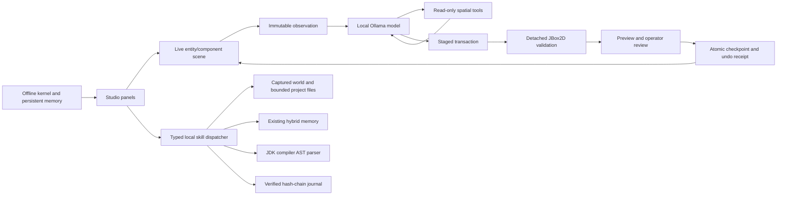

# Fraynix Studio system architecture

Edition020 extends the Java goal layer with a separate local-data computation family, typed family-specific model tools, an explicit imported-source binding and real chart/audit outputs. The data handler does not acquire physics/model ownership; physical goals keep their native control guard. See [motion-data procedures](MOTION_DATA_PROCEDURES.md).

Edition 019 adds a Java-owned durable goal/procedure layer above the existing world model and native controller. The desktop performs registered browser/canvas effects and real canvas assertions; it does not decide physical success. See the [current goal/skill contract](GOALS_AND_SKILLS.md), including ownership, atomic checkpoints, nonce-bound effects, explicit restart recovery and current limits. The diagrams below retain the inherited Studio architecture for continuity.

## Components

`Main -> jade.Window -> Scene + Renderer + Physics2D + ImGuiLayer` is the graphical runtime. `FactorySceneAdapter` bridges authored scene components to the shared `FactoryWorld` representation.

`FactorySession` owns the project world, checkpoint store and kernel service. The factory runtime provides schemas, entity/component records, transactions and broad-phase spatial bounds. The kernel supplies task execution, validation, retrieval, persisted routing/memory and traces.

`FraynixWorkspace` manages background model observation and conversational inference. `FactoryModelService` uses the checked-in local-model catalog and existing Ollama adapter. UI availability is derived from `/api/tags`; residency comes from `/api/ps`.

`SceneAgent` captures a `SceneKnowledge` observation and runs a model/tool/validation loop. `SceneProposal` converts accepted operations to a staged transaction. `SceneSimulation` validates a detached candidate with real JBox2D. `SceneEditHistory` owns before/candidate checkpoints, receipts and restart-safe undo.

`LocalSkillDispatcher` adds five compiled local functions with versioned input/output contracts and explicit host capability grants. `FactorySession` supplies its immutable world snapshot to the worker. The Tools tab renders definitions and journaled results; the CLI can invoke non-world tools with explicit grants. No imported Markdown executes or grants authority. The Create model loop retains its existing protocol.

`MerkleAppendOnlyJournal` validates legacy/J2 history on load and before append. Cross-process locks serialize writers; forced staging and atomic replacement precede in-memory publication. Abandoned staging and unfinished tool calls remain visible. See [contracts and recovery](CONTINUITY_AND_SKILLS.md) for the limits of integrity evidence, explicit recovery and file-access checks.

## Data flow

1. Capture all serialized authored components, stable identities and relevant spatial/runtime metadata.
2. Freeze the observation and asset descriptions before background work.
3. Send a schema-constrained request to a selected local model.
4. Execute read-only spatial/component queries or validate its operation batch.
5. Return query results or validation failures to the model within the configured turn budget.
6. Present a validated draft and simulated trajectories for review.
7. Check the authored fingerprint again, persist the checkpoint, install the replacement and retain undo evidence.

Background changes to non-scene task/data records are retained at commit time. Camera and selection changes do not stale a draft; authored changes do. Replacement installs preserve the prior scene until initialization succeeds, and dispose replaced rendering buffers afterward.

## Boundaries

The editor's operation protocol is deliberately a fixed set of data changes. General kernel source-mutation classes are included as part of the imported kernel, but arbitrary source mutation and host execution are not exposed through the Create protocol. The entire older shell, biological topology, Rust substrate and speculative research documents are not booted by the desktop application.

The current CPU 120B test proves a local model can generate a proposal that this engine accepts and simulates. It does not prove automatic model routing, learned weights, full 128K context operation or human-goal correctness.
