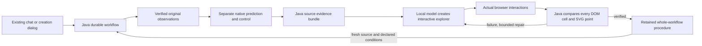
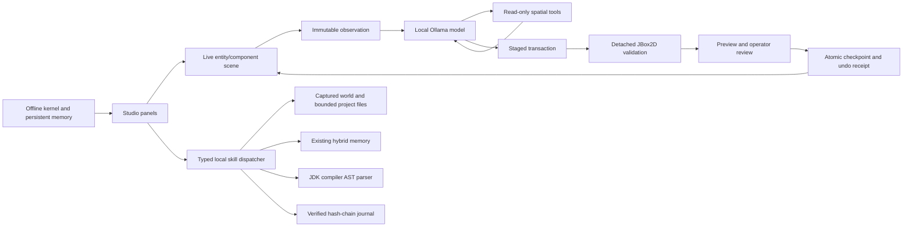

## Edition108 - published and fetched back

Published release 0f9a399285bb071ca72d2fb55543b5448261dbdc; annotated readme-108 tag object 76fb8008e083d740b6899437b1cd4f62fd2099f6. Actual main/edition108/tag push fetched and verified: 1388 canonical sources, 34186 frozen hashes across108 editions and 3464 logical original archive entries. 126 distinct Java checks plus22 final affected rechecks,148 desktop checks,23 browser controls and28 altered-record refusals pass. Twelve actual expectations pass: seven completions including two abrupt recoveries and five required refusals. Prior recorder-boundary refusal and full331.632s costs retained separately; corrected fresh trial passes declared boundaries. Two cold clean/upgrade pairs retain all costs. Every original source/outcome gate retained. Actual images reviewed at1600/1100; guide at1440/390. Preserve private worlds and frozen editions; no delegation. [Publication receipt](PUBLICATION_108.json).

2026-11-10. Isolated S:/Codex-Work/fraynix-workspace-edition108; parent c294d77f. Explicit orchestration-only qualification transition from genuine107 browser-qualified originals. Exact old supervisor/dependency/proof/publication lineage rechecked at admission, recovery, handoff and before saving. Five fresh examples and selected report pass original gates. Silent qualification, refresh and old-procedure reuse refuse; unsupported dependencies and chained transitions refuse. Actual12 requests: seven completions, two abrupt recoveries, five required refusals; zero planner/generation calls.126 distinct Java checks plus22 final affected rechecks,148 desktop,23 browser controls and28 altered-record refusals pass. Initial recorder-boundary refusal retained with full costs; corrected actual-state recorder reruns all12 requests fresh. Two cold clean/upgrade pairs retain all costs; no equal-bank speedup or training claim. Eight compiled helpers and two104 resources unchanged. Private worlds/frozen001-107 preserved; no delegation; heavy work serial. Next: growing-bank capacity/maintenance and explicitly versioned changed-verifier transitions. Main/tag publication and fetched verification completed; remote CI status is recorded separately in the receipt.

## Edition107 — published and fetched back

Published release 5058a6ca4d5b0165f1cb100c9679a4eba56b25d3; annotated readme-107 tag object ca692291a9f5611e20b7d0bf098a881be256449e. Actual main/edition107/tag push fetched and verified: 1380 canonical sources, 33323 frozen hashes across107 editions and 2178 logical original archive entries. 118 Java methods,148 desktop checks,23 browser controls and30 altered-record refusals pass. Fifteen actual request expectations pass:13 completions including eight abrupt numerical recoveries and two required source refusals. Two paired cold refresh/recheck repetitions retain full costs. Every original source/outcome gate retained. Actual screenshots reviewed at1600/1100 pixels and offline guide at1440/390. No delegation; preserve private worlds and frozen earlier editions. [Publication receipt](PUBLICATION_107.json).

2026-11-10, America/Los_Angeles. Isolated S:/Codex-Work/fraynix-workspace-edition107. Explicit full qualification refresh retains dependencies and old proof references, rechecks originals before new work/recovery/completion, runs five fresh examples and publishes selected data through original gate. Default recheck retained. Actual15 requests:13 completions including eight abrupt numerical recoveries after report-input persistence; two altered-source admissions refuse with original106 reason and zero planner retry. Two paired cold recheck/refresh repetitions at genuine bank1; full preparation/caller/browser/restart/refusal costs retained.118 Java,148 desktop,23 browser controls and30 altered-record refusals. Seven existing compiled classes and summary104 resources unchanged; WorkflowRunner identity changes explicitly. No generated content or weight training. No selective refresh of changed implementations claimed. Private worlds and frozen001–106 preserved. No delegation; heavy work serial. Next: explicit changed-dependency qualification transitions with fresh evidence and costs. Main/tag publication and fetched verification completed; remote CI status is recorded separately in the receipt.

## Edition106 — published and fetched back

Published release 6b4967d4a64a2e9dd025ab5b5589bc839bcff9f9; annotated readme-106 tag object 655b9cd1501dbe2a6cc78986a949f133e3485258. Actual main/edition106/tag push fetched and verified: 1371 canonical sources, 32788 frozen hashes across106 editions and 2885 logical original archive entries. 110 Java methods,148 desktop checks,23 actual browser controls and26 final plus6 preliminary altered-record refusals pass. Fourteen actual request expectations pass: eleven completions and three required refusals, plus five invalid import refusals. Cold refusal and abrupt recovery checked; all original source/outcome gates retained. Actual screenshots reviewed at1600/1100 pixels and offline guide at1440/390. No delegation; preserve private worlds and frozen earlier editions. [Publication receipt](PUBLICATION_106.json).

2026-11-10, America/Los_Angeles. Isolated S:/Codex-Work/fraynix-workspace-edition106. Authentic Java workflow admission refusals persist the original reason and exact current effect authority; no planner retry, Resume refused, exact late receipts cannot mutate result/context. Foreign/stale/browser-forged refusal rejected; ordinary interrupted recovery remains. Actual cohort: one qualification preparation and ten numerical reuse completions; derived overflow plus two changed-proof admissions refuse; five invalid imports refuse. Cold refusal and abrupt data-boundary recovery pass. 110 Java,148 desktop,23 actual browser controls and26 independent altered-record refusals. Eight compiled classes and summary resources unchanged; GoalRunner freezes the durable numeric representation before producing exact reserved inputs. Its new runtime identity is explicit; a genuine old binding is refused. No generation/planner calls or training claim. Initial seven successes plus tiny-scale serialized-input refusal retained with full costs; final fresh cohort is separate. All costs and originals retained. Private worlds and frozen001–105 preserved. No delegation; heavy work serial. Next: explicit dependency-based qualification maintenance measurements, keeping all checks. Main/tag publication and fetched verification completed; remote CI status is recorded separately in the receipt.

## Edition105 — published and fetched back

Published release 66ce7891cb14a6e1a50515d0f60b4399678d8b97; annotated readme-105 tag object 896f64fa7f3628c756fc6238919399f585f67ae2. Actual main/edition105/tag push fetched and verified: 1363 canonical sources, 32132 frozen hashes across105 editions and 3724 logical original archive entries. 102 Java methods,148 desktop checks,23 actual browser fixture controls and30 final plus6 prior-failure altered-evidence refusals pass. Seventeen actual request expectations pass: fifteen completions and two required refusals. Genuine collection preparation and cold bank0/4/8 probes retain full costs; abrupt recovery retains original child identities. Application captures reviewed at1600/1100 pixels; offline guide at1440/390 pixels. No new delegation; preserve private worlds and frozen prior editions. [Publication receipt](PUBLICATION_105.json).

2026-11-09, America/Los_Angeles. Isolated S:/Codex-Work/fraynix-workspace-edition105. Java-owned durable supervisor automates five explicitly synthetic qualification cases through unchanged104 workflows, then verifies selected data and publishes through the original104 gate. Fifteen actual requests completed; displayed corruption and altered retained proof refused. Eight genuine preparation publications, six cold-copy probes at bank0/4/8, one abrupt recovery with stable original child IDs. Full preparation, caller, restart and refusal costs retained; two repetitions, no causal speedup claim. 102 Java,148 desktop,23 actual browser controls and30 final plus6 prior-failure altered-record refusals pass. Five verifier classes and104 resources unchanged. No content generation or weight training. Known limitation: altered-proof refusal records the original source error, then one failed82.1544ms planner fallback obscures it in chat; no workflow or procedure is created. Preserve that cost and fix terminal reporting next. Separate16-supervisor history; executable20/native64/procedures32/version8 limits remain;1200s awake/three resumes. Preserve private worlds, old worktrees and frozen001–104. No delegation; heavy work serial. Initial host Resume ownership defect fixed and fresh final cohort rerun; prior14 successes plus failed recovery26.608s retained separately. Read README105 and contract. Next: broader numerical/mapping cases and explicit dependency-based refresh measurements. Main/tag publication and fetched verification completed; remote CI status is recorded separately in the receipt.

## Edition104 — published and fetched back

Published release 80d27cf6271bc2497c74ea3190517897d9a79a26; annotated readme-104 tag object 848c134e8ed3edc7bbda07c232b958fc4829f71f. Actual main/edition104/tag push fetched and verified: 1356 canonical sources, 31268 frozen hashes across 104 editions and 368 logical original archive entries. 93 Java methods, 141 desktop checks, 23 actual browser fixture controls and 20 altered-evidence refusals pass. All eleven measured trial expectations pass: nine completions and two required refusals. Actual application captures reviewed at 1600 and 1100 pixels; offline guide checked at 1440 and 390 pixels. Harness collection failure and developer-assisted reopen remain in measured costs. No new delegation; preserve private worlds and frozen prior editions. [Publication receipt](PUBLICATION_104.json).

2026-11-09, America/Los_Angeles. Isolated S:/Codex-Work/fraynix-workspace-edition104. Nine actual chat workflows completed; early retention and injected displayed corruption refused. Java-owned input-driven summary: all six values, quality and chart from fresh normalized input/criteria; no expected metric answers supplied to renderer, zero content-generation calls. Not model-generated or trained. Five original varied-data proofs checked before held-out37 retention; cold mapped reuse and abrupt109-row recovery verified. Preserve original verifier class bytes, private worlds and frozen001–103. Old103 runner-bound identities are not relabelled. No delegation; heavy work serial. Read README104 and contract. Next: broader numeric cases and measured qualification cost, then explicit automatic qualification with provenance. Main/tag publication and fetched verification completed; remote CI status is recorded separately in the receipt.

## Edition103 — published and fetched back

Published release b9de5241fbb551c57f33e81364ec2a3a950dbba9; annotated readme-103 tag object 9d5eb7a1cb14eac5d74dccd09591794760b4bbef. Actual main/edition103/tag push fetched and verified: 1347 canonical sources, 31009 frozen hashes across 103 editions and 517 logical original archive entries. 88 Java methods, 141 desktop checks, 23 actual browser fixture controls and 16 altered-evidence refusals pass. All six measured trial expectations pass: three completions and three required refusals. Presentation reviewed separately at 1600 and 1100 pixels; offline guide checked at 1440 and 390 pixels. No new delegation; preserve private worlds and frozen prior editions. [Publication receipt](PUBLICATION_103.json).

2026-11-09, America/Los_Angeles. Isolated S:/Codex-Work/fraynix-workspace-edition103. Three actual reuse requests completed and three were refused as required. All six retain exact original102 model code; no new generation calls. Fresh data reports, new artifact identities, behavior receipts and independent audits remain mandatory. Recorded52 survived abrupt Java interruption and explicit Resume; its saved descendant survived cold restart and handled96-row reversal and32-row flat synthetic inputs. Strict quality, actual injected cell corruption and hardcoded summary16 all refused; no failed skill promoted.

Source/outcome verifier classes from101/102 are byte-identical. New103 protocol identity and exact ancestry are separate; eight-link bound. Refused reuse cannot silently regenerate or bypass independent failure on Resume. Original private worlds and frozen001–102 remain untouched. No delegation; heavy work serial. Read README103 and docs/EDITION_103_CONTRACT.md. Next: input-driven summary and quality contract, held-out reuse checks, then measure reuse-versus-regeneration costs. No weight-training or matched speedup claim. Main/tag publication and fetched verification completed; remote CI status is recorded separately in the receipt.

## Edition102 — published and fetched back

Published release 8754da63bbb5f76625d99605138955ca9f782862; annotated readme-102 tag object 565692f87275d2dbc257da631673e0f41662aa53. Actual main/edition102/tag push fetched and verified: 1339 canonical sources, 30711 frozen hashes across102 editions and 844 logical original archive entries. [Publication receipt](PUBLICATION_102.json).

2026-11-09, America/Los_Angeles. Isolated S:/Codex-Work/fraynix-workspace-edition102; summary cohort began at 87bf1ff67d6c98f210ccd8a1099afc4924a8212d; final runtime receipt source 4d0f2a2c42b98686fb8fa83694fa3354f62d49cc. Three measured explorer tasks and one new49-row motion summary completed; three summary requests, including changed-source16-row reuse, exhausted their draft limits and saved no new skills, with their full1708.308s,1668.589s and3927.334s retained. The52-row baseline first failed two drafts and the unchanged600s budget; explicit developer-assisted prompt correction/recovery is labelled, with originals and unfinished-call timing retained. The96-row injected display fault was rejected then repaired. The first summary exhausted all allowed drafts/resumes after JavaScript and missing-axis failures. Explicit resumes, adapter correction and all costs are retained as a failed request. Stronger explicit axis checks were followed by bounded actual missing-ID diagnostics, with Java and outcome checks unchanged for the browser change. Subsequent same-task Java retry-hint persistence is tested separately and the16-row continuation is labelled developer-assisted. The final fresh cohort is distinct from both exhausted requests. The new49-row summary/trace checks every original value and point in four filter states and its skill survives cold restart. Fresh16-row input binds correctly but all three generated drafts report range0.16m instead of total travel0.31m, even after explicit formula guidance; reuse is refused. Do not claim changed-input summary reuse succeeded. Legacy101 verifier bytes remain unchanged.

80 focused Java methods,135 existing desktop and10 additional checks pass;5 legacy,11 summary and7 diagnostic actual Chromium fixtures pass. Independent original/journal/accounting inspection passes with15 baseline,18 mixed-summary and6+7 prior-failure altered-evidence refusals. No matched speedup or weight-training claim. Complete cost is dominated by actual local generation; next test verified implementation reuse with full fresh-source/outcome checks. CPU-only/four-thread model policy preserved.

Keep private live045/qa046, earlier worktrees and frozen001–101. No new delegation; heavy work serial. Main/tag publication and fetched-content audit completed. Post-push CI is separate. Parent CI42613246058 is completed/success; do not call pending CI passed. All owned102 tests are closed. See README102, contract and lossless originals.

## Edition101 — published and fetched back

Published release a80bf42a6e7659d40ae4a3f0e375779e62eab005; annotated readme-101 tag object 29104d2c9844673aeb933b9c16d4c54ed001caa2. Actual main/edition101/tag push fetched and verified: 1321 canonical sources, 30283 frozen hashes across101 editions and 167 logical original archive entries. [Publication receipt](PUBLICATION_101.json).

2026-11-09, America/Los_Angeles. Isolated S:/Codex-Work/fraynix-workspace-edition101; cohort source cbe941e65835d7e02cdcfed63f061b0d7c4e94fa. One registered Java data→creation workflow now binds selected recorded input, verifies analysis, generates content with actual local gpt-oss:20b and independently checks four table states before saving the whole procedure. Abrupt Java interruption after data, explicit resume, cold restart and fresh52-row reuse are verified. All quality flags remain. CPU-only/four-thread model policy preserved.

60 final focused Java methods pass, plus7 prior typed-graph regressions;135 existing desktop and7 selection/new checks pass;5 real Chromium fixture controls and8 altered-evidence refusals pass. The expanded earlier run failed one pending-repair restart check; its original failure is retained. Independent read-only review found and helped fix action-only audit calls, receipt cache ordering, skill-publication ordering and old-receipt repair bypass. No generic visibility, efficiency, weight-training or physical-generalization claim.

Preserve private live045/qa046, previous worktrees and frozen001–100. The user authorized the single independent reviewer; no other delegation. Heavy/native/model work serial. Main/tag publication and fetched-content audit completed. Post-push CI is separate. Parent CI42604303817 is recorded separately as in_progress/None. Next: complete-task cost cohorts, additional explicit contracts, clipping/overlay checks and bounded history archives.

## Edition100 — published and fetched back

Published release e2ba11fdcdbd3929bbc9c57d929911e4c0588296; annotated readme-100 tag object 566d4c2cb2c7904d207c87dbb042d75972991f66. Actual main/edition100/tag push fetched and verified: 1312 canonical sources, 30120 frozen hashes across100 editions and 209 logical original archive entries. [Publication receipt](PUBLICATION_100.json).

2026-11-09, America/Los_Angeles. Isolated S:/Codex-Work/fraynix-workspace-edition100, branch edition100. Edition100 adds explicit visible CSV selection and Java-verified data-to-creation lineage. Pinned input survives browsing and is reverified on restart. The completed local gpt-oss:20b cohort analyzes 49 recorded rows, creates a real filter/reset explorer, restarts, then reuses both saved procedures with 52 rows and tighter quality limits. The source-derived behavior contract is supplied through the existing creation dialog; it is not model-authored verification. All quality flags remain attached.

40 focused Java methods, 135 existing desktop checks, four new selection checks and independent original/source/rendered-outcome inspection pass. Five altered-evidence variants are refused. Actual wide/narrow views, source clearing/replacement, keyboard access and restart restoration are captured. Final UI source2e36b493 compacts the source summary with Mission open, preserving all chat controls; layout was rechecked and all compiled inputs/JARs match the actual model cohort. The initial model generation exceeded its unchanged budget and saved no skill; it remains archived. Independent inspection assumptions and a restored-view navigation race were corrected, with original failures retained. No efficiency, weight-training or physical generalization claim.

All owned100 test apps are closed; original live045/qa046 projects and model GPU policy remain unchanged. Canonical publication target remains eyeoverthink/Fraynix-Agent-Workspace. Main/tag publication and fetched-content audit completed. Post-push CI is separate. Parent CI42593795811 is recorded separately and was still in progress at the last check; do not call it green. Preserve prior001–099 releases. No subagents; native/model work serial. Do not rebuild a running installation. New-computer setup on fraymus-home is separate.

Next: durable multi-stage chat goals for supported analysis → creation → inspection → skill saving, with explicit contracts and fresh-input checks. Test restart between stages and changed sources, then complete task costs. Keep Java authority, integrated views, all source/outcome checks and retained failures.

## Edition099 — published and fetched back

Published release 1bd6522383c9a564652c6ca23ddb379913bbd71a; annotated readme-099 tag object 21eef9881762fbfc45a208c7d6d76f04b124d48c. Actual main/edition099/tag push fetched and verified: 1304 canonical sources, 29955 frozen hashes across99 editions and 321 logical original archive entries. [Publication receipt](PUBLICATION_099.json).

2026-11-09. Isolated S:/Codex-Work/fraynix-workspace-edition099, branch edition099; actual cohort source 71712af35f6572103de2614b5baa01a86adb569d. Edition099 makes the same integrated workspace easier to use and tests complete world, recorded-data and creation requests through the installed local gpt-oss:20b model. A fourth request reuses a saved data procedure after a cold restart. 55 focused Java methods and 135 desktop checks pass; layout/restart and four actual-model tasks pass. Independent native originals and four altered-evidence refusals pass. Three saved skills survive restart; one is reused on changed recorded input. Larger resizable chat, retained display transcript and actual task summaries preserve the integrated app. Optional sealed model planning is off by default. Initial harness failures and zero-model direct world result retained. Parent CI 42582181920: in_progress/None; no false CI success. Final UI source5177d38f preserves the composer during Mission and selects the matching preview tab. All owned099 test apps are closed; original live projects remain untouched. Main/tag publication and fetched-content audit completed. Post-push CI is separate.

Keep Java authority, all original/outcome checks, live045/qa046 private data and frozen001–098. No subagents; heavy/model/native work serial. No physical generalization or weight-training claim. Next: clearer selected inputs and connected data-to-creation workflows, tested with real requests and changed inputs.

## Edition098 — published and fetched back

Published release 3bf91945547bf1a07c8f6264a5dc4d928a2b030d; annotated readme-098 tag object aa10685de747e592f5f946e07d72b94c06ede299. Actual main/edition098/tag push fetched and verified: 1297 canonical sources, 29710 frozen hashes across98 editions and 4974 logical original archive entries. [Publication receipt](PUBLICATION_098.json).

Default adaptive requests now require evidence that remembered procedures repay their extra work. 12/12 fresh evaluation tasks completed, with 3 explicit recoveries and 3 saved skills.

Native sourcef2fe986842242d238b9674a197c3b4385149c262; isolated S:/Codex-Work/fraynix-workspace-edition098. 38 original tasks independently inspected; 11 altered-evidence refusals. See README098 for actual comparative costs, conservative allowances and limits. Current parent CI attempt 2: in_progress/None; original HTTP504 failure retained. Keep Java ownership, every source/outcome check, private live data and frozen001–097. No subagents; heavy work serial. Main/tag publication and fetched-content audit completed. Post-push CI is separate.

## Edition097 — published and fetched back

Published release ea96b4de40961cd0fea6123b3dcb5ae7b14986c0; annotated readme-097 tag object c7d239f600981c70f357c681387387d56683e4ef. Actual main/edition097/tag push fetched and verified: 1288 canonical sources, 28611 frozen hashes across97 editions and 1244 logical original archive entries. [Publication receipt](PUBLICATION_097.json).

**24/24 sequence goals completed; 8 interruptions were explicitly recovered. 4 saved procedures executed after reopening.** Across both blocks, memory took 200.53 s longer over complete streams and 291.14 s longer after charging preparation once.

Study source 32915b05745f5663c45bcf6ef914d9f17e3ef1af; parent CI42554061175 passed. 90 Java methods passed, 1 skipped;135 desktop,11 accounting and29 altered-evidence checks pass. All 334 production engine classes match096. Work in S:/Codex-Work/fraynix-workspace-edition097. Preserve live045/qa046/private data and frozen001–096. No subagents; heavy checks serial. No new fit or model inference. Next: measured bottleneck improvement with matched coverage; recovered external times remain ineligible for training. Actual main publication and fetched-content audit completed. New-head CI is separate.

Edition096 restores the full verification path; production motion and original outcomes are unchanged. [Results](../README-096.md).

Edition095 measures complete mixed tasks, recovery and saved skills without changing production Java classes. [Results](../README-095.md) · [Contributor contract](../README-CONTRIBUTORS.md).

Edition094 verifies three-stage recovery under abrupt owned-process termination, fixes native atomic replacement retries and adds an explicit closed093 frame handoff. All outcome checks remain. [Results](../README-094.md) · [Current contributor contract](../README-CONTRIBUTORS.md).

Edition093 verifies a new forecast from recovered state before later actual motion. Original predictions and all source/outcome checks remain. [Results and limits](../README-093.md).

Edition092 validates the unchanged091 runtime against growing verified banks and actual interrupted tasks. Whole caller time includes restart; partial resumed costs remain excluded from calibration. [Results and limits](../README-092.md).

Edition091 reuses only canonical fingerprints of identical authenticated native envelopes. Every read retains full-byte checking and fresh JSON; all existing motion/outcome/report/commit checks run. [Measured results and limits](../README-091.md).

# Fraynix Agent Workspace system architecture

Edition089 integrates source-verified owned paired timing into Java memory selection, with conservative original085 fallback and measured twelve-task sequences. The original fitting gate and all outcome checks remain active. [Measured results and limits](../README-089.md).

Edition088 adds read-only resource compatibility visibility to cost review, with actual CPU/heap-change and counterfactual payoff tests. The original gate and all outcome checks remain unchanged. [Measured scope and results](../README-088.md).

Edition087 adds owned actual fit/task-check observations and bounded workload-matched empirical allowances before new fitting. Existing original verification remains authoritative; missing or changed observations fall back explicitly. [Results and limits](../README-087.md).

Edition086 adds a Java cost gate before new calibration fitting. Bounded summary proposals may decline spending; positive proposals still enter the unchanged authoritative verifier. Explicit horizon/cost allowances, durable decision receipts and a simple-control recommendation are integrated in the world controls. [Results and limits](../README-086.md).

Edition085 binds an optional exact compatible procedure through Java, confirmed world controls, chat transport and saved skills. Calibration retains real outcomes, records bank size and fitting cost, widens uncertainty beyond measured bank sizes, and reports conditional repayment. Original native verification remains. [Results and limitations](../README-085.md).

Edition 084 adds grouped repeated complete-cost estimates to Java procedure selection, with unchanged motion/commit checks. Two nearby distinct tasks require three independent comparisons each; workload, receipt, proof-state and implementation identity remain exact. See [results and limits](../README-084.md).

Edition 083 adds read-only Java calibration coverage after original evidence checks. Runtime, restart and saving conditions stay separate; no action authority changes. See [measurements and boundaries](../README-083.md).

Edition 082 adds validated Java launch limits and read-only resource counters. Existing native outcome and world-commit authority is unchanged. See [current measurements](../README-082.md).

## Current edition081: bounded parallel calibration evidence

[Edition081](../README-081.md) keeps the existing selection and outcome authority. `CalibrationScan081` uses two Java readers to run original `ProofMemo078.snapshot` checks; `WorldProcedure079` joins them before comparing ordered evidence, retaining implementation and paired-cost arithmetic checks at all existing boundaries. One batch in flight, no persistent trust or timestamp shortcut. Failed or interrupted reads cannot authorize an estimate. Operational diagnostics measure loads, elapsed loader/hash time, failures and successfully verified bytes; they do not replace physical evidence. Normal runtime uses two readers, with an isolated-test-only serial comparison. Complete-task timings and original physics/controller/verifier/WorldLedger behavior are unchanged.

## Edition080 foundation: complete-task cost calibration

[Edition080](../README-080.md) measures the existing durable procedure's full Java completion interval. `TaskCost080` matches owned completed controls and estimates empirical savings; `WorldProcedure079` persists timing/model/source provenance; `GoalRunner` owns the monotonic lifecycle clock and saving workload. The existing persistent-world panel reviews explicit comparison pairs. Original physics, native controls/verifiers, WorldFrames and WorldLedger remain unchanged. A cost estimate cannot authorize motion. Interrupted timings are excluded; retained models cannot substitute warm measurements for cold proof work or a different saving workload. Evaluation stays outside calibration.

## Edition079 foundation: selective memory and durable world goals

[Edition079](../README-079.md) connects chat and saved skills to the existing Java goal runner. `Procedure079` owns cost decisions/current-frame task checks; `Waypoints079` proposes bounded targets; `WorldProcedure079` owns staged native forecasts, distinct actual execution, evidence, bounded recovery and memory. Existing host checks verify the actual report. `WorldLedger` commits one measured final revision; `WorldExport079` preserves all stages. Owned exact-byte proof trust is boot-local; skills and verified worlds persist. The frozen unfamiliar-task comparison measures whole-task costs against simple and always-memory controls. See the current README for results and qualified limits.

## Edition078 foundation: verified proof reuse

[Edition078](../README-078.md) adds a bounded Java proof cache and byte-verified proof receipts. `ProofMemo078` retains compact successful source-bound checks; `ProcedureStudy078` alone executes fresh native forecast/actual programs, carries measured frames and seals training-only receipts. `Procedure078` owns recipe, retrieval and claim rules. The integrated panel shows full/reused proof counts and lookup/audit/hash timings alongside actual native motion. Simple, geometry, uncached and cached memory share the same repertoire; the study does not promote a controller or mutate an active world. Existing controller, physics and verification remain authoritative. See the current README for measured utility, wall time and training-inclusive outcomes.

## Edition077 foundation: obstacle-aware verified procedures

[Edition077](../README-077.md) adds a bounded Java clear-landing search and source-bound waypoint receipts. `Waypoints077` proposes intermediate poses and previews geometry locally; `ProcedureStudy077` alone executes fresh native forecast/actual programs, carries measured frames and seals training-only receipts. `Procedure077` owns recipe, retrieval and claim rules. The integrated panel distinguishes planned targets from recorded native motion. Simple and geometry controls share the same repertoire as memory; the study does not promote a controller or mutate an active world. Existing controller, physics and verification remain authoritative. See the current README for measured utility, wall time and training-inclusive outcomes.

## Edition076 foundation: verified procedures

The persistent-world panel now includes an isolated Java procedure study. `Procedure076` defines five typed recipes, component ranking and whole-task checks; `ProcedureStudy076` owns training, freezing receipts, matched evaluation, recovery and exact exports. Each staged handoff uses `WorldFrames` measured position, rotation, velocity and elapsed time. Original native controller and verifier code remain unchanged; hidden contact manifolds are not continuously restored.

The bank contains only complete, independently executed and verified training procedures. New-task use still requires a fresh forecast and actual execution. The fixed-order and geometry controls have the same procedure repertoire as memory. This study does not automatically publish a skill to the general registry, mutate an active world or grant arbitrary chat execution. See [edition076](../README-076.md), its [frozen contract](EDITION_076_CONTRACT.md) and [original evidence](readmes/076/original-evidence.json) for measured scope and next integration gates.

## Ownership foundation from edition044: one Java owner, visible missions

Every active chat route and native-procedure selection now uses the existing durable Java queue. Java owns semantic routing, selected sources, typed stages, child goal/workflow identities, model contracts/code generation, actual outcome checks, cancellation and recovery. The desktop hosts the real browser/canvas/camera and formats observations. It contains no active chat-planning model call. [Ownership and operating details](JAVA_CHAT_044.md).

The existing timeline now switches between Activity and Mission. Mission reads actual Java goal, source/version, child status, history/hash, retained skill and result; its controls stop/resume the real task and refuse opening a later artifact revision as the original result. Normal Game Lab is already integrated using the original Java renderer with its native window hidden and editor uninitialized. Source-qualified screenshot/vision behavior from043 remains. [Concept and production sequence](EDITION_044_VISION.md). Earlier edition sections below retain their dated scope; the044 contract supersedes earlier ownership/window descriptions.

## Edition043: Java workbench ownership and visual evidence

Ordinary browser/canvas chat and saved-recipe scheduling now run through the durable Java Agency043 queue. The desktop executes authenticated surface claims. Original before/during/after PNGs retain source/version/time/hash metadata; owned JDK pixel descriptors and differences support tested visual references. Optional installed local vision is an untrusted estimate. Actual current artifact checks control completion. The earlier043 specialized-agent limitation is superseded by044 Java coordination; existing physical/perception controllers and surface adapters remain. [Operation and scope](JAVA_VISUAL_AGENCY.md).

## Edition042: one continuing Java agent

A project-owned headless Java process now holds identity, per-boot clocks, checked shared neural state, bounded sensory replay, observation freshness and a segmented integrity witness. The existing interface reconnects under a single renewable lease. Pure Java goals continue without it; unfinished claimed host actions require explicit Resume. The primary Game Lab button uses the integrated original renderer rather than a separate editor. Existing Electron/browser hosting and native Bullet dependencies remain; no new neural framework is introduced. See [operation and recovery](CONTINUING_JAVA_AGENT.md) and [README042](../README-042.md).

## Edition040: shared Java spatial runtime and integrated views

Java adapts actual source identities/poses from native ledger/live ownership, original game and separate recorded mat observations. It computes camera projection, clipping and picking; the shell draws integrated linked views and matching original game raster. Typed read/project/report tools pin one source and verify an actual saved artifact. Coordinate frames, action authority and unknown depth remain explicit. See [operation](SHARED_SPATIAL_RUNTIME.md) and [README040](../README-040.md).

## Edition039: operational self-model and persistent object knowledge

Java registers actual host capabilities and injects compact current state into every planning request. Durable human-associated object identities retain original observation/native provenance. A lease-fenced Java job coordinates one separate unprivileged browser worker for actual bounded public research, cached citations and checked reports. Human labels, observations, native state and untrusted web references remain distinct. See [operation and limits](OBJECT_KNOWLEDGE.md) and [README039](../README-039.md).

## Edition032: native experience with a reserved decision

The existing shared Java runner now owns a frozen force-learning experiment.
Four training scenes and four candidate caps produce16 actual native trials;
the training-only choice commits before eight paired reserved comparisons.
The031 controller and all original physical limits remain unchanged. Every raw
native run is hash-bound and re-audited;72 actual table cells and three paired
chart modes precede task completion. Explicit same-job recovery preserves settled
trials and the original selection. Conditional activation requires original
gates and report evidence; new pushes opt in visibly. Current24N candidate is
rejected (success5/8→5/8, effort ratio1.262196165); baseline8/32N stays active.
Rollback persistence has a separately labelled software control; successful
native candidate activation is not claimed. See [native experience](NATIVE_EXPERIENCE.md).

## Edition031: approach planning and contact-driven tasks

The existing Spatial interface now binds an actual crate and upright pusher.
The shared Java runner freezes original source/roles/force budgets, searches joint
configurations, verifies standing approaches and executes bounded forces only on
the pusher. Real native contacts move the crate. Measured stalls trigger finite
retreat/reapproach inside the original cap. Both dynamic bodies, full plan,
controller and original evidence checkpoint atomically for explicit same-run
recovery. Independent native ledger/outcome checks and all six real chart modes
plus exact visible original data precede skill retention. Chat supplies semantic
conditions and host-controlled default preservation. Existing030 Map checkpoint
classes remain byte-identical. See [native pushing](NATIVE_PUSHING.md).

## Edition030: recoverable native map state and declared materials

The existing Java map owner commits body pose/orientation/linear/angular velocity, controller progress, settling, disturbance and full trace before corresponding live observations. Explicit compatible recovery continues the same run and independently compares actual initialized native state. Contact caches rebuild. Declared palette floor properties drive native friction/restitution and Java drag; separate per-tick audits reconstruct position, work/effort, kinetic energy and impulse. Nine actual report charts and visible material/work data precede skill retention. Completed reports retain original contents. Chat reuse preserves saved material defaults unless explicitly replaced. See [native recovery/material contract](NATIVE_MAP_RECOVERY.md) and [edition030 evidence](../README-030.md). Next: native pushable-object planning and complete dynamic-body recovery, then layer transitions and independently evaluated policy promotion.

## Edition029 runtime additions

The existing map pipeline now accepts an explicit global graph contract. A JDK-only selector retains original adjacency candidates and performs a complete independent floor-graph audit before native play. Coverage, original-endpoint shortest routes, components, graph edges/cycle rank and rejection reasons remain source-bound. The shared goal/Skills path verifies native traces, all six interactive charts and visible original topology data. Partial reuse preserves saved global defaults. Original028 generation and published package reconstruction remain intact. See [global map topology](GLOBAL_MAP_TOPOLOGY.md).

The first frozen reserved comparison is1/12→5/12 globally accepted, with native passes for all five accepted new worlds and seven retained rejections. Budgets differ and no threshold was changed after inspection. This is explicit constraint enforcement and conditional physical verification, not automatic model training or universal map completion. Compatible native map checkpoints are now implemented in030; the frozen029 comparison remains unchanged.

## Edition028 runtime additions

The existing workspace now connects original reference PNGs to a Java adjacency model, bounded seeded grid repair, actual native colliders and a force-controlled avatar. `map-world-v1` uses the shared durable goal runner and existing procedure registry. The model selects typed semantic options; Java owns source identity, physical timing, trace verification and six interactive chart-frame checks. The Maps view provides actual manual and agent play, source confirmation, reconstruction-checked JSON import/export and original dungeon-layer selection. See the [reference-map world contract](REFERENCE_MAP_WORLDS.md).

Original2D–4D dungeon coordinates remain complete. An explicit layer compiles into a separately declared three-axis physical world; hidden source axes are never unioned. Time, material parameters and relationships remain named state variables. Manual input is run-bound and expires; legacy incomplete native motion without a checkpoint becomes a separately recorded attempt;030 compatible checkpoints continue the same map run. Completed evidence and stable report identities can be reused without repeating physical effects. Palette semantics and scale are declared, not inferred real-world measurements. Learned adjacency, reactive control and retained procedures have distinct roles; this edition does not train Ollama weights.

## Edition027 runtime additions

The current workspace retains Java-owned durable goals and the existing desktop browser/canvas. The new checked-in `geometry-core` module computes seeded mathematical geometry without a rendering/runtime dependency beyond the JDK. `procedural-space-v1` adds frozen inputs, cooperative computation, independent topology/navigation checks, actual original-coordinate view auditing, retained procedures and reconstruction import to the shared goal runner. See the [runtime contract](PROCEDURAL_SPACE.md) and [tutorial analysis](PROCESSING_ALGORITHM_REFERENCE.md).

Chat selects bounded semantic options; it cannot supply result coordinates or completion flags. Original N-D data, four recorded projections, slices and growth/path state remain distinct. The supported2–16D vector/colony calculations and2–4D grids do not add physical dimensions to Bullet or establish calibrated real-world fidelity.

New evidence workflows opt into `responsive-v1`: the private desktop host observes the exact artifact in unprivileged780/390px Chromium views, and Java verifies geometry/legibility alongside the unchanged source-cell and native-plot checks. Layout failures use the existing bounded repair budget. The probe does not replace CSS. Historical workflows keep their frozen profile. These additions preserve the separate game, physics, browser, perception and creation interfaces documented below.

Edition026 adds a durable `evidence-workflow-v1` parent over the existing data, native world and creation goals. Stable owned stage intents reconcile restart; completed evidence is revalidated and reused. Java reconstructs an original-source bundle and independently checks every rendered table cell and both native SVG traces before whole-workflow retention. The existing canvas, goal card and Skills library provide entry/reuse; observation data and native simulation remain explicitly separate. See [evidence workflows](EVIDENCE_WORKFLOWS.md).

Edition025 adds `creation-web-v1` to the same Java goal/procedure registry. Edition025 initially supplied generation through the desktop;044 moves admitted generation into Java. The desktop still supplies actual canvas interactions through private leased effects; Java pins source/model/checks, owns artifact versions, validates observed receipts, bounds repairs and reconciles restart. Passing procedures can regenerate and verify on a fresh selected CSV. See [durable creation](DURABLE_CREATION.md). This extends the current layout and creation canvas; it does not install generated host handlers or train LLM weights.

Edition024 adds pure Java temporal feature tracking, visible motion diagnostics and new reserved-footage evaluation. The candidate improves all three clips but fails the unchanged coverage/false-visible gates, so baseline remains active. Old profiles and pinned goals/skills remain installed; the new adapter retains the unchanged earlier scorer. See [temporal tracking](TEMPORAL_TRACKING.md) for actual computations, source freeze, results and limits.

Edition023 adds a Java-owned tracking research loop: immutable original-frame/mask import, frozen profile comparisons, separate reference scoring, fixed promotion gates, persistent rollback and implementation pins on browser goals/skills. The real recorded-sequence candidate fails and remains rejected; synthetic controls verify lifecycle without being presented as real-world improvement. Chat selects the registered workflow; it cannot write predictions or thresholds. See [tracking evaluation](TRACKING_EVALUATION.md).

Edition022 adds browser perception as a fourth registered Java procedure: actual Chromium pixel capture, admitted local vision estimates, pure-Java appearance tracking, explicit persistent user corrections and source-fenced sampling/recovery. The browser renders outlines and broken observation trails; Java owns state, budgets and evidence. Page labels, model estimates and user-labelled examples retain distinct authority. See [browser perception](BROWSER_PERCEPTION.md). This does not replace the game, physics or spatial view, and does not train LLM weights.

Edition021 adds a separate source-qualified spatial box runtime, isolated native forward forecasts, actual constrained manipulation and a third shared goal/procedure family. Stable scene/object identity, explicit scale and source labels, report receipts and recovery are documented in [spatial worlds](SPATIAL_WORLD.md). This extends the integrated view without replacing the original game or learned ramp model.

Edition020 extends the Java goal layer with a separate local-data computation family, typed family-specific model tools, an explicit imported-source binding and real chart/audit outputs. The data handler does not acquire physics/model ownership; physical goals keep their native control guard. See [motion-data procedures](MOTION_DATA_PROCEDURES.md).

Edition 019 adds a Java-owned durable goal/procedure layer above the existing world model and native controller. The desktop performs registered browser/canvas effects and real canvas assertions; it does not decide physical success. See the [current goal/skill contract](GOALS_AND_SKILLS.md), including ownership, atomic checkpoints, nonce-bound effects, explicit restart recovery and current limits. The diagrams below retain the inherited Studio architecture for continuity.

## Components

`Main -> jade.Window -> Scene + Renderer + Physics2D + ImGuiLayer` is the graphical runtime. `FactorySceneAdapter` bridges authored scene components to the shared `FactoryWorld` representation.

`FactorySession` owns the project world, checkpoint store and kernel service. The factory runtime provides schemas, entity/component records, transactions and broad-phase spatial bounds. The kernel supplies task execution, validation, retrieval, persisted routing/memory and traces.

`FraynixWorkspace` manages background model observation and conversational inference. `FactoryModelService` uses the checked-in local-model catalog and existing Ollama adapter. UI availability is derived from `/api/tags`; residency comes from `/api/ps`.

`SceneAgent` captures a `SceneKnowledge` observation and runs a model/tool/validation loop. `SceneProposal` converts accepted operations to a staged transaction. `SceneSimulation` validates a detached candidate with real JBox2D. `SceneEditHistory` owns before/candidate checkpoints, receipts and restart-safe undo.

`LocalSkillDispatcher` adds five compiled local functions with versioned input/output contracts and explicit host capability grants. `FactorySession` supplies its immutable world snapshot to the worker. The Tools tab renders definitions and journaled results; the CLI can invoke non-world tools with explicit grants. No imported Markdown executes or grants authority. The Create model loop retains its existing protocol.

`MerkleAppendOnlyJournal` validates legacy/J2 history on load and before append. Cross-process locks serialize writers; forced staging and atomic replacement precede in-memory publication. Abandoned staging and unfinished tool calls remain visible. See [contracts and recovery](CONTINUITY_AND_SKILLS.md) for the limits of integrity evidence, explicit recovery and file-access checks.

## Data flow

1. Capture all serialized authored components, stable identities and relevant spatial/runtime metadata.
2. Freeze the observation and asset descriptions before background work.
3. Send a schema-constrained request to a selected local model.
4. Execute read-only spatial/component queries or validate its operation batch.
5. Return query results or validation failures to the model within the configured turn budget.
6. Present a validated draft and simulated trajectories for review.
7. Check the authored fingerprint again, persist the checkpoint, install the replacement and retain undo evidence.

Background changes to non-scene task/data records are retained at commit time. Camera and selection changes do not stale a draft; authored changes do. Replacement installs preserve the prior scene until initialization succeeds, and dispose replaced rendering buffers afterward.

## Boundaries

The editor's operation protocol is deliberately a fixed set of data changes. General kernel source-mutation classes are included as part of the imported kernel, but arbitrary source mutation and host execution are not exposed through the Create protocol. The entire older shell, biological topology, Rust substrate and speculative research documents are not booted by the desktop application.

The earlier Studio CPU 120B test proves a local model can generate a proposal that this engine accepts and simulates. It does not prove automatic model routing, learned weights, full 128K context operation or human-goal correctness.

## Edition033: versioned native contact controllers

The preserved031 baseline and separate solver-contact candidate share the Java
goal, Spatial, canvas and Skills interfaces through PushRuntime. ContactStudy
executes frozen seen-development/different-reserved paired native cases and
checks original hashes, physical failures and actual report receipts. Activation
and rollback preserve exact version/code/decision provenance. Retained skills
require their evaluated controller; new executions bind fresh roles and verify
again. Compatible checkpoints preserve both bodies and the original trace.

A package-private verified native report path supports bounded lossless native
records while public creation retains its original file limits. Case import
uses the existing Spatial busy queue before enabling physical tasks.
[Complete contract and next acceptance gate](CONTACT_CONTROLLERS.md).

## Edition034: native multi-object poses

The separate PosePlan/PosePhysics/PoseVerify/PoseCheckpoint/PoseStore path adds
bounded selected-body virtual force and torque, ordered multi-box target poses,
all-body observations and compatible same-run continuation. It does not replace
contact-only PushRuntime or change033activation/profile behavior. PoseStudyStore
owns40fixed paired native trials, original byte hashes and unchanged feature
gates. PoseStudyReport and PoseReport supply original registered artifacts;
actual canvas rows/coordinates are checked before procedural retention.

Chat binds actual roles/displayed targets to Java goals. Exact-version skills
reuse fresh source roles and retain unrequested wrench defaults. Moving native
observations remain separate from immutable authored source objects. New goals
currently start from that source; persistent world revisions across goals are
planned. A registered64MBcomparison transport uses hashed10MBparts; ordinary
exports retain20MB. No new libraries, models or cloud services are introduced.
[Full scope, evidence and next gate](MULTI_OBJECT_POSES.md).

## Edition035: persistent world revisions across goals

WorldFrames/WorldLedger preserve stable IDs and all-body kinematics across
completed goals, independently of immutable imported scenes. Separate035native
classes restore positions/quaternions/linear and angular velocities; physics
pauses between goals and solver caches are reconstructed. Pending goal/run
ownership blocks replacements. Atomic forced ledger writes, head compare-and-set,
idempotent verified commit and explicit labelled restore protect continuity.

The existing Java runner, Spatial, chat, original reports and Skills use this
same world. Real native and Chromium evidence precedes head advancement and
retention. Full history export includes abandoned attempts.034and older native
sources remain preserved. [Complete contract and next gate](PERSISTENT_WORLDS.md).

## Edition036: observations attached to persistent world identities

[Observed-world contract](OBSERVED_WORLDS.md) and [edition036](../README-036.md)
describe the new Java observation store, separate from the unchanged035 native
ledger. Imported real pixels and first-frame human rectangles drive unchanged
flow-v3 tracking. A Java position/velocity covariance filter predicts before
measurement and retains accepted image-plane estimates under the SAME world/body
IDs. Native binding and observation revision CAS, exact-prefix replay, Stop
execution generations and explicit stale state preserve provenance. Native
verified frames are not overwritten. Missing depth/scale/FPS and uncalibrated
uncertainty remain explicit. Chromium decodes actual local videos into bounded
samples. Chat read/start/wait/report tools and standard world.observe consume
this evidence; complete exports retain every related observation attempt and
original imported pixel source. Original video containers stay separate.

## Edition090 cost freshness

Edition090 implemented, validated and published to main. Forced memory was faster on 6 of six tasks and slower on 0. The guard marked 3 tasks outside scene coverage and 1 tasks with repeated cost disagreement. These are observed results, not predetermined success labels. Guarded selection took 104.08 s longer than simple control across these six task calls, before charging the shared fit. 31 actual native goals / 18 mixed goals; 256 distinct Java cases with explicit source-qualified invocation records. No weight training or physical accuracy claim. Fetched release verification is recorded in docs/PUBLICATION_090.json.

TaskCost090 guards the existing089 estimate; WorldProcedure079 freezes checked source outcomes and persists warnings. GoalRunner rechecks original report, timing and world commit. No physics authority or fitting gate was replaced.
