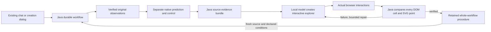
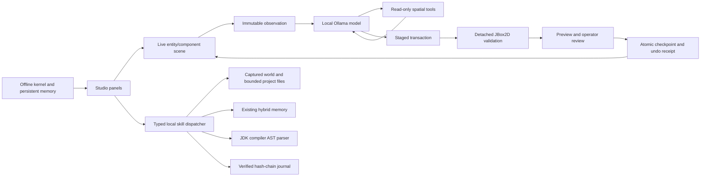

# Fraynix Studio system architecture

## Edition030: recoverable native map state and declared materials

The existing Java map owner commits body pose/orientation/linear/angular velocity, controller progress, settling, disturbance and full trace before corresponding live observations. Explicit compatible recovery continues the same run and independently compares actual initialized native state. Contact caches rebuild. Declared palette floor properties drive native friction/restitution and Java drag; separate per-tick audits reconstruct position, work/effort, kinetic energy and impulse. Nine actual report charts and visible material/work data precede skill retention. Completed reports retain original contents. Chat reuse preserves saved material defaults unless explicitly replaced. See [native recovery/material contract](NATIVE_MAP_RECOVERY.md) and [edition030 evidence](../README-030.md). Next: native pushable-object planning and complete dynamic-body recovery, then layer transitions and independently evaluated policy promotion.

## Edition029 runtime additions

The existing map pipeline now accepts an explicit global graph contract. A JDK-only selector retains original adjacency candidates and performs a complete independent floor-graph audit before native play. Coverage, original-endpoint shortest routes, components, graph edges/cycle rank and rejection reasons remain source-bound. The shared goal/Skills path verifies native traces, all six interactive charts and visible original topology data. Partial reuse preserves saved global defaults. Original028 generation and published package reconstruction remain intact. See [global map topology](GLOBAL_MAP_TOPOLOGY.md).

The first frozen reserved comparison is1/12→5/12 globally accepted, with native passes for all five accepted new worlds and seven retained rejections. Budgets differ and no threshold was changed after inspection. This is explicit constraint enforcement and conditional physical verification, not automatic model training or universal map completion. Compatible native map checkpoints are now implemented in030; the frozen029 comparison remains unchanged.

## Edition028 runtime additions

The existing workspace now connects original reference PNGs to a Java adjacency model, bounded seeded grid repair, actual native colliders and a force-controlled avatar. `map-world-v1` uses the shared durable goal runner and existing procedure registry. The model selects typed semantic options; Java owns source identity, physical timing, trace verification and six interactive chart-frame checks. The Maps view provides actual manual and agent play, source confirmation, reconstruction-checked JSON import/export and original dungeon-layer selection. See the [reference-map world contract](REFERENCE_MAP_WORLDS.md).

Original2D–4D dungeon coordinates remain complete. An explicit layer compiles into a separately declared three-axis physical world; hidden source axes are never unioned. Time, material parameters and relationships remain named state variables. Manual input is run-bound and expires; legacy incomplete native motion without a checkpoint becomes a separately recorded attempt;030 compatible checkpoints continue the same map run. Completed evidence and stable report identities can be reused without repeating physical effects. Palette semantics and scale are declared, not inferred real-world measurements. Learned adjacency, reactive control and retained procedures have distinct roles; this edition does not train Ollama weights.

## Edition027 runtime additions

The current workspace retains Java-owned durable goals and the existing desktop browser/canvas. The new checked-in `geometry-core` module computes seeded mathematical geometry without a rendering/runtime dependency beyond the JDK. `procedural-space-v1` adds frozen inputs, cooperative computation, independent topology/navigation checks, actual original-coordinate view auditing, retained procedures and reconstruction import to the shared goal runner. See the [runtime contract](PROCEDURAL_SPACE.md) and [tutorial analysis](PROCESSING_ALGORITHM_REFERENCE.md).

Chat selects bounded semantic options; it cannot supply result coordinates or completion flags. Original N-D data, four recorded projections, slices and growth/path state remain distinct. The supported2–16D vector/colony calculations and2–4D grids do not add physical dimensions to Bullet or establish calibrated real-world fidelity.

New evidence workflows opt into `responsive-v1`: the private desktop host observes the exact artifact in unprivileged780/390px Chromium views, and Java verifies geometry/legibility alongside the unchanged source-cell and native-plot checks. Layout failures use the existing bounded repair budget. The probe does not replace CSS. Historical workflows keep their frozen profile. These additions preserve the separate game, physics, browser, perception and creation interfaces documented below.

Edition026 adds a durable `evidence-workflow-v1` parent over the existing data, native world and creation goals. Stable owned stage intents reconcile restart; completed evidence is revalidated and reused. Java reconstructs an original-source bundle and independently checks every rendered table cell and both native SVG traces before whole-workflow retention. The existing canvas, goal card and Skills library provide entry/reuse; observation data and native simulation remain explicitly separate. See [evidence workflows](EVIDENCE_WORKFLOWS.md).

Edition025 adds `creation-web-v1` to the same Java goal/procedure registry. The desktop supplies admitted local generation and actual canvas interactions through private leased effects; Java pins source/model/checks, owns artifact versions, validates observed receipts, bounds repairs and reconciles restart. Passing procedures can regenerate and verify on a fresh selected CSV. See [durable creation](DURABLE_CREATION.md). This extends the current layout and creation canvas; it does not install generated host handlers or train LLM weights.

Edition024 adds pure Java temporal feature tracking, visible motion diagnostics and new reserved-footage evaluation. The candidate improves all three clips but fails the unchanged coverage/false-visible gates, so baseline remains active. Old profiles and pinned goals/skills remain installed; the new adapter retains the unchanged earlier scorer. See [temporal tracking](TEMPORAL_TRACKING.md) for actual computations, source freeze, results and limits.

Edition023 adds a Java-owned tracking research loop: immutable original-frame/mask import, frozen profile comparisons, separate reference scoring, fixed promotion gates, persistent rollback and implementation pins on browser goals/skills. The real recorded-sequence candidate fails and remains rejected; synthetic controls verify lifecycle without being presented as real-world improvement. Chat selects the registered workflow; it cannot write predictions or thresholds. See [tracking evaluation](TRACKING_EVALUATION.md).

Edition022 adds browser perception as a fourth registered Java procedure: actual Chromium pixel capture, admitted local vision estimates, pure-Java appearance tracking, explicit persistent user corrections and source-fenced sampling/recovery. The browser renders outlines and broken observation trails; Java owns state, budgets and evidence. Page labels, model estimates and user-labelled examples retain distinct authority. See [browser perception](BROWSER_PERCEPTION.md). This does not replace the game, physics or spatial view, and does not train LLM weights.

Edition021 adds a separate source-qualified spatial box runtime, isolated native forward forecasts, actual constrained manipulation and a third shared goal/procedure family. Stable scene/object identity, explicit scale and source labels, report receipts and recovery are documented in [spatial worlds](SPATIAL_WORLD.md). This extends the integrated view without replacing the original game or learned ramp model.

Edition020 extends the Java goal layer with a separate local-data computation family, typed family-specific model tools, an explicit imported-source binding and real chart/audit outputs. The data handler does not acquire physics/model ownership; physical goals keep their native control guard. See [motion-data procedures](MOTION_DATA_PROCEDURES.md).

Edition 019 adds a Java-owned durable goal/procedure layer above the existing world model and native controller. The desktop performs registered browser/canvas effects and real canvas assertions; it does not decide physical success. See the [current goal/skill contract](GOALS_AND_SKILLS.md), including ownership, atomic checkpoints, nonce-bound effects, explicit restart recovery and current limits. The diagrams below retain the inherited Studio architecture for continuity.

## Components

`Main -> jade.Window -> Scene + Renderer + Physics2D + ImGuiLayer` is the graphical runtime. `FactorySceneAdapter` bridges authored scene components to the shared `FactoryWorld` representation.

`FactorySession` owns the project world, checkpoint store and kernel service. The factory runtime provides schemas, entity/component records, transactions and broad-phase spatial bounds. The kernel supplies task execution, validation, retrieval, persisted routing/memory and traces.

`FraynixWorkspace` manages background model observation and conversational inference. `FactoryModelService` uses the checked-in local-model catalog and existing Ollama adapter. UI availability is derived from `/api/tags`; residency comes from `/api/ps`.

`SceneAgent` captures a `SceneKnowledge` observation and runs a model/tool/validation loop. `SceneProposal` converts accepted operations to a staged transaction. `SceneSimulation` validates a detached candidate with real JBox2D. `SceneEditHistory` owns before/candidate checkpoints, receipts and restart-safe undo.

`LocalSkillDispatcher` adds five compiled local functions with versioned input/output contracts and explicit host capability grants. `FactorySession` supplies its immutable world snapshot to the worker. The Tools tab renders definitions and journaled results; the CLI can invoke non-world tools with explicit grants. No imported Markdown executes or grants authority. The Create model loop retains its existing protocol.

`MerkleAppendOnlyJournal` validates legacy/J2 history on load and before append. Cross-process locks serialize writers; forced staging and atomic replacement precede in-memory publication. Abandoned staging and unfinished tool calls remain visible. See [contracts and recovery](CONTINUITY_AND_SKILLS.md) for the limits of integrity evidence, explicit recovery and file-access checks.

## Data flow

1. Capture all serialized authored components, stable identities and relevant spatial/runtime metadata.
2. Freeze the observation and asset descriptions before background work.
3. Send a schema-constrained request to a selected local model.
4. Execute read-only spatial/component queries or validate its operation batch.
5. Return query results or validation failures to the model within the configured turn budget.
6. Present a validated draft and simulated trajectories for review.
7. Check the authored fingerprint again, persist the checkpoint, install the replacement and retain undo evidence.

Background changes to non-scene task/data records are retained at commit time. Camera and selection changes do not stale a draft; authored changes do. Replacement installs preserve the prior scene until initialization succeeds, and dispose replaced rendering buffers afterward.

## Boundaries

The editor's operation protocol is deliberately a fixed set of data changes. General kernel source-mutation classes are included as part of the imported kernel, but arbitrary source mutation and host execution are not exposed through the Create protocol. The entire older shell, biological topology, Rust substrate and speculative research documents are not booted by the desktop application.

The earlier Studio CPU 120B test proves a local model can generate a proposal that this engine accepts and simulates. It does not prove automatic model routing, learned weights, full 128K context operation or human-goal correctness.
