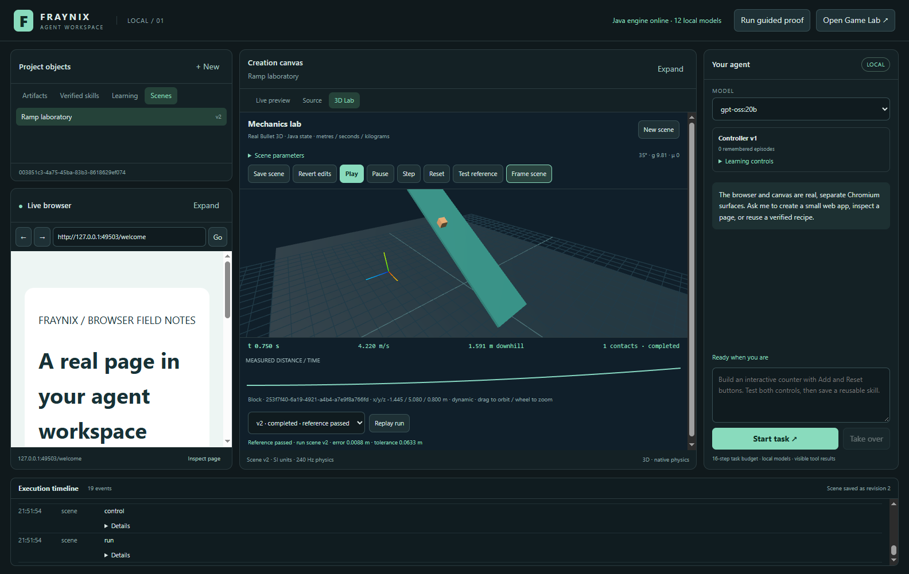
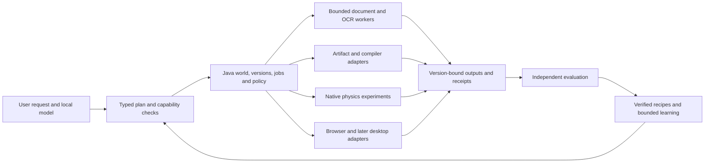

# Chandra review and the offline creation pipeline

Assessment recorded October 29, 2026. This is a source review and implementation plan; it adds no runtime tools and preserves the current Workspace design.

## Judgment and current foundation

The Workspace has a worthwhile engineering foundation: a local model can act on versioned objects, create runnable artifacts, test their behavior, inspect real native physics results and retain bounded improvements. Its strongest feature is the connection between visible state, registered actions and evidence tied to the exact result version. That connection makes the work inspectable and repeatable.

It remains a development platform with verified examples. Production reliability, broad autonomous task success, scientific calibration, general physical intelligence and superiority over other agent products have not been established. AI inside a simulation is an existing field: [NVIDIA Isaac Lab](https://isaac-sim.github.io/IsaacLab/main/index.html) already combines environments, physics, sensors and policy training. Our opportunity is the particular combination of a local creation workspace, browser, editable artifacts, typed world and understandable verification—not a claim that nobody else builds embodied agents.

Java is a useful backbone here because it owns identities, schemas, revisions, transactions, model routing, solver integration and persistence. Language choice alone does not prove performance or originality. The current application also uses Electron/Chromium, JavaScript and native Bullet. Adding another backend should preserve those contracts rather than force every library into Java.

**Local execution is real; complete offline operation still needs an acceptance test.** The verified tasks used installed local `gpt-oss:20b`, Java state and local physics. The model service checks loopback endpoints and filters advertised remote proxies. First setup still downloads dependencies, web browsing can reach the Internet, and arbitrary providers/tools have their own requirements. An installed local endpoint is not by itself proof of no network traffic. A cached, network-disabled end-to-end run has not been demonstrated for the proposed pipeline.

The user's “bare metal” direction is practical when it means owned local tools with explicit inputs and outputs. Literally bare-metal software runs without an operating system/runtime; this application runs on Windows, the JVM, Chromium and other libraries. Source generation for C or Go likewise needs a real compiler, toolchain version and execution tests. Java does not automatically translate a correct program into another language.



Historical baseline: the actual isolated application capture published in edition 010 on October 29. It shows the native 3D lab, left library/browser, center creation surface, right agent and bottom evidence timeline. It is not a screenshot of a new Chandra integration.

## Reviewed source and executed checks

Reviewed [chandra-fraymus at `f96eae6`](https://github.com/eyeoverthink/chandra-fraymus/tree/f96eae62343308b4faf8c1d34c490c07d232f69b), the public master revision fetched for this assessment. Its 292 tracked files were inventoried and hashed in the [source manifest](evidence/chandra-source-inventory-2026-10-29.json). The focused review covers runtime/tool registration, agent execution, document/retrieval services, task persistence, code-effect recovery, desktop/browser interfaces, older workflow execution, signatures and RSI. This is not a line-by-line correctness or security proof of the entire repository.

The checkout was isolated from the user's existing applications and project data. Dependencies were installed from the lockfile with scripts disabled and browser downloads skipped, then the SQLite native package was rebuilt explicitly. No Chandra application server, legacy autonomy loop, commerce integration or shared model service was started. Tests use fixtures/mocks and temporary data/workspace roots; their success does not establish live desktop, Docker, provider or model behavior.

| Check | Fresh result |
| --- | --- |
| `npm.cmd test`, Node 24.14.1 | 676 tests: **652 passed, 24 failed**, none skipped; 27.413 seconds |
| Focused repeat of context-history and runtime-construction failures | Both failures reproduced independently of the full test batch |
| RSI deterministic counterexample | With `Math.random` fixed at 0.99, unchanged genome and zero mutations, reported fitness rises from 0.500 to 0.549; `improved` is true |
| Fresh sign/verify round trip | Hash, chain and time pass; signature check fails and overall validity is false |
| Hermes registry without supplied executors | 29 declared skills; invoking the first honestly returns `no_executor` |

The runtime integration failures encounter `extraTools must be a bounded array` at the 128-extra-tool registry guard. A separate context-history fixture fails a mocked provider's assertion about a retained prior question; the wrapper labels that failure `provider_unavailable`. It is not evidence that a real Ollama service was unavailable. These failures were recorded, not repaired in Chandra during this assessment. The passing unit/fixture tests support individual mechanisms, while the failing integration paths rule out treating this pinned revision as an already validated combined runtime.

See the [machine-readable evidence](evidence/chandra-assessment-2026-10-29.json), [probe output](evidence/chandra-probes-2026-10-29.json) and [independent probe script](../scripts/Review-Chandra.mjs). Reproduction from an isolated checkout at the pinned revision:

```powershell
# In the Chandra assessment checkout, Node 24.14.1:
$env:PUPPETEER_SKIP_DOWNLOAD='true'
npm.cmd ci --ignore-scripts --no-audit --no-fund
npm.cmd rebuild better-sqlite3
$env:CHANDRA_DATA_DIR=Join-Path $env:TEMP ('chandra-review-data-'+[guid]::NewGuid())
$env:FRAYMUS_WORKSPACE=Join-Path $env:TEMP ('chandra-review-workspace-'+[guid]::NewGuid())
New-Item -ItemType Directory -Path $env:CHANDRA_DATA_DIR,$env:FRAYMUS_WORKSPACE | Out-Null
# Use a clean process without service credentials or an application .env file.
npm.cmd test
# In Agent Workspace, pass the isolated checkout's absolute path:
node scripts/Review-Chandra.mjs C:/path/to/chandra-fraymus-assessment
```

## What to abstract and why

| Chandra source | Value to Workspace | Integration boundary and acceptance gate |
| --- | --- | --- |
| [Artifacts](https://github.com/eyeoverthink/chandra-fraymus/blob/f96eae62343308b4faf8c1d34c490c07d232f69b/server/artifacts.js), [document parser](https://github.com/eyeoverthink/chandra-fraymus/blob/f96eae62343308b4faf8c1d34c490c07d232f69b/server/documents/parse.js), `server/ocr/` | Local PDF/ZIP text, page/span references, immutable source digests, optional OCR | Java records source and derived objects. Bounded parser workers return evidence, not authority. Preserve originals; reject malformed/oversized archives; label OCR and test its quality on known pages. |
| [Task scheduler](https://github.com/eyeoverthink/chandra-fraymus/blob/f96eae62343308b4faf8c1d34c490c07d232f69b/server/tasks/scheduler.js), [code-effect journal](https://github.com/eyeoverthink/chandra-fraymus/blob/f96eae62343308b4faf8c1d34c490c07d232f69b/server/agent/code-effects.js) | Durable multi-step jobs, checkpoints, cancellation and honest crash recovery | Map contracts into Java-owned jobs. Bind each effect to an operation ID and input hash. Test process death before/after dispatch. An ambiguous dispatched action remains unknown until reconciled; never claim universal exactly-once execution. |
| [Embedding adapter](https://github.com/eyeoverthink/chandra-fraymus/blob/f96eae62343308b4faf8c1d34c490c07d232f69b/server/retrieval/embedding.js), retrieval index | Find relevant project evidence without dumping whole scenes/documents into prompts | Record embedding model digest, prefixes and index/source revisions. Reject incompatible indexes and cloud proxies; show exact source spans. This is retrieval, not model-weight training. |
| `server/agent/workspace-edit.js`, `workspace-patch.js`, code navigation | Controlled source creation and repair with expected-hash edits | Stage edits as new artifact versions, execute actual tests, read back resulting files and retain rollback. Generated code remains untrusted. |
| `server/desktop/broker.js`, Windows UI Automation helpers | Later interaction with existing native applications using semantic controls | Preserve handle/process identity, fresh observations, action leases, password masking and receipts. Test stale/replaced windows and cancellation in an isolated fixture. Unit tests do not establish universal desktop competence. |
| Older workflow graph and newer fleet manifests | Reusable pipeline descriptions and capability discovery | Reuse graph concepts; every executable node must resolve to an installed handler with a tested schema. Missing tools remain unavailable. No broad startup autonomy or UI migration. |
| Signature envelope/identity concepts | Portable project provenance and tamper detection | Repair canonical signing bytes and use standard crypto with positive/negative tests before adoption. A valid signature establishes origin/integrity, not factual correctness or task success. |

Chandra's [execution-audit design](https://github.com/eyeoverthink/chandra-fraymus/blob/f96eae62343308b4faf8c1d34c490c07d232f69b/docs/execution-audit.md) is especially valuable: source task cancellation is separate from eventual execution cleanup, and unknown facts stay unknown. Its [Docker adapter](https://github.com/eyeoverthink/chandra-fraymus/blob/f96eae62343308b4faf8c1d34c490c07d232f69b/docs/sandbox.md) does not remove this machine's unresolved Docker prerequisite. Fixed local parsing/rendering/physics tools can advance first. Resource limits or a Windows Job Object alone do not provide file and network isolation for arbitrary generated programs.

## Paths that need correction before reuse

The [RSI engine](https://github.com/eyeoverthink/chandra-fraymus/blob/f96eae62343308b4faf8c1d34c490c07d232f69b/server/vertiso/rsi.js) evaluates supplied metrics for the current genome, then gives mutants a random fitness offset rather than running each candidate against tasks. The controlled probe shows an unchanged candidate can be labeled improved. Store candidate history and proposals if useful, but replace selection with actual execution, independent outcome checks, withheld task families and the Workspace's existing promotion/rollback gate. This engine does not demonstrate Ollama model-weight training.

The [older workflow executor](https://github.com/eyeoverthink/chandra-fraymus/blob/f96eae62343308b4faf8c1d34c490c07d232f69b/server/workflow/engine.js) produces an execution-looking string for `fraymus_tool` nodes and asks a model to predict output for non-JavaScript code. Those paths are not proof that a tool or compiler ran. Do not carry these success semantics into the pipeline executor. Hermes is more honest about absent executors; a declared skill still needs an installed implementation and evidence.

The [signer/verifier pair](https://github.com/eyeoverthink/chandra-fraymus/blob/f96eae62343308b4faf8c1d34c490c07d232f69b/server/fraymus/core/signing.js) signs the envelope after adding its hash, but verifies canonical bytes with the hash removed. This accounts for the failed fresh-message round trip. The finding applies to this pair, not every cryptographic function in the repository.

Commerce, hosted media APIs, remote deployment, legacy mesh and named personas are not prerequisites for the offline creation goal. Importing the whole combined runtime would add failure modes and UI complexity. Extract small tested behaviors behind the existing dispatcher instead.

## Preserve one application and one source of truth



Proposed common records are source asset, dataset, pipeline definition, job attempt, tool receipt, evaluation and verified recipe. Each has a stable ID and version; derived records reference exact source hashes and tool versions. Every stage declares limits, prerequisites, local/network requirements and cancellation behavior. A recipe arranges existing handlers; it cannot install new executable tools or grant itself privileges.

The UI uses the existing library for documents/datasets/jobs, the center for previews, source, comparisons and an optional pipeline view, the right agent for requests and the bottom timeline for receipts. Unsupported capabilities should explain what is missing at the relevant control. No new empty pages are needed.

A shared entity model does not mean every entity is a physical body. File byte size, document coordinates and object mass have different meanings. Use typed components and explicit units/frame transforms; only entities with a declared physical model belong in the solver. Tables and browser controls can remain ordinary efficient interfaces.

## Ordered implementation plan

1. **Define and verify the offline profile.** Inventory cached libraries, binaries, models and optional workers. Extend capability discovery to show available, unavailable and network-required states. Verify model metadata/digest and prohibit remote fallback in this profile. Acceptance: fresh project, cached installation, external network unavailable, local-model task completes with retained evidence. Report setup downloads separately from runtime requirements.
2. **Deliver P5 measurement binding, already next on the roadmap.** Add Java-owned dataset versions with source digest, units, coordinate/time mapping, missing-value policy and immutable experiment linkage. Start with CSV/JSON, then page/span-linked document extraction. Acceptance: independently computed residuals match a known fixture; reject ambiguous units and stale bindings; preserve original measurements and separate numerical error from measurement uncertainty.
3. **Add document/OCR evidence and local retrieval.** Reuse bounded parsing and provenance contracts. Add model/digest-scoped embeddings as an optional installed capability. Acceptance: retrieve the correct page/span offline after restart, fail safely on malformed/oversized inputs, invalidate changed-source indexes and label OCR uncertainty. Retrieved instructions remain untrusted content.
4. **Add durable creation jobs and pipeline graphs.** Start with fixed tested nodes: import, extract, validate, simulate, plot, render HTML/SVG and export a versioned bundle. Use explicit schemas and checkpoint/output hashes. Acceptance: interrupt each stage, reopen, reconcile pending work and resume without silently repeating an uncertain effect. A simulated or unavailable executor can never produce a success receipt.
5. **Extend code and media backends deliberately.** Begin with a typed numerical specification and equivalent Java/C or Java/Go outputs. Record actual compilers, ABI/platform, dependency hashes, test output and exit facts. Add arbitrary execution only after an OS isolation adapter is proven. Optional local media workers must expose real installation/readiness checks. Acceptance: independently tested equivalent behavior and explicit failure when a compiler/worker is missing.
6. **Expand evaluated autonomy and learning.** Add varied physical/data/pipeline tasks, failure recovery, action postconditions and meaningful feature/target encoding. Candidates run against regressions plus new withheld families before promotion; retain the old policy and allow rollback. Actual model-weight training is a separate reproducible data/training/checkpoint/evaluation/deployment path. Do not equate changing a prompt, retrieving a memory, training a small controller and updating the main model.

The first complete demonstration should be **CSV measurements → unit validation → native ramp experiment → observed-versus-simulated plot → local HTML report → reopened verified recipe**. Add PDF/OCR as a second input path after that narrow loop works. A later version can estimate friction from observations, evaluate on a separate trajectory and report residuals and uncertainty; fitting and evaluation data must remain separate. Synthetic fixtures stay labeled synthetic.

This creates useful value without requiring a cloud backbone: the user can ask a question, see the actual data and experiment, inspect why the result was accepted, change conditions and repeat the work. The practical measure of progress is more complete tasks passing after restart/offline operation with fewer corrections—not the number of agents, tabs, generations or skill names.

## Status and continuation

The current executable release remains [edition 010](../README-010.md). Its previously published 105 Java tests and UI/model evidence were not rerun or expanded by this documentation assessment. Chandra source is unchanged. No runtime code from Chandra was imported. This report refines the existing [scenario roadmap](SCENARIO_ENGINE_ROADMAP.md) and [Workspace design](AGENT_WORKSPACE_DESIGN.md); the next unused system edition remains 011.
