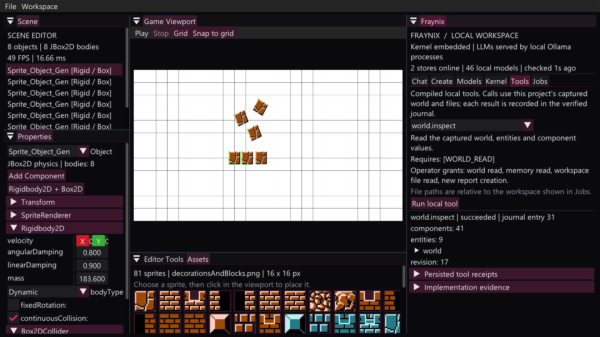

# Verified continuity and local tools

This implementation adds two parts of the creator system: verified restoration of its event journal and a typed dispatcher for five executable local tools. Both live in the checked-in, JDK-only `factory-kernel` module. The original Full-AI-System and editor repositories are not build inputs.

## Tool contracts

| Tool ID, version 1 | Input | Required host capabilities | Result |
| --- | --- | --- | --- |
| `world.inspect` | None | `WORLD_READ` | Captured revision, entity/component counts, complete component records as JSON |
| `memory.search` | `query` | `MEMORY_READ` | Up to eight actual kernel retrieval hits, scores and previews |
| `java.analyze` | Workspace-relative `path` | `WORKSPACE_READ` | File hash, AST declaration/type/method counts and parser diagnostics |
| `docs.generate` | `title` | `WORLD_READ`, `REPORT_WRITE` | New Markdown world report, revision and file hash |
| `artifact.verify` | Workspace-relative `path`, `expectedSha256` | `WORKSPACE_READ` | Actual hash, byte count and explicit `matches` result |

`SkillSchema` rejects missing/unknown fields, invalid integer/boolean/hash values, and oversized fields. Inputs and outputs are immutable flat string maps with declared wire types; the world and retrieval results are JSON strings within those maps. Registrations have stable IDs, versions, required capabilities, schemas and the SHA-256 of the compiled dispatcher class. That class hash is implementation evidence, not an attestation of every transitive dependency.

The registry selects compiled Java handlers. Markdown descriptions, downloaded documents and model responses cannot register code or grant capabilities. AST analysis calls the local JDK parser with annotation processing disabled; it does not execute the source, resolve all symbols, compile classes or establish semantic correctness. A `syntaxValid=true` result is only a parser result.

Artifact verification reports `matches=false` for a digest mismatch. A receipt saying the tool succeeded means it completed its operation; inspect its result fields to decide whether the artifact passed.

## Editor integration

Open **Fraynix > Tools**, select a tool, fill its schema fields and choose **Run local tool**. The tab shows the real registry, requirements, current result and restored receipts. **Kernel** displays journal verification, retained staging files and unfinished call IDs.



`FactorySession` captures the world on the editor thread and passes the immutable snapshot to its background worker. Inspection/document tools use that snapshot's full structured component data. They do not observe pixels or edit the scene. The operator UI grants the four listed local capabilities for explicit button invocations. A different host or agent caller must supply its own grants; setting a `grants` input field is rejected. General local tools are not yet automatically invoked by the Chat/Create model loops. Create retains its existing read-only spatial tools and staged scene protocol.

Reads remain within this project's real workspace path. Absolute paths, traversal outside it and symbolic links are rejected; resolved junction targets outside it are also refused. Java sources are limited to 2 MiB and artifact verification to 32 MiB. New reports use unique call IDs under `skill-reports/`, cannot overwrite existing files, and are limited to one million characters of world data. Model weights stay in Ollama's stores. These are application checks, not OS isolation from an adversary racing filesystem changes or other Java code already running in the process.

## Command line

From the source checkout after `gradlew.bat --offline installDist`:

```powershell
$cp = 'build/install/Fraynix-Studio/lib/*'
java -cp $cp brain_architecture.kernel.OfflineKernelCli skills "$PWD"
java -cp $cp brain_architecture.kernel.OfflineKernelCli verify-journal "$PWD"
java -cp $cp brain_architecture.kernel.OfflineKernelCli skill "$PWD" java.analyze --grant WORKSPACE_READ 'path=src/main/java/Main.java'
java -cp $cp brain_architecture.kernel.OfflineKernelCli skill "$PWD" memory.search --grant MEMORY_READ 'query=scene checkpoint'
```

The same commands work through `scripts/Run-Kernel.ps1 -Offline -KernelArguments @(...)`. Supply a `--grant CAPABILITY` pair for each capability. The CLI begins with no grants. World inspection/document creation require a host-provided live snapshot, so the headless CLI refuses them instead of inventing an empty world. Use the editor for those two tools.

## Durable execution evidence

A validated invocation writes `skill_started` before its handler runs. A terminal record stores the call ID, skill/version, granted and required capabilities, implementation class hash, canonical input/output hashes, validated input fields, output fields and elapsed time. Rejections and failures have separate record types. Full successful results survive restart in the journal; the UI truncates large displays only.

Calls with a start record and no terminal record remain visible as unfinished. They may have produced an effect before interruption. The system does not automatically rerun them. In particular, a report may already exist when the terminal journal write fails; inspect the unique report/call ID before retrying. This is durable evidence, not a claim of exactly-once effects across all files.

Project self-memory refresh selects this checkout's README, architecture, continuity/skills and verification documents, then indexes them with generated memory/forecast files. Legacy documentation paths remain fallbacks for older workspace layouts; they are never external source roots. The Studio forecast records durable jobs, measured model profiles and scoped agent tool integration as next work.

## Journal restore and commits

`MerkleAppendOnlyJournal` verifies every loaded entry's index, timestamp encoding, payload hash, previous-entry hash, entry hash and prefix Merkle root before exposing it. Legacy valid records remain readable; new `J2` records encode hash payload fields unambiguously, including delimiter characters in metadata. After the first J2 entry, legacy records cannot resume. Complete invalid records, interior blank lines and malformed data fail with an error and retain the original log.

Each append locks the journal across threads and processes, revalidates the committed disk history, stages and forces the complete replacement, then commits with an atomic filesystem rename. In-memory publication follows the successful rename. No non-atomic fallback is used. On restart, the system reads only the committed log; abandoned `kernel-journal-*.pending` files remain as evidence and appear in status. They are not replayed or silently deleted.

The Merkle accumulator validates prefix roots in O(n log n). This first durable writer rewrites the log on each append, so append I/O is O(B), where B is the file's byte length. Large journals need a measured segmented writer/checkpoint design later. The tests simulate interrupted staging and legacy torn tails; they do not establish behavior under hardware power loss or filesystem failure that violates atomic-rename guarantees.

Hash chains provide internal consistency, not identity authentication. A fresh process cannot detect a deliberately rewritten valid history or removal of a valid suffix without an independently trusted expected head. This change does not add Ed25519 signatures, trusted remote anchors, encryption, FHE, zero-knowledge proofs, or validation of every other kernel state file.

## Explicit recovery of an old partial tail

New atomic writes avoid in-place torn append records. For an older, already-damaged log, recovery is deliberately explicit. Keep a previously verified entry count and Merkle root outside the damaged journal. Run:

```powershell
java -cp $cp brain_architecture.kernel.OfflineKernelCli recover-journal-tail "$PWD" <verifiedPrefixCount> <verifiedPrefixMerkleRoot>
java -cp $cp brain_architecture.kernel.OfflineKernelCli verify-journal "$PWD"
```

Recovery only removes an unterminated invalid trailing record when the entire preceding prefix matches that anchor. It refuses a wrong anchor, a complete valid last record, or a newline-terminated corrupt record. It first preserves the exact original bytes as `journal-recovery-<UUID>.evidence`, then atomically installs the prefix. An empty journal anchor uses count zero and an empty root. Recovery does not synthesize lost events or determine whether the damage was accidental.

## Validation and next work

`JournalContinuityTest` checks legacy/J2 compatibility, independent Merkle calculations for many prefix lengths, tampering of every serialized field, exact-byte recovery evidence, invalid anchors, abandoned staging, failed writes, multiple threads and two concurrent JVM writers.

`LocalSkillsTest` runs all five handlers with real files/memory/world data, broken Java syntax, a source static initializer that must never execute, positive/negative digest checks, missing capabilities, invalid schemas, traversal, absolute paths, persistent receipts and unfinished calls. A symlink probe runs when the host permits symlink creation; local Windows skipped that probe due to privileges. `FactorySceneIntegrationTest` checks the editor worker receives real identities and components without adding scene objects. The native Studio check renders all six tabs, performs `world.inspect`, sends real local-model requests, and restores scene/chat across two processes.

Per-model Chat/resource profiles, streaming and model controls are implemented in [live model controls](LIVE_MODEL_CONTROLS.md). Next: add durable queued jobs and expose selected read-only dispatcher calls to agents under explicit host grants. Broader imported skill packs require individual Java implementations and tests. The supplied browser WASM demonstration remains reference material; it is not used as a compiler, sandbox or artifact-restoration engine.
