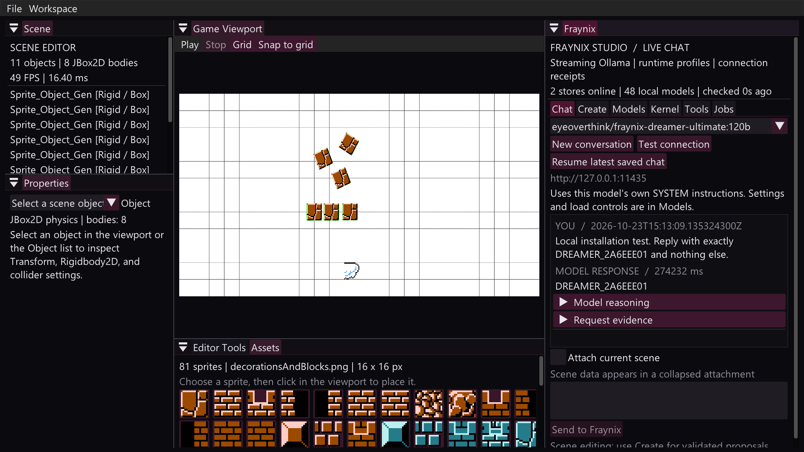

# Dreamer 120B: installed, tested and published

Activated October 23, 2026 following the user's request for immediate local Studio use and publication to their Ollama account.

Model: **`eyeoverthink/fraynix-dreamer-ultimate:120b`**

Public page: [eyeoverthink/fraynix-dreamer-ultimate:120b](https://ollama.com/eyeoverthink/fraynix-dreamer-ultimate:120b).

The model is installed in the existing F: Ollama store and selected in Studio's **Fraynix > Chat** tab. The short local alias `fraynix-dreamer-ultimate:120b` also exists. Use the fully qualified name consistently to select the same tag locally and online.

This is the reviewed Dreamer inference profile over the existing `gpt-oss:120b` weights. Creating and pushing this profile did not train, merge or replace the 120B weights. It inherits the base's native Harmony template and upstream license, adds the concise Dreamer SYSTEM instructions, and avoids custom stop tokens. The separate unverified B200 trainer/daemon was not activated.

## Use it now

Studio is open with the full model name selected, the actual test response visible, and its saved scene restored. Enter a message in Chat and click **Send to Fraynix**. **Create** continues to use its existing scene proposal/preview/apply path. Installing a model does not automatically implement the remaining named skills.

For a terminal connected to the already-running F: service:

```powershell
$env:OLLAMA_HOST = 'http://127.0.0.1:11435'
ollama run eyeoverthink/fraynix-dreamer-ultimate:120b
```

The primary Ollama service on 11434 remains separate. Omitting `OLLAMA_HOST` normally targets that primary store instead.

On another machine, the published model can be pulled with:

```text
ollama pull eyeoverthink/fraynix-dreamer-ultimate:120b
```

Publishing makes the model available in the registry; it does not create an always-running cloud inference instance.

## Saved local settings

| Setting | Value used |
| --- | --- |
| Service | `http://127.0.0.1:11435` |
| Weight format | GGUF / MXFP4, 116.8B metadata |
| Weights | 65,369,799,840 bytes; existing layer `6be6d66a3f546d8c19b130dc41dc24b2fc159f84ffbc76a0ee0676205083cf5a` |
| Context / output allowance | 4,096 / 1,024 tokens |
| CPU threads / GPU layers | 12 / 0 |
| Temperature / repetition penalty | 1 / 1 |
| Client response-idle allowance | 900 seconds |
| Service cold-load allowance | 15 minutes |
| Keep loaded after use | 1,800 seconds |
| F: service concurrency | One loaded model, one parallel request |

These starting values are editable under **Models**. They were chosen for the measured local CPU path, rather than the unverified B200 training estimates. The primary service was not stopped. The empty secondary service was restarted with the longer load allowance; no model files were moved or deleted.

The installed [Modelfile](../models/FRAYNIX-DREAMER-120B.Modelfile) records the inference recipe. Studio stores its exact endpoint/tag mapping in the user's local model catalog and its request settings under the default project's `models/runtime-profiles.json`. Weights stay outside this repository.

After a reboot, start the existing F: store if needed, then launch Studio:

```powershell
& 'C:\Users\eyeka\Downloads\Fraynix-Studio\scripts\Start-FDrive-Ollama.ps1' `
  -ModelStore 'F:\LocalDiskC\Users\eyeka\.ollama\models'
& 'C:\Users\eyeka\Downloads\Fraynix-Studio\Launch-Fraynix-Studio.bat'
```

The helper uses a hidden server process, loopback binding and logs under `build/fdrive-ollama/`. If an Ollama server already answers on the port, it reports reuse and does not change or terminate that process. This setup does not install a Windows boot service.

## Actual validation

The test instantiated the same `FraynixWorkspace` controller used by the application, discovered the model through the normal catalog/service, saved its profile, and sent an unpredictable nonce through the normal streaming chat path into the real project conversation store.

- HTTP 200, completed response, **38 NDJSON frames**.
- Requested/returned nonce: `DREAMER_2A6EEE01`.
- Service-reported cold model load: **260.77 seconds**; complete request: **274.23 seconds**.
- Response SHA-256: `8a2f53e2b34d7cac61f41955d41c57ca12b3430709220995f771bf5503cfabae` over the stream's normalized NDJSON lines.
- A separate warm HTTP check with low reasoning returned the configured Dreamer name and `19 + 23 = 42` in **13.45 seconds**. This is a small task timing, not a general latency guarantee.
- Studio closed normally and reopened with the new conversation/model selected. The saved scene retained SHA-256 `a958381eba6784304ad5770fceefbe3c2106af9ad9cc74633afdf893ca7e5a71`, revision 30, 11 authored objects and 8 JBox2D bodies.
- The actual native startup frame was inspected. Studio remained responsive and the model was resident in Ollama after testing.



## Publication validation

The F: Ollama service confirmed the signed-in account was `eyeoverthink`. `ollama push eyeoverthink/fraynix-dreamer-ultimate:120b` completed successfully. An independent public page request returned HTTP 200, and an anonymous registry manifest request returned HTTP 200.

The public manifest's **five layer digests and config digest** match the local model, including the existing weight layer and the new SYSTEM layer `fb93140f3e2b99dc76aad2583f5c0f2b4d47325b6dfbc0fd795e2ae365d5f051`. The local v2 manifest digest is `f4c2235f63046d4731f69256d0e33e23e6954f7dab685ea8ca1de5f002787e7d`. Manifest encoding differs between the local v2 and legacy registry response, so their raw file hashes are recorded separately rather than equated.

Only the model package was pushed to Ollama. Scene files, conversations, project memory, original attached prompt dumps and the proposed cloud scripts were not part of the model publication. The 65 GB weight blob was not separately rehashed in this activation; the comparison verifies registry references and the actual tested local model path, not a new signed hardware attestation.

See [activation evidence](evidence/dreamer120b-activation-2026-10-23.json). The [earlier package review](DREAMER_120B_REVIEW.md) remains a snapshot of the original, unmodified package and its implementation gaps. Its staged candidate was subsequently used as the basis for this installed recipe.
