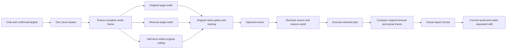

# Edition045: compare, commit, remember

The direction is one continuing Java agent with an inspectable world, a controlled ability to act and a record of what happened. The next useful step is to make a prediction compete with alternatives before it becomes an action.

Edition045 implements that step for the existing persistent native manipulation task. Three actual native trials begin from the same verified all-body frame. The agent keeps the failed candidate, ranks only verified results and carries out its selected plan through the original controller, world ledger and report checks. Optional review separates prediction from authorization to move. This bounded planning mechanism works inside the existing editor and Java task loop.

## What the architecture gains

The app already has continuing identity, clocks, witness records, local model access, native physics, a persistent world, source-qualified observations, browser/canvas surfaces and retained procedures. Counterfactual planning connects those existing parts around a stronger question: **what evidence justifies this action in this world now?**

The persistent world is the reference state. A branch is a complete disposable experiment. A decision is a source-bound comparison. Execution is an owned native task. A successful procedure is a versioned method whose next use must obtain a fresh world binding and new predictions. The trace of a failed branch is useful evidence and remains visible.

Java maintains those meanings even when the interface disconnects. Screenshots let the system inspect its actual presentation; numeric body traces establish simulated movement. Neither is interchangeable with a camera measurement, an object identity or a subjective experience.

## A coherent world, not a collection of chat panels

The useful unification is a common record of **entities, observations, actions, goals and time**. Different views can show that record without pretending they are interchangeable measurements:

| View / representation | Grounding | Next useful connection |
| --- | --- | --- |
| Browser page | Current DOM references, actual pixels and leased browser actions | Tie a selected visible object to a source-qualified hypothesis and a checked task. |
| Camera and mat | Original frame, timestamp, registered plane, scale and uncertainty | Compare fresh measured movement against the correctly aligned prediction. |
| Native3D world | Stable body identities, poses, contacts, velocities, controller and ticks | Test alternatives and retain an actual verified revision. |
| Procedural2D/3D/higher-dimensional map | Algorithm, seed, parameters and explicit projection | Carry the source recipe and scale into a supported playable-world compiler. |
| Creation canvas | Versioned files, actual execution and observable behavior checks | Connect an authored artifact to its producing task, test and reusable procedure. |
| Neural memory | Actual encoding, weights, replay and measured outcomes | Evaluate a specific contribution to novelty detection, policy choice or recovery. |

A higher-dimensional point representation can organise features, trajectories and procedural parameters. Its projection can produce2D/3D views. It does not add physical dimensions to the present3D solver or infer unseen object geometry from a single image. The same distinction lets the system grow without confusing an invented representation with an observed fact.

The next visual design should follow the same unification: one primary world/creation surface, one conversational mission, and inspectable evidence when needed. Orthographic, perspective, map, timeline and chart views can share selections and provenance. A new capability should earn a place in an existing task flow rather than automatically becoming another tab.

## A useful internal loop

The architectural analogue of a subconscious is bounded background work with a continuing clock and retained state: inspect an unresolved outcome, replay a relevant experience, prepare an alternative and propose a check. It should run at idle priority, keep its work observable and yield to the user's task. The existing heartbeat and witness provide continuity; they do not by themselves establish subjective experience or useful intelligence.

A production reasoning cycle would bind every stage to evidence:

1. **Notice:** register an observation with its source, time, uncertainty and active coordinate frame.
2. **Hypothesise:** retain possible identities or causes separately from verified properties.
3. **Predict:** compute a finite set of source-bound alternatives within declared authority.
4. **Choose:** compare them using an explicit objective and measurable gates.
5. **Act:** use the owner/controller appropriate to the surface, with an idempotent effect identity.
6. **Witness:** connect the resulting frame, numeric trace, surface receipt and goal to the same causal record.
7. **Evaluate:** measure success, prediction error, latency and unintended effects.
8. **Retain or reject:** save a verified method, preserve a failed case and use separate evaluation before promoting a changed policy.

Edition045 implements the prediction/choice/execution comparison for its narrow native task inside the existing loop. A future typed skill graph can extend that pattern across browser, data, maps and creation without handing an LLM authority to invent completion.

## Production boundaries

- The LLM can interpret broader requests and explain observations. This explicit counterfactual workflow uses deterministic Java routing and registered actions; it does not require model inference to invent a plan.
- The unchanged native controller owns movement timing, force and torque. Forecasts and actual execution use the same solver, so trace agreement demonstrates integration consistency, not a newly learned law of nature.
- The world ledger owns the source revision, body identities and commit. A changed head invalidates the frozen decision even if its old forecast succeeded.
- The verifier owns the outcome. A passing narrative, screenshot or selected candidate cannot replace the full native gates, rendered evidence and comparison.
- A retained skill stores the method and authority ceiling. It does not turn an old forecast into permission to act on another world.

## The next layers, in order

1. **Typed skill graphs.** Compose the existing verified procedures with declared input/output types, source requirements, failure branches and exact dependency versions. Acceptance: a multi-stage task resumes at a verified boundary, refuses an incompatible input and does not repeat an already committed action.
2. **Useful planning rather than more candidates.** Measure complete wall time and task success against the unchanged controller on frozen new configurations. More alternatives are justified only if they improve a declared outcome within the budget. A tiny floating-point tie is not evidence of useful intelligence.
3. **Observation-driven model correction.** Bind fresh measured motion to the right registered frame, carry uncertainty and compare prediction errors against the existing simple detector. Promote a correction only on separate evaluation evidence; keep rollback and original observations.
4. **A shared semantic world.** Connect human-associated objects, validated measurements, browser-derived reference candidates and authored assets through provenance. A category guess or matching internet image remains a hypothesis until checked. No automatic camera or web collection is introduced here.
5. **Measured neural contribution.** Test whether the existing nervous system improves novelty detection, controller selection or recovery over simpler baselines. Keep the CPU reference and measure the complete workload before claiming GPU benefit or training progress.
6. **Supported-machine delivery.** Reproducible install, explicit supported hardware and graceful recovery belong beside capabilities. Preserve the one-window experience and private project separation.

These are acceptance gates for subsequent editions. Edition045 ships only the bounded native comparison and its real controls, evidence and recovery. The longer-term value comes from joining perception, prediction, creation and verified action in one coherent local process.
