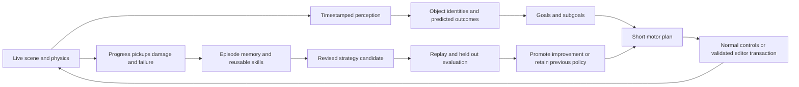

# Fraynix embodied AI and continual learning

Updated October 29, 2026. The goal is one working editor in which a local AI understands the real scene, manipulates its objects, plays through the same controls as a person, and improves from measured experience. The original Mario engine, the Fraynix component and transaction system, local models, and the Hrm nervous system each contribute to that loop.

## Review requests and resulting behavior

| Your observation or request | Required behavior | Current implementation |
| --- | --- | --- |
| Mario turned white after eating a mushroom | Preserve the correct character texture through growth, damage and animation changes | Renderer reconciles changed sprite sheets before drawing; full sampler tables move the sprite to another batch |
| The agent did not pursue the mushroom | Recognize a useful power-up, release it from its block, and intercept it | A goal planner chooses active power-up blocks, mushrooms and flowers from live game components |
| Repeated runs should improve rather than blindly repeat | Save the consequences of decisions, retain useful actions, and reconsider failures | Per-level motor rewards and failed optional goals persist between runs and restarts |
| Learning should continue autonomously | Repeat complete observe, act, evaluate and restart cycles within a user-controlled budget | Learn 5 runs restores the authored level between episodes; Escape, Take over and Stop cancel practice |
| The AI should really see and understand the character | Connect visible appearance, stable identity and changing state | Bounded model observations now explicitly identify Mario, his form, sprite sheet, position, grounded state and death state using engine data |
| Combine the entire application with your AI and nervous system | Keep the full game, editor, physics, local AI, memory and neural activity in the same application | The integrated engine is working; broader visual reasoning and neural policy training have separate acceptance gates below |

## The complete working loop

The immediate feedback loop runs through physics and actor inputs. Slower model reasoning should choose objectives, explain obstacles and retrieve relevant memories without blocking the simulation. A nervous system can supply sensory dynamics and learn action patterns, while the engine remains responsible for contacts, identities, serialization and execution receipts.

## Perception that follows the actual world

Engine perception should identify players, enemies, power-ups, blocks, passages, ledges, hazards and editable objects. Every observation should carry a scene revision, simulation tick, stable entity identity, world coordinates, velocity and relevant state. Mario becoming Big or Fire must update that observation even though his identity stays the same. A selected object should be inspectable through exact component queries rather than a guessed name or a palette index.

Visual perception is the next complementary channel. Capture the rendered viewport at a known tick, pass the image to a capable local vision model, and align its detections with engine identities and coordinates. Track confidence and reject stale detections. Evaluate small, big, fire, blinking, occluded and airborne characters against known engine labels. This distinguishes interpreting the image from reading the engine's already-known component state. The present pilot uses the component channel; general image recognition is a development gate.

## Intentional play and manipulation

Gameplay goals should include survival, acquiring useful abilities, exploring useful routes, reaching a destination and finishing the level. The planner must weigh reward against risk and time. A mushroom can justify a detour; a repeatedly unreachable flower should not consume the entire episode. Moving power-ups need interception rather than walking toward an old location. Wider routes, crouching or alternate passages should be considered when character size changes what fits.

Motor actions should remain ordinary movement, jump, release, fire and contextual controls. Editor actions should remain typed entity and component operations through the existing transaction and validation system. Both paths need cancellation, observed results and bounded execution. Teleporting an actor, deleting a blocking wall or changing a reward to manufacture success would invalidate a gameplay result.

## Learning that changes future decisions

There are several different learning mechanisms. Their results should be visible independently.

| Mechanism | What changes | Evaluation |
| --- | --- | --- |
| Episodic memory | Recorded situations, goals, actions and outcomes | Restore after restart and retrieve the relevant situation |
| Motor strategy learning | Choice among bounded movement approaches in a local context | Compare progress, pickups, damage, completion and elapsed simulation ticks |
| Neural plasticity | Synaptic weights and neural dynamics in the Hrm core | Compare a frozen neural checkpoint with a trained checkpoint under the same task conditions |
| Model adaptation | A local model, adapter or retrieved skill library | Hold out tasks and measure correctness, cost and regression before adoption |
| System evolution | A proposed policy, planner, skill or code change | Build and test an isolated candidate, replay benchmarks, then promote or roll back |

The implemented play memory is a small contextual bandit: it scores a few movement strategies by local outcome, retains a useful strategy, and considers alternatives after poor results. It also remembers failed optional block goals in the same authored level. It saves JSON under the project's `brain/play-memory-v1.json`. It does not update the Ollama model's weights. Hrm plasticity remains a separately controlled experiment.

Recursive improvement means completing the feedback loop repeatedly and checking whether each revision helps. Randomly changing actions on every run is not a sufficient learning result. Reusing a successful jump can be correct; repeating a known failed detour without new evidence is a problem. Exploration can occasionally reduce performance, so progress should be judged across defined tasks and repeated trials.

## Persistent memory and explanations

The UI should show the current observation, objective, planned action, reason, confidence, experience used and measured result. Recent episodes should be comparable without reading raw logs. Save the episode boundary, authored-level fingerprint, actor state, strategy decisions, pickups, damage, death, progress and simulation duration. Longer term, add compact event traces and replayable action sequences with the model digest and neural checkpoint that produced them.

Use separate storage for authored levels, play copies, personal memory, model weights and published code. Restoring a level must not overwrite the learning store, and stopping Play must restore the authored scene. An edited level needs a new memory context so an old obstacle assumption is not applied blindly. Personal chats, learned project state and credentials stay outside Git.

## Curriculum and promotion gates

| Stage | Deliverable | Acceptance gate |
| --- | --- | --- |
| 1 Character and interaction correctness | Correct textures, collisions, state observations and pickup events | Small to Big and Fire transitions render correctly and survive save and restore |
| 2 Goal directed play | Power-up acquisition, bounded detours and recovery | Collect actual spawned items using ordinary controls and continue to the target |
| 3 Persistent practice | Saved strategy rewards, failed-goal memory and finite repeated episodes | Restart restores memory; later runs change a failed decision; human takeover stops the loop |
| 4 Broader navigation | Gaps, low ceilings, size changes, moving enemies, pipes and alternate routes | Complete multiple authored and unseen fixtures with reliable survival and no special case teleporting |
| 5 Replay and demonstrations | Tick-aligned event traces, action replay and imitation examples | Reproduce supported episodes and explain divergence when physics or content changes |
| 6 Learned neural control | Reward-linked policy updates using the nervous system or a compact policy network | Repeated seeded evaluations beat the frozen baseline on held out routes without increasing damage |
| 7 Visual reasoning | Synchronized viewport images and identity-grounded detections | Correctly recognize forms and hazards from images at measured accuracy and latency |
| 8 Evaluated self improvement | Candidate generation, local sandbox evaluation, versioning and rollback | A candidate passes the existing build, gameplay and unseen-task suites before it replaces the incumbent |

Stages 1 through 3 have concrete implementations and scoped verification in [edition 004](../README-004.md). The remaining stages are development milestones. A broader success claim requires multi-level evaluation; the original-level prefix test is not proof that every Mario level can be solved.

## Local first operation

Ordinary editing, gameplay, observation and motor learning should work locally. Optional cloud providers require explicit configuration and a spending cap. Background jobs need a clear running state, an execution budget, cancellation and recoverable checkpoints. Model reasoning and candidate builds should run outside the render thread. Prefer existing host model, job, kernel and dispatcher contracts as these capabilities expand.

The desired product is an adaptive creative partner: it can explain a scene, build or repair objects, test its work in the real engine, play what it builds, remember what happened, and propose the next improvement with evidence. The [main implementation plan](IMPLEMENTATION_PLAN.md) covers the wider creator and factory system; this document gives the embodied play and learning requirements.
