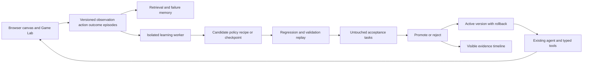

# Fraymus OS One assessment and workspace integration plan

Reviewed October 29, 2026. This is a source and engine assessment; the current Agent Workspace application design and code remain unchanged.

**Fraymus-OS-One can contribute both a working improvement-loop pattern and a substantial creation toolbox.** Its most useful learning mechanism runs a candidate, observes a failure, changes a bounded rule, checks fresh examples and replays previous goals before retaining the change. The related `fraymus-brain` repository already separates much of that engine from React and adds actual small weight-training experiments. The next workspace development should reuse these mechanisms behind the current interfaces and connect them to actual browser, artifact and gameplay outcomes.

[Current guide](../README-006.md) · [Design plan](AGENT_WORKSPACE_DESIGN.md) · [Review evidence](evidence/fraymus-os-one-review.json) · [Independent probes](evidence/fraymus-os-one-probes.json) · [Source inventory](evidence/fraymus-os-one-inventory.json)

## Reviewed repositories and scope

| Repository | Reviewed commit | Scope |
| --- | --- | --- |
| [Fraymus-OS-One](https://github.com/eyeoverthink/Fraymus-OS-One/tree/2861859ad41dc51475159361946f70c585f8f686) | `2861859ad41dc51475159361946f70c585f8f686` | 172 tracked files; 55 JS/JSX/MJS source files and 31,901 source lines; sixteen workspace registrations, project model, runtime, continuity, learning engines, adapters and manuals |
| [fraymus-brain](https://github.com/eyeoverthink/fraymus-brain/tree/bf7c513e97480376d2583688f9e5b43c6c44657f) | `bf7c513e97480376d2583688f9e5b43c6c44657f` | The kernel explicitly linked by OS One; package exports, Think, FlyGNN, quantization/training code, test suite and saved layer checkpoint |
| Agent Workspace | implementation `e370eea`, guide `e39b652` | The existing independent successor with real browser, runnable canvas, native local-model tools, versioned files, tests, recipes and Game Lab |

All OS One tracked files were inventoried; the review concentrates on architecture and the core runtime, learning, persistence and execution paths. It does not claim a line-by-line correctness proof of the whole application. Both reviewed repositories were cloned into separate review directories. Their tracked source is unchanged. No mail service, provider, generated Node project or shared model service was started or modified.

## What I verified by execution

| Check | Observed result |
| --- | --- |
| OS One production build | Passed; Vite compiled 71 modules |
| Existing OS One OPEG tests | 4 passed |
| Related kernel test suite | 16 passed: Think, binds, ternary training, row gains, outliers and supported GGUF decoder fixtures |
| Think on a fresh mind | `14 - 9` first returned an incorrect result internally, changed subtraction to SUB and passed with result 5 |
| Reuse | `100 - 37` returned 63, replayed the earlier case and required no second rewrite |
| More operator learning | Multiplication and division revised their mappings and preserved earlier arithmetic goals |
| Serialized mind | After JSON round-trip, 24 fresh arithmetic cases passed without another rewrite |
| Honest unsupported results | Division by zero and missing facts failed; a browser-building prose goal remained UNVERIFIED |
| Bind collision | `bind fire 7`, then `bind steam 4` changed placement from overwrite-zero to next-free and retained two readable concepts |
| Synaptic update | A FlyGNN slice's stored mean weight changed from 1.00 to 1.05 after `trainHebbian` |
| Small weight training | The kernel's two-input neuron example reduced training MSE from 0.375 to approximately 0.004793; later non-improving steps were held |

These are actual local results. The saved full-size Qwen tensor experiment was inspected as a published checkpoint; it was not rerun against a local model file. OS One's full browser UI, mail/voice/media providers and native conversion tools were not acceptance-tested during this review. The production build establishes that its source compiles, rather than proving all sixteen workflows work on this Windows machine.

The [independent probe script](../scripts/Review-Fraymus-Learning.mjs) runs against the pinned OS One checkout without starting its server. To repeat the review checks from their respective directories:

```powershell
# Fraymus-OS-One checkout at 2861859
npm.cmd ci --ignore-scripts --no-audit --no-fund
npm.cmd run build
node --test server/opeg.test.mjs
# fraymus-brain checkout at bf7c513
npm.cmd test
npm.cmd run phi75
# Agent Workspace checkout; pass the absolute OS One review directory.
node scripts/Review-Fraymus-Learning.mjs C:/path/to/Fraymus-OS-One
```

## The learning mechanisms are different and complementary

### Think changes a reusable program policy

[`brainMind.js`](https://github.com/eyeoverthink/Fraymus-OS-One/blob/2861859ad41dc51475159361946f70c585f8f686/client/src/tools/brainMind.js) is the strongest immediate abstraction. It has an arithmetic parser, an independent integer evaluator, FrayVM emission using the mind's current operator table, bounded candidate opcode search, numeric probes, regression replay and a retained prior-table record called a fossil. The revised table governs later tasks. The first subtraction error is deliberate: the seed maps minus, multiply and divide to ADD.

That is persistent rule adaptation in a defined executable domain. It is a useful pattern for choosing and repairing workspace strategies. It does not automatically solve arbitrary natural-language tasks: unsupported prose remains unverified. The existing mind retains at most 32 arithmetic cases and 12 fossils; workspace-scale replay should use a persistent episode store rather than inherit these small in-memory limits.

[`BrainPage.jsx`](https://github.com/eyeoverthink/Fraymus-OS-One/blob/2861859ad41dc51475159361946f70c585f8f686/client/src/tools/BrainPage.jsx#L3635) calls Think, stores the returned mind and persists continuity. The [server memory routes](https://github.com/eyeoverthink/Fraymus-OS-One/blob/2861859ad41dc51475159361946f70c585f8f686/server/index.js#L940) save and restore that state. This supplies the cross-run persistence connection that the current workspace can extend.

### FlyGNN changes its own synaptic state

[`FlyGNNv10`](https://github.com/eyeoverthink/Fraymus-OS-One/blob/2861859ad41dc51475159361946f70c585f8f686/client/src/tools/flyGnnConnectome.js#L231) creates a seeded neuron/connectivity model with mutable weights and activations. `trainHebbian` changes stored edge weights, and `messagePassingStep` uses connected presynaptic weights to update activations. `trainConceptSlice` also writes a concept label and exact target value onto a lead neuron; `readConceptSlice` retrieves those stored tags and a mean weight.

Consequently, the bind read-back demonstrates stored association and collision handling. Its exact value is also stored explicitly; that read-back alone is not a test of a neural network inferring a previously unseen answer. For the workspace, this engine is a candidate small controller or associative subsystem. It needs meaningful feature encoding, outcomes and independent task metrics before affecting browser or game decisions.

### Other local adaptation can help routing and retrieval

[`sovereignEcosystem.js`](https://github.com/eyeoverthink/Fraymus-OS-One/blob/2861859ad41dc51475159361946f70c585f8f686/client/src/tools/sovereignEcosystem.js) includes a small ternary cortex, running nearest-class-mean updates, sub-prototypes and memory-cycle logic. Its 64-dimensional input representation is deterministic token hashing. Those pieces can be evaluated as local task routing, failure grouping and retrieval components. They are distinct from the embeddings or learned weights of the installed language model.

[`emotionCore.js`](https://github.com/eyeoverthink/Fraymus-OS-One/blob/2861859ad41dc51475159361946f70c585f8f686/client/src/tools/emotionCore.js) maps state and outcomes to bounded exploration/risk/verification parameters. A useful transfer would make repeated verified failures increase inspection or testing effort and reduce repeated actions. The current UI can show those control changes in the timeline without introducing a new emotion dashboard.

### The linked kernel performs actual weight training

The OS One README points explicitly to **fraymus-brain**, which exports reusable functions through [`index.js`](https://github.com/eyeoverthink/fraymus-brain/blob/bf7c513e97480376d2583688f9e5b43c6c44657f/index.js).

- [`trainPhi75`](https://github.com/eyeoverthink/fraymus-brain/blob/bf7c513e97480376d2583688f9e5b43c6c44657f/kernel/phi75.js#L330) computes an error-derived gradient, updates ternary votes, proposes trit/scale/bias changes and keeps a candidate only when the batch loss falls. I reran its small neuron example and the tests.
- [`trainLedgerMatrix`](https://github.com/eyeoverthink/fraymus-brain/blob/bf7c513e97480376d2583688f9e5b43c6c44657f/kernel/layerTrain.js#L278) trains ternary block representations against the original file matrix. It checks training error, a separate validation batch and an inlier error budget, while retaining exact outlier values.
- [`train-attn-v.mjs`](https://github.com/eyeoverthink/fraymus-brain/blob/bf7c513e97480376d2583688f9e5b43c6c44657f/examples/train-attn-v.mjs) reads one real Q8_0 attention-value tensor, fits gains, trains its representation and writes a JSON checkpoint. The stored checkpoint describes a 128 × 896 Qwen2.5 0.5B matrix, with 5 of 8 vote steps retained and validation relative RMSE approximately 0.48984 → 0.48899 after the row-gain stage.

This is real numerical training and a useful starting point. The tensor experiment improves a representation's approximation to an existing teacher matrix. It does not by itself add new task knowledge to a whole language model. A checkpoint in this custom JSON format is also not automatically a loadable Ollama model. Full-model runtime conversion, quality tests and task-level learning remain integration work.

The `heldOut` batch in the matrix trainer is consulted repeatedly to accept candidates, so it serves as validation. A final untouched task set is still needed for claims about generalization. Likewise, small reconstruction errors are not direct evidence of improved language generation or browser control.

## How the entire creator app benefits this one

The broader app contains usable generation, compilation, asset and packaging patterns. The integration should extract their engines and output formats, while keeping the present workspace layout.

| OS One area | Transfer to Agent Workspace | Priority |
| --- | --- | --- |
| Code and project model | Source/file manifests, reusable components, static/React/MERN export transforms | High; map into versioned artifacts |
| CRUD | Generate actual schema-based forms and REST project source | After isolated application workers and API acceptance tests |
| REPL | Inspect DOM, prototype and debug a creation | Use the existing isolated preview and typed debugging tools |
| Canvas | Content/media/style/layout entity components with x/y/z organization | High for richer artifacts; preserve domain-specific semantics |
| HTML and JS | Live document generation, console/error feedback and responsive preview | High; fits the center canvas/source workflow |
| Brain | Think, continuity, candidate history and adaptation engines | First learning integration |
| OPEG | Domain-specific executable checker and sanitized result structure | Reuse the checker/receipt pattern; each new domain needs its own oracle |
| WASM and FrayVM | Bounded programs, compilation, traces and certificate mechanisms | Later executable artifact type with dedicated tests |
| Emoji and Emoji Coder | Compact encodings and generated markup/source | Optional import/export adapters |
| Dispatch | Signed bundle metadata, payload integrity and provenance | Useful later for portable skills; signature verification does not establish safe behavior |
| Seal | Signed media/program bundles and synchronized avatar playback | Optional media artifact type |
| 8-bit | Image processing, masks, pixel assets and frame workflows | Useful creation capability after resource limits and portability work |
| Production | Cast, audio envelope, mouth frames and timed composition | Later audiovisual renderer and test adapter |
| Mail | Mail import/export and explicitly requested communication workflows | Separate connector capability; not needed for the first learning milestone |
| Screw | Reusable cards/catalogs combining source and media | Map suitable cards to versioned recipes with tests |
| Node runtime and export | Build real multi-file applications, logs, ZIP output and runtime profiles | Valuable pattern after a proper worker execution boundary |

The pure `applyX(project, ...)` transformations are a useful design choice: a generator returns proposed project content instead of needing to own the whole UI. Adapt that output into a workspace transaction and artifact revision, then open it on the existing canvas and validate it. The model continues using the current tool registry; it does not acquire the original server's unrestricted execution routes.

## What needs adaptation before reuse

There are substantial working mechanisms here, alongside demonstrations and heuristic scores. These distinctions affect the integration:

1. **Keep measured metrics separate from configured values.** In `runFlyGnnMeasureTrainMeasure`, word-accuracy percentages are literal values. My zero-vs-ten-iteration probe returned the same 78% held-out figure while actual weights changed. `evaluateOmegaIntelligence` combines weights, skill counts and cycle/generation bonuses, and the Thinking³ `empiricalAccuracy` is calculated from entropy and cycle count. Those numbers can be diagnostic heuristics; use independently executed task outcomes for promotion.
2. **Move generated execution outside the trusted application.** `compileAndVerifySkillInVm` uses `new Function` despite its name. OS One's Node runner inherits host process environment and privileges; a heap setting is not an OS sandbox. Preserve the current workspace's isolated renderer and private Java API, and design a separate worker for new general programs. Do not copy these executors into the privileged Electron process.
3. **Keep raw model output and corrected output distinguishable.** The OS One Ollama route can replace an answer from an oracle-supplied synthesis. Its double-check branch can also append a measured label when absent. Neither operation establishes that a model learned or independently verified a task. Feed actual tool receipts into episodes; keep raw draft, intervention and outcome as separate records.
4. **Use a project-scoped durable store.** OS One continuity writes JSON and the UI falls back to localStorage. Reuse its schema ideas and mind state, but store them in successor-only versioned checkpoints with explicit persistence results, migration rules and rollback. Do not mix the two apps' continuity directories.
5. **Make provider and operating-system dependencies explicit.** Some media conversion paths use macOS tools such as `sips`, Quick Look and `avconvert`; some rendering/voice paths depend on external services. Keep optional capabilities unavailable until their adapter works on Windows. The current app continues running without Docker or WSL.
6. **Pin the extracted dependency and its evidence.** The standalone kernel already removes the main React dependency from the learning path. Review its exported functions and pin the reviewed source rather than importing a moving repository branch or the 5,567-line Brain page into the shell. Retain attribution and inspect redistribution terms before packaging.

These are concrete integration boundaries, rather than reasons to discard the original work. The Think mechanism and the small numerical trainer already meet stronger evidence standards than a score that rises just because another cycle ran.

## Preserve the current product design

Keep project objects and the browser on the left, the live creation/source canvas in the center, the agent on the right and evidence in the bottom timeline. Learning should improve what happens inside those surfaces.

- **Project objects:** add episode collections, candidate versions and training checkpoints as real entity/component types when implemented.
- **Agent panel:** show the active policy/model version and a plain status such as evaluating candidate or replaying earlier tasks.
- **Timeline:** show the failure, proposed change, baseline comparison, regression result, promotion or rejection.
- **Canvas:** render the artifact being tested, a concise comparison or an explicitly selected training result.
- **Game Lab:** feed tick-aligned observations and outcomes through its adapter; preserve its live simulation and saved level.

There is no need to import sixteen top-level tabs. Capability adapters and contextual controls can grow inside the existing working app. The original OS One app remains independently usable.

## Proposed learning architecture



Java remains the owner of model routing, entity state, transactions and persistent evidence. A small worker can expose the extracted JS kernel through a bounded JSON protocol. Its output proposes a change or ranks an existing action; only the current host dispatcher executes tools. Training does not install arbitrary executable handlers or bypass action validation.

The minimum records are:

| Record | Required content |
| --- | --- |
| LearningEpisode | Task ID, observation reference/digest, action/tool arguments, actual result, artifact/model/policy versions, acceptance outcome, failure class, timing and provenance |
| LearningCandidate | Parent version, mechanism/type, data/episode references, changed rules or checkpoint digest, capabilities and worker limits |
| EvaluationReport | Frozen task suite, train/validation/final-test split, baseline/candidate results, regressions, task success, repeated-action rate, time/cost and test receipts |
| PromotionRecord | Accepted/rejected, decision evidence, active version, previous version and rollback target |

A stale observation should produce a lesson to observe again. A failed artifact test should record the failure and the revision that repaired it. A repeated blocked movement should contribute an alternative-action outcome. These are concrete training signals. Page text, model claims and synthetic scores must not become ground truth on their own. Episode capture should omit secrets and personal page content unless needed and explicitly selected for the local dataset.

## Recommended implementation order

| Stage | Deliverable | Acceptance gate |
| --- | --- | --- |
| 1. Durable episodes | Add episode and policy/candidate schemas using the existing store and timeline | Record a real browser/canvas task; close/restart and recover the same versioned outcome; interrupted records are handled |
| 2. Extracted adaptive controller | Pin the standalone kernel, retain its Think reference fixture and add a bounded workspace strategy learner | Later related tasks use a persisted change; baseline comparison shows fewer repeated failures without breaking earlier tasks |
| 3. Real regression replay | Deterministic browser/artifact fixtures plus held-out task variations | A deliberately harmful candidate is rejected; a useful one passes; rollback restores the prior behavior |
| 4. Small trainable model | Train a local routing/failure/action-ranking component from verified episodes | Reproducible loss and task metrics on disjoint data; report success and failure, not only training loss |
| 5. Whole-model research adapter | Separate dataset/checkpoint/export/inference worker for an explicitly chosen model | Loadable candidate, known parent, independent tool-task quality and context/format regressions; baseline remains available |
| 6. More creation capabilities | Add generators, FrayVM/WASM, media and full-app workers in useful order | Each artifact type has a real renderer, actual validator, persistence and cancellation/recovery test |

The **next coding milestone should be stages 1–3**, because they make learning visible, persistent and testable using the app that already works. The small weight trainer can then learn from meaningful episodes instead of a fabricated success score. A whole-model training experiment may proceed separately when its dataset, runtime format and evaluation path are ready.

## Value to the project

The current workspace supplies the visible environment, actual actions, versioned creations and behavioral evidence. OS One supplies existing adaptive rule machinery, associative and numerical kernels, continuity patterns and a broader creation toolbox. Together they support a product in which an agent can reuse a proven solution, change a strategy after a measured failure and show why a later version is better.

The strongest near-term result is an observable improvement across repeated tasks with a retained explanation and rollback. That is the practical bridge from the current working creation loop to the larger self-improving system the creator intends. No claim of unrestricted computer control, full-model self-training or broad intelligence improvement is needed to deliver and measure that next step.
