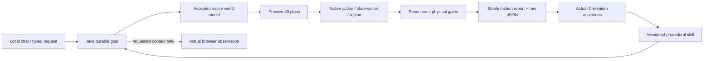

# Java goals and procedural skills

Edition 019 connects natural-language chat to the existing learned numerical world model and native physics. A tool performs one action. A procedural skill completes a registered task through actions, checks and recovery. The first registered procedure is `world-reach-report-v1`.

## Complete task

Ask: “Predict how this native block moves, reach target 1.2 metres despite a +0.35 m/s disturbance, chart predicted versus actual motion, and save the successful procedure as reach-chart-retain.” Physical parameters can be specified explicitly. The supported domain remains slope 10–40°, friction 0–0.3, gravity 8–12 m/s², mass 0.5–2 kg, target 0.4–1.8 m, and the default 12 × 3 m ramp at Z=0. This is a native ramp task, not arbitrary real-world manipulation.

1. The local model selects typed semantic inputs. The host checks explicit numeric requirements and optional requested browser context before starting. A currently selected source scene is bound by the host; Java checks its version and freezes a separate goal scene. A foreign current experiment must be reset first; that preserves its saved scene and run history.
2. Java reuses an accepted native dynamics model. If none is available, an owned prerequisite job performs the existing training, independent native evaluation and separate recorded-data evaluation. Training does not run again on every procedure use.
3. Java prepares an owned paused world and evaluates the existing 49 candidate plans. A current-state digest is required and physical state must remain unchanged during preview.
4. The controller executes one action every 12 native 240 Hz solver ticks, observes the actual state, measures prediction error and replans. Exactly one actual impulse is scheduled at tick 108 (0.45 s); its sign and magnitude come from the frozen request. The native trial lasts 360 ticks (1.5 s). Wall-clock timing is not a real-time guarantee.
5. Java reconstructs endpoint, terminal-speed, settling and action-use metrics from recorded native samples and commands. Fixed acceptance is endpoint ≤0.08 m, terminal speed ≤0.25 m/s, settling error ≤0.15 m and model actions ≥80%. Thirty plans, twenty-nine prediction checks and the actual disturbance must exist.
6. Java writes a stable, versioned artifact containing a displacement chart, raw run JSON and typed procedure parameters. Violet one-step forecasts are aligned to measured ticks; the green curve is actual motion. One-step RMSE describes this run's forecasts and is not a confidence interval.
7. The desktop opens that exact artifact and performs seven actual Chromium assertions. Java verifies the pinned version/content hash and the stored assertion receipt. An invented `passed:true` value cannot complete the goal.
8. Only after all checks pass may Java retain a versioned procedural skill. The final chat summary uses Java's measured values. A local model chooses and explains; Java owns durable execution; the controller owns physical timing; independent verifiers decide completion.

## Ownership, durability and recovery

Goals and procedures are FactoryWorld entities in the private project's `goals/tasks.fworld`. Scenes, brain jobs, artifact files and test receipts retain their existing stores. Each goal has frozen parameters, source binding, attempt number, history, report identity and a finite recovery budget. State changes are atomically checkpointed. There is no distributed transaction spanning every file and native effect.

The control server serializes goal transitions with competing physics/model mutations. A goal owns its live native run. Direct reset, scene editing, competing impulses, calibration application and model rollback reject while it is running. Cancel stops its owned physics and any still-active owned training job. Cancellation never promotes a skill.

After process loss, active goals are marked **interrupted**. They do not silently resume. Select **Resume saved task** in the right panel. An unfinished physics run stays recorded as interrupted, and a new attempt starts from the frozen conditions. A completed physical run is reused; it is not physically replayed merely because report verification was interrupted. Stable scene, model-job and report effect identities reconcile saved effects. Three explicit resumes are allowed, with a 180-second budget per attempt. Failed physical acceptance is never reported as success.

Desktop effects are restricted to registered `browser.observe` and `canvas.verify-report` handlers. Their private claim/ack routes use goal/effect identity, a fresh nonce and a 30-second claim expiry. These routes are absent from the model's tool catalog. New claims can retry a read or report check after expiry; this is not an exactly-once guarantee for arbitrary external writes. Browser content is retained as a source URL/hash and labelled untrusted context. It supplies no physics evidence, handlers or permissions.

The original authored source remains unchanged. Do not edit the frozen goal scene while an interrupted task is awaiting recovery; changed frozen content is rejected. Cancel and begin a new task if you want different conditions. Personal project data, model weights, browser profiles and credentials remain outside Git.

## Reuse a skill

Open **Verified skills**, select the named procedural version, inspect its prerequisites/actions/recovery and change slope, friction, target or disturbance. **Run and verify again** creates a new Java goal and separate scene. Reuse performs fresh prediction and feedback; it does not blindly replay earlier impulses. Each completed goal records which exact skill version it used and its new measured outcome.

Skill versions are immutable FactoryWorld records containing a registered procedure kind, defaults, prerequisites, actions, success gates, recovery policy and source goal/run/report evidence. Saving the same goal/name again returns the same version. Saving a different verified goal under that name creates the next version. Existing tested HTML artifact recipes remain a separate capability. Procedure data does not install arbitrary Java, shell or browser code.

Limits are one active goal, 64 retained goals, 32 procedural version records, at most eight versions per name, and the existing 16-job brain history limit. Reaching a budget stops with an explicit reason; it does not erase history. This edition adds one fully implemented registered workflow. It does not claim a general user-programmable workflow language, online LLM weight training, unrestricted tool installation, broader collision learning or real hardware control.

## Interfaces and testing

Chat receives `world.model`, `goal.start`, `goal.read`, `goal.cancel`, `goal.resume`, `procedures.list`, `procedure.save` and `procedure.run`. Semantic chat inputs use direct fields such as `angleDeg`, `friction`, `targetM`, `disturbanceMps`, `saveSkillName` and `browserContext`. The desktop translates them to the Java typed definition and binds source/ownership handles. Host acknowledgment is not a model tool. Existing memory retrieval and local-model admission still apply to planning calls.

The private loopback API supplies `/api/goals/start|read|list|cancel|resume`, `/api/procedures/save|run`, and private desktop-effect routes. It requires the existing bearer capability. The original game, brain, browser, canvas, native manipulation, measurements, calibration and export interfaces remain available outside an active owned task.

Run the normal Java checks, `npm test` in `workspace-desktop`, `npm run test:goals` for native/browser/canvas/restart/reuse checks, and `npm run test:live-goals` for actual local-model selection through the visible chat UI. Each integration test creates isolated temporary project data. Electron integrations run sequentially. The [fixed edition 019 cases and gates](../workspace-engine/src/main/resources/goals/contract-v1.json) were written before their first execution; these are local development cases, not a hidden external benchmark.

The recorded Delfys reality forecast retains edition 018's failed 0.015 m gate. Passing the native goal does not authorize physical-world actuation. Next work should add further registered task families and independent failure/novel-condition cases, then evaluate experience-derived changes before promoting them.

[Edition 019](../README-019.md) · [World model and recorded reality](WORLD_MODEL_REALITY.md) · [Architecture](ARCHITECTURE.md)
