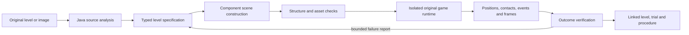

## Progress through edition118 — 2026-11-11

Declared enemies and obstacles now use original source components and normal inputs in the integrated Game Lab. Optional pickup decisions read actual support, clearance, obstruction and enemy motion; skipped opportunities do not become false failed-learning events. Development12/12 finishes versus9/12 prior policy, with five pickups/seven declined/zero damage; original24 regressions retain finishes and collection. See [edition118](../README-118.md) for separately reserved hardware/software results, actual costs and counterexamples.

One existing Java chat task constructs challenges, retains the fresh simple comparison, requires AI finish, survives interruption in a fresh trial, and reports verified reasons. Old measured-gap repairs remain for old recipes; challenge terrain repairs are refused. Original source/outcome gates remain. [Contract](EDITION_118_CONTRACT.md).

Next119: use contact/displacement observations for the retained seed8 gap-to-step stall. Compare bounded recovery inputs on fresh reserved cases; do not rewrite this failure. Then reconsider deferred opportunities after threats pass, with capped retries and measured benefit. Then broaden multiple-enemy/obstacle/height scenarios and already-wedged recovery. Broader explicit image-component support needs independent images, unknown-region review and refusal measurements. Reusable level procedures still require retirement/reactivation and fresh qualification before unchanged32-slot admission. The historical roadmap below remains planning, not a claim that every step is delivered.

## Progress through edition117 — 2026-11-11

The wider seed15 failure is corrected at its approach: bounded observed-item interception defers the optional chase jump while preserving the existing gap-safety jump. The original stalled contact/displacement trace remains. No physics, transform, collider or finish rule changed; generic escape from an already-wedged character is a separate future task.

All24 declared hardware layouts finish with24 pickups and no damage. Twelve prior regressions, six wider development and six reserved cases; the reserved six repeat on software rendering. Six existing transformed-reference cases regenerated per renderer require simple and revised completion, while four unsupported images still refuse. Actual chat exposes checked pickup/damage outcomes and resumes a wider-gap task after abrupt interruption. Full costs and original failed/skipped checks remain in [edition117](../README-117.md) and [its contract](EDITION_117_CONTRACT.md).

Next: declare enemy/obstacle layouts, unreachable and risky pickups, alternate heights and already-wedged states; compare completion, survival, collection and total work. Broader explicitly supported image components follow. Procedure retirement/reactivation with original provenance remains required before admission into the unchanged32-slot bank. The older roadmap below remains historical planning, not a claim that every item is delivered.

## Progress through edition116 — 2026-11-11

The retained seed0 controller failure is corrected using owned Java landing forecasts and ordinary input, without editing physics or actor state. The original policy remains an explicit baseline. Final narrower-layout comparison: revised12/12, original5/12, simple12/12; power-ups2 versus7 original. Six reserved layouts repeat under software rendering. The wider reference cohort still reveals a five-tile-gap failure on seed15: simple finishes6/6 reconstructed levels, revised5/6. This is the next contact/landing-recovery case, alongside restoring safe pickup pursuit without losing finishes.

CI-first investigation reproduced115's one failed reference test: invalid GLSL330 sampler indexing produced malformed frames on Mesa. Portable literal sampler branches and explicit shader exceptions fix the renderer; image thresholds and source/outcome checks remain. Six fresh native reference scenes, declared crops/shifts/scales, independent reconstruction parameters and actual playtests pass on both renderers; missing finish, incomplete floor, covered player and blank image refuse. No arbitrary web-image claim. Shader identity prevents reuse of old proofs as current evidence.

[Edition116](../README-116.md) and [its contract](EDITION_116_CONTRACT.md) preserve complete costs, original failures, actual chat/restart evidence and remaining limits. Procedure retirement/reactivation with original provenance is still required before new admission into the unchanged32-slot bank. The phase descriptions below are the original roadmap, not claims that every broader item is delivered.

## Progress through edition115 — 2026-11-10

The durable source-construction task is implemented in the existing Java chat owner: original component checks, actual simple-control playtests, at most two observed-gap repairs, existing-AI comparison and explicit fresh-session recovery. The first bounded reference front end is also implemented for known original sprites and the two-gap recipe. Images retain original bytes, grid/match measurements and explicit Powerup behavior; unsupported foreground and occluded actors refuse. This is the first bounded slice of phase116, not general screenshot reconstruction.

[Edition115 contract](EDITION_115_CONTRACT.md) records the acceptance gates. The final README and actual evidence distinguish simple-control success from the existing AI failure on seed0. No new procedure-bank admission or model training. Next: broaden image evidence/layout support, improve the measured AI controller failure, and implement explicit procedure retirement/reactivation before retaining new skills into the full32-slot bank. Preserve all earlier contracts and frozen evidence.

# From an existing level to a newly tested playable world

Declared 2026-11-10, following edition 113. This is a development plan, not a statement that every phase is implemented. The first implementation is edition 114. Original sources, saved worlds, published README editions and verification rules remain intact.

## Purpose and demonstration

Give the agent a complete creation task in the environment it can observe and control:

> Use the original Mario components to create a short beginner level. Include reachable gaps, a power-up and a finish. Run it, explain what passed or failed, and save the level with its evidence.

The result must be a real serialized scene with working Java components, loaded by the existing game runtime. A drawing of a level is not a playable level. A successful file write is not a successful playtest. A failed controller run does not by itself prove that a human cannot complete a level.

This advances the larger design: requests become constructed environments; predictions can be checked through action; failures guide bounded revisions; useful procedures retain their origins, checks and recovery. It does not require a generative video transformer. It also does not establish general intelligence or subjective awareness.

## What is already present

| Existing part | Useful foundation | Boundary |
| --- | --- | --- |
| `levels/mario-original.json` | 1,248 objects, 6,085 components and 16 component types, including player animation states, terrain, enemies, power-ups and flag logic | This is the full source scene. Root `level.txt` is only a two-object transform example. |
| Scene serialization and component registry | Structured positions, sprites, collision bodies and Java behavior references | JSON stores data; Java implements behavior. Unknown types must be refused. |
| Scene validation and factory transactions | Physics checks, asset checks and round-trip validation | Structural correctness does not establish reachability or enjoyment. |
| Embedded Game Lab | Original renderer, actual physics, bounded input steps, observations and AI play inside the workspace | The current bridge does not yet create/import a new platformer level. |
| Java goals, histories and verified procedures | Durable progress, recovery, evidence and reusable task structure | A new level skill needs its own typed contract and success checks. |
| Reference-image mapping | Declared palette/tile interpretation and native top-down navigation scenes | This is not arbitrary Mario screenshot recognition or a platformer compiler. |

Existing external rendering/physics dependencies remain. New analysis and construction logic is owned Java; this plan does not claim the entire application is dependency-free. Known unfinished legacy behaviors, including invincibility question blocks, must not enter the supported generator vocabulary.

## Architecture and authority

Java owns source selection, construction, identities, validation, execution records and outcome decisions. Chat translates a request into a supported specification and explains results. The desktop shows the actual runtime and controls. Screenshots complement structured observations; they do not replace source or outcome checks.

The source, candidate, test session and active authored world have different identities. Construction never overwrites the bundled source or a user's authored scene. Selecting a candidate is an explicit action. Every runtime reset must reconstruct the same checked candidate in its own project directory, without silently loading an older authored scene.

## Phase 114 — source analysis and separate playable candidates

Implement a bounded Java constructor using known source components. Preserve the complete player's animation/state definitions, sprite references and physics settings. Reassign object/component identities; retain source-object lineage separately. Build a short declared layout from terrain, a player, a supported power-up block and a finish. Store candidate JSON and a manifest with source/candidate hashes, parameters, object counts and asset references.

Add controls to the existing Game Lab: analyze the original, create a candidate, select a saved candidate and open it. Keep the ordinary original-game path available. Starting a candidate must use the existing hidden renderer and a distinct runtime directory. A manifest is evidence of construction, not a playability certificate.

Acceptance:

- Read the real source and report component counts and required assets; distinguish the small root example.
- Create different bounded layouts from explicit parameters, with exactly one player and a finish, finite geometry and unique identities.
- Refuse changed candidate/source/asset bytes and unknown candidate IDs before launch. Reject malformed/out-of-range inputs and preserve originals.
- Load/render the generated candidate, move using actual game inputs and show observed collision/goal state. Record failures as failures.
- Compare source bytes before/after, reopen the saved candidate after restart, and capture the real app at useful sizes.
- Run relevant source/physics/runtime/desktop regressions. Record full trial time and source identity.

No screenshot reconstruction, generic text-to-level model, new learned controller or automatic skill promotion is claimed in this phase.

## Phase 115 — durable chat-driven construction and playtest skill

Connect the constructor to a typed Java skill graph: analyze → construct → validate → playtest → inspect → save. Preconditions include a supported source and available runtime ownership. Every action is bounded by candidate count, ticks, wall time and artifact size. Recover after interruption by checking saved bytes and runtime identity, then reconstructing a fresh session; never append observations from two incompatible sessions as one continuous proof.

Use both simple scripted input and the existing AI controller. Compare success, falls, collisions, power-up collection, goal completion, action count and complete cost. Observing a finish collision verifies completion; reaching a nearby X coordinate alone does not. A claim that a mushroom was collected needs the actual spawned-object/player-state evidence.

Allow a small number of repairs tied to a specific failure hypothesis, for example reducing a gap or moving an unreachable power-up. Preserve every candidate and trial, including failures. Do not teleport the player or relabel a prediction as observed motion. Stop with a useful explanation when the bounded repair budget is exhausted.

Before saving new procedures into a full bank, implement the previously proposed explicit procedure lifecycle: retire/reactivate with original provenance, descendants and rollback retained. Keep the active 32-procedure limit. No silent eviction or raised capacity.

Acceptance: one visible chat request completes the workflow, survives an abrupt stage interruption, produces an honestly checked result, and repeats on a fresh layout. Include malformed requests, changed source files, failed drafts and recovery costs. Compare local-model planning with direct routing; report model calls separately.

## Phase 116 — reference-image reconstruction with known sprites

Start with a screenshot of a known engine scene and its known sprite atlas. Estimate grid scale and camera crop; match tile/sprite templates; distinguish background, solid terrain, actors and uncertain cells. Retain the original image hash, crop, estimated coordinates, matches, confidence and human corrections. Image pixels cannot reveal hidden blocks, off-screen geometry, material properties or all behavior: mark these unknown or require a declared rule.

Translate the recognized layout into the same typed specification and constructor, then reuse the existing validation/playtest skill. Show image and reconstructed scene with an alignment overlay. Keep template matching, geometric reasoning and connected-component algorithms in Java where practical; introduce no external model dependency merely for convenience.

Acceptance: held-out images with changed scale/crop, occlusion and distracting backgrounds; measure tile classification and position error against known scenes. Refuse ambiguous reconstructions rather than silently inventing collision geometry. Actual generated levels must load and receive fresh playtests. A web screenshot is a later input option, not permission to browse or download arbitrary content automatically.

## Phase 117 — useful procedural variety and qualified reuse

Expand the bounded vocabulary: intermediate platforms, terrain elevation, supported enemies, coin routes and deliberate difficulty constraints. Estimate jump envelopes from actual trajectories, then verify candidate paths using the runtime. Keep geometric reachability, controller reliability and human enjoyment as separate measurements.

Test unfamiliar seeds and component combinations held out from repair tuning. Compare no-memory generation, simple constraints and remembered procedures. Count the cost of retrieval, construction, simulation, verification and repair. Retain procedures only when their verified benefit justifies their extra work; preserve source and engine identities across upgrades.

Acceptance: improved held-out completion or reduced complete task cost, without sacrificing source/outcome checks. Report negative results and controller limitations. This is operational skill improvement; neural or language-model weight training requires a separate experiment.

## Phase 118 — broader world creation and shared experiments

Generalize the validated task pattern to native 3D scenes and calibrated observations while retaining domain-specific component and physics rules. Offer orthographic/perspective views of shared state. Treat fourth and higher dimensions as declared coordinates, latent features or time-indexed data; a projection is not evidence of extra physical dimensions.

Export scene JSON and lineage, replay input/events, CSV traces, screenshots, and optionally an encoded video when a real encoder path is implemented and tested. Runnable code export needs a declared runtime/version/assets manifest and a clean-build test. Importers must map explicit supported formats; no universal-file or universal-engine import claim.

Acceptance: an independently reconstructed scene reproduces the checked task under the declared tolerances, and any action applied to the active world is checked again against current state.

## Evidence, controls and practical cost

For each trial retain source hashes, engine/build identity, candidate parameters and JSON, input sequence, runtime/session ID, state samples, outcome reason, representative frames and elapsed times. Keep observed, predicted and inferred fields distinct. The same scene can be structurally valid, render correctly and still fail a controller test. A screenshot alone cannot certify completion.

Run serial on this host, with explicit tick/time bounds and isolated test projects. Preserve live private worlds and do not rebuild installed JARs beneath running users. Do not upload private camera frames, model weights or runtime credentials. Existing chat/workflow/goal/archive capacities remain unchanged.

Validation layers: constructor unit tests; actual legacy deserialization/asset/physics tests; private bridge tests; actual embedded app/control tests; interrupted/restarted trials; held-out layouts; corrupted/missing source and outcome tests. Publish actual evidence and limitations, not a claimed universal success rate from one demonstration.

## Relationship to the previous roadmap

[Edition 113 review](APP_REVIEW_113.md) proposed procedure lifecycle, a second data creation skill, local-model routing and observation-to-artifact work. This user-requested game creation path now supplies the next complete creation task. The 32-slot lifecycle and real-model evaluation remain prerequisites for broad retained skill reuse; the two-source data report is deferred, not falsely marked complete. Existing physics, data, browser, canvas, chat and history functionality stays in place.

## Immediate delivery sequence

1. Publish this prospective outline and the first-phase contract, with the actual repository target confirmed.
2. Implement source analysis, separate candidate files and integrated Game Lab launch.
3. Test source preservation, structural/asset checks, actual motion and completion; retain failed attempts.
4. Update the new README, actual screenshots, continuity notes and logs with measured results and remaining gaps.
5. Push the implementation, fetch it back and verify the exact published files. Report CI independently of local checks.

The direction is a useful agent that creates, acts, observes and checks in one application. Every new capability must earn its description through a working path and inspectable outcomes.
