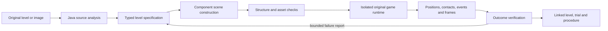

## Edition 143 / 2026-11-13 — independent appearance confirmation

The unified Java world/browser/creation mission continues. [Edition143](../README-143.md) adds an explicit partial-view experiment with source provenance, original-pixel replay and independent outcomes. Real footage and generated controls remain separate; defaults and all checks retained.

# Next steps

1. **Separate appearance confirmation from identity continuity.** The fresh generated return improves from one accepted correct measurement with142 to12 with143, but both accept the labelled copy once while the target is hidden. Develop a bounded continuity/ambiguity constraint on this now-exposed failure; preserve the result and freeze the next change before new held-out tests. Repetition and a high match score are not identity proof.
2. **Qualify complete occlusion and return on real footage.** The eligible FaceOcc1 window stays at77/92correct with15missing and no gain; no actual underlying-flow loss occurred, so the supplemental search never ran. Coupon yields no verified donor appearances despite23/23correct donor tracking; retain this legitimate refusal and investigate admission evidence without lowering standards or manufacturing examples. Use new independently labelled camera intervals with actual disappearance, return and competing objects; preserve uncertain labels.
3. **Reduce repeated evidence work only with measured benefit.** Include reference verification, search, original-pixel replay, durable writes, reopening and export. Compare full workflows under equal collection sizes and preserve every source/code/outcome check. The fixed-order timings here are not an isolated speed comparison.
4. **Connect qualified observations to durable goals.** World, browser and creation tasks must distinguish observed support, inferred geometry and unknown identity. Better box overlap must improve complete tasks before changing defaults or granting action authority. Keep the unified Java application as the destination.

## Edition 142 / 2026-11-13 — partial views from verified appearances

The unified Java world/browser/creation mission continues. [Edition142](../README-142.md) adds an explicit partial-view experiment with source provenance, original-pixel replay and independent outcomes. Real footage and generated controls remain separate; defaults and all checks retained.

# Next steps

1. **Maintain confirmation for verified reference hypotheses.** The new partial-return control finds strong unique matches, but alternating best reference keys reset confirmation at two frames. Test bounded per-reference continuity without treating a reference switch as identity proof or relaxing competitor rejection. This exposed cohort becomes development evidence; freeze the next change before new evaluation sources. Keep the original anchor and provenance, and never let predictions certify themselves.
2. **Expand independently labelled occlusion and lookalike evidence.** Include true disappearance, re-entry, moving covers and similar objects with separately reviewed target/competitor geometry. Do not treat generated controls or an unknown visibility boundary as camera-level success.
3. **Make useful references earn their processing cost.** Measure donor verification, search, persistence, repeated audit, restart and export together. Reuse exact source/code-bound computation only while preserving every check; compare complete tasks rather than a single matching call.
4. **Return qualified observations to durable goals.** World, browser and creation tasks must distinguish observed support, inferred geometry and unknown identity. Improved tracking should demonstrably improve a complete task before it becomes a default or authorizes an action.

## Edition141 / 2026-11-13 — source-qualified recovery after loss

The unified Java world/browser/creation mission continues. [Edition141](../README-141.md) adds explicit recovery after genuine flow loss while retaining baseline139 proposals, defaults and all checks. Fresh outcomes and costs remain separate from synthetic mechanism tests.

## Next steps

1. **Handle partial views without inventing identity.** The car case exposes a gap between a full source template and a clipped, changing view. Develop visible-part geometry and independently verified alternate appearances on these now-exposed recordings. Preserve original anchors and competitor checks; never admit a suspect recovery as its own training example.
2. **Qualify real disappearance and return.** Freeze the next method before new recordings with complete cover, re-entry and a similar-looking competing object. Label target and distractor rectangles independently, retain uncertain boundaries, and measure every correct, wrong and missing return. This cohort contains no confirmed fully hidden images and cannot qualify full-occlusion behavior.
3. **Make the extra work earn its cost.** Measure end-to-end tracking, source replay, persistence, UI reads and reopening. Bound expensive recovery search and reuse only exact source/code-bound computation while retaining every source and outcome check. Do not trade away verification to improve a timing number.
4. **Keep the connected application central.** Durable Java world, browser and creation goals should receive clear measured, predicted and unknown states. A missing or ambiguous object should trigger observation or an explicit refusal, not silently authorize manipulation or become appearance memory. Better recovery must improve complete tasks before it becomes the default.

## Edition140 / 2026-11-13 — corroborated warnings and bounded restoration

The unified Java world/browser/creation mission continues. [Edition140](../README-140.md) separates advisory disagreement from confirmed warnings and adds bounded original-source restoration, with defaults and every source/outcome check preserved. Fresh results, costs and limitations are retained.

## Next steps

1. **Recover useful observations after loss.** Use the now-exposed140 failures for development, then freeze the next method before new recordings. Separate motion-range failure, full obstruction and changed appearance. A recovered candidate must be checked against original evidence, competing matches and independent outcomes; waiting longer is not evidence.
2. **Measure the price of delayed warnings.** Three-image corroboration can retain legitimate motion but also delay rejection of a wrong proposal. Compare correct retained measurements, missed wrong proposals, confirmed false warnings and restoration failures on the same histories. Keep the stronger139 guard and existing default available while this tradeoff is unresolved.
3. **Qualify real-camera restoration.** Positive synthetic restoration tests establish the implemented mechanism, not its value on camera footage. Obtain independently reviewed full-cover/return and similar-object cases, preserving ambiguous boundaries and reporting every missed or incorrect return.
4. **Reduce full-workflow cost without dropping checks.** Original-pixel replay and repeated verified reads contribute substantial latency. Profile complete tracking, UI review, restart and export; any retained computation must remain bound to exact source, code and outcome identities and pass corruption/restart checks.
5. **Keep the shared application central.** Only qualified observations should feed durable Java world, browser and creation goals. The agent must distinguish measured state, predicted state and unknown state before choosing an action or retaining an appearance example.

## Edition139 / 2026-11-13 — foreground motion and spatial structure

The unified Java world/browser/creation mission continues. [Edition139](../README-139.md) adds explicit immutable seed-part evidence and relative-motion warnings, retaining baseline behavior and every source/outcome check. Fresh camera disappearance/return results include withheld correct observations, uncertainty and full costs. No default promotion.

## Next steps

1. **Reduce false withholding before adding more autonomy.** Use these now-exposed failures for development: separate genuine replacement or background drift from normal scale, pose and lighting changes. Keep the immutable source anchor; any additional appearance example must pass the existing independent admission checks. Freeze the next candidate before new evaluation.
2. **Make disappearance and return measurable.** Use larger targets, complete obstruction, re-entry and labelled lookalikes. Obtain independent visibility and target-identity review, retain uncertain boundaries, and measure correct recovery alongside false recovery and missing observations. Four confidently covered car images cannot establish general occlusion handling.
3. **Earn back the added processing cost.** Profile full tracking, persistence and original-pixel replay. Compare any optimization on identical histories and interrupted tasks, retaining every source and outcome check. Faster computation without useful observations is insufficient.
4. **Keep the connected application central.** Feed only qualified measurements into durable Java world, browser and creation goals. Clearly separate observed position, predicted position and unknown state. A missing or suspect measurement must not silently authorize a physical action or become appearance memory.

## Edition138 / 2026-11-13 — drift evidence before tracking loss

The unified Java world/browser/creation mission continues. [Edition138](../README-138.md) adds an explicit original-appearance guard, an unchanged-output monitoring control and complete original-pixel replay before independent outcome scoring. Defaults and all verification remain. No target predictions become anchor memories. See fresh results, missing observations, false warnings and full task costs before judging utility.

## Next steps

1. Detect gradual foreground drift that preserves similar colors. Develop spatial-part and foreground/background motion checks against the now-exposed138 failures, freeze the candidate, then evaluate on genuinely new footage. This study removed only two wrong overlaps and added no correct observations; it does not justify broader autonomous use or a default change.
2. Collect independently reviewed complete occlusion/return and similar-object crossings. Keep uncertain visibility explicit, report missing observations, and measure warning delay, false alarms and correct recovery. One confidently hidden sample and sparse bottle distractor labels are insufficient for general recovery claims.
3. Profile complete tracking, persistence and original-pixel audit costs. Reuse only immutable, source-bound evidence where every source and outcome check remains intact. Then connect qualified observations and supported appearance memories back to durable Java world/browser/creation goals.

## Edition137 / 2026-11-13 — frozen verified references and cheaper durable history

The unified Java world/browser/creation mission remains unchanged. [Edition137](../README-137.md) connects independently supported reference examples to explicit bounded recovery while refusing target-prediction learning and source/evaluation overlap. Completed history reopens without rewriting; complete transaction and source/outcome checks remain. See the measured camera results and full costs before making any promotion claim.

Next: stronger independently checked foreground evidence on genuinely new occlusions/returns; separately stored immutable frame evidence to reduce repeated persistence work; then qualified observations in durable goals. Preserve prior proof identities, private projects, authority checks and defaults.

## Edition136 / 2026-11-13 — anchored memory and cheaper verified reads

The unified Java world/browser/creation mission remains unchanged. [Edition136](../README-136.md) blocks49 observed wrong appearance admissions, but also52 correct ones; only3 rendered examples retained and no recovery gain. Camera learning remains unqualified; defaults stay intact. All36 controlled evidence-read hashes match; six-run summary408ms→20ms, while cold startup535ms→748ms. Every source/outcome check remains; no live-camera speed claim.

Next: useful foreground/reference evidence with independent new camera labels, then cold-open/write efficiency and durable goals. Preserve all prior evidence, private projects, authority checks and human-review boundaries.

## Edition135 / 2026-11-13 — continuity and curated appearances

The unified Java world/browser/creation mission remains unchanged. [Edition135](../README-135.md) preserves incumbent tracking continuity and adds independently audited appearance proposals. Fresh evaluation finds no recovery benefit:86/327 correct for all methods,46 automatic admissions with28 wrong. Defaults stay unchanged. A separate post-evaluation export retains16 fully visible reference-supported descriptors (11 real-camera,5 rendered) with original source/audit links; no automatic reuse or weight training.

Next: prevent drift from contaminating memory, validate complete camera occlusion/return with independent target/distractor labels, then test explicit curated-reference reuse on new footage before promotion. Rendering/game experiments remain useful controlled environments; camera results need their own evidence and uncertainty. No source/coordinate/action checks may be bypassed to make a workflow look successful.

## Edition 134 — 2026-11-12

Independent OTB object boxes and source-only AI visibility now audit lost tracking, target overlap, labelled distractor matches and recovery in the actual Java workspace. The frozen part-appearance candidate fails the simpler incumbent (7/246 versus 83/246 visible matches); it is explicit and unpromoted. The incumbent alone recovers after the one labelled full occlusion. No real full out-of-frame return is covered by this sample. Preserve defaults, physical-accuracy limits and all original evidence. Next improve supported continuity without template contamination, then independently adjudicated occlusion/re-entry and source-age gates in durable world/browser/creation goals. See [edition 134 contract](EDITION_134_CONTRACT.md).

## Edition133 — 2026-11-12

Explicit Java appearance association and visual support candidates now compare original pixels against immutable132 labels. Context/competing matches, strong two-image recovery and withheld support are source-backed diagnostics, not semantic identity or physical contact certification. Frozen comparison shows availability limits; legacy-flow and ordinary forecasts remain defaults. Contact audit can evaluate original stored default boxes without relabelling them as a new tracking proof. Keep the connected world/browser/creation mission central; next use reliable source age/uncertainty to request observations before durable physical goals. See [edition133 contract](EDITION_133_CONTRACT.md).

## Edition132 observation evidence — 2026-11-12

Source-only visibility/contact annotations and immutable downstream audits are the current perception step. They preserve defaults and native world separation. Retrospective AI marks do not establish identity recognition, calibrated physical accuracy or human truth. Next: independently reviewed contacts/occlusions, an explicitly qualified contact estimator, fixed-horizon uncertainty and justified observation requests/refusals in the continuing Java goals. See [edition132 contract](EDITION_132_CONTRACT.md). The connected browser/world/creation application remains the destination; Game Lab is its simulation runtime, not a substitute for external evidence.

## Edition130 continuity — 2026-11-12

Recorded physical-accuracy qualification takes priority for this edition. Game Lab, playable-level creation, native verification and their defaults remain intact. An unpromoted experimental tracker on recorded windows does not certify physical reconstruction from an arbitrary game image or real camera. Refer to [the integrated roadmap](INTEGRATED_AGENT_ROADMAP.md) and the current physical-reference audit before using observed geometry as a verified action target.

## Progress through edition 125 — 2026-11-12

[Edition 125](../README-125.md) records complete task costs and independently reviews optional-action decisions using later explicit trials. Recovery uncertainty, original calibration exclusion and complete cohort/source checks remain visible. The controller, selector and original native verification are unchanged. [Contract](EDITION_125_CONTRACT.md).

The next priority returns to the entire agent: 126 real local-model world/browser/creation selection; 127 procedure lifecycle; 128 calibrated observation-to-artifact mission; 129 evaluated adaptation; 130 coherent daily use. [Integrated roadmap](INTEGRATED_AGENT_ROADMAP.md) defines acceptance gates. Earlier contact-only proposals below remain dated history, not the current direction.

## Progress through edition124 — 2026-11-12

[Edition124](../README-124.md) adds opt-in user allowance and conservative benefit/cost decisions around the unchanged native task verifier. Repeated fresh explicit calibration; no-benefit and unknown-scene abstention; original and recovered evidence stays authoritative. [Contract](EDITION_124_CONTRACT.md).

Next125: measure prediction error and missed useful opportunities, including late verification and recovery costs, before broadening reuse. Next126: moving shells, reversals and changing supports. Then expand image components and reusable verified procedure lifecycles. Earlier entries are dated history.

## Progress through edition123 — 2026-11-12

[Edition123](../README-123.md) measures complete workflow costs of optional waiting and returns with the same contact122 controller. Four explicit approaches;72 repeated fresh-project workflows, retained simple comparisons and failed-task measurement refusal. No default promotion, model training or automatic utility assignment. [Contract](EDITION_123_CONTRACT.md).

Next124: explicit user time allowances and uncertainty-aware estimates, measured estimation cost and abstention on new cases. Next125: moving shells, reversals and changing supports. Then broader image components and verified procedure lifecycle. Earlier entries remain dated history.

## Progress through edition122 — 2026-11-12

[Edition122](../README-122.md) fixes the retained descending-contact deaths and supported-edge stall through ordinary input.85 older course executions finish without damage; original24 pickups and three previous return benefits remain. Fresh reserved outcomes and every comparison are retained in the edition. [Contract](EDITION_122_CONTRACT.md).

General AI Play/challenges use contact122; old nonchallenge safe117 and explicit historical policies remain. No new model training or skill admission. Next123: repeated full costs and optional-goal value. Next124: richer observed contact uncertainty on new declared cases. Then broader image components and verified procedure lifecycle. Earlier entries below remain dated history.

## Progress through edition121 — 2026-11-11

[Edition121](../README-121.md) establishes a useful return by actual collision/finish and a return-disabled comparison. One extra development pickup,71 older safe finishes, native wall reversals observed. Two development enemy-contact deaths remain. Reserved hardware/software outcomes and every unsuccessful prototype are retained. [Contract](EDITION_121_CONTRACT.md).

General AI Play and declared challenge tasks use revisit121; old nonchallenge recipes retain safe117. Original physics and verification remain. No model training or new saved-procedure admission.

Next122: late-enemy landing/contact timing, new reserved cases and comparison with simple control. Next123: repeated full-cost measurements and user objective to choose optional returns. Later: expanded image components and verified procedure lifecycle under existing collection limits. Earlier entries below are dated history.

## Progress through edition120 — 2026-11-11

Two retained supported pickups are collected after bounded waiting and actual clearance. The unsupported gap stays refused. Seven development finishes/three pickups/zero damage and all54 older finishes preserved. [Edition120](../README-120.md) records six reserved hardware/software outcomes, complete costs, original unsuccessful returns and actual chat/restart evidence. [Contract](EDITION_120_CONTRACT.md).

General AI Play and declared challenge tasks use opportunity120; old non-challenge tasks keep safe117. Nearby returns are implemented with continuous support and braking checks but useful collection remains unproven. No original physics or verification gate is removed. No neural training or new saved-procedure admission is claimed.

Next121: enemy reversals, moving pickups, constrained platforms and useful return opportunities. Compare observation timing, safe finishes, optional collection and complete work on a newly reserved set. Then expand declared image components and procedure retirement/reactivation under the unchanged32 active slots. Historical roadmap entries below remain dated plans.

## Progress through edition119 — 2026-11-11

Both retained118 failures are corrected through measured native contact/displacement and bounded input-only recovery. Temporary moving-threat deferrals can be reconsidered without false learning; passed enemies are not chased backward for a stomp. Six development finishes, all18 prior challenge finishes and all24 older finishes/pickups preserved. See [edition119](../README-119.md) for fresh reserved hardware/software comparisons, pickup tradeoffs, complete costs and counterexamples.

General AI Play and explicit challenge tasks use the qualified recover119 policy; old non-challenge task recipes retain their explicit safe117 comparison. Source/outcome checks, ownership, limits and old policy names remain. Actual chat reports verified recovery/deferral counters and resumes through a fresh trial. [Contract](EDITION_119_CONTRACT.md).

Next120: measure useful waiting and revisiting under changing enemy motion, multiple obstacles and constrained retreat. Compare survival, collection, failures and full task costs on newly reserved courses. Preserve refusal when no safe retreat is observed. Explicit image-component support and procedure retirement/reactivation follow; no new32-slot procedure admission is claimed. Historical roadmap entries below are planning, not statements that every phase has shipped.

## Progress through edition118 — 2026-11-11

Declared enemies and obstacles now use original source components and normal inputs in the integrated Game Lab. Optional pickup decisions read actual support, clearance, obstruction and enemy motion; skipped opportunities do not become false failed-learning events. Development12/12 finishes versus9/12 prior policy, with five pickups/seven declined/zero damage; original24 regressions retain finishes and collection. See [edition118](../README-118.md) for separately reserved hardware/software results, actual costs and counterexamples.

One existing Java chat task constructs challenges, retains the fresh simple comparison, requires AI finish, survives interruption in a fresh trial, and reports verified reasons. Old measured-gap repairs remain for old recipes; challenge terrain repairs are refused. Original source/outcome gates remain. [Contract](EDITION_118_CONTRACT.md).

Next119: use contact/displacement observations for the retained seed8 gap-to-step stall. Compare bounded recovery inputs on fresh reserved cases; do not rewrite this failure. Then reconsider deferred opportunities after threats pass, with capped retries and measured benefit. Then broaden multiple-enemy/obstacle/height scenarios and already-wedged recovery. Broader explicit image-component support needs independent images, unknown-region review and refusal measurements. Reusable level procedures still require retirement/reactivation and fresh qualification before unchanged32-slot admission. The historical roadmap below remains planning, not a claim that every step is delivered.

## Progress through edition117 — 2026-11-11

The wider seed15 failure is corrected at its approach: bounded observed-item interception defers the optional chase jump while preserving the existing gap-safety jump. The original stalled contact/displacement trace remains. No physics, transform, collider or finish rule changed; generic escape from an already-wedged character is a separate future task.

All24 declared hardware layouts finish with24 pickups and no damage. Twelve prior regressions, six wider development and six reserved cases; the reserved six repeat on software rendering. Six existing transformed-reference cases regenerated per renderer require simple and revised completion, while four unsupported images still refuse. Actual chat exposes checked pickup/damage outcomes and resumes a wider-gap task after abrupt interruption. Full costs and original failed/skipped checks remain in [edition117](../README-117.md) and [its contract](EDITION_117_CONTRACT.md).

Next: declare enemy/obstacle layouts, unreachable and risky pickups, alternate heights and already-wedged states; compare completion, survival, collection and total work. Broader explicitly supported image components follow. Procedure retirement/reactivation with original provenance remains required before admission into the unchanged32-slot bank. The older roadmap below remains historical planning, not a claim that every item is delivered.

## Progress through edition116 — 2026-11-11

The retained seed0 controller failure is corrected using owned Java landing forecasts and ordinary input, without editing physics or actor state. The original policy remains an explicit baseline. Final narrower-layout comparison: revised12/12, original5/12, simple12/12; power-ups2 versus7 original. Six reserved layouts repeat under software rendering. The wider reference cohort still reveals a five-tile-gap failure on seed15: simple finishes6/6 reconstructed levels, revised5/6. This is the next contact/landing-recovery case, alongside restoring safe pickup pursuit without losing finishes.

CI-first investigation reproduced115's one failed reference test: invalid GLSL330 sampler indexing produced malformed frames on Mesa. Portable literal sampler branches and explicit shader exceptions fix the renderer; image thresholds and source/outcome checks remain. Six fresh native reference scenes, declared crops/shifts/scales, independent reconstruction parameters and actual playtests pass on both renderers; missing finish, incomplete floor, covered player and blank image refuse. No arbitrary web-image claim. Shader identity prevents reuse of old proofs as current evidence.

[Edition116](../README-116.md) and [its contract](EDITION_116_CONTRACT.md) preserve complete costs, original failures, actual chat/restart evidence and remaining limits. Procedure retirement/reactivation with original provenance is still required before new admission into the unchanged32-slot bank. The phase descriptions below are the original roadmap, not claims that every broader item is delivered.

## Progress through edition115 — 2026-11-10

The durable source-construction task is implemented in the existing Java chat owner: original component checks, actual simple-control playtests, at most two observed-gap repairs, existing-AI comparison and explicit fresh-session recovery. The first bounded reference front end is also implemented for known original sprites and the two-gap recipe. Images retain original bytes, grid/match measurements and explicit Powerup behavior; unsupported foreground and occluded actors refuse. This is the first bounded slice of phase116, not general screenshot reconstruction.

[Edition115 contract](EDITION_115_CONTRACT.md) records the acceptance gates. The final README and actual evidence distinguish simple-control success from the existing AI failure on seed0. No new procedure-bank admission or model training. Next: broaden image evidence/layout support, improve the measured AI controller failure, and implement explicit procedure retirement/reactivation before retaining new skills into the full32-slot bank. Preserve all earlier contracts and frozen evidence.

# From an existing level to a newly tested playable world

Declared 2026-11-10, following edition 113. This is a development plan, not a statement that every phase is implemented. The first implementation is edition 114. Original sources, saved worlds, published README editions and verification rules remain intact.

## Purpose and demonstration

Give the agent a complete creation task in the environment it can observe and control:

> Use the original Mario components to create a short beginner level. Include reachable gaps, a power-up and a finish. Run it, explain what passed or failed, and save the level with its evidence.

The result must be a real serialized scene with working Java components, loaded by the existing game runtime. A drawing of a level is not a playable level. A successful file write is not a successful playtest. A failed controller run does not by itself prove that a human cannot complete a level.

This advances the larger design: requests become constructed environments; predictions can be checked through action; failures guide bounded revisions; useful procedures retain their origins, checks and recovery. It does not require a generative video transformer. It also does not establish general intelligence or subjective awareness.

## What is already present

| Existing part | Useful foundation | Boundary |
| --- | --- | --- |
| `levels/mario-original.json` | 1,248 objects, 6,085 components and 16 component types, including player animation states, terrain, enemies, power-ups and flag logic | This is the full source scene. Root `level.txt` is only a two-object transform example. |
| Scene serialization and component registry | Structured positions, sprites, collision bodies and Java behavior references | JSON stores data; Java implements behavior. Unknown types must be refused. |
| Scene validation and factory transactions | Physics checks, asset checks and round-trip validation | Structural correctness does not establish reachability or enjoyment. |
| Embedded Game Lab | Original renderer, actual physics, bounded input steps, observations and AI play inside the workspace | The current bridge does not yet create/import a new platformer level. |
| Java goals, histories and verified procedures | Durable progress, recovery, evidence and reusable task structure | A new level skill needs its own typed contract and success checks. |
| Reference-image mapping | Declared palette/tile interpretation and native top-down navigation scenes | This is not arbitrary Mario screenshot recognition or a platformer compiler. |

Existing external rendering/physics dependencies remain. New analysis and construction logic is owned Java; this plan does not claim the entire application is dependency-free. Known unfinished legacy behaviors, including invincibility question blocks, must not enter the supported generator vocabulary.

## Architecture and authority

Java owns source selection, construction, identities, validation, execution records and outcome decisions. Chat translates a request into a supported specification and explains results. The desktop shows the actual runtime and controls. Screenshots complement structured observations; they do not replace source or outcome checks.

The source, candidate, test session and active authored world have different identities. Construction never overwrites the bundled source or a user's authored scene. Selecting a candidate is an explicit action. Every runtime reset must reconstruct the same checked candidate in its own project directory, without silently loading an older authored scene.

## Phase 114 — source analysis and separate playable candidates

Implement a bounded Java constructor using known source components. Preserve the complete player's animation/state definitions, sprite references and physics settings. Reassign object/component identities; retain source-object lineage separately. Build a short declared layout from terrain, a player, a supported power-up block and a finish. Store candidate JSON and a manifest with source/candidate hashes, parameters, object counts and asset references.

Add controls to the existing Game Lab: analyze the original, create a candidate, select a saved candidate and open it. Keep the ordinary original-game path available. Starting a candidate must use the existing hidden renderer and a distinct runtime directory. A manifest is evidence of construction, not a playability certificate.

Acceptance:

- Read the real source and report component counts and required assets; distinguish the small root example.
- Create different bounded layouts from explicit parameters, with exactly one player and a finish, finite geometry and unique identities.
- Refuse changed candidate/source/asset bytes and unknown candidate IDs before launch. Reject malformed/out-of-range inputs and preserve originals.
- Load/render the generated candidate, move using actual game inputs and show observed collision/goal state. Record failures as failures.
- Compare source bytes before/after, reopen the saved candidate after restart, and capture the real app at useful sizes.
- Run relevant source/physics/runtime/desktop regressions. Record full trial time and source identity.

No screenshot reconstruction, generic text-to-level model, new learned controller or automatic skill promotion is claimed in this phase.

## Phase 115 — durable chat-driven construction and playtest skill

Connect the constructor to a typed Java skill graph: analyze → construct → validate → playtest → inspect → save. Preconditions include a supported source and available runtime ownership. Every action is bounded by candidate count, ticks, wall time and artifact size. Recover after interruption by checking saved bytes and runtime identity, then reconstructing a fresh session; never append observations from two incompatible sessions as one continuous proof.

Use both simple scripted input and the existing AI controller. Compare success, falls, collisions, power-up collection, goal completion, action count and complete cost. Observing a finish collision verifies completion; reaching a nearby X coordinate alone does not. A claim that a mushroom was collected needs the actual spawned-object/player-state evidence.

Allow a small number of repairs tied to a specific failure hypothesis, for example reducing a gap or moving an unreachable power-up. Preserve every candidate and trial, including failures. Do not teleport the player or relabel a prediction as observed motion. Stop with a useful explanation when the bounded repair budget is exhausted.

Before saving new procedures into a full bank, implement the previously proposed explicit procedure lifecycle: retire/reactivate with original provenance, descendants and rollback retained. Keep the active 32-procedure limit. No silent eviction or raised capacity.

Acceptance: one visible chat request completes the workflow, survives an abrupt stage interruption, produces an honestly checked result, and repeats on a fresh layout. Include malformed requests, changed source files, failed drafts and recovery costs. Compare local-model planning with direct routing; report model calls separately.

## Phase 116 — reference-image reconstruction with known sprites

Start with a screenshot of a known engine scene and its known sprite atlas. Estimate grid scale and camera crop; match tile/sprite templates; distinguish background, solid terrain, actors and uncertain cells. Retain the original image hash, crop, estimated coordinates, matches, confidence and human corrections. Image pixels cannot reveal hidden blocks, off-screen geometry, material properties or all behavior: mark these unknown or require a declared rule.

Translate the recognized layout into the same typed specification and constructor, then reuse the existing validation/playtest skill. Show image and reconstructed scene with an alignment overlay. Keep template matching, geometric reasoning and connected-component algorithms in Java where practical; introduce no external model dependency merely for convenience.

Acceptance: held-out images with changed scale/crop, occlusion and distracting backgrounds; measure tile classification and position error against known scenes. Refuse ambiguous reconstructions rather than silently inventing collision geometry. Actual generated levels must load and receive fresh playtests. A web screenshot is a later input option, not permission to browse or download arbitrary content automatically.

## Phase 117 — useful procedural variety and qualified reuse

Expand the bounded vocabulary: intermediate platforms, terrain elevation, supported enemies, coin routes and deliberate difficulty constraints. Estimate jump envelopes from actual trajectories, then verify candidate paths using the runtime. Keep geometric reachability, controller reliability and human enjoyment as separate measurements.

Test unfamiliar seeds and component combinations held out from repair tuning. Compare no-memory generation, simple constraints and remembered procedures. Count the cost of retrieval, construction, simulation, verification and repair. Retain procedures only when their verified benefit justifies their extra work; preserve source and engine identities across upgrades.

Acceptance: improved held-out completion or reduced complete task cost, without sacrificing source/outcome checks. Report negative results and controller limitations. This is operational skill improvement; neural or language-model weight training requires a separate experiment.

## Phase 118 — broader world creation and shared experiments

Generalize the validated task pattern to native 3D scenes and calibrated observations while retaining domain-specific component and physics rules. Offer orthographic/perspective views of shared state. Treat fourth and higher dimensions as declared coordinates, latent features or time-indexed data; a projection is not evidence of extra physical dimensions.

Export scene JSON and lineage, replay input/events, CSV traces, screenshots, and optionally an encoded video when a real encoder path is implemented and tested. Runnable code export needs a declared runtime/version/assets manifest and a clean-build test. Importers must map explicit supported formats; no universal-file or universal-engine import claim.

Acceptance: an independently reconstructed scene reproduces the checked task under the declared tolerances, and any action applied to the active world is checked again against current state.

## Evidence, controls and practical cost

For each trial retain source hashes, engine/build identity, candidate parameters and JSON, input sequence, runtime/session ID, state samples, outcome reason, representative frames and elapsed times. Keep observed, predicted and inferred fields distinct. The same scene can be structurally valid, render correctly and still fail a controller test. A screenshot alone cannot certify completion.

Run serial on this host, with explicit tick/time bounds and isolated test projects. Preserve live private worlds and do not rebuild installed JARs beneath running users. Do not upload private camera frames, model weights or runtime credentials. Existing chat/workflow/goal/archive capacities remain unchanged.

Validation layers: constructor unit tests; actual legacy deserialization/asset/physics tests; private bridge tests; actual embedded app/control tests; interrupted/restarted trials; held-out layouts; corrupted/missing source and outcome tests. Publish actual evidence and limitations, not a claimed universal success rate from one demonstration.

## Relationship to the previous roadmap

[Edition 113 review](APP_REVIEW_113.md) proposed procedure lifecycle, a second data creation skill, local-model routing and observation-to-artifact work. This user-requested game creation path now supplies the next complete creation task. The 32-slot lifecycle and real-model evaluation remain prerequisites for broad retained skill reuse; the two-source data report is deferred, not falsely marked complete. Existing physics, data, browser, canvas, chat and history functionality stays in place.

## Immediate delivery sequence

1. Publish this prospective outline and the first-phase contract, with the actual repository target confirmed.
2. Implement source analysis, separate candidate files and integrated Game Lab launch.
3. Test source preservation, structural/asset checks, actual motion and completion; retain failed attempts.
4. Update the new README, actual screenshots, continuity notes and logs with measured results and remaining gaps.
5. Push the implementation, fetch it back and verify the exact published files. Report CI independently of local checks.

The direction is a useful agent that creates, acts, observes and checks in one application. Every new capability must earn its description through a working path and inspectable outcomes.
