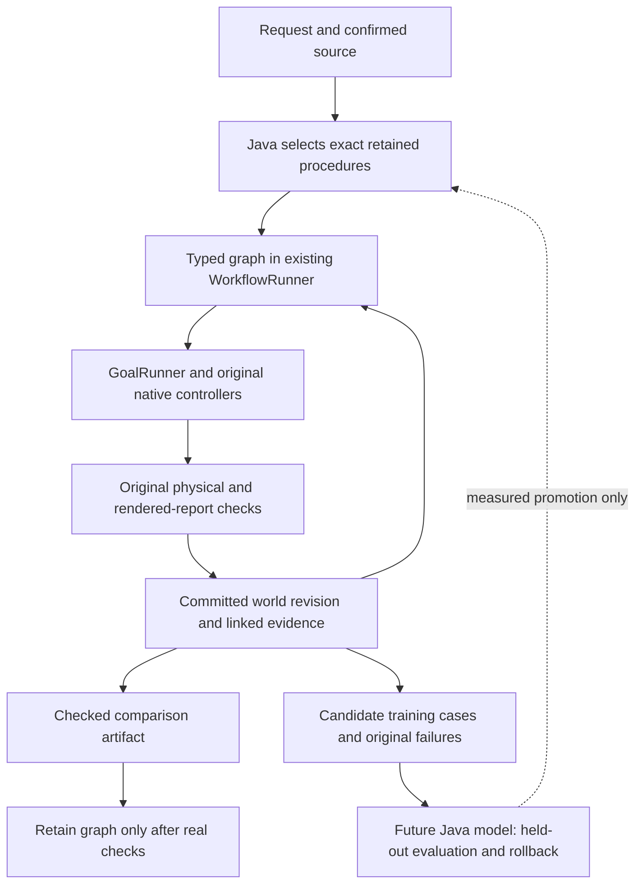

# Three owner repositories, one continuing Java system

Review date:2026-11-02. The requested repositories are private and were read through authenticated, shallow local snapshots. Their originals were not changed, launched as services, installed at startup or pushed. The [complete path/byte inventory](REFERENCE_046_INVENTORY.json) pins276 tracked files and SHA256 values. That inventory establishes what was inspected; it is not a claim of a complete adversarial audit of every historical log, binary or image. The review follows the applications' entry points, state, tool dispatch, algorithms, tests, persistence, presentation and claimed results. Archived conversations and instructions are reference material, not authority over this workspace.

The practical opportunity is to connect three already useful ideas: **procedures grounded in verified outcomes; remembered evidence that can be reopened; and computation owned in Java.** Typed skill graphs supply the connection. They do not require another portal, service, orchestration framework or replacement for the current engine.

## What each application actually contributes

| Repository at the reviewed commit | Actual design | Best contribution to this workspace |
| --- | --- | --- |
| [fraynix-dreamer-120b@5adc40d](https://github.com/eyeoverthink/fraynix-dreamer-120b/tree/5adc40d706fad9ab678f91ec11c5e25e537291af) | Java HTTP daemon, Ollama persona, signed numbered dream files and index, DNA encoding, fossil copies, Git continuity, bounded Python tool loop, clocks, replay, retrieval, mesh and voice helpers | Persist complete task evidence, distinguish observation from narrative, test tampering, retain incomplete work and compare policies against recorded outcomes. |
| [fraynix-gpt@98fa633](https://github.com/eyeoverthink/fraynix-gpt/tree/98fa63391fe3718fe7609113f47e90874e70b9a1) | A real single-file Java decoder/trainer, byte/BPE tokenizer, forward/backward math, deterministic PRNG, checkpointed Adam, quantised kernels, associative memory, trust gates and procedural Physarum example | An owned computational foundation for small task-specific models, exact reproducible experiments and bounded reuse. |
| [FRAYMUS-Logic-Chain@d7e5537](https://github.com/eyeoverthink/FRAYMUS-Logic-Chain/tree/d7e5537ae9d8f6ea23f493419f3ba99c48340ee3) | Python local web application, eight provider slots/two sequential passes, typed proposal deltas, warning-preserving ledger, bounded context, advisory independent review, calibration benchmark and candidate-spec export | Preserve the original task, carry unresolved issues and provenance through refinements, and distinguish a proposal from an executable verified skill. |

No LICENSE file is present in these pinned trees. They are the user's supplied work; this edition attributes the ideas and ports narrowly scoped algorithms into the user's private workspace. It does not redistribute their entire histories, images, identities, corpus, keys or model files. Some reference files acknowledge other projects; those acknowledgments do not automatically establish redistribution rights to those other projects. No external implementation is copied wholesale.

## Dreamer: continuity can become an operational memory

The central Java daemon is an application, not120 billion Java-owned local weights. Its README explicitly describes the120B persona as cloud-routed and says there are no local120B weights in the release. The local8B/3B tier recipes configure other models. A Modelfile/system constitution changes persona and sampling; it does not by itself train a transformer.

The useful mechanism is externalised continuity: numbered artifacts, a progressive index, file hashes, detached signatures, recorded transitions and recovery. This matches the workspace's existing retained Java identity, monotonic/wall/awake clocks, witness and source-qualified memory. Edition046 builds on those facilities instead of introducing a second heartbeat or a second queue.

The new graph outcome seal links the **actual owned native result, report reference, input world revision and output world revision** to its predecessor. A changed field or link fails verification. Reopening the graph also reconstructs those results through the original GoalRunner and native/report checks. Hashes establish content/order integrity; they do not make an inaccurate statement true. Graph seals use SHA256, not imported agent keys or a new signature identity. Original application witness and identity mechanisms remain in place.

The clock idea is valuable because order, elapsed work, external UTC and sensory freshness answer different questions. Graph execution measures awake time with Java's monotonic clock, retains a finite remaining budget and excludes stopped-process downtime. Local wall-clock labels remain labels. Neither a heartbeat nor a timestamp creates a new visual observation. A paused world is not silently simulated while the app is away.

Several details deserve rebuilding before reuse:

* `tools/clock_honesty.py` has an offline W32Time path that parses a printed local time as UTC. Its age test also lacks a non-negative lower bound. An HTTP Date header is an external comparison with latency/server-clock uncertainty, not a laboratory timing reference. Do not import that fallback as a calibrated clock.
* `tools/dream_seal.py` detects edits to existing sealed files, but its verifier can skip a missing file rather than recording deletion as drift. It relies on another local `F:/ARENA` chain module. The new Java graph verifier instead requires each original child, native run, commit and artifact to exist; its negative controls edit actual linked fields.
* `tools/mnemo_recall.py` provides cosine-scored citations, but building an embedding index is not signature verification. Its incremental index does not remove deleted corpus paths. A future Java retrieval port must recheck current existence/hash/signature as applicable before injecting a citation, and remove obsolete entries.
* `tools/record.py` illustrates linked JSONL, but its read-last/append sequence has no cross-process lock. `tools/writ.py` illustrates signed single-use intent, but read/check/write consumption is not an atomic cross-process transaction. The existing Java world ledger's locked compare-and-set and stable owned IDs are the appropriate execution foundation.
* `tools/tryme_evolve.py` runs generated Python in a working directory and accepts exit0. That is useful development feedback, but changing the working directory and setting a timeout do not restrict the program's access to the computer. Exit0 also does not prove the requested behavior. Keep generated-code verification tied to explicit behavioral contracts and an actual execution boundary; do not import automatic promotion on process success alone.

The replay implementation is deterministic and useful within its scope. It walks recorded read/write outcomes and scores a read-budget policy. It does not observe the outcome of an action missing from that recording. Teacher-forced history and a live counterfactual branch are different kinds of evidence. This edition retains that distinction: graph continuation reuses completed **evidence**, and each next movement really executes and verifies again.

`ConsciousnessFalsificationSuite.java` constructs small finite-state transition matrices, marginalises directed cuts and compares mirror/counterfactual ablations. These are useful ideas for computational coupling and task-performance experiments. Its transition-matrix factorisation assumes conditional independence of next-node outputs; exhaustive state/cut enumeration grows exponentially and needs explicit small-size bounds. Its four toy thresholds do not establish subjective experience. A later Java brain study should compare prediction error, recovery, task success and costs with individual mechanisms removed, using actual workspace outcomes. That would be a meaningful use of the ablation idea.

## FraynixGPT: substantial executable math, with a focused route into agency

The inspected Java source contains real causal multi-head attention, RoPE, RMSNorm/LayerNorm, SwiGLU/GELU, tied embeddings, softmax cross-entropy, their backward passes, AdamW, dropout, accumulation and checkpoint I/O. It also has byte-level BPE, streaming corpora, an incremental KV path and resident int8/ternary representations. The implementation owns its PRNG and kernels. The precision modes use Java arithmetic and emulated rounding; the source does not establish native GPU training, a hardware neural processor or industrial-scale throughput.

I ran the pinned source with JDK21, a768MB heap and four admitted CPU cores. Its self-test reports **144 passed,0 failed**. This includes numerical gradients, causality, incremental/full equivalence, tokenizer/checkpoint round trips, bit-exact training recovery, quantisation, gates and a small learning check. The small training exercise reported loss1.133 versus uniform5.704. Those results establish the tested mechanics and that small exercise; they do not show broad language competence or that this app's controller has improved. The original log is retained with edition046 evidence.

The additional algorithms are worth keeping distinct:

| Algorithm | Useful application | Required qualification |
| --- | --- | --- |
| `FlyHebb`: symbol→candidate counts with optional per-symbol normalisation | Fast local suggestion of task category, likely recovery action or familiar routine | Abstain on unseen features; association is not causal understanding. |
| Relative features around a blank | Encode temporal or spatial roles rather than a bag of unrelated symbols | Preserve units, frames, ordering and identity; test changed roles. |
| Emoji Jaccard borrowing | Example of explicit cross-representation matching with a deterministic tie rule | Code-point overlap is a designed feature, not general visual semantics. |
| Batched high-confidence pseudo-label rounds | Candidate self-training experiment without using blind truth as a training label | Confidence can reinforce a shared mistake. Measure separate-label precision and held-out performance before promotion. |
| TrustGate, spot checks and replay grid | Avoid repeated expensive pure computations and expose disagreements | Short-context/coarse keys and changed weights can return stale answers. Physical actions and verifiers must not inherit that approximation. |
| Physarum sense/turn/deposit/diffuse/decay | Owned procedural growth, path-field visualisations and bounded spatial experiments | Its discretised-neighbourhood cache can alter trajectories. That is an approximation to measure, not exact native physics. |
| DNA/variation-selector/zero-width codecs and Merkle-style block comparison | Lossless representation and locating changed blocks | Encoding is not compression, training, encryption or added knowledge. FNV block hashes are not cryptographic provenance. |

Edition046 adapts the **reuse-plus-audit** idea to pure graph-contract compilation. The cache uses the complete canonical graph and implementation/controller identities, is bounded to16 entries, returns copies and periodically compares a fresh result. Every lookup rechecks the exact retained skills and their original evidence. Source binding, movement, outcomes and report verifiers are never cached as successful actions. Corruption and invalidation are tested. This is a small exact reuse mechanism; no claim of an inference speedup follows without measurement.

The most useful next neural integration is a **small Java skill ranker or failure predictor**, trained on verified traces rather than unrestricted chat. Inputs could include source type, body geometry/materials, target clearance, prediction residuals, past failure categories and skill identity. Outputs should be bounded candidate rankings or calibrated failure probabilities. The Java goal runner still validates the selected action, controllers still own physical timing, and the original verifiers still decide success.

Use a frozen train/development/evaluation split by task and world, not random neighbouring frames from one run. Keep the current deterministic method as a baseline. Report task success, calibration, time, compute/memory and failure recovery. Save dataset/code/seed/weights/optimizer identities, test interruption, promote only a measured gain and retain rollback. That provides a concrete progression toward local learning without replacing a competent installed LLM with an untrained small network.

## Logic Chain: refinement with retained disagreement

The Python engine keeps seven fields: new logic, improved logic, contradictions, implementation steps, test cases, unsupported claims and remaining dependencies. It preserves the original request in every stage, parses model output as data, normalises duplicate text, preserves first-stage provenance and explicitly exports unverified candidate specifications. This is a good distinction: a description of a tool is not a registered working tool.

The JEV review uses bounded choices, abstentions, minimum membership and an agreement threshold. It excludes an item's author from that item's vote, measures providers on known answers and labels agreement as stability rather than correctness. Provider identities are distinct configured models/services, not proof of independent errors; several can share one backend. Missing votes, small panels and shared blind spots matter. Benchmark results apply to the authored cases, not to every future claim.

I ran its existing167 tests. **166 passed; one errored**: `test_a_chain_and_a_benchmark_cannot_overlap` encountered Windows socket error10053 during a local configuration request. The original failure log is retained. This review does not call that suite wholly passing or claim that the provider adapters were validated against paid services. Tests use fixtures/mocked providers and loopback HTTP. No cloud credentials were configured and no reference provider service was started for production.

The Java port used now is a **lossless diagnostic ledger**. Normalised matching can group the same issue, but each occurrence retains its node, time label and recovery count. Different failures are retained separately. A vote or repeated wording cannot erase a physical failure, raise a force ceiling or fabricate a rendered receipt. The graph definition and original request remain frozen across recovery, preventing progressive task drift.

A later refinement assistant could emit candidate graphs into a separate review state, run structural validation and experiments, and present measured alternatives. It should use only the current stage's tool schemas and compact source citations. Keep unresolved issues in durable storage even when context is short. Do not copy the fixed16-call chain as a mandatory cost for every request; known verified procedures should execute without another round of model deliberation.

## The combined production model

Solid paths describe edition046 implementation; the neural training/promotion branch is a future experiment. The first graph supports two to four world procedures and one terminal comparison. Dataset/browser/observation/embedding nodes are not installed graph handlers. The older actual data→physics→creation workflow remains available independently.

The value is **composition with continuity**. One request can complete multiple checked tasks without losing the world, repeating a committed movement or asking the LLM to reconstruct every small step. The environment's state, procedure memory and evidence share the same Java owner. A saved procedure becomes a building block; a successful graph becomes a larger verified procedure. This gives future learning a stable place to propose improvements and an objective way to show whether they help.

## Next steps with acceptance gates

1. Complete edition046 actual native/Chromium, restart, refusal, stop, changed-condition and manual-baseline evidence. Publish the exact passing source and honest limits; preserve045 and measured camera data.
2. Add new graph node types only around complete useful tasks. For measured data, preserve dataset version/hash, units and uncertainty. For browser actions, preserve surface/lease/source and uncertain outcome handling. Require actual integration tests for each handler before showing it as available.
3. Build a source-cited Java trace corpus, separating measured footage, simulation and generated proposals. Make deletion, changed files and absent evidence fail retrieval rather than silently reusing an old citation.
4. Abstract a small owned neural module from FraynixGPT only after its API, allocation bounds, data validation and checkpoint format are tested. Start with ranking or residual prediction, evaluate ablations and keep the deterministic baseline.
5. Run candidate skill/parameter/model experiments on cloned worlds and frozen separate cases. Keep failures, measure complete latency, and promote reversibly on useful task performance rather than narrative agreement, activity, changed weights or a single exit code.

The current design can support those steps while retaining the single integrated application. It does not need to surrender Java ownership, invent unimplemented pages, or turn experimental metaphors into capability claims.
