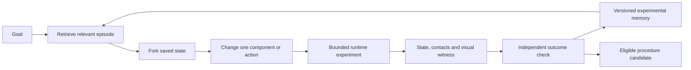

# Game Lab as rehearsal, memory and internal inspection

Design assessment added during edition072, November5,2026. This extends the user's idea without changing the already declared observation experiment or its gates. The following architecture is proposed; it is not a claim that general autonomous rehearsal or these external repositories have been installed into the app.

## The central connection

The Game Lab is an executable environment. An agent can put a hypothesis into a state, apply an action, let dynamics run and inspect the result. That is more informative than asking another model to agree with a prediction. Its value comes from controllable experiments, state access, observation and comparison. “Subconscious” is a useful design analogy for bounded background rehearsal; it does not establish subjective experience.

The existing application already supplies parts of this loop:

| Existing component | Actual responsibility | Remaining connection |
|---|---|---|
| [EmbeddedGameRuntime](../src/main/java/runtime/EmbeddedGameRuntime.java) | Owns the preserved hidden game runtime, bounded stepping, play/pause/reset, AI input, structured observations and captured renderer frames. | General branchable game checkpoints, experiment contracts and reusable episode memory. |
| [SpatialGameSnapshot](../src/main/java/runtime/SpatialGameSnapshot.java) | Exposes actual entities, components, transforms, body velocity/material parameters, sprites and camera state. | This observation is not a complete restore checkpoint. Legacy XY units and draw order must not be silently treated as calibrated metres or physical Z. |
| [Counterfactual045](../workspace-engine/src/main/java/fraymus/workspace/Counterfactual045.java) | Runs bounded native3D alternatives from one frozen world frame, records attempts, rejects stale state and preserves interrupted work. | Generalize the existing branch mechanism into a searchable library of experiments, rather than build a second world engine. |
| [WorldLedger](../workspace-engine/src/main/java/fraymus/workspace/WorldLedger.java), [WorldFrames](../workspace-engine/src/main/java/fraymus/workspace/WorldFrames.java) | Retain world identity, revisions, state and evidence. | Index episode similarities, assumptions, component substitutions and applicability. |
| [EvidenceReplay049](../workspace-engine/src/main/java/fraymus/workspace/EvidenceReplay049.java) | Checks clock-aligned observations, declared provenance and calibrated coordinate frames. | Join physical observations, simulated branches and visible clips while keeping their origins distinct. |
| [SkillGraph046](../workspace-engine/src/main/java/fraymus/workspace/SkillGraph046.java), [Procedure044](../workspace-engine/src/main/java/fraymus/workspace/Procedure044.java) | Bind exact retained procedure versions to fresh typed world inputs; order two to four world procedures and a checked comparison; retain every diagnostic occurrence. | Add hypothesis/experiment-memory contracts and retrieval while preserving existing execution and outcome checks. |

The original game bridge and the native3D counterfactual runner are different adapters today. Neither should be described as already having every capability of the other. They can share an experiment/memory interface while retaining their own dynamics, units and restore guarantees.

## An experiment can become an executable memory

A useful memory should contain:

- A source world ID, immutable frame/checkpoint, engine/code version, time step and applicable units.
- The question, prediction, goal, uncertainty and success contract recorded before execution.
- The entity/component changes and action sequence, including deadlines and resource costs.
- Actual state and contact/event traces, a final verified outcome and explicit failure reason.
- Rendered keyframes or video references bound to the same episode and ticks.
- Parent episode, changed assumptions, tested conditions and valid reuse boundaries.

Video is valuable for visual recall, explanation and pattern discovery. Structured state and event logs allow exact queries and replay. Pixels alone do not restore velocity, contacts, random state, controller memory or native solver state. A checkpoint must define what it restores, and replay must be checked against fresh execution within declared tolerances.

Never rewrite the original episode to make a new result appear old. Fork it. A changed mass, material, obstacle or action becomes a child experiment with its own identity. Shared immutable assets and component deltas can reduce storage. Reusing a result can reduce computation only when source versions, relevant state and preconditions still match. A different material or altered controller should invalidate the corresponding cached result.

The existing graph memo caches pure contract checks, not physical actions or their outcomes. Preserve that boundary: memory can suggest an action, select a previously useful procedure or avoid redundant hypothetical search. Applying it in the current world still needs a fresh source binding and actual outcome verification. Retrieval is not evidence that an action has already happened.

An entity-component thinking structure can use real entities for objects and separate typed nodes for hypotheses, experiments, observations, procedures and claims. Edges can mean “predicted by,” “tested in,” “contradicted by,” “derived from” and “valid under.” Those relationships are more useful than an undifferentiated collection of text or screenshots. A claim node must not become a physical object merely because both use the same storage structure.

## What Akashic supplies

Pinned source: [fraynix-akashic at2e5a0f94](https://github.com/eyeoverthink/fraynix-akashic/tree/2e5a0f94b8d812d6ef9c976366220be8ba75aeaa). All13 Java source files were captured for review, with local copies checked against their Git blob identities. The focused reading covers the store, columns, consolidation, gate, runtime and verification paths. Its useful ingredients include deterministic recurrent columns, lineage and fossil records, binary state/weight serialization, a seal codec, HDC similarity, candidate consolidation and runtime compilation of a plasticity rule.

The best transfer is continuity with explicit lineage: retain an experiment even when its policy is retired, record how a candidate was derived, and preserve a recoverable previous version. HDC can be tested as an approximate episode-retrieval key. A retrieved candidate still needs exact metadata and outcome checks; vector similarity does not prove applicability or truth.

Several current source boundaries need attention before adopting its persistence or learning claims:

- [AkashicStore](https://github.com/eyeoverthink/fraynix-akashic/blob/2e5a0f94b8d812d6ef9c976366220be8ba75aeaa/src/fraynix/akashic/AkashicStore.java) creates tables and writes rows, but its constructor does not load stored rows and seeds genesis into its initially empty lists. No restoreColumns method is present. The RAM fallback does not retain state across process exit.
- Its snapshots contain B and predictedB vectors. They omit weights, phase, surprise counters and other state required for full continuation. Same-tick IDs depend on tick and column IDs/count, not complete snapshot contents.
- [Ouroboros](https://github.com/eyeoverthink/fraynix-akashic/blob/2e5a0f94b8d812d6ef9c976366220be8ba75aeaa/src/fraynix/akashic/Ouroboros.java) adds new columns to its runtime list without adding them to store.active. The phase changes after the column's seal is computed. The column seal itself covers selected state rather than all weights and control state.
- [Dreamer](https://github.com/eyeoverthink/fraynix-akashic/blob/2e5a0f94b8d812d6ef9c976366220be8ba75aeaa/src/fraynix/akashic/Dreamer.java) labels mean absolute weight magnitude as meanSurprise. Its weighting does not use the recorded surprise fields. It computes a master matrix locally but returns a record containing its seal/preview, rather than that matrix or a persisted executable checkpoint.
- [JevGate](https://github.com/eyeoverthink/fraynix-akashic/blob/2e5a0f94b8d812d6ef9c976366220be8ba75aeaa/src/fraynix/akashic/JevGate.java) measures similarity to an internally derived majority. That can identify disagreement; agreement is not an independent correctness test. It also recomputes entire HDC encodings inside the bit-majority loop, an avoidable cost for a future implementation.

These are specific implementation findings. Deterministic updates and changing weights are real computations, but useful learning must be measured on retained tasks and fresh conditions. The proposed Java integration should use the workspace's existing durable store and outcome checks rather than inherit an incomplete restore path.

Executed review: the exact pinned13 Java source files compiled with Java21. The repository's original VerifyAll completed in RAM mode with19 passed/0 failed, including serialization, deterministic updates and runtime plasticity-rule compilation. Six additional focused checks reproduced the listed boundaries: weights are omitted from the root state seal; same-tick snapshots omit changed weights; tick phase changes after sealing; new runtime columns are missing from store.active; recorded surprise changes do not change the dream result; and the advertised restore method is absent. These checks used temporary RAM stores, not the user's live databases. The original suite and the counterexamples test different properties; both results are retained. [Original suite](readmes/072/original/logs/akashic-original072.log.gz) · [Focused checks](readmes/072/original/logs/akashic-probes072.log.gz).

## What the reverse-engineering agent contributes

Pinned source: [fraymus-re-agent at4c04eee3](https://github.com/eyeoverthink/fraymus-re-agent/tree/4c04eee36be9a0c188a76bc5db8db16fb0142233). The reviewed first-party scripts coordinate radare2, Ghidra, local model annotations and a receipt log. The repository includes a built Ghidra distribution; its Mac execution claims and artifacts were inspected as supplied evidence, not rerun on this Windows workspace. No RE engine, new model or binary was installed or executed for this source review.

This is useful as an internal investigator. It can connect a failure to a method, instruction range, branch, data structure, dependency or serialized field. The link should run both ways: an episode identifies the failing behavior; the investigator forms a code-level hypothesis; a controlled experiment tests it; the result updates the episode's explanation.

Byte access is an evidence source, not automatic semantic understanding. Architecture, instruction set, calling convention, types and runtime observations still matter. When our Java source is available, source and bytecode inspection are usually the most direct starting point. A full native decompiler is a much larger capability than a Java class-file reader. The current RE project is an orchestration of substantial upstream tools, not a dependency-free handwritten decompiler.

Four controlled probes reproduced gaps in the selected scripts, without real model/tool/device calls:

| Source path | Probe result | Integration rule |
|---|---|---|
| [fra-annotate.py](https://github.com/eyeoverthink/fraymus-re-agent/blob/4c04eee36be9a0c188a76bc5db8db16fb0142233/scripts/fra-annotate.py) | The function splitter misaligns name, address and body on a two-function fixture. | Validate exact address/body binding before accepting annotations. |
| [hive-plan.py](https://github.com/eyeoverthink/fraymus-re-agent/blob/4c04eee36be9a0c188a76bc5db8db16fb0142233/scripts/hive-plan.py) | A failed child process still records dossier_done. | Completion requires exit status, expected outputs and independent checks. |
| Same planner | An unparseable response records plan_done with zero steps. | Explicitly distinguish no valid plan from successful goal completion. |
| [hive-receipts.py](https://github.com/eyeoverthink/fraymus-re-agent/blob/4c04eee36be9a0c188a76bc5db8db16fb0142233/scripts/hive-receipts.py) | A caller-supplied verified flag labels a packet verified even with a non-digest seal. | Recompute evidence checks locally; retain claimed and verified status separately. |

The receipt chain preserves recorded content; it does not make the recorded claim true. The existing annotation artifact also retains an empty model response and low agreement. Those failures are useful evidence. They should remain attached to the interpretation instead of being promoted into an unquestioned memory.

## Proposed next delivery

Edition072 supplies a concrete motivation. Its completed native study retained612 executions: the new policy succeeded on39/48 clean and39/60 disturbed tasks, while the preserved adaptive baseline succeeded on39/48 and40/60. Joint state ranges covered46/48 clean trajectories but20/60 disturbed trajectories. The declared combined qualification failed. These are native simulator results, not physical-world calibration. The full study took about47minutes including evidence processing; it is not a real-time background-thinking benchmark.

An episode library should retain those missed predictions, changed conditions and costs. Retrieval should identify relevant failures as well as successes. Bounded background rehearsal needs a scheduler with explicit time, memory and execution budgets, interruption, and priority for the user's active work. Measure whether retrieving a valid prior episode avoids unnecessary trials; do not assume that a growing memory automatically makes the system faster or more capable.

One retained example makes this concrete. In disturbed case7, an external push arrived at tick84. The preserved adaptive policy observed at tick92 and corrected successfully. The new policy waited until tick116; by then its remaining correction budget could not reach the goal. That is an episode about a missed intervention window, with a paired successful alternative. It can inform a future hypothesis and training case, but the same case must not then be counted as fresh evidence that the revised policy generalizes.

Extend the current Java goal runner with one concrete end-to-end rehearsal task:

> Retrieve the closest verified block-moving experiment, fork its starting state, change the friction or payload, test a small set of actions, compare prediction with actual motion, and retain the new episode with a replayable visual witness.

1. Define typed requests and results for observer, hypothesis proposer, experiment runner and verifier. They share one goal budget and source world identity. A role can be deterministic Java; separate models are optional.
   Expose the registered experiment types, required inputs, restore guarantees, cost limits and success checks through the existing capability/context path. The planner needs an accurate account of its available methods; a prompt claiming unlimited abilities cannot supply missing handlers.
2. Add an episode index over existing world records and branches. Store exact validity metadata and immutable parent/child lineage. Begin with deterministic metadata retrieval; compare HDC retrieval only after a baseline exists.
3. Show the source state, changed components, predicted/actual trace and visual replay together inside the existing app. Label imagined, simulated, physically observed and verified data explicitly.
4. Add a small owned Java class-file inspection tool for our compiled classes: headers, constant pool, method/code ranges and validated instruction boundaries. Unknown formats should be refused explicitly. Compare it with JDK tooling and known fixtures before expanding to control-flow graphs.
5. Use the internal investigator only when an experiment reveals an unexplained failure. It proposes a tested explanation or candidate patch; it does not hot-swap the live brain merely because two models agree.
6. Test cold restart, stale cache invalidation, one-component substitutions, contradictory interpretations, interrupted experiments and recovery. Compare fresh task completion, sensing, wall time and memory against the same system without episode retrieval.

For the first delivery, use experiments rebuilt from a known initial state and declared controller/random state. The restore contract should say exactly which state is reconstructed and what replay tolerance is required. Arbitrary mid-contact restoration may also require native solver caches and other hidden state; a JSON entity snapshot alone must not be advertised as restoring those. Expand to paused in-flight experiments only after that separate test passes. The same interface can admit the game adapter later without pretending its current observation format is already a checkpoint.

The first proof is faster or more reliable task completion after reusing a relevant episode, including changed conditions. A larger graph, more active nodes or a new seal is not that proof. This direction preserves the user's central idea: the engine is a place where thinking can produce inspectable consequences, and the resulting experiences become part of the next decision.
