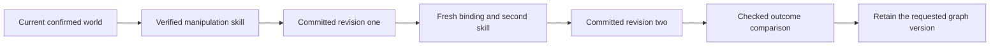

# Typed skill graphs: current implementation and remaining design

**Edition046 status:** the first bounded graph is implemented in the existing Java `WorkflowRunner`, `GoalRunner`, `Procedure044` and evidence checks. It connects two to four exact retained world procedures and one checked comparison. Original native controllers and report gates remain. [Edition046 contract](EDITION_046_CONTRACT.md) and [current operation](../README-046.md) describe the implemented boundary. [The frozen045 edition](../README-045.md) preserves the earlier proposal and evidence.

The remaining dataset/observation/browser/artifact edge types, conditional branches and general graphs below are **future design**, not installed handlers. The existing fixed data→physics→creation workflow remains supported separately. The procedure graph is distinct from the proposed numerical synaptic graph; see [stacked local processors](STACKED_CORTEX_046.md).

## The problem to solve

A retained procedure already completes a checked task. A longer request needs several such procedures, with the right source passed between them. A graph should describe those dependencies without inventing another task owner or allowing an imported document to install executable handlers.

The first useful proof is two successive manipulation goals in one persistent world, followed by a checked comparison artifact. Stage two must start from the verified revision produced by stage one. A restart between them must retain the same child identity and avoid repeating the first committed movement.

A second proof should join an actual data-analysis result to a native experiment and a checked creation artifact through the existing workflow. It must preserve the distinction between measured data, declared simulation parameters and generated presentation.

## Ownership and execution

- `Agency043` retains the conversational parent and its goal, selected graph version and actual workflow child.
- `WorkflowRunner` retains the graph cursor, dependencies, reservations, receipts, interruption and explicit recovery. Extend this supervisor rather than creating a parallel scheduler.
- `Procedure044` resolves exact registered procedure names and versions and preserves their allowed semantic parameters and authority ceilings.
- `GoalRunner` and the existing native controllers execute each actual child task. A graph cannot supply a passing receipt or bypass original verifiers.
- Surface adapters perform real browser/canvas actions under existing leases. Mission presents actual persisted states and source references.

The graph definition should be inert JSON. Its node kinds refer only to registered procedures and checked artifact operations. No JavaScript expressions, shell snippets, dynamic class names or arbitrary endpoint paths should be accepted as node handlers.

## Source and output types

| Proposed type | Required provenance | Admission rule |
| --- | --- | --- |
| Persistent world reference | World ID, expected revision/head, stable roles, declared units and scope | Read and validate the current head before reserving a physical child. |
| Verified world outcome | Owned goal/run, committed revision, original metrics and report receipt | Reconstruct through the original owner; reject an invented success object. |
| Dataset reference | ID/version/hash, original rows, column mapping, units and source kind | A changed version or incompatible unit requires a new binding. |
| Measured observation reference | Original run/frame hashes, timestamps, registration, scale and uncertainty | Do not silently turn an uncalibrated image or human label into a measured physical parameter. |
| Artifact reference | ID/version/content hash and exact passing behavior checks | Reopen and check the pinned version; a later edit does not inherit its old receipt. |
| Skill reference | Registered name, exact version, kind, code identity and parameter policy | Resolve the retained procedure through the Java registry; refuse incompatible upgrades. |

References should carry identifiers and compact summaries, with full evidence retained outside the prompt. Edges should name declared typed outputs, not run arbitrary JSON-path code. Units and coordinate frames belong to the type contract: pixel positions, mat-plane metres, legacy game units and native3D poses must not be treated as interchangeable arrays.

## First graph constraints

Start with a small acyclic graph and a declared finite node/attempt/time budget. A node records prerequisites, permitted inputs, exact skill version, expected output type, success verifier and a bounded recovery policy. A conditional edge can select among declared branches using verified output fields. It cannot add new handlers or increase a movement's force ceiling.

The existing fixed workflow remains a supported older kind. New graph records need their own schema/version discriminator. Deserialization must validate all nodes and edges before any effect, reject cycles/foreign versions and retain unsupported originals without rewriting them.

This diagram is the implemented046 world-chain case. Its exact retained references, typed metre/native3D binding, deterministic child IDs, sealed outcomes and original evidence checks are enforced. Arbitrary branch execution is not supported.

## Recovery is the central proof

Each effect needs a deterministic owned identity established before dispatch. On restart, inspect that same child and its original receipt before choosing what to do next:

1. If the child committed and passed its original gates, reconcile the graph's output record without applying the movement again.
2. If it is running under the compatible owner, reconnect rather than create another child.
3. If it is interrupted and supports verified continuation, require the existing explicit Resume path.
4. If the source head, code identity, evidence or authority changed, stop for a fresh reviewed binding.
5. If the outcome is uncertain, retain that uncertainty. A browser form submission without a server idempotency mechanism cannot receive a universal exactly-once guarantee; inspect its actual outcome before any retry.

The initial proof should use native world commits and versioned artifacts, whose original receipt mechanisms already exist. Broader web effects need separate source-specific recovery tests.

Stop must propagate to the owned child and prevent dependent nodes from starting. No failed or uncertain graph becomes a retained successful skill. Recovery must not silently replace the graph definition, swap a source or replay a committed stage.

## Learning and promotion

Retaining a graph means retaining a verified procedure, not training language-model weights. Record failures as cases with their actual inputs, source qualifications, actions, outcome and code version. A proposed changed policy or graph should be evaluated on frozen separate cases against the unchanged method before promotion, with rollback to the previous version.

The current045 results offer little order-dependent benefit: the two complete plans tied in native duration. A stronger evaluation needs actual tradeoffs, such as different obstacle clearance, declared force profiles, stage dependencies or recoverable disturbances. Those extensions require their own physical scope and fresh cases; they are not justified by tiny floating-point effort differences.

Measure complete task time as well as success. Registered known procedures should be schedulable in Java without asking the LLM to regenerate every small read/action/finish decision. The local model remains useful for semantic interpretation and explanations when those add value. Source summaries and tool definitions should be restricted to the current stage, and CPU/GPU admission measured rather than assumed.

## Acceptance before shipping

| Proof | Required result |
| --- | --- |
| Normal two-goal continuation | Two actual commits, second bound to the first outcome, original native/report checks intact. |
| Restart at the commit boundary | Same child reconciled; no duplicate movement or duplicate successful stage. |
| Restart during supported native execution | Original compatible continuation and trace retained; no invented fresh success. |
| Stale or mismatched source/type | Refusal before the next physical effect. |
| Stop and uncertain outcomes | Owned child stops; dependants remain unstarted; original evidence remains inspectable. |
| Skill/code version change | Explicit compatibility decision; no silent substitution. |
| Retained graph reuse | Exact graph/skill versions survive restart and obtain fresh source bindings. |
| Useful performance | Measured success and full latency against the unchanged workflow on separate frozen cases. |
| Integrated presentation | Mission shows actual nodes, sources, receipts and recovery in the same window; no fabricated percentage. |

The implementation should ship only after actual Java/native/Chromium workflows satisfy those gates, with original logs, screenshots, source matches and publication verification. This is the next proposed development contract, not evidence that those features are already implemented.
