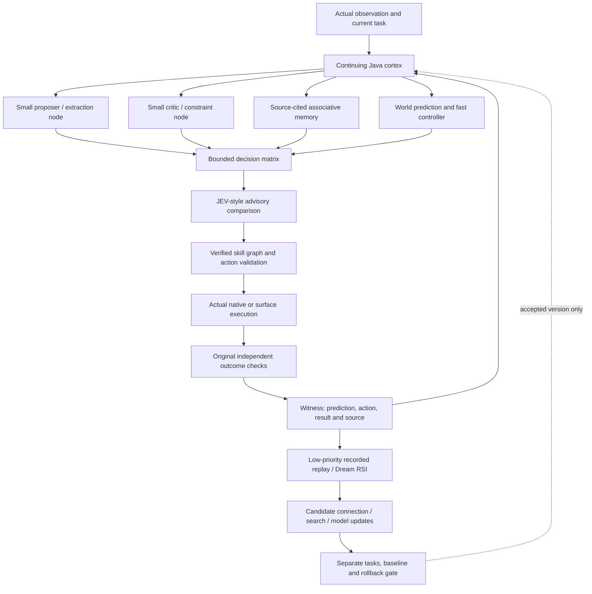

# Stacked local processors and a learning cortex

User clarification,2026-11-02: Needle3, MicroLlama, multiple offline Ollama specialists, JEV and Dream RSI are intended as connected processing nodes, with a neural cortex learning their associations and decision paths. This expands the earlier single-model assessment. Small models need not perform every responsibility themselves. A coordinated network can retain task state and learned connections outside their limited contexts.

This is a source-based architecture review and next implementation contract. Edition046 implements the verified-procedure graph substrate; it does not claim that these additional model workers have already been activated, fine-tuned or connected to this app. The existing Java nervous core and earlier learned dynamics remain actual implemented components, with their existing scopes. No worker, model download, remote provider or training job was launched by this review.

## What I found deeper in the repositories

| Component | Exact inspected source | What the code establishes |
| --- | --- | --- |
| Offline Needle3 | [fraynix native proposal worker](https://github.com/eyeoverthink/fraynix/blob/fdc6f262e357c785ef116199d364a8c08ae3f620/scripts/specialists/needle_worker.py) | Native `.cact`/DLL hash checks, explicit tool shortlist, schema-validated inert proposals and request/installation digests. That worker explicitly reports no weight update; it is an inference path. |
| Multiple Needle contexts | [Needle Python interface](https://github.com/eyeoverthink/fraynix-system/blob/d2360c8f42b37ebdaede64b8cf502c345441d7a1/integrations/model-sources/needle/needle/__init__.py), [isolated worker](https://github.com/eyeoverthink/fraynix-system/blob/d2360c8f42b37ebdaede64b8cf502c345441d7a1/integrations/model-sources/needle/needle/_worker.py) | Generation-specific library handles, model loading, embeddings and complete/reset operations; custom-weight workers isolate native state in child processes. Merely instantiating several wrappers is not evidence that their native global state is independent. |
| Real Needle local training | [finetune.py](https://github.com/eyeoverthink/fraynix-system/blob/d2360c8f42b37ebdaede64b8cf502c345441d7a1/integrations/model-sources/needle/needle/model/finetune.py) | Real LoRA adapter parameters, JAX gradients, clipped AdamW updates, held-out loss/call scoring and saved adapter metadata. Local fine-tuning is distinct from the platform endpoint. Its optional data-generator calls OpenRouter; offline use must supply local verified examples and never invoke that generator. The local adapter path leaves its confidence head untrained and explicitly drops it at export. |
| Sparse adaptive cortex | [fraymusSpikingGraph.ts](https://github.com/eyeoverthink/creator-nexus/blob/f45c1a11357f0e7862ea2307d285588ee9a67db9/base44/shared/fraymusSpikingGraph.ts) | Adjacency-indexed sparse signed synapses, leaky integration, competitive firing, delayed event buckets and arrival-aware STDP eligibility/weight updates. These are executable algorithms, not just a cortex label. |
| Prediction before witness | [fraymusAdaptiveMemory.ts](https://github.com/eyeoverthink/creator-nexus/blob/f45c1a11357f0e7862ea2307d285588ee9a67db9/base44/shared/fraymusAdaptiveMemory.ts) | Digest-checked memory, predictions which do not increase trust, single-use outcome witness, explicit TD value-table updates, and replay which creates no new witnesses. Lexical vector similarity and witnessed scores are distinguished from calibrated probabilities. |
| JEV | [fraymus-arena/brain/jev.py](https://github.com/eyeoverthink/fraymus-arena/blob/80926f538b6705bde88307742672147311e9bcbd/brain/jev.py) | Bounded heterogeneous voting, abstention, calibration records, disagreement and early-stop accounting. Its defaults include a Gemini lane; an offline implementation must select installed local lanes explicitly. Repeating one backend under different role names does not establish independent errors. |
| Dream RSI | [nomo/dream_rsi.py](https://github.com/eyeoverthink/nomo/blob/59ba919a7cd74f00d895cd8f868268809d460d4e/nomo/dream_rsi.py) | Read-only recorded attempt trees, legal parent-dependent exploration, three policy interpreters, reward/attainment versus budget, and incumbent-preserving selection on ties. It changes a search policy using recorded outcomes; that replay is not a new physical observation or LLM-weight update. |
| MicroLlama | [offline kit embedded in the library](https://github.com/eyeoverthink/fraymus-library/blob/5d01b8440438ae7fed18f681686c7103decda917/wow/Wow-Offline-Self-Contained.html.txt) | A small Torch network definition is present. That particular export also contains placeholder tokenization/decoding, random-init fallback and a hardcoded ability flag; its attention lacks a causal mask and position encoding. Another pressed export contains an explicit class stub. Those exports cannot serve as a verified offline language model unchanged. FraynixGPT's tested Java tokenizer, causal attention, positions, gradients and checkpoint mechanics are a stronger owned reconstruction base. |

These references are specific pinned files, not a new complete inventory of all those larger repositories. Their deployment notes are claims/history to inspect, not instructions to start services or change this application's authority. The original three repositories' complete276-path inventory remains separate.

## The architecture your clarification points toward

The proposed “left/right” or yin/yang roles are useful complementary processing responsibilities: generate/critique, predict/observe, explore/conserve, abstract/ground. They need not imitate a literal human hemispheric split. They exchange typed, source-qualified messages and can disagree without losing either result.

The Java cortex should remain the continuing owner. Model nodes consume bounded stage inputs and produce proposals/features, not private alternate worlds whose outputs overwrite the shared state. The existing queue schedules goal-level work. Physical controllers keep their own timing; a slow language response must not stall contact handling, Stop or a clock. Multiple local workers are a hardware scheduling decision, with measured latency/RAM/VRAM and explicit model/context identities.

## Three real kinds of learning

1. **Connection and controller learning.** Update bounded routing strengths, association weights, eligibility traces or value estimates from source-linked outcomes. This can improve which node/skill is chosen without changing language-model weights. STDP supplies temporal credit signals; task outcomes must establish whether those changes are useful. Activity alone is not a success label.
2. **Search-policy learning.** Replay recorded attempt trees to compare bounded strategies. A changed policy must then face separate fresh tasks. Replaying a successful trace repeatedly must not count as repeated independent evidence or prove what an unrecorded branch would have done.
3. **Model-parameter learning.** Train an owned small model or compatible adapter from actual verified examples, with a real tokenizer, gradients and saved optimiser/model identity. Fine-tuning multiple specialist nodes is possible; stacking inference contexts does not itself merge their weights or enlarge a single model's parameter count.

All three are compatible with the user's local-first design. A larger LLM can be an optional specialist; it need not be the only place where memory, policy, learning or coordination lives. There is no architectural requirement that the whole system fit inside one model's context window.

## How to implement it in this application

**Keep the edition046 procedure graph distinct from a neural graph.** A procedure edge carries verified task state and declared authority. A synaptic edge carries a numerical influence or eligibility value. Mapping between them should be explicit; a learned high weight cannot bypass an original physical verifier.

The first concrete extension should be an outcome-bound **decision record** in Java: task/source/skill/model identities, pre-action feature vector, proposed bounded alternatives, predictions made before execution, actual verifier result, observed cost and a unique witness ID. Reopening a decision must not create another witness. Bind the reward to the actual owned run/report rather than model self-evaluation. Preserve failures and separate simulations from measured footage.

Then abstract the indexed sparse cortex into a small owned Java module using the existing brain-core rather than duplicating it. Retain delayed-event time, membrane voltage, eligibility, edge weights, memory provenance, prediction/witness state, policy version and PRNG state. Test continuous versus split/checkpointed execution, nonempty delayed queues, positive/negative timing cases, duplicate-witness refusal, bounded resource use and byte-stable recovery.

A decision matrix can combine deterministic constraints, prediction residuals, skill history, specialist votes and learned scores. JEV-style agreement is one input. Original action/source/force gates remain outside that score and cannot be voted away. Start with an explicit unchanged policy baseline, plus single-node and complementary-node ablations. Measure success, actual prediction/calibration error, recovery, complete latency and resources on fresh tasks. Record correlated errors rather than equating node count with independence.

After that, add actual local specialist workers only when their installed artifacts and context isolation are verified. Existing Ollama can supply local nodes. An optional Needle worker can provide structured extraction/inference, but its native `.cact` ABI is not automatically compatible with a pure-Java transformer. Owning a Java implementation means validating architecture, tokenizer, weight layout and numerical equivalence before claiming a replacement. Do not silently substitute random weights or a demo response when a worker is absent.

Finally, connect Dream RSI and adapter/small-model training to the decision records as background **candidate** generation. Keep the incumbent, source/data/code/seed identities and rollback. The first release should demonstrate that the connected system improves on a new task set and retains the improvement after restart. This is the test that would turn the proposed synapse-like coordination into useful learning in the actual app.

[Three original repositories reviewed](REFERENCE_LOGIC_046.md) · [Edition046 acceptance contract](EDITION_046_CONTRACT.md) · [Existing goal and skill system](GOALS_AND_SKILLS.md)
