# Edition 096 — Keep verification working end to end

[Previous: edition 095](README-095.md) · [All editions](docs/readmes/INDEX.md) · [Offline verification explorer](docs/readmes/096/index.html) · [Contributor direction](README-CONTRIBUTORS.md)

**The local verification repairs are complete: {passed} Java methods passed and {skipped} were skipped across {classes} classes, combining the original run with explicit corrected-test reruns.** The original complete invocation failed four test-boundary assertions; it was not a clean full-suite pass. All 334 engine and 166 Studio classes stayed byte-identical through the test correction. Factory checks and separate Studio distribution/source-isolation checks passed. The new remote CI outcome remains a separate result.

Recorded November 8, 2026; completed {finished}. This edition improves reliability in the existing integrated app. It does not introduce a new physics model, claim useful learning from changing weights, or trade source verification for speed. The [prospective contract](docs/EDITION_096_CONTRACT.md) was committed before the changes.

## Where this fits in the working app

The existing workspace combines chat, a browser, a creation/report canvas, the original Game Lab and native 3D experiments. Java owns durable goals, action validation, world state and verified procedures. Electron presents those functions in one interface; optional local models propose work through registered tools. Edition 096 strengthens that boundary and tests the construction path already present in the app.

```mermaid
flowchart LR
    Request[Chat request] --> Proposal[Validate model proposal]
    Proposal --> Java[Java prepares bounded task]
    Java --> Trials[Run separate native alternatives]
    Trials --> Review[Review retained evidence]
    Review --> Actual[Execute and verify actual motion]
    Actual --> World[Commit world once]
    World --> Skill[Save verified procedure]
    Skill --> Fresh[Retest against a later world]
```



The screenshot walkthrough starts from the construction controls, exercises review and two cold restarts, and checks the report and saved procedure. The schema tests cover the chat handoff; this edition does not claim a new live-model conversation or fresh browser/Game Lab validation.

## What was wrong and what changed

| Failure | Evidence and repair | What stays enforced |
| --- | --- | --- |
| Construction chat advertised Java-owned design choices | The unchanged053 assertion failed locally. The tool schema now hides `design053` and `reviewCounterfactual045` on direct and bound saved-procedure construction paths. | Java still pins review/design from the request and refuses an increased force ceiling. The original tool catalog remains intact. |
| Historical world test expected an older engine source | The original056 lock failed on WorldLedger. A complete comparison also found WorldNativeCheckpoint had changed. Both complete diffs were reviewed and their exact old/new hashes are chained in the 096 extension. | Original035/056 contracts, scene bytes, unchanged source files, native outcomes and thresholds remain unchanged. The original four scenarios are actually executed again. |
| Two large integrity tests exhausted the default heap | Both unchanged tests failed in isolated 512 MiB processes on copies of completed original studies, then passed at 1024 MiB. | Test JVMs receive a bounded 1 GiB heap, a JVM-reported processor count of four, one class per process and one process at a time. Production app heaps and native budgets are unchanged. |

Only `Tools044.java` changes production Java behavior. The other changes concern test process resources, the test-only historical source chain, staged command-validation tests and an actual app walkthrough. This does not grant the language model new execution authority. The original Java Studio distribution now enables ZIP64 so the complete preserved history can exceed ZIP32 archive limits; no existing content is excluded. Its first archive is fully decompressed and CRC-checked, and final edition files are compared byte for byte after packaging.

The [096 regression extension](docs/WORLD_096_REGRESSION_LOCK.json) records the reviewed chain. WorldLedger gained explicit closed-world version upgrades and bounded capacity of 32 in previous editions. WorldNativeCheckpoint gained stronger source identity and a bounded atomic Windows replacement retry. The original physics and outcome checks remain in the chain. Altered original contracts, scene bytes, source files, duplicate/foreign entries and broken version links are refused. Passing these old cases establishes regression coverage, not new held-out performance.

## Four test-boundary failures found during the complete run

The full run exposed four older tests that sent Java-prepared construction commands back through the model-input schema: one each in Payload057Test, Payload058PolicyTest, Support059Test and Support060Test. The production sequence validates model proposals first; Java then pins design, review and payload policy. The corrected tests follow that order, preserve every original policy/geometry/outcome assertion, and also require the model boundary to reject Java-only fields. The complete native payload experiment from edition 057 method remains unchanged. See the [dated follow-up contract](docs/EDITION_096_VALIDATION_UPDATE.md).

All original failing XML is retained. The {correction_count}-method follow-up passed; its results replace only those explicitly identified methods in the combined method ledger. Production class hashes match the original run for all 334 engine and 166 Studio classes. This completes method coverage without pretending the original invocation passed. No default test filter or physics-threshold relaxation was added.

## Memory diagnosis without changing the app limits

| Original test |512 MiB copied-record run|1024 MiB copied-record run|
| --- | --- | --- |
| UncertainNative071 | OutOfMemoryError at 19.04 s | Passed in 34.94 s |
| UsefulNative072 | OutOfMemoryError at 22.54 s | Passed in 60.85 s |

Both tests retain original data while making deliberately corrupted copies, serializing and parsing complete records, checking traces, restarting and testing cancellation. The smaller heap failures do not establish that the ordinary UI requires 1 GiB. The passing diagnosis is also not a claim of spare memory: logged heap snapshots reached the configured limit before collection. These are GC snapshots, not an instantaneous process-memory peak. No OS CPU affinity was pinned for this unit-test run. Passing these tests at 1 GiB does not establish that every large-study UI operation fits512 MiB.

The copied studies are labelled diagnostic reuse. Their original files were byte-checked before copying and were not edited. Both failing and passing logs, XML, GC traces and copy manifests are archived. A subsequent complete lifecycle generated **fresh071 and072 studies**, with 504 and 612 actual native executions respectively, and ran the unchanged integrity, chronology, tamper, trace, restart and cancellation assertions. They are not counted as new physical-camera observations.

## Validation actually completed

- 25 focused methods across five classes passed. The four historical world scenarios run inside one of these methods. New tests reject model attempts to supply Java-owned choices, altered historical bytes and broken source chains.
- Combined coverage of the complete invocation and corrected rerun contains **{total} methods: {passed} passed and {skipped} skipped**, with no remaining failures. The [verification record](docs/readmes/096/verification.json) preserves both original full-run failures and the source-qualified method ledger. No test is excluded from the default lifecycle; physical outcome thresholds are unchanged.
- The shared factory runtime, model-adapter and transaction checks passed. After the failed full invocation, source-isolation and application distribution checks were completed separately. Those custom checks are separate from the JUnit count.
- Existing Studio regressions passed for blocked-player recovery, mushroom planning, remembered play choices, explicit asset placement, level import/export, scene serialization and physics checkpoints. These are regression checks, not a new interactive play evaluation.
- Three conditional methods were skipped: Windows refused symbolic-link creation without the required privilege, and the two optional recovered-evidence probes lacked their separately created projects for editions 093 and 094. Their original skip messages are retained; no privilege escalation or fabricated fixture was used.
- 135 existing desktop tests passed.
- A fresh isolated Electron/Java walkthrough reviewed three declared construction alternatives, with one successful direct-first trial and two explicitly not needed, restarted, explicitly executed the selected plan, verified the native result and rendered report, committed once, saved a procedure and retained it through a second restart.

Original full-run source: `{source}`. Corrected-test source: `{correction_source}`. App walkthrough source: `{ui_source}`. Each result records its actual source rather than claiming that a later documentation commit was the one tested. Original failed assertions and512 MiB failures remain alongside the passing checks. The earlier parent CI evidence remains available; this local result does not rewrite that CI history.

## Actual app walkthrough

Two walkthrough attempts exposed harness assumptions after successful native construction. The first clicked a report button after the app had changed views. The second reached the report but waited for older wording from edition 053; read-only inspection confirmed that the current directFirst055 policy was correctly displayed. That owned test window was then closed and its interruption retained. The corrected harness explicitly opens the panel, requires the direct-first intent and checks its current policy text. The complete workflow was rerun in another fresh project. Both failed attempts, original motion, results, review screenshots and inspection evidence remain archived. No application behavior or physical outcome check was weakened to obtain the captures. A separate native-record audit also corrects an older harness description that said three actual trials: the authoritative records show one actual review trial, two not-needed candidates and one distinct actual execution. The original result file is preserved.

The UI is the existing integrated workspace. The Java engine tries direct control in a separate world first and waits for review while the active world stays unchanged. Here that first trial succeeded; the two unused alternatives remain explicitly marked not needed. After a cold restart, the exact decision survives. Explicit resume performs a distinct native execution; original motion, support and report checks precede the world commit and saved skill.


The verified report is opened in the app's canvas. This is an actual app capture, not a generated mockup. The bridge scene is synthetic. These checks do not certify a physical bridge or prove performance on arbitrary geometry.


The same app was checked at 1100 pixels without page overflow. The walkthrough uses512 MiB and a JVM-reported processor count of two, preserving the ordinary app resource configuration. It exercises the Java controls and saved procedure, **not live language-model inference**. The model-argument boundary has separate Java tests.


## Review without opening a private project

After installing the engine and desktop dependencies, start a separate review project from the checkout root:

```powershell
$env:FRAYNIX_WORKSPACE_PROJECT = Join-Path (Get-Location).Path 'build/review096/project'
$env:FRAYNIX_WORKSPACE_PERSISTENT = '0'
Set-Location workspace-desktop
npm start
```

This creates isolated review data. It does not migrate or reopen another installation's project. In the spatial construction controls, create a bridge world, name the procedure to retain, and enable review before comparing designs. Inspect the declared alternatives and actual trial results, then explicitly resume the chosen construction. The report and saved procedure should survive reopening that same review project.

## Reproduce and inspect

Use JDK 21 and the repository's Gradle wrapper. From the checkout:

```powershell
.\gradlew.bat :check :distZip :workspace-engine:installDist --no-daemon --max-workers=1 --console=plain
node scripts/Study-Build095.cjs --stamp
cd workspace-desktop
npm test
node test/verification096-integration.cjs
```

The actual local Java run also used `--offline` with already-cached pinned dependencies. The desktop walkthrough requires the installed engine distribution and existing desktop dependencies; the commands above install it and stamp the existing input/artifact checker (its filename retains095; the receipt records the current source). The screenshot harness refuses to overwrite its original project. Do not point it at a live user project. No Docker or WSL is required for this validation.

The initially checked Studio archive is {archive_gib} GiB and contains the preserved evidence history, so rebuilding it involves substantial disk I/O. That installation cost is separate from the earlier goal-call timings. ZIP64 preserves the contents; it does not make this a small runtime package. A future packaging split should keep the historical evidence published and verified while measuring the cost of a smaller operational installation. This is the original Java Studio ZIP, not a standalone installer for the integrated Electron workspace; the workspace uses the checkout, installed Java engine and desktop dependencies described above.

The [original-evidence index](docs/readmes/096/original-evidence.json) records compressed and raw hashes for failed and successful logs, full XML, the declared fresh native studies, historical scenarios and app originals. The remaining full-suite temporary projects are preserved locally; the archive scope is explicit. The [source inventory](docs/readmes/096/file-inventory.json) and [offline explorer](docs/readmes/096/index.html) need no CDN or private project. Earlier editions remain frozen.

## Destination and next acceptance gate

The destination remains one local agent workspace where Java owns requests, durable work, observations, actions, memory and verification. Reliable tests are part of that foundation: a remembered procedure suggests work; it cannot certify a new outcome.

After checking the new complete remote CI result, declare a warm continuing-workspace mixed-task study before running it. Keep simple control and fixed verified memory as matched comparators. Let each task earn its own retained experience, record bank size and bytes, and charge lookup, verification, saving, startup and recovery. Use related but changed short and long tasks, keep execution order visible, and report failures as failures rather than cheap completions. Separate interrupted clock ownership from uninterrupted calibration data.

Only measured complete-task savings can justify a new selection policy. Edition095's cold fixed-bank timings do not establish that growing memory pays off in a warm session. Edition 096 does not claim that result, new LLM training or general intelligence. Broader creation, browser and real-world tasks should follow through the same verified Java path.
