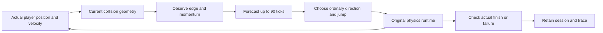

# Fraynix Agent Workspace — edition 116

## Observe the failure. Change the controls. Test again.

Edition116 improves the Game Lab controller against the actual failure retained in [edition115](README-115.md). It forecasts a bounded landing from the player's current position and velocity, checks real collision geometry, and adjusts ordinary controls. At an observed edge it commits to a crossing instead of continuing an unsafe mushroom chase.

**Across twelve measured layouts, revised control finishes 12/12, the original controller 5/12, and simple control 12/12.** Completion improves, but power-up collection falls from seven to two. These are bounded course tests, not evidence of general game mastery or new model training.

The first action was checking CI. Edition115's main run had one failing reference-image test. Reproducing its software renderer exposed an invalid shader that rendered missing sprites. That renderer defect is fixed; the original image recognizer and its refusal thresholds remain unchanged. Six fresh reference images reconstruct and playtest on each of two renderers, with four additional unsupported-image refusals on each.

[Previous edition115](README-115.md) · [Full phased plan](docs/PLAYABLE_LEVEL_CREATION_PLAN.md) · [Acceptance contract](docs/EDITION_116_CONTRACT.md) · [Offline interactive guide](docs/readmes/116/index.html) · [Validation record](docs/readmes/116/verification.json)


## What you can do now

1. Ask chat to construct a supported playable level. Java creates a separate candidate from the original game components.
2. Watch actual simulation and progress in the integrated **Game Lab**. Simple control tests the candidate first; revised game AI supplies a separately recorded comparison.
3. Permit up to two repairs to observed gap failures. Each repair creates another candidate; prior failed trials remain.
4. Recover an interrupted request through **Mission → Resume**. Java verifies the saved state and begins a fresh native trial, retaining the interrupted session.
5. Import a supported PNG, inspect the component outlines, and prepare a reconstruction request. The image-derived candidate must pass the same source and actual outcome checks.
6. Inspect **Level task history**, including final controller diagnostics, and choose **Recheck evidence** or **Open verified result**.

Start with:

```text
Create a playable Mario level gapTiles=10 repairLimit=2; construct, playtest and repair it.
```

For a shorter different course:

```text
Create a playable Mario level seed=4 lengthTiles=64 gapTiles=2 secondGapTiles=1.
```

Supported fields remain `seed=0..9999`, `lengthTiles=48..72`, `gapTiles=1..10`, `secondGapTiles=1..10`, and `repairLimit=0..2`. `without repairs` disables repairs. These fields configure the existing two-gap recipe. An image request cannot also override its geometry manually.

To try image reconstruction, save this [actual native reference](docs/readmes/116/actual-reference.png), expand **Create a level**, choose the PNG and **Analyze reference**, inspect its outlines, then **Prepare reconstruction request → Start task**. Recognition identifies supported appearances; the original component definitions supply behavior. A picture alone does not establish collision rules or playability.

## Prepare and run

Java 21 and Node.js are required. Existing rendering, physics and desktop dependencies remain; the new controller and analysis logic are owned Java. From the repository root:

```powershell
.\gradlew.bat prepareGameRuntime115 :workspace-engine:installDist
.\scripts\Start-Agent-Workspace.ps1
```

Stop this installation's Java owner before upgrading its files. A closed desktop does not necessarily mean Java has stopped. Use a deliberately selected project; the launcher does not migrate another project's private data. The existing `prepareGameRuntime115` task name remains valid and prepares current code/assets without repeatedly copying historical documentation. Full distribution packaging still includes that history.

Old trials retain their original engine identities. A changed runtime, controller or shader requires a fresh playtest; an old successful trial is not silently relabelled as edition116 evidence.

## Controller: bounded prediction and actual input



`LandingGuard116` projects up to 90 ticks at 1/60second using current velocity, the player's acceleration/braking limits and gravity. Three foot samples check support. It first evaluates the desired direction, then at most three alternatives: release, left or right. If no supported landing is found, it reports that limit rather than inventing ground. The forecast is approximate; actual physics remains the outcome authority.

When ground support disappears ahead, the controller accounts for forward momentum, begins a bounded jump and holds its crossing direction until landing or timeout. Unsafe optional pursuit is deferred. A moving mushroom or flower is not mistaken for a structural ceiling. Descending motion is checked again every tick, so the next observation can revise the action.

No actor position, terrain, gravity, finish condition or collision result is changed to manufacture success. Human controls remain available. `ai-step` retains `legacy115` for an explicit comparison; the default is `landing116`. A policy cannot be changed midway through one bounded AI trial. Final observations expose checks, corrections, estimated landing and actual input; they do not turn a forecast into proof.

## Measured controller results

| Partition | Controller | Finish contact | Power-ups | Median complete trial |
| --- | --- | ---: | ---: | ---: |
{{CONTROLLER_ROWS}}

Development layouts use seeds 0, 1, 4, 8, 11, 17. The separately declared reserved layouts use 2, 5, 6, 10, 13, 16, with lengths 48–72 and independently varied gap widths. Every policy starts from a fresh candidate runtime; before/input/after states and final PNGs are retained. The simple baseline uses the declared gap positions. It is a useful lower-cost reference, not a general visual agent.

The hardware run reports this workstation's NVIDIA GeForce GTX 1660 Ti; the software run reports Mesa llvmpipe. The reserved six layouts repeat under software rendering. They are the same six geometries on another renderer, not six additional unfamiliar layouts. Each reported time is one fresh trial including launch/reset, control chunks and the final observation; writing the retained files afterward is excluded. These timings are not repeated statistical latency estimates. [Exact measurements and timing scope](docs/readmes/116/measurements.json).

**The tradeoff matters:** completing all twelve courses while collecting only two power-ups is conservative progress. The next controller improvement should recover safe collection without losing these finishes. The first landing-only prototype fixed seed0 but lost an original success on seed4; its traces remain in the archive. The final regression gate refuses any lost original success in the tested cohort.

## CI first: why the image test failed

Edition115 main [run42956804562](https://github.com/eyeoverthink/Fraynix-Agent-Workspace/actions/runs/42956804562) failed one of863 engine tests; two were skipped. Edition114 main passed. On the CI software renderer, GLSL330 rejected nonconstant sampler-array indexing. Disabled Java assertions allowed the failed shader to continue. The image recognizer then correctly refused a malformed overview.

Both the visible sprite shader and the picking shader now select texture samplers through literal branches. Shader source, compilation and linking failures throw explicit exceptions. A hidden native OpenGL test compiles both and confirms an intentionally invalid shader fails clearly. Shader bytes also join the game-task engine identity and installed-asset comparison.


Local reproduction uses the same checksum-verified Mesa26.2.5 package as CI, in a private test Java installation. The system Java installation is unchanged. The unchanged115 image test passes after the shader correction. Exact failed logs, CI report, images and corrected outputs are preserved. New CI artifact paths retain the native/reference output if a later run fails. Local results do not substitute for the new remote CI run, whose status is reported separately in the publication receipt.

## Fresh image reconstruction

Six new actual native scenes use seeds 1, 4, 8, 11, 15, 17, different lengths and gap widths. Their declared transformations include a sky crop, a seven-pixel horizontal shift, and 1×, 1.5× or 2× nearest-neighbor scaling. These are controlled reference images from this app, not unrelated web images.

For each image, the recognizer's parameters must equal the independent original candidate's parameters. Java then constructs a different candidate, runs actual playtests and checks its outcome. The allowed repair budget remains two. Both hardware and software runs retain the source PNG, transformed PNG, transform parameters, recognized components and complete task record.


Four additional required refusals cover a missing finish segment, incomplete floor row, covered player and blank image. The original115 tests also retain changed-original and unknown-foreground refusals. Successful recognition never removes the source or outcome checks. [Hardware image evidence](docs/readmes/116/reference-hardware.json) · [Software image evidence](docs/readmes/116/reference-software.json).

The wider image cohort also exposes a remaining controller failure. Simple control finishes all six reconstructed levels; revised AI finishes five and stalls on seed15's five-tile first gap. Its retained trace ends near x=5.142, y=0.539 with no supported landing found and a no-progress stop. The earlier 12/12 controller result concerns the separately declared narrower-gap layouts; it must not be generalized to this wider course. The completed reconstruction task reports both the verified simple-control finish and the failed AI comparison. This new case is the next landing/contact-recovery target.


## Durable chat, interruption and complete costs

The actual Electron app and installed Java engine were tested through four visible requests. The restart test terminates only its own isolated Java process during an unfinished trial, reopens that same test project, and uses the visible Resume control. The interrupted session remains; the new trial has a different session identity. The verified result is reopened at tick 0 for review rather than showing a stale end frame.

| Actual request | Complete elapsed | Simple control | Revised AI | Repairs |
| --- | ---: | --- | --- | ---: |
{{CHAT_ROWS}}

The no-repair request is an expected refusal after an actual failed trial. It is not counted as a completion. These whole-request timings include orchestration, persistence, checking and recovery where applicable. [Exact actual UI results](docs/readmes/116/actual-ui.json).


Validation includes **{{JAVA_COUNT}} distinct Java test methods**, 165 desktop regression checks, actual native game trials, four visible chat requests, abrupt recovery, and the offline guide at 1440 and 390 pixels. The source and original evidence index make those claims inspectable. The actual app is captured at 1600 and 1100 pixels; the guide's mobile layout is not a claim that the native workspace is a phone app.

These supported requests use **zero model calls**. The available local `gpt-oss:20b` catalog option is checked, but no new LLM inference or training result is claimed. Java routing, the owned controller and actual simulation produce these outcomes.

Run relevant checks serially from the repository root:

```powershell
.\gradlew.bat :test :workspace-engine:test --tests 'fraymus.workspace.Game*Test' --console=plain --max-workers=2
npm --prefix workspace-desktop test
```

The native tests require a working OpenGL context. [The CI workflow](.github/workflows/build.yml) provisions its checksum-pinned software renderer. `GameController116Test` defaults to the development set; a fresh run with JVM property `study116.validation=true` selects the reserved set. Set `study116.output` and `reference116.output` to fresh directories to retain previous measurements. The full local regression also includes existing embedded-game, spatial-game and chat-owner tests. [The actual UI recorder](workspace-desktop/test/game116-integration.cjs) requires the current build receipt and its declared local model catalog option; it refuses to overwrite an earlier output directory.

## Preserved boundaries and implementation map

The original 1,248-object source remains unchanged. Root `level.txt` remains a small two-object example. Existing 24 chat slots, 24 level-task history slots, 32 candidate limit, three explicit resumes and 32 active saved procedures remain. New level records do not automatically enter the reusable procedure bank. Import and generated JSON are data, not new executable tools.

```text
src/main/java/agent/LandingGuard116.java       bounded landing model
src/main/java/agent/GameInput.java             controller and original-policy comparison
src/main/java/runtime/EmbeddedGameRuntime.java actual native observations and inputs
src/main/java/renderer/Shader.java             explicit shader failure handling
assets/shaders/                               portable sprite/picking shaders
workspace-engine/src/main/java/               durable task, candidate and image checks
workspace-engine/src/test/java/               actual controller/reference cohorts
workspace-desktop/renderer/brain-game.js       integrated view and diagnostic history
workspace-desktop/test/game116-integration.cjs actual chat/restart/screenshots
README-116.md                                 frozen edition narrative
docs/readmes/116/                              screenshots, measurements, original evidence
docs/publication116/                          reproducible documentation/publication checks
```

The larger system remains the same: Java owns durable goals, tools, world state, validation and memory; the desktop presents browser, canvas, chat and game surfaces. The native game uses the existing renderer and physics. This edition strengthens one measured perception/action loop; it does not replace the system with a separate demo.

## Next phases and acceptance gates

1. **Wider-gap recovery and safe power-up pursuit:** investigate seed15's retained contact/no-progress trace, then evaluate reachable pickup routes and braking while preserving the 12 completion cases. Use new enemy/obstacle layouts and separate collection and survival scores. Promote only a policy that earns the tradeoff.
2. **Broader reconstruction:** add explicitly supported components/layouts with independent images, false-accept/refusal measurements and review of unknown areas. Current evidence does not support arbitrary web screenshots, hidden geometry or generic level design.
3. **Procedure lifecycle:** retire and reactivate procedures with original provenance under the unchanged 32 active slots. Qualify level procedures before reuse; keep runtime changes and historical proofs distinct.
4. **Unified world experiments:** apply the same observe/predict/act/check/retain contract to supported 3D components and calibrated observations. Preserve units, uncertainty, causality and actual outcome evidence.

The useful direction is an agent that can inspect its environment, choose an action, see a result and keep an honest record across interruptions. Richer worlds and richer behavior should be earned through new measured tasks.

[Original evidence index](docs/readmes/116/original-evidence.json) · [Project memory](docs/PROJECT_MEMORY.md) · [Development log](docs/DEVELOPMENT_LOG.md) · [Obsidian map](docs/obsidian/124-measured-game-control.md) · [All editions](docs/readmes/INDEX.md)
