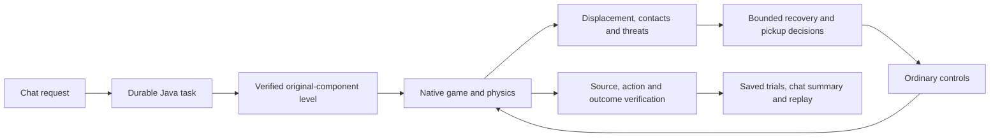

# Fraynix Agent Workspace — edition 119

## Recover from the contact. Reconsider the opportunity. Verify the result.

The integrated Game Lab now corrects both failures retained in [edition 118](README-118.md): the player lodged against a block after crossing a gap, and the player died after permanently skipping a power-up. The new owned Java policy, `recover119`, reads actual displacement and solid contact before choosing bounded retreat and jump inputs. It can defer an enemy-threatened pickup and inspect it again after the threat moves. It no longer reverses toward an enemy behind the player to attempt a stomp.

**Both retained failures now finish, each with one collected power-up and zero damage.** In the pickup case, two temporary deferrals precede actual collection. Six declared development courses finish with five total pickups and zero damage. One successful course still leaves its pickup uncollected. These are scoped measurements, not a claim of universal play or new neural training.

{{RESERVED_RESULT}}

[Previous118](README-118.md) · [Full phased plan](docs/PLAYABLE_LEVEL_CREATION_PLAN.md) · [Acceptance contract](docs/EDITION_119_CONTRACT.md) · [Offline interactive guide](docs/readmes/119/index.html) · [Validation](docs/readmes/119/verification.json)


## Try it in the existing app

1. Open **Game Lab → Create a level from the original components**.
2. Select **Corner recovery** or **Moving threat and pickup**.
3. Select **Prepare challenge request**, then **Start task** in chat.
4. Java constructs a separate level from the original components, retains a simple-controller comparison, and runs the selected AI policy in a fresh native session.
5. Watch the actual game frame and its recovery/deferral status. The finish is accepted only after real flag contact. Challenge terrain is never repaired to manufacture a result.
6. Read the verified chat summary: collected power-ups, damage, permanent skips, temporary deferrals and contact-recovery attempts.
7. Open **Level task history → Recheck evidence** for original observations, actions, failed/interrupted trials and source checks. After interruption, use **Mission → Resume**; the unfinished trial restarts from its verified initial state in a new native session.

```text
Create a playable Mario level seed=8 lengthTiles=72 gapTiles=4 secondGapTiles=2 goombaTile=26 obstacleTile=24 obstacleHeight=2.
Create a playable Mario level seed=23 lengthTiles=64 gapTiles=2 secondGapTiles=3 goombaTile=14 turtleTile=27 obstacleTile=24 obstacleHeight=2.
```

The existing enemy/steps, cramped power-up and pickup-above-gap presets remain. Unsupported inputs and unfinishable challenges still refuse. The final review opens the candidate at tick zero; its recorded finish remains a separate verified trial.

{{DEFAULT_SCOPE}}


### Run locally

Use Java 21 and Node.js with the repository's existing dependencies:

```powershell
.\gradlew.bat prepareGameRuntime115 :workspace-engine:installDist
.\scripts\Start-Agent-Workspace.ps1
```

Choose a separate saved project for evaluation. Existing private projects and live Java owners are preserved. The `prepareGameRuntime115` name prepares the **current** native code and assets. Java owns execution, state and verification; the desktop hosts the integrated game, browser and canvas. The engine still uses its established JBox2D, LWJGL/OpenGL and desktop dependencies. This edition adds hand-written Java logic, without a new external library or model download.

## What the failures taught us

### A reported velocity is not proof of movement

The retained seed8 run reaches approximately X5.885/Y0.870. The controller reports downward velocity while native contacts keep the body stationary. Its older recovery check used near-zero vertical velocity, so it failed to recognize this lodged state.

`ContactObserver119` reads up to 32 native contacts, rejects sensors and non-terrain contacts, and determines whether the player has support plus an opposing side contact. `ContactRecovery119` detects 24 ticks without more than 0.008 original units of displacement. It checks an observed retreat landing within a bounded 1.25-unit drop, waits if an enemy is close behind, then requests ordinary retreat and jump inputs. The original player controller must still detect the ground and permit the jump. If a pickup goal changes mid-escape, support and threat observations remain bound to the committed retreat direction. A real physics-fixture test removes that side’s support while retaining opposite-side floor and requires refusal.

| Bound | Actual rule |
| --- | --- |
| Contact attempts | At most 3 per automatic run; successful motion does not reset this budget |
| Rear-threat wait | At most 180 ticks |
| Retreat | At most 90 ticks; refuse if support is lost or a rear threat appears |
| Forward jump phase | At most 90 ticks, with up to 28 ticks of held jump input |
| Opportunity deferral | At most 3 per object, 60 ticks apart |
| Pickup checks | Existing maximum 4 candidate assessments per tick |
| Retained decision details | Existing maximum 16 rows; total counters remain explicit |

All distances use the Game Lab's original units, not metres. Bounds apply to this controller, not to the separate SI-unit 3D Lab. No transform, velocity, collider, enemy behavior, physics parameter or victory condition is changed by recovery.


### A temporary threat should not become permanent amnesia

The retained seed23 run initially rejects a pickup because an enemy crosses its approach. The old travel behavior then reverses toward the enemy for a stomp and later backs into it during recovery. The revision keeps enemy-threat deferral separate from permanent geometric refusal, observes again within a finite budget, and does not chase a passed enemy backward for a stomp.

Unsupported approaches, insufficient clearance and structural obstacles remain reasons to decline. Neither deferral nor refusal is recorded as a failed motor lesson. Actual unreachable motor attempts retain the existing failure-learning path. This edition changes owned control logic; it does not claim LLM-weight updates or autonomous discovery of the algorithm.


## One app, with checked coordination

The Java goal owner still controls the task and its native runtime. The desktop observes and presents it. Recovery does not bypass ownership, session continuity, action budgets, source identity or outcome checks. `GameEvidence119` additionally rejects impossible recovery counters, unknown phases, mismatched decision totals, too-frequent deferrals and excessive per-object deferrals. Chat reports the checked audit rather than inferring success from a forecast.



The rest of the workspace remains intact: persistent world goals, measured world-model experiments, browser interaction, canvas creation, data workflows, local models, memory and verified procedures. A successful game trial does not establish real-world control accuracy. Reference-derived tasks retain their explicit safe117 comparison. Known-sprite image reconstruction retains its previous scope and refusals; no enemy-image recognition expansion or procedure-bank admission is claimed.

## Results and complete costs

Each native trial uses a fresh process/session. The table preserves every measured comparison, including failures. The six edition 119 reserved courses were declared before tuning and first evaluated after the policy was fixed. A subsequent code-review correction bound observations to a committed escape direction; both the original reserved evaluation and the final repeat are retained. The repeat is regression evidence, not a new unseen cohort. The software repetition uses those same courses, not six additional unseen cases. The 18 previous challenge courses and 24 earlier courses are regressions.

| Cohort | Policy | Finishes | Pickups | Damage | Deaths | Skips | Deferrals | Contact attempts | Median full native trial |
| --- | --- | --- | --- | --- | --- | --- | --- | --- | --- |
{{CONTROLLER_ROWS}}

Simple-control pickup/damage callbacks remain uninstrumented, reported as **n/a**. Its finish/death/fall observations remain available. Whole native trial costs include launch, simulation, rendering and communication. Added observation timings measure only their named checks; these single trials are not repeated performance benchmarks or whole-app speedup claims.

{{COST_RESULT}}

Actual visible chat requests include construction, retained comparisons, saving, verification and review opening:

| Request | Complete wall time | Simple | AI | Repairs |
| --- | --- | --- | --- | --- |
{{CHAT_ROWS}}

**{{JAVA_COUNT}} distinct Java test methods and 165 desktop checks passed.** Actual UI testing covers both corrected failures, abrupt Java interruption and visible Resume, retained low-clearance refusal, an unfinishable challenge and narrow layout. Six transformed known-sprite references and four unsupported references per renderer preserve image checks. Original source/candidate corruption, engine identity, owner/session/action/image/repair/outcome checks remain. All five actual chat requests use the existing Java route and make zero model calls; the local model selector's availability is not an inference benchmark.


[Measurements](docs/readmes/119/measurements.json) · [Actual UI records](docs/readmes/119/actual-ui.json) · [Validation](docs/readmes/119/verification.json) · [Original evidence](docs/readmes/119/original-evidence.json)

The original baseline and first unsuccessful prototype are retained alongside the successful development candidate. Raw and compressed SHA-256 hashes preserve original logs, traces, screenshots and isolated test projects. Private projects, credentials, model weights and Java/Mesa binaries are excluded. CI was checked first; its 118 runs were pending. Hosted CI status is reported separately from local checks and fetched publication.

## Source map

```text
src/main/java/agent/
  ContactObserver119.java      native terrain contacts and supported retreat
  ContactRecovery119.java      bounded displacement-based input policy
  PowerupPlanner.java          finite opportunity deferral without false learning
  GameInput.java               controller composition and observed counters
workspace-engine/src/main/java/fraymus/workspace/
  GameEvidence119.java         recovery/deferral integrity checks
  GameTask115.java             durable verified task owner
  GameSummary118.java          checked outcome explanation
workspace-desktop/renderer/brain-game.js
workspace-desktop/test/game119-integration.cjs
docs/publication119/           reproducible validation and publication helpers
```

[Complete source inventory](docs/readmes/119/file-inventory.json) and [Obsidian map](docs/obsidian/127-contact-recovery-and-reconsideration.md) connect this edition to the larger system.

## Next steps

{{NEXT_STEPS}}

Keep the original evidence, budgets and counterexamples. Broader image components need independent examples and explicit unknown-region refusals. Reusable level skills still need retirement/reactivation and fresh qualification before admission under the unchanged 32-slot limit. The 24-task history and three-restart limits remain. Cross-domain transfer to manipulation or creation requires fresh verification in that domain.
