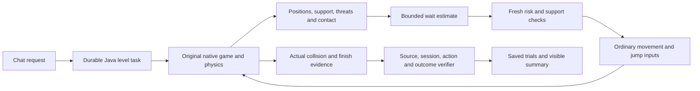

# Fraynix Agent Workspace — edition 120

## Wait when another observation can make the pickup worthwhile

Three reserved courses in [edition119](README-119.md) finished without their optional item. Two had supported power-up blocks guarded by moving enemies. The third placed the power-up above a gap. Edition120 adds a small owned Java policy that can wait for a temporary threat, observe again, and pursue only after the actual approach clears. The unsupported gap remains a refusal.

**Both supported missed items are now collected, with a finish and zero damage.** Across seven declared development courses, the previous `recover119` controller finishes all seven with zero pickups. `opportunity120` also finishes all seven, collects three items and records zero damage. All54 older courses still finish without damage; the original24 pickup courses retain24 pickups. These observations describe this finite test set, not general mastery.

{{RESERVED_RESULT}}

[Previous119](README-119.md) · [Acceptance contract](docs/EDITION_120_CONTRACT.md) · [Full phased plan](docs/PLAYABLE_LEVEL_CREATION_PLAN.md) · [Offline guide](docs/readmes/120/index.html) · [Verification](docs/readmes/120/verification.json) · [Source inventory](docs/readmes/120/file-inventory.json)


## Try it

1. Open **Game Lab → Create a level from the original components**.
2. Choose **Wait for moving threat** or **Turtle and pickup**.
3. Press **Prepare challenge request**, then start the task in chat.
4. Watch the simple comparison and the actual AI trial. The Game view reports waiting time, confirmed clearance and any aborted wait.
5. Open **Level task history** to inspect the original trials, decisions and verified outcome. **Recheck evidence** checks the retained source and outcome chain again.

Example request:

```text
Create a playable Mario level seed=41 lengthTiles=72 gapTiles=3 secondGapTiles=4 goombaTile=15 turtleTile=28 obstacleTile=25 obstacleHeight=2 repairLimit=0; compare controls and report skipped pickups.
```

The task creates a separate candidate. It retains the simple controller's failure, runs the AI in a fresh native session and reports collision-based collection and actual finish contact. The reviewed candidate opens at tick0; the displayed starting frame is not a new victory. An interrupted task requires explicit resume and a fresh incomplete trial. Completed evidence stays attached.

{{DEFAULT_SCOPE}}

## What changed inside Java

`OpportunityTiming120` estimates when a moving enemy will leave the existing pickup-risk window. It uses the observed position and velocity, rejects unknown or effectively stationary motion, checks that the enemy will not cross the holding position, and refuses estimates beyond three simulated seconds. This is a bounded linear spending estimate. Enemies can reverse; its answer is never accepted as proof that the route is safe.

`PickupOpportunity120` checks actual support, grounded state, velocity and incoming threats each tick. It holds ordinary input at zero while waiting. Fresh risk assessment must confirm clearance before pursuit resumes. A changed support, position, threat or deadline releases the wait. There are at most180 ticks per wait,360 total, and three starts, once per object. Controller timing remains the original60Hz; desktop capture and model inference do not set physical timing.

The same class can propose a nearby return to a remembered deferred block. It requires a grounded player, backward distance at most1.75 original units, continuous observed floor, clear approach, and enough observed floor for braking plus the existing edge buffer. A return gets at most240 ticks and there are at most three starts, once per object. A permanent refusal remains authoritative even when that object was previously waited for. The existing contact, gap, obstacle and damage handling stays active.

**Useful collection through revisiting remains unproven.** An early development probe admitted a return, spent28 ticks and collected nothing when the original edge guard took over. That evidence is retained. The added braking-support check refuses this return. Four declared early-pickup probes all finish without damage, but neither the old nor new controller collects their item. This is a remaining gap, not a successful return demonstration.


## How the pieces work together



Java owns the task, controller and evidence. The existing desktop presents the embedded renderer and chat. No new external package or separate editor window is introduced. No teleport, collider edit, hidden terrain repair, synthetic collision or scripted success substitutes for native play. Old explicit controller names remain available for comparisons. Physics and rendering implementations stay unchanged.

`GameEvidence120` adds bounded wait/return counter and decision checks to the existing119 checks. The task recomputes the audit from retained actions and native observations. Its engine identity also binds the verifier implementations. Altered audit totals, invented starts, repeated waits and expired opportunities are refused. These checks complement the existing source, asset, candidate, engine, owner, session, input, image and outcome checks; none are replaced by a cached success label.

## Results and costs

| Group | Controller | Finishes | Pickups | Damage | Wait ticks | Return ticks | Median complete trial |
| --- | --- | ---: | ---: | ---: | ---: | ---: | ---: |
{{CONTROLLER_ROWS}}

Simple control does not have instrumented pickup/damage callbacks; those cells are `n/a`. A failed trial is retained. Hardware and software repetitions use the same reserved cases and do not count as additional unseen examples. Development corrections were completed before the first reserved run. The original failed fixture and prototype diagnostics remain linked in the raw evidence archive.

{{COST_RESULT}}

The initial supported waits estimate138 ticks and clear after141 observed ticks. The shifted goomba example estimates163 and clears after167. Fresh observation, rather than the estimate, ends each wait. Perception/check time and full native trial time are reported separately. A slower finish that safely gains a pickup is a tradeoff; no whole-app speedup is claimed.


| Actual visible request | Wall time | Simple result | AI result | Repairs |
| --- | ---: | --- | --- | ---: |
{{CHAT_ROWS}}

Five real visible requests cover the old gap-repair recipe, both newly collected pickups, an unsupported gap refusal and a deliberately unfinishable challenge. One request survives an abrupt owned Java process interruption and resumes with a new trial. All five use the existing explicit Java route with zero model calls. The local `gpt-oss:20b` catalog entry is checked; that does not establish a new model inference or learning result.

## Validation and boundaries

- {{JAVA_COUNT}} distinct passing Java methods, including real native floor-loss, wait expiry, permanent-refusal, braking and return-deadline fixtures, forged-evidence refusal, actual task completion and restart.
- 165 desktop checks, five visible requests, normal and1100-pixel layouts, actual native waiting/collection screenshots, and1440/390-pixel offline guide checks.
- Seven development courses, four extra return probes, six reserved courses, all54 older course regressions, plus independent hardware/software repetitions within the documented scope.
- Six transformed reference images and four refusals per renderer retain the earlier known-component reconstruction scope. Arbitrary web-image understanding is not added here.

The controller still misses some optional items. Three successful development cases outside the corrected pair leave their item behind, and the unsupported-gap case intentionally declines its item. Linear enemy motion prediction is narrow and can be wrong; every wait has a deadline and fresh checks. A return admission is not a guarantee of eventual collection. The small fixed policy is not neural weight training or autonomous recursive self-improvement. No new procedure-bank admission is claimed.


## Files and reproducibility

| Responsibility | Source |
| --- | --- |
| Clearance spending estimate | [OpportunityTiming120](src/main/java/agent/OpportunityTiming120.java) |
| Bounded waiting and return admission | [PickupOpportunity120](src/main/java/agent/PickupOpportunity120.java) |
| Ordinary controller composition | [GameInput](src/main/java/agent/GameInput.java) |
| Original embedded runtime | [EmbeddedGameRuntime](src/main/java/runtime/EmbeddedGameRuntime.java) |
| Durable task and evidence | [GameTask115](workspace-engine/src/main/java/fraymus/workspace/GameTask115.java), [GameEvidence120](workspace-engine/src/main/java/fraymus/workspace/GameEvidence120.java) |
| Fresh native controller study | [GameController120Test](workspace-engine/src/test/java/fraymus/workspace/GameController120Test.java) |
| Actual visible review | [game120 integration](workspace-desktop/test/game120-integration.cjs) |
| Serial validation and publication | [publication120](docs/publication120) |

[Complete measurements](docs/readmes/120/measurements.json), [actual chat receipts](docs/readmes/120/actual-ui.json), [original evidence index](docs/readmes/120/original-evidence.json), [source map](docs/readmes/120/system-map.json) and [Obsidian map](docs/obsidian/128-pickup-waiting-and-return-cost.canvas) preserve the implementation and its limits. Each archived original has raw and compressed SHA-256 checks. Private live worlds, credentials, model weights and installed runtimes are excluded. Historical numbered READMEs and snapshots001–119 remain unchanged.

CI was checked first; hosted results are recorded separately from local validation. Publication is only claimed after actual main/edition120/tag push and a fresh fetched-tree audit. The rolling README will link the publication receipt once that audit completes.

## Next steps

{{NEXT_STEPS}}

The larger direction remains one local Java-owned agent system: observations, world state, actions, persistent tasks and verifiable outcomes connected to the same app. This edition improves one small decision—whether to wait—in that system. The next improvements should earn their place through safer completion, useful collection and measured total cost on new cases.
