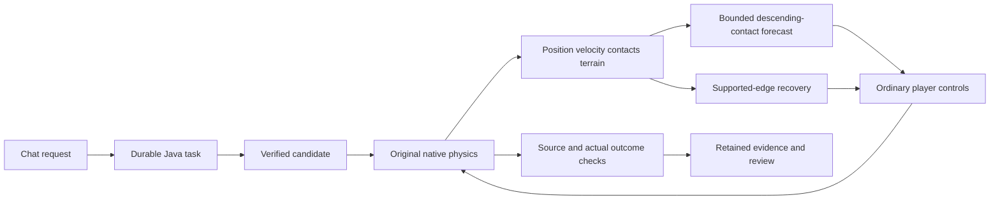

# Fraynix Agent Workspace · Edition 122

**Avoid dangerous descending contact. Recover from a supported edge. Verify the actual finish.**

2026-11-12 · Local Java execution, original native physics and one integrated workspace.

[Previous edition](README-121.md) · [All editions](docs/readmes/INDEX.md) · [Offline interactive guide](docs/readmes/122/index.html) · [Acceptance contract](docs/EDITION_122_CONTRACT.md) · [Phased plan](docs/PLAYABLE_LEVEL_CREATION_PLAN.md)


## What edition 122 changes

Edition 121 established a useful return to missed pickups, but retained two enemy-contact deaths and a turtle course that stopped making progress. This edition works directly from those recorded failures. It adds a short enemy-contact forecast during descent and a bounded escape from stationary support at a block edge. Both issue ordinary controls. The original enemy collision rules, player movement, gravity, terrain and success conditions remain in force.

The retained failures are development cases now, not new unseen tests. A separate set of eight reserved courses was declared before tuning. Its first run completed one valid case, then rejected a length outside the existing 48–72-tile builder limit. Six invalid lengths were corrected to 72 before their candidates could run; the controller, seeds, gaps, enemies and other settings stayed fixed. A second admission rejection found the high-edge turtle initially over its seed-dependent gap; it was placed at the adjacent supported tile before that candidate could launch. All declared inputs are then checked before any run. Both rejected attempts are retained, and repeating the first two valid cases is not additional unseen evidence. Their outcomes, the original failures and every comparison remain available below. A safer forecast is a decision aid; only native collision and finish evidence establish what happened.

## Try the corrected courses

1. Launch the workspace and open **Game Lab** in the integrated creation canvas.
2. Expand the level-building controls and choose **Descending enemy approach**, **Late turtle approach**, or **Supported edge recovery**.
3. Prepare and send the chat request. Java constructs an isolated candidate, runs the simple comparison and then the AI trial, and checks the outcome.
4. Watch the live counters for descending-contact corrections and supported-edge escapes. The counters describe actions, not success.
5. Open **Level task history** to inspect the retained attempts, actual finish and collected items. A successful candidate reopens at its start for review.
6. Try **Return to a cleared pickup** to check that the previous return behavior remains available. The unsupported gap pickup still has a separate refusal case.


The explicit level-task route uses Java and makes zero model calls. Selecting an Ollama model in the interface does not mean it generated these actions. General chat retains its existing model routes. No model-weight training or automatic skill-bank admission is claimed here.

## Why the enemy deaths happened

The original observations show the player descending toward an enemy while the controller tries to line up a landing. An enemy at a similar height can cause fatal side contact before the desired top contact occurs. In the late-turtle case the player reaches the ground too close to the enemy to recover reliably with the old timing.

`EnemyLanding122` evaluates at most three horizontal choices, using up to 60 fixed simulation steps per forecast. It reads current position, velocity, movement parameters and collision geometry. It checks a conservative enemy envelope along the descent and a short separation margin at touchdown. An alternative is chosen only if the predicted landing is supported and avoids the predicted contact. The next frame supplies a fresh observation.

The revised policy also stops using the older descending stomp-alignment heuristic. Existing policies remain selectable for comparison. These changes do not teleport the player, edit enemy speed, modify collision normals or force a stomp. If no supported contact-free alternative is found, the forecast records that limitation instead of manufacturing safety.

The forecast is deliberately narrow: it approximates short enemy motion from current velocity. It is not a full prediction of all future wall reversals, shell behavior or multiple-body interactions. Native outcomes and the fresh reserved comparison remain necessary.

## Why the turtle course stalled

The player had collected a mushroom and was resting on a block edge. Its original grounding probe reported airborne and its controller reported downward velocity, but measured position stayed constant and the physics contact list showed real terrain support. The landing guard repeatedly selected zero horizontal movement. The older contact recovery required an opposing wall contact, which was no longer present at that edge.

The revised recovery admits this additional observed condition: stationary position for at least 24 ticks, a real terrain support contact, and a missing grounded indication. It checks the ground behind before issuing a short retreat. Once ordinary motion reaches usable support, the existing recovery can jump forward. The original three-attempt limit and wait/retreat/jump deadlines remain. No grounded flag is written and no body is moved directly.


This distinction matters beyond this course: requested velocity is not proof of movement, and a single grounding probe is not the whole contact state. Recovery uses the combination of observed displacement, contacts and nearby support, then verifies subsequent progress.

## Measured outcomes

{{RESULT_SUMMARY}}

| Partition | Controller | Finishes | Pickups | Damage | Deaths | Median complete trial time |
| --- | --- | ---: | ---: | ---: | ---: | ---: |
{{CONTROLLER_ROWS}}

Complete trial time includes the fresh native launch, simulation, rendering and bridge work through the final frame; later cleanup is excluded. These are individual runs, not a calibrated speed claim. The new forecast adds work and can change the route. Finishing and retaining useful pickups are evaluated separately.

| Retained failure | Previous controller | Revised controller | Revised contact corrections | Edge escapes |
| --- | --- | --- | ---: | ---: |
{{FIX_ROWS}}


{{REGRESSION_SUMMARY}}

{{RESERVED_LIMITS}}

[Complete measurements](docs/readmes/122/measurements.json) · [Original evidence index](docs/readmes/122/original-evidence.json) · [Reserved results](docs/readmes/122/controller-reserved.json)

## Verification and recovery

The durable task still binds the source, component construction, assets, installed engine identity, native owner/session, bounded actions, frame receipts and observed outcome. `GameEvidence122` validates the additional forecast counters, horizon, enemy limit, selected input, support/contact conditions and edge-start bounds alongside the existing checks. A claimed safe override with an unsafe landing is rejected. A forecast without an observation is rejected. Changing retained evidence is rejected.

Old proofs remain tied to their original compiled engine. They are never relabelled as evidence from this release. A failed trial remains a failure even if an item was collected. An interrupted trial stays recorded when a new native session resumes the durable request.

Seven actual visible requests exercise old terrain repair, the three corrected courses, return after an abrupt owned-process interruption, unsupported-pickup refusal and an intentionally failed challenge. The failed challenge remains interrupted until explicitly cancelled; the system does not repair challenge terrain to force a pass.

| Actual request | Wall time | Durable status | Certified AI pickups |
| --- | ---: | --- | ---: |
{{CHAT_ROWS}}


## Tests and CI

CI was checked before implementation. Both edition 121 main and release jobs succeeded, including the corrected load-interruption test. The original status snapshot is retained. Edition 122 hosted CI is reported separately from local verification and publication.

- {{JAVA_COUNT}} distinct Java test methods: native trials, boundary checks, provenance, restart and tampering refusal.
- 168 desktop checks, seven visible requests, abrupt process recovery and a narrow desktop review.
- Original reference-image checks remain: six transformed cases and four refusals on each renderer, plus the earlier reference regression.
- The fresh reserved set is repeated with actual software rendering. This repeats the same scenes; it is not another unseen dataset.
- Normal launcher preparation and build receipts are checked around the visible review.
- Real screenshots, source inventory, exact compressed originals, linked documents and all historical edition hashes are verified before publication.

[Validation record](docs/readmes/122/verification.json) · [Actual UI record](docs/readmes/122/actual-ui.json) · [Hardware references](docs/readmes/122/reference-hardware.json) · [Software references](docs/readmes/122/reference-software.json)

## Running from source

Use [Launch-Agent-Workspace.bat](Launch-Agent-Workspace.bat), backed by [Start-Agent-Workspace.ps1](scripts/Start-Agent-Workspace.ps1). JDK 21 and Node.js LTS are required. First preparation downloads locked dependencies; a prepared installation can use the offline mode.

Before updating an installed build, use **Stop Java & close app**. Closing just the desktop may leave its durable Java owner alive. Preparation preserves running owners and refreshes both workspace and native Game Lab installations when stopped.

For an isolated review, choose a new project directory:

```powershell
$env:FRAYNIX_WORKSPACE_PROJECT = Join-Path $env:USERPROFILE '.fraynix-agent-workspace/projects/review-edition122'
.\Launch-Agent-Workspace.bat
```

Use a different unused name if that project is already active. Existing personal worlds and databases are not test fixtures.

## Architecture and direction

The app remains a local Java-owned agent workspace. Java maintains durable tasks, entities, actions and evidence. The desktop hosts the integrated game view, browser, canvas and chat. Game Lab supplies an observable environment with real native execution; serialized state makes experiments inspectable and reproducible.



```text
src/main/java/agent/EnemyLanding122.java       short contact forecast
src/main/java/agent/ContactRecovery119.java   opt-in supported-edge recovery
src/main/java/agent/GameInput.java            bounded ordinary controls
workspace-engine/.../GameEvidence122.java    added receipt checks
workspace-engine/.../GameTask115.java         durable task and outcome audit
workspace-desktop/renderer/brain-game.js      integrated controls and presets
workspace-desktop/test/game122-integration.cjs actual visible review
```

No new external framework is added. Existing native rendering and physics dependencies remain. This edition is a measured controller improvement, not general visual recognition, general intelligence or neural training.

## Next phases

**123: choose optional actions from measured value and cost.** Repeat complete tasks to measure variability. Compare finishing quickly against collecting useful power-ups, including cases where waiting, returning or extra observation costs more than it earns. Keep the return-disabled and simple-control comparisons.

**124: richer contact uncertainty.** Use new declared cases for wall reversals during prediction, moving shells, mixed enemies and changing support. Compare predicted contact with actual contact and retain false alarms as well as missed hazards. Do not tune against a set while calling it unseen.

**Later: broader creation and verified procedures.** Expand explicitly supported image components, retain unknown-region refusal, and qualify reusable procedures only after reconstruction, changed-condition playtests, recovery and source/outcome verification. Existing collection limits remain.

[Architecture](docs/ARCHITECTURE.md) · [Project memory](docs/PROJECT_MEMORY.md) · [Development log](docs/DEVELOPMENT_LOG.md) · [Contributor handoff](README-CONTRIBUTORS.md) · [Obsidian map](docs/obsidian/130-enemy-contact-and-supported-edge-recovery.canvas)
