# Fraynix Agent Workspace · Edition 123

**Measure the pickup benefit. Count the whole workflow. Keep safety ahead of speed.**

2026-11-12 · Local Java decisions, original native physics, durable checked tasks.

[Previous edition](README-122.md) · [All editions](docs/readmes/INDEX.md) · [Interactive cost guide](docs/readmes/123/index.html) · [Acceptance contract](docs/EDITION_123_CONTRACT.md) · [Phased plan](docs/PLAYABLE_LEVEL_CREATION_PLAN.md)


## What changed

Edition 122 fixed two recorded enemy-contact deaths and a supported-edge stall. Edition 123 asks a different question: when does waiting or returning for a power-up earn its extra work? It adds four explicit pickup approaches to the same controller, makes them available through durable chat requests, and measures repeated complete workflows. The default remains the edition 122 behavior.

| Pickup approach | Optional waiting | Remembered returns | Preserved behavior |
| --- | --- | --- | --- |
| `full` | Enabled | Enabled | Existing default |
| `no-wait` | Disabled | Enabled | Contact, terrain, risk and recovery checks |
| `no-return` | Enabled | Disabled | Contact, terrain, risk and recovery checks |
| `direct` | Disabled | Disabled | Safe forward pickups and every safety check |

These are controlled feature comparisons. `direct` does not mean blind forward motion, and disabling remembered returns does not prohibit every backward movement used by normal collision recovery. No physics, body transform, collectible counter or finish condition is overwritten.

## Measured findings

{{FINDINGS}}

The table reports totals across repetitions. A pickup count of three means one pickup in each of three runs, not three objects in one course. Times are elapsed **complete Java workflow** seconds.

| Partition / case | Approach | Finishes | Pickups total | Damage / deaths | Median wall seconds | Observed range |
| --- | --- | --- | --- | --- | --- | --- |
{{RESULT_ROWS}}


## When is it worth it?

A slower approach can be useful if it adds a pickup the user values enough. For comparisons with three safe paired finishes and an extra pickup in every pair, Java reports:

`observed conservative threshold = max(0, largest measured elapsed-time increase) / smallest measured extra-pickup count`

The [interactive guide](docs/readmes/123/index.html) lets you enter how many extra seconds you would allow per additional pickup and compare that allowance with the measured threshold. It does not change the controller. Three observations are not a statistical confidence bound or a prediction guarantee for another machine or level.

| Partition / case | Enabled approach vs comparison | Extra pickups per pair (range) | Extra wall seconds (range) | Observed seconds per extra pickup | Assessment |
| --- | --- | --- | --- | --- | --- |
{{COMPARISON_ROWS}}

If either approach fails to finish safely, the comparison refuses an economic recommendation. If no additional pickup is demonstrated, it says so. A consistently faster approach with no worse pickup count can still be useful. Mixed outcomes and overlapping timings remain visible; there is no invented single utility score.

## What the clock includes

Each measured row starts before creating its fresh project and task owner. It includes source checks, candidate construction, a fresh simple-control comparison, the AI trial, native frame capture, all durable task saves, final source/outcome verification, and closing the owned runtime. The phases are setup, task advancement, verification and shutdown. Advancement includes native execution **and** its surrounding validation, persistence and response construction.

Simulation ticks are reported separately. The existing `workNanos` field is partial engine work and is not used as full wall time. UI scheduling, chat presentation, post-study cost analysis and study-report writing are outside the Java-workflow clock. Each study records its analysis time separately in `analysisNanos`. The Java workspace is already running when a request starts; outer Gradle/test-JVM startup is excluded, while the task-owned native game startup is included. Actual visible request timings are recorded separately below, including the request interrupted for the restart test. Explicit Java routes make zero model calls; these measurements are not LLM inference benchmarks.

{{ENVIRONMENT}}

All strategies use fresh memory and the same declared geometry. Order rotates over three repetitions; each strategy occupies three of four positions, not complete counterbalancing. File-system caches and unrelated machine load can still affect elapsed time. We retain ranges and individual measurements instead of claiming statistical certainty or removing inconvenient samples.

## Cases and verification

Development contains a supported wait, a supported return, and an unsupported pickup. The first pilot is retained separately and excluded from repeated statistics. Two new measurement cases were declared before running: seed 251 with a shifted turtle approach, and seed 257 with a supported remembered return. Software rendering repeats the seed 257 case on the same geometry; it is a portability repeat, not additional unseen evidence. The new wait case shifts the turtle; the new return case changes the seed while retaining the same return geometry. These are modest checks, not proof of generalization to arbitrary courses. No controller tuning follows their outcomes.

{{VALIDATION}}

`GameEvidence123` checks that disabled actions stayed disabled. All previous source, asset, component, engine, owner, session, action, image, motion and outcome checks remain. Strategy identity is tied to the original request. Old proofs remain bound to their original engine identity. A failed trial can now be verified for **measurement**, with `completionCertified=false`; the ordinary completion verifier still refuses it. This does not promote failed tasks or bypass the task history limit of 24.

CI was checked first: edition 122 main and release were still running, while the latest completed edition 121 runs had succeeded. Hosted CI status is recorded separately from local validation and the fetched publication audit.

## Try it in the app

1. Open the integrated **Game Lab**, then expand **Create a level from the original components**.
2. Choose **Return to a cleared pickup** or the turtle/pickup course.
3. Choose a **Pickup approach**, prepare the request, and send it through chat.
4. Inspect the verified completion, actual pickups and the wait/return counters in task history. A completed candidate reopens at its start for review.
5. Repeat the same course with another approach. Keep full timing separate from game ticks; use the measured guide for the edition's controlled comparisons.

For example:

```text
Create a playable Mario level seed=127 lengthTiles=72 gapTiles=2 secondGapTiles=2 pickupTile=42 goombaTile=46 obstacleTile=60 obstacleHeight=1 repairLimit=0 pickupStrategy=no-return
```

Unknown, empty or duplicate strategy choices are refused. Non-default strategies require explicitly declared challenge geometry. General AI Play and requests without a strategy retain the existing default.


## Actual visible requests

These are separate end-to-end app observations, not pooled into the repeated Java timings. All screenshots are actual captures from an isolated review project.

| Request | Elapsed seconds | Final chat status | Verified AI pickups |
| --- | --- | --- | --- |
{{CHAT_ROWS}}


## Implementation and evidence

```mermaid
flowchart LR
 Request[Chat request and explicit approach] --> Task[Durable Java task]
 Task --> Source[Source and candidate checks]
 Source --> Compare[Fresh simple comparison and AI trial]
 Compare --> Native[Original native physics]
 Native --> Verify[Actual outcome and action checks]
 Verify --> Measure[Complete workflow timing]
 Measure --> Analysis[Repeated cost and pickup comparison]
 Analysis --> Value[Observed threshold for a user allowance]
```



```text
src/main/java/agent/PickupStrategy123.java          native feature choices
src/main/java/agent/PickupOpportunity120.java      bounded wait/return behavior
workspace-engine/.../GameStrategy123.java         request and policy binding
workspace-engine/.../GameEvidence123.java         disabled-action checks
workspace-engine/.../GameTask115.java             durable execution and measurement verification
workspace-engine/.../GameCost123.java             repeated cost and benefit analysis
workspace-engine/.../GamePickupStudy123Test.java  complete native study
workspace-desktop/renderer/brain-game.js          integrated pickup selector
```

[Measurements](docs/readmes/123/measurements.json) · [Verification](docs/readmes/123/verification.json) · [Original evidence index](docs/readmes/123/original-evidence.json) · [Source inventory](docs/readmes/123/file-inventory.json)

No new external framework, automatic policy promotion, neural weight training or saved-skill admission is introduced. The app remains a local Java-controlled system with one integrated presentation. The evidence establishes the measured trade-offs, not a general valuation of health, survival or future levels.

## Next phases

**124: preference-aware optional actions.** Use explicit user time allowances and an uncertainty-aware cost estimate, then test on new scenes before changing the default. Include cases where the estimate should abstain. Count the cost of estimating and verifying the decision itself.

**125: broader contact uncertainty.** Add declared moving-shell, enemy-reversal and changing-support cases. Keep actual contact, false alarms, missed hazards and bounded recovery visible. Earlier plans for broader image components and reusable verified procedures remain on the roadmap.

[Architecture](docs/ARCHITECTURE.md) · [Project memory](docs/PROJECT_MEMORY.md) · [Development log](docs/DEVELOPMENT_LOG.md) · [Contributor handoff](README-CONTRIBUTORS.md) · [Obsidian map](docs/obsidian/131-full-cost-pickup-choices.canvas)
