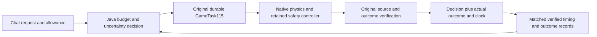

# Fraynix Agent Workspace · Edition 124

**Choose extra work only when its verified benefit fits your time allowance.**

2026-11-12 · Java-owned decisions, original game physics, durable verified tasks.

[Previous edition](README-123.md) · [All editions](docs/readmes/INDEX.md) · [Interactive evidence guide](docs/readmes/124/index.html) · [Acceptance contract](docs/EDITION_124_CONTRACT.md) · [Development phases](docs/PLAYABLE_LEVEL_CREATION_PLAN.md)


## What this system is

Fraynix is a local agent workspace. Java owns persistent goals, typed tools, task execution, world state and verification. The desktop presents chat, the browser, creation/data tools and integrated game/3D views. An LLM can propose and explain; an observed physical outcome, source check or build/test result determines whether a task actually succeeded. These game requests use an explicit Java route, so they work without an LLM choosing each movement.

The Game Lab is an executable environment for experiments: build a separate candidate, run real inputs through the original simulation, retain the frames and state changes, compare predictions with outcomes, and reopen the verified result. Edition124 adds a small decision layer around that existing runtime. It does not turn a reward estimate into permission to bypass a safety check.

## What changed

Edition123 measured the complete cost of waiting and returning for optional power-ups. Edition124 lets a request **choose an approach from current evidence**, using an explicit allowance and a conservative estimate of benefit and extra time.

| Mode | Behavior |
| --- | --- |
| `full` | Existing optional waiting and remembered returns; still the default |
| `no-wait` | Remembered returns permitted; optional waits disabled |
| `no-return` | Optional waits permitted; remembered returns disabled |
| `direct` | Skip optional waits and returns; retain safe forward pickups and collision recovery |
| `budget` | Compare freshly verified approaches with your allowance; choose direct when evidence is missing, unsafe, inconsistent or too costly |

Only `budget` uses `pickupBudgetSeconds`. This is **estimated extra elapsed request seconds per additional pickup**, bounded to 0–120. It is not the total task duration or a hard deadline. The app shows the selected approach, allowance, sample counts and reasons. Existing manual modes and general AI Play keep their previous behavior.

## How the decision works

1. Collect completed explicit-strategy tasks in the same saved project. At least **three direct and three alternative** observations are required.
2. Match the entire declared geometry, including seed, and the current algorithm/resource context. Require the same renderer and evidence no older than seven days. Do not import old edition123 timings as new calibration.
3. Recheck the original task, source, assets, engine identity, action traces and actual outcome. Keep matching failures in the sample set. A failed or damaged run prevents recommendation of that alternative.
4. Bound benefit by `min(alternative pickups) − max(direct pickups)`. If that lower bound is zero or negative, do not recommend the extra work.
5. Reject timing sets with `max / min > 1.5`. Add observed variation and verification costs to the extra-time estimate.
6. Choose the qualifying alternative with the lowest estimated extra seconds per conservative additional pickup. Otherwise choose direct. Zero allowance skips expensive calibration lookup entirely.

The cost calculation is:

```text
extra = max(0, max(alternative seconds) − min(direct seconds))
variation reserve = 2 × max(range(alternative seconds), range(direct seconds))
overhead = measured decision admission + reserve for repeated completion source checks
estimated extra seconds = extra + variation reserve + overhead + 0.25 recording reserve
required allowance = estimated extra seconds / conservative additional pickups
```

These are empirical engineering bounds from a small sample, **not statistical confidence intervals**. The zero-gain, unknown-scene and failed-evidence cases matter as much as the positive examples. Eligibility does not prove that a future run will earn a pickup. Live safety and actual finish checks remain authoritative.

## Measured results

{{FINDINGS}}

Each row below is an actual budgeted task. The estimate is the recorded full-versus-direct assessment; a missing threshold means no consistent benefit or insufficient evidence. External time includes the study's additional re-audit and result materialization, so it is deliberately distinguished from the calibrated first-outcome clock.

| Partition / case | Allowance | Chosen approach | Full threshold | Actual pickups / finish | First verified outcome seconds | External request + re-audit seconds |
| --- | --- | --- | --- | --- | --- | --- |
{{RESULT_ROWS}}


Three explicit runs per approach precede each development and software budget series; their order alternates. Fresh cases use budget mode before collecting comparison results, so they must abstain. The explicit calibration requests are upfront work, not hidden background runs. Their cost is not charged again to each later choice; this edition does not claim that calibration has earned back its acquisition cost. These are modest new conditions, not evidence of arbitrary-course generalization. The controller is not tuned against reserved results.

Both earlier development passes are preserved separately. Review identified a known repeated cost: calibration sources are checked again at completion. The final version reserves time for that second check and collects fresh calibration under its new algorithm identity. Compatibility review also preserved the original refusal for a failed older recipe that has no AI comparison. Neither earlier pass qualifies final decisions; development calibration is rerun with the final wrapper identity.

### Unfamiliar-scene comparisons

These are one budgeted request and one explicit full request per new scene. They show the observed cost of caution, without treating a single comparison as sufficient calibration.

| New case | Budget choice: pickups / finish | Explicit full: pickups / finish | External time change, full minus budget |
| --- | --- | --- | --- |
{{RESERVED_ROWS}}

### Calibration acquisition

This is explicit upfront work, separate from later choice costs. The original observations remain inspectable; there is no claimed amortized saving yet.

| Partition / case | Explicit examples | External elapsed seconds total |
| --- | --- | --- |
{{CALIBRATION_ROWS}}

## Timing and persistence

The calibrated clock begins at Java admission and ends after the first verified terminal outcome. It includes construction, the simple-control comparison, actual AI simulation, frame capture, task saving, caller scheduling and source/outcome verification. The final timing-receipt write, subsequent audits and later application shutdown are outside that clock. The study additionally records the full request plus repeat audit. Actual chat elapsed times are reported separately and include presentation/polling and, where applicable, recovery.

Interrupted or restarted timings remain in history but cannot calibrate later choices. Budget-selected runs are evaluation records, not self-qualifying training samples. A repeated start of an older task cannot invent a new fast clock. Choice receipts retain original and resolved requests, allowance, source hashes, samples, timing boundaries and decision. Restart and completion recheck these bindings. A changed renderer stops a learned choice before its AI inputs; a fresh direct request or new calibration is required.

Checksummed receipts and owner checks detect accidental or tested alteration; they are not cryptographic attestation against an administrator rewriting the entire local project. The separate native verifier remains the authority for motion and completion. No physics, body position, collectible counter or finish condition is overwritten. Incompatible or damaged matched evidence is never silently discarded to obtain a favorable estimate. A new isolated project can collect fresh calibration after a runtime/resource change; the original project remains preserved. The existing **24 game-task history limit remains**.

{{ENVIRONMENT}}

## Try it

1. Open the integrated **Game Lab** and expand **Create a level from the original components**.
2. Choose **Return to a cleared pickup**. Run three requests with **Skip optional waits and returns**, and three with **Wait and return when safe**, in the same project. Alternating their order helps expose timing variation.
3. Select **Choose using my allowance and evidence**, enter the extra seconds you would allow per additional pickup, and prepare/send the request.
4. Open **Level task history**. Review **Optional-action decision**, then use **Recheck evidence**. The chat also states the chosen approach and allowance.
5. Try zero allowance or a new seed. The result should choose direct when the necessary evidence is unavailable. The system does not silently spend extra time generating calibration trials.

```text
Create a playable Mario level seed=127 lengthTiles=72 gapTiles=2 secondGapTiles=2 pickupTile=42 goombaTile=46 obstacleTile=60 obstacleHeight=1 repairLimit=0 pickupStrategy=budget pickupBudgetSeconds=30
```

For explicit calibration use the same request with `pickupStrategy=direct` or `pickupStrategy=full` and omit `pickupBudgetSeconds`. Invalid, duplicate, missing or non-finite allowances are refused. The selected allowance is your preference; the system does not assign an intrinsic value to a pickup.


## Validation and actual app review

{{VALIDATION}}

| Actual chat request | Elapsed seconds | Status | Verified pickups |
| --- | --- | --- | --- |
{{CHAT_ROWS}}


CI was checked before implementation: edition123 main/release and edition122 runs were still in progress. Latest recorded hosted status is kept in the publication receipt. Local test success and a fetched Git audit do not establish hosted CI success.

## Implementation and evidence



Only eligible **explicit** runs feed calibration through that last link. No choice may qualify itself.

| Source | Responsibility |
| --- | --- |
| `workspace-engine/.../GameBudgetPolicy124.java` | Strict request parsing, cost/benefit bounds and abstention |
| `workspace-engine/.../GameChoices124.java` | Durable timing, source matching, restart and original verifier integration |
| `workspace-engine/.../GameTask115.java` | Unchanged native task authority and completion checks |
| `workspace-engine/.../GameBudgetStudy124Test.java` | Repeated actual native tasks and recovered/tampered receipt checks |
| `workspace-desktop/renderer/brain-game.js` | Allowance input and human-readable decision evidence |
| `workspace-desktop/test/game124-integration.cjs` | Actual chat, deliberate owned-process interruption and screenshots |

[Measurements](docs/readmes/124/measurements.json) · [Verification](docs/readmes/124/verification.json) · [Original evidence](docs/readmes/124/original-evidence.json) · [Source inventory](docs/readmes/124/file-inventory.json)

## Limits and next phases

This release selects among existing safe pickup approaches for exact declared courses. It does not yet value arbitrary browser actions, infer user utility, learn transferable timing across machines, train neural weights or promote procedures to the skill bank. Three observations give a useful conservative rule, not general intelligence or a formal risk guarantee. Exact matching can decline useful opportunities on unfamiliar scenes; the reserved comparisons expose that cost of caution.

**125 — evaluate the decision itself.** Compare predicted extra cost with measured extra cost, account for late verification/recovery and quantify helpful opportunities missed by abstention. Investigate broader reuse only after held-out results justify it.

**126 — broader contact uncertainty.** Moving shells, enemy reversals and changing supports; retain actual contacts, false alarms, missed hazards and bounded recovery. Then expand recognized image components and reusable verified procedures.

The direction remains one integrated system: requests lead to real execution, observations, retained evidence and better bounded decisions. Improvement is established by useful outcomes and honest costs, not by adding labels or removing checks.

[Architecture](docs/ARCHITECTURE.md) · [Project memory](docs/PROJECT_MEMORY.md) · [Development log](docs/DEVELOPMENT_LOG.md) · [Contributor handoff](README-CONTRIBUTORS.md) · [Obsidian map](docs/obsidian/132-budgeted-optional-actions.canvas)
