# Fraynix Agent Workspace · Edition 125

**Review whether an optional action was worth its complete cost.**

2026-11-12 · Local Java task ownership, original native physics, retained evidence.

[Previous edition](README-124.md) · [All editions](docs/readmes/INDEX.md) · [Interactive guide](docs/readmes/125/index.html) · [Acceptance contract](docs/EDITION_125_CONTRACT.md) · [Whole-agent roadmap](docs/INTEGRATED_AGENT_ROADMAP.md)


## Original direction

Fraynix remains one local agent workspace. Java owns continuing identity, tasks, world state, typed actions, memory and verification. Browser, creation canvas, qualified camera observations and game/physics views are working surfaces of that system. The immediate Game Lab work provides actual decisions and consequences to study. Next priority returns to whole-app model selection, reusable skills and observation-to-artifact missions. This release does not introduce a separate application or replace the original game engine.

## Where the complete app stands

| Existing layer | Useful capability | Evidence and boundary |
| --- | --- | --- |
| Continuing Java agent | Durable task scheduling, typed actions, recovery, retained episodes and visual observations | [Java visual agency](README-043.md); screenshots are observations, not proof of understanding |
| Browser and creation canvas | Actual embedded browsing, interactive artifact creation and rendered behavior checks | [Integrated layout and local-model workflows](README-099.md); a tool registration does not prove a completed action |
| Physics and world state | Persistent worlds, bounded motion predictions, manipulation and verified procedures | [World goals and reusable skills](README-019.md); supported task families have explicit limits |
| Qualified observations | Recorded motion, persistent estimates and measured mat-to-world alignment | [Observed worlds](README-036.md), [measured alignment](README-041.md); camera estimates retain source, units and uncertainty |
| Long-lived task history | Archive completed goals and chat tasks while retaining verifiable evidence | [Goal history](README-111.md), [chat history](README-112.md); active limits remain bounded |
| Game Lab decision review | Construct and test supported levels, compare optional actions, inspect their complete costs | This edition; exact-condition evidence does not establish universal game competence |

These are established layers with their own dated evidence. Edition 125 reruns the declared relevant checks below; it does not claim to revalidate every earlier domain or to train model weights. The next integration phase tests the local model's use of these connected capabilities.


## What works in this edition

A retained budget request now has a cost record and an independent outcome review. Open its task history to see time to the first verified outcome, recorded operation time, later verification work and uncertain interrupted intervals. **Compare with later trials** checks the original task and seeks subsequent explicit direct/full runs under the same conditions. It requires three per approach. The six examples used to calibrate the original decision cannot count as later evaluation. **Open saved review** rechecks the stored review and its original sources; later trials do not rewrite that old result.

The movement controller, optional-action selector and native task verifier are unchanged. Default behavior, the 0–120 extra-seconds-per-pickup allowance and all original source/asset/action/owner/renderer/outcome gates remain. A review never grants permission to execute a plan, promotes a skill, changes a model's weights or claims that an unperformed action succeeded.

## Complete costs and uncertainty

| Clock | Meaning | Limit |
| --- | --- | --- |
| First verified outcome | Admission through the first checked terminal outcome, including caller waits and earlier timing-record writes | Final timing-record write and later app shutdown are outside it |
| Recorded operations | Admission, execution, verification, measurement and recovery call durations | Each ending timing-record write is outside its call duration; overlapping categories must not be added to the first-outcome span |
| Later checks | Recorded work after the first verified outcome | Kept separately; repeated rechecks never reset the original clock |
| Recovered span | Wall-clock time across a restart | Clock continuity is unproven; not eligible for the calibrated comparison |
| External request | Trial driver observes the whole request plus its final re-audit; actual chat also includes presentation/recovery | Different calling/resource contexts are reported separately |

A pending operation at interruption has unknown duration. It cannot become zero work or a successful event. Old tasks without edition 125 records remain readable without invented clocks. Changed records and invalid task transitions are refused. Retained local checksums are integrity checks, not independent attestation against an administrator rewriting all local evidence.

## How a review is computed

1. Reverify the original budget decision and actual native outcome.
2. Find later explicit direct/full trials with matching parameters, context and renderer. Exclude the original calibration IDs and automatic/recovered timing samples. Retain eligible failed outcomes.
3. Recheck source, action and outcome evidence. Invalid matched evidence makes the comparison inconclusive; it cannot be dropped to obtain a favorable result.
4. Bound extra pickup benefit by the smallest full-strategy count minus the largest direct count. Nonpositive benefit cannot support extra work.
5. Compare complete first-outcome time ranges. Add the positive difference between the original decision's duration and the smallest later duration for its selected strategy. This conservative **decision-and-run excess** includes scheduling and run variation; it is not an isolated causal planning-cost measurement.
6. Divide the upper observed extra cost by the conservative benefit. Compare with the original allowance and prediction, where present. Save the original decision, later source snapshots, exact cohort, metrics and review cost.

These are empirical comparisons, not confidence intervals or a guarantee. The explicit trial order alternates; it is not randomized. A missed-opportunity finding is conditional on these actual repeated trials. An unfamiliar or failed case remains a useful boundary.

## Measured results

{{FINDINGS}}

| Partition / case | Original choice | Independent direct / full | Benefit lower | Predicted extra s / pickup | Observed upper extra s / pickup | Missed opportunity |
| --- | --- | --- | --- | --- | --- | --- |
{{RESULT_ROWS}}


{{VALIDATION}}

Passing the validation checks means the app correctly preserved and assessed each result. It does not mean every course succeeded:

| Partition / case | Actual workflows | Certified completions | Uncertified outcomes | AI player deaths |
| --- | --- | --- | --- | --- |
{{OUTCOME_ROWS}}

Uncertified outcomes cannot justify a favorable optional-action review. They remain in the [outcome counts](docs/readmes/125/outcomes.json) and original traces; the held-out controller is not tuned to turn them into successes in this edition.

The final declared dataset contains 53 workflows: 26 development, 14 reserved and 13 software-rendering repeats. A separate 13-workflow preflight is retained and excluded from final calibration/evaluation totals. Development uses six explicit calibration runs, one budget decision and six later explicit evaluation runs per case. Reserved cases start with an uncalibrated budget request and six later comparisons. Software rendering repeats a known course in a separate context; it is not additional unseen evidence. Failed cases are retained and never counted as certified completion.

{{ENVIRONMENT}}

## Actual chat and recovery

The actual integrated application creates levels through the existing Java chat route, reviews an initially insufficient comparison, gathers later trials, opens the saved result after an abrupt owned-process interruption and retains a failed course. These explicit requests make zero model calls. An installed local model is selected in the UI, but no fresh LLM reasoning or training is claimed by this trial.

| Request | Complete visible seconds | Outcome |
| --- | --- | --- |
{{CHAT_ROWS}}


## Try it

From a prepared checkout with JDK 21 and Node.js, select a separate review project:

```powershell
$env:FRAYNIX_WORKSPACE_PROJECT = Join-Path $env:USERPROFILE '.fraynix-agent-workspace/projects/edition125-review'
.\scripts\Start-Agent-Workspace.ps1
```

Keep private projects and live Java owners separate when upgrading. First preparation can need dependency downloads; the prepared cache supports `-Offline`. No Docker or WSL is required for this workflow.

1. Open Game Lab. Send an explicit budget request, such as the example below. Earlier explicit runs in the same project may qualify its decision.
2. In **Level task history**, select that request and choose **Compare with later trials**. Missing independent evidence is reported as missing.
3. Run three explicit direct and three explicit full requests with the same parameters after the budget request. Alternate their order. These are actual tasks with real cost; the app does not launch them silently.
4. Select the original budget request and compare again. Inspect benefit, complete cost and uncertainty.
5. Reopen the project and choose **Open saved review** to recheck the retained original result.

```text
Create a playable Mario level seed=127 lengthTiles=72 gapTiles=2 secondGapTiles=2 pickupTile=42 goombaTile=46 obstacleTile=60 obstacleHeight=1 repairLimit=0 pickupStrategy=budget pickupBudgetSeconds=30
```

For explicit comparisons replace the final strategy/allowance with `pickupStrategy=direct` or `pickupStrategy=full`. A single run cannot establish a repeated benefit. The task limit remains 24. New reviews are bounded to 256 retained records; reaching that bound refuses a new review while preserving originals.

## Implementation and evidence

```mermaid
flowchart LR
  Chat[Existing durable chat] --> Costs[Java task cost recorder]
  Costs --> Choices[Unchanged optional-action choices]
  Choices --> Native[Original task and native physics]
  Native --> Checks[Original source and outcome checks]
  Checks --> Clock[First checked outcome and later checks]
  Clock --> Review[Independent later-trial review]
  Review --> History[Saved review and original evidence]
```



```text
workspace-engine/src/main/java/fraymus/workspace/
  TaskCost125.java       · durable operation and terminal clocks
  GameCosts125.java      · existing task adapter, source checks and saved review
  GameCostReview125.java · independent benefit/cost comparison
workspace-desktop/renderer/brain-game.js · existing task-history presentation
workspace-desktop/test/game125-integration.cjs · actual chat/restart/review
```

[Measurements](docs/readmes/125/measurements.json) · [Verification](docs/readmes/125/verification.json) · [Original evidence](docs/readmes/125/original-evidence.json) · [Source inventory](docs/readmes/125/file-inventory.json)

## Next phases

[The whole-agent roadmap](docs/INTEGRATED_AGENT_ROADMAP.md) restores integration as the priority. Phase 126 tests a real local model across supported world/browser/creation tasks. Phase 127 completes procedure retirement/reactivation with original evidence. Phase 128 joins calibrated observations, prediction and verified content in one reusable mission. Phase 129 evaluates bounded candidate improvements on new cases. Phase 130 improves the unified daily workflow and distribution. These are planned acceptance gates, not shipped features.

Hosted CI is tracked separately from local tests and fetched publication. See the publication receipt for the latest recorded status. Preserve failed attempts and previous editions. The useful destination remains an agent that acts, checks its work, retains useful experience and applies it under changed conditions.
