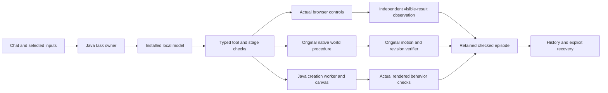

# Fraynix Agent Workspace · Edition 126

**One local model working through the actual browser, persistent world and creation canvas.**

2026-11-12 · Java owns task state and completion · Actual local inference · Original outcomes retained

[Previous edition](README-125.md) · [Edition history](docs/readmes/INDEX.md) · [Offline interactive guide](docs/readmes/126/index.html) · [Acceptance contract](docs/EDITION_126_CONTRACT.md) · [Integrated roadmap](docs/INTEGRATED_AGENT_ROADMAP.md)


## Returning to the whole agent

The destination remains one continuing local workspace. Java owns identity, clocks, task state, typed actions, persistent worlds, evidence, memory and recovery. The desktop presents the browser, canvas and game/physics views. A local language model interprets supported requests and chooses permitted actions; actual controls and physics execute them; independent checks determine which result can be retained as verified.

Edition125 measured whether optional game actions justified their complete cost. Edition126 tests the broader application with an installed model. It also closes a concrete browser gap: an unconstrained model finish message previously produced a **completed-unverified** result. The new opt-in browser contract freezes the expected page and visible text before planning. After each browser mutation, and on an explicit finish request, the trusted host reads the actual DOM; Java compares those values with the original contract. Java stops at the first passing result, before another model action can repeat a completed submission. A summary or supplied `passed` flag cannot substitute for that observation.

The app's existing Java route selector still chooses supported task families. Within a stage, the local model selects from the permitted tools. Creation uses the existing Java-owned contract/code generation worker. These measurements do not demonstrate an unrestricted planner selecting arbitrary new tools, physical recognition, neural-weight training or general cross-domain transfer.

## What changed

| Layer | Implemented behavior | Evidence boundary |
| --- | --- | --- |
| Browser request | User supplies exact result page, result element and expected visible text in existing chat settings | Explicit opt-in criteria; not inferred success from a model answer |
| Java browser gate | Original criteria enter the immutable objective; Mutations and `finish` request a separate host observation | Actual URL, exactly one visible matching element, and exact text must agree |
| Host observation | One bounded isolated DOM snapshot reads every required result | No click, script supplied by the model, network operation or rewritten test is part of verification |
| Continuing runtime | Checked browser outcomes enter the existing task journal and a verified browser episode | Public learning endpoints cannot manufacture the internal browser completion receipt |
| Recovery/history | An interrupted claim loses authority; explicit Resume takes fresh observations; historical checks retain original evidence | A saved result is dated evidence, never a claim about a page that has since changed |
| Existing world/creation | Real local-model trials use original tools and verifiers | No replacement physics, relaxed native checks or scripted answers attributed to a model |

No external library or provider was introduced. The existing application still uses its established Java runtime, native physics, Electron/Chromium surfaces and JSON support. “Owned logic” does not mean these dependencies disappeared.

## Actual local-model results

{{RESULTS}}

The installed model was **gpt-oss:20b**, digest `f38aa0c53da5f8c49d08c43a99df24ff53167fe68e24664a7777288e7656fdfe`. Java-owned planning used CPU-only inference with four threads; the local-model service's residency was checked. Tests ran serially on this installation, not on the user's newer RTX 5070 computer. Model loading, prompt evaluation, generation and complete caller time remain distinct measurements.

{{TIMINGS}}

These are individual actual runs, not confidence intervals or a claim of consistent production latency. The scripted browser baseline excludes durable chat admission and model planning. World baselines use the same native verifier, with separately created equivalent labelled scenes. Direct artifact replay starts with an already generated implementation, so it is not an alternative measurement of creating that implementation from nothing. Setup imports, selected targets, fixture pages and independent test expectations were supplied by the harness and are never attributed to model reasoning.

## Browser: actions followed by an independent check

The labelled local pages exercise named inputs, a real button and a visible result. The app's existing reference leases require current observations for click/type actions. The final planner receives the current page references separately from brief action/error summaries; older observations remain stored but do not supply actionable references in that prompt. Repeated unchanged reads retain the existing bound. A stale reference is refused. The model selects actual controls; Java preserves allowed tools, proposals, admission, effects and outcomes. The separate driver also reads the result and verifies that the form was submitted exactly once.

The frozen contract can contain 1–8 distinct selectors and bounded expected text. The ordinary interface exposes one result check. It requires an exact HTTP(S) URL without embedded credentials. The host reads all checks in one isolated snapshot and rejects navigation during that observation. Java checks task, attempt, effect, contract hash, actual values and the associated captured page before recording success. An intermediate post-action mismatch continues planning without consuming a repair attempt; an incorrect explicit finish remains a failed check. Changed criteria, missing checks, a wrong URL, hidden/duplicate elements, stale action authority and fabricated success fields cannot satisfy the gate.

This verifies declared DOM results at a particular time, using bounded element geometry and style checks. It does not establish pixel-level visibility through every overlay or ancestor transparency. A website can display text without an external service processing a transaction. The contract does not prove that a payment, message or remote database update occurred. Such tasks require a separate service-side verifier; this release does not introduce one.


The recovery view is a checked historical screenshot report. It is not a claim that a freshly opened page still has the same state. The original live capture and all failed attempts remain in the evidence index.

## Persistent world: the model requests, physics decides

Two labelled synthetic arrangements use the existing native procedure path. The harness imports the scene and confirms targets and force/torque limits. The local model then chooses allowed tools to inspect and arrange that selected world. The actual native procedure performs motion and checks its recorded execution before a new world revision is committed.

Independent checks compare each resulting body's position, orientation and terminal speed with the confirmed target, then compare the committed revision/hash with the procedure's original proof. Each successful task must commit exactly one revision. A separate recomputation normalizes the recorded floating-point quaternions before comparing angles; tiny or zero numerical residuals in these synthetic scenes are not physical measurement precision. A cold restart must preserve the resulting frames. These are supported existing scenes, not a claim that the model learned arbitrary manipulation or succeeded on unseen physical environments.


## Creation: working code and changed-input tests

The actual model generates a local packing calculator through the existing Java creation worker. The request names the controls and required behavior. Java first freezes observable checks, retains each draft and error, and waits for actual rendered results. The independent driver exercises integer and decimal inputs, recalculation and reset; it does not accept a title, screenshot or model-written success sentence as proof.

After restart the saved procedure remains identifiable. Explicitly replaying the generated implementation into a new artifact must pass the independent changed-input checks again. This demonstrates a working retained implementation and repeatable behavior within the declared scope. It does not establish automatic adaptation to arbitrary new requests.


## Recovery and honest failures

The browser test deliberately interrupts the owned Java process while a surface action is claimed. The old claim is rejected after restart. The same original task and criteria remain; Resume starts from a fresh page observation. Completed historical checks can subsequently be reopened without treating their stored screenshots as new observations. If a crash interrupts a witness-log replacement, startup can recover exactly one complete, verified append extending the unchanged committed bytes. Both byte sequences remain as evidence. A partial, conflicting or invalid record still requires attention; recovery does not execute a browser or world action.

Development failures are retained beside the final results:

{{FAILURES}}

Passing validation means the tested contract and stated behavior hold for those cases. It does not erase earlier failures, imply every request will succeed, or make a pending hosted CI run successful.

## Try the integrated workflow

Prepare with JDK 21 and Node.js, then choose a separate project for review:

```powershell
$env:FRAYNIX_WORKSPACE_PROJECT = Join-Path $env:USERPROFILE '.fraynix-agent-workspace/projects/edition126-review'
.\scripts\Start-Agent-Workspace.ps1
```

A prepared checkout can use `-Offline`; first dependency preparation may need network access. No Docker or WSL is required for this workflow. Keep private project data and existing live Java owners separate when upgrading.

1. Select an installed local model. For model-driven world procedures, enable **Model planning for world procedures** in **Skills, memory & settings**.
2. For a browser task, open the page, expand **Check a browser task**, choose the exact result page and expected visible element/text, and enable those checks for the request. Then state the actual actions in chat.
3. Read **Outcome details** and **Evidence & recovery**. An unsupported or failed outcome remains unverified or interrupted. A verified browser result includes the observation time and page.
4. For world tasks, select a world and confirm supported target poses and limits first. For creation, describe the working controls and required behavior. Each domain retains its own source and outcome rules.
5. If interrupted, inspect the retained state before Resume. Browser contracts remain unchanged; a new objective requires a new request. Disable browser checks when moving to a world or creation request.

## The application around these tests

The existing workspace connects a real browser and local files, a creation canvas, data-analysis tasks, persistent physical worlds, the integrated Game Lab, observation/tracking work, the Java brain and retained history. Source selection and task inputs remain explicit. Scene reconstruction, camera calibration and saved procedures keep the limits recorded in their original editions; this edition does not recertify all earlier physical results.

Java continues to own durable task and world state, typed commands, checks, clocks and recovery. The browser and canvas remain hosted presentation/execution surfaces. A working brain is demonstrated by recorded decisions and outcomes, not by calling activity consciousness or describing persistent logs as model-weight training.

```text
workspace-engine/src/main/java/fraymus/workspace/  Java task, world and evidence owners
workspace-desktop/                               Browser, canvas, chat and surface adapters
workspace-desktop/test/                          Actual app/model studies and boundary checks
src/main/java/runtime/                           Integrated original game runtime
scripts/                                         Preparation, packaging and documentation checks
docs/readmes/126/                                Results, screenshots, originals and offline guide
docs/obsidian/                                   Connected engineering notes and maps
```

## Architecture and evidence



{{VALIDATION}}

[Verification summary](docs/readmes/126/verification.json), [actual browser study](docs/readmes/126/browser-study.json), [actual world and creation study](docs/readmes/126/model-study.json), [measurements](docs/readmes/126/measurements.json), [original evidence index](docs/readmes/126/original-evidence.json), [source inventory](docs/readmes/126/file-inventory.json), and [Obsidian architecture note](docs/obsidian/134-real-model-workspace.md) preserve the distinction between real inference, harness setup, unit fixtures and native outcomes. Planner request hashes, model digests and provider timing receipts are retained where the existing runtime exposes them. These do not include every raw prompt or transport byte. Local checksums are integrity checks, not administrator-proof attestation.

## Next: useful retained procedures

Edition127 will give compatible versioned procedures a deliberate lifecycle: inspect, retire and reactivate them while preserving original sources and descendant evidence, without increasing the active limit. Edition128 connects qualified observation to a working artifact in one mission. Edition129 evaluates bounded changes against incumbents and simpler control before promotion or rollback. Edition130 concentrates those capabilities into coherent daily use. These remain planned phases with explicit acceptance gates, not capabilities claimed by edition126.

The useful loop remains **request → observe → choose → act → independently check → remember → evaluate reuse**. This edition supplies new measured connections in that loop while keeping the existing Java application intact.
