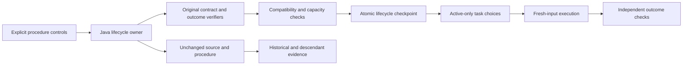

# Fraynix Agent Workspace - Edition 127

**Keep useful procedures available. Retire old versions without erasing how they were verified.**

2026-11-12 | Java-owned lifecycle | One integrated application | Original evidence preserved

[Previous edition](README-126.md) | [All editions](docs/readmes/INDEX.md) | [Interactive offline guide](docs/readmes/127/index.html) | [Acceptance contract](docs/EDITION_127_CONTRACT.md) | [Integrated roadmap](docs/INTEGRATED_AGENT_ROADMAP.md)


## The application and its direction

Fraynix is a continuing local agent workspace. Java owns durable tasks, typed actions, procedure memory, world state, verification and recovery. The desktop connects chat, a real browser, a working creation canvas, the integrated Game Lab, native physics and qualified observation tools. A local language model can choose admitted actions and explain results; Java and the independent host checks decide what actually succeeded.

The destination is one coherent loop: **request, observe, choose, act, check, remember, evaluate reuse**. The game and physics runtime supply controlled experiments and observable outcomes. Browser elements, files, bodies and observations retain their own tools, units and verifiers even when they belong to one mission.

Edition 126 demonstrated six real local-model requests across browser, world and creation work. Those dated results remain in [README-126](README-126.md). Edition 127 addresses a practical memory problem: a useful collection also needs to explain its methods and take old versions out of service without destroying evidence. This release does not claim new model training, consciousness, unrestricted browsing or automatic procedure adaptation.

## What is implemented

| Control | Actual behavior | Evidence preserved |
| --- | --- | --- |
| Inspect | Shows exact name/version, kind, prerequisites, actions, recovery, source references, current compatibility, descendants and lifecycle history | Read-only inspection does not execute the procedure or change its original payload |
| Retire | Removes the exact version from new model/UI task choices and rejects direct execution | Original procedure, source goal/workflow, report and descendant references remain stored |
| Reactivate | Reconstructs the saved contract through the original Java verifiers, checks original evidence and compatibility, and requires a free active slot | A dated inspection and chained lifecycle event record what was checked |
| Open source report | Opens the original checked report in the existing canvas when its evidence remains valid | The report is historical evidence, not a new execution |
| Recovery | Lifecycle changes use the existing atomic goals checkpoint; interrupted work must settle before management | A failed write rolls back availability; committed retirement survives process loss |

The collection still allows **32 active procedures and eight versions per name**. Retirement frees an active slot; it does not reset version numbering. Storage is bounded to 512 retired entries and 32 lifecycle changes per managed procedure, with an 8-million-byte lifecycle record ceiling. At a limit, operations refuse and retain originals. This release does not add deletion or unbounded history.

The new lifecycle record is understood by edition127 and later compatible builds. Keep a separate project backup for downgrade; an older reader must not bypass or strip the new record to force a load.

Legacy artifact recipes are a separate existing collection. These controls manage the shared Java procedure registry, including data analysis, procedural geometry, creation, qualified workflows and typed graphs. Management is an explicit user action, outside the model's tool authority.

## Try it in the app

Prepare with JDK 21 and Node.js, and select a separate review project:

```powershell
$env:FRAYNIX_WORKSPACE_PROJECT = Join-Path $env:USERPROFILE '.fraynix-agent-workspace/projects/edition127-review'
.\scripts\Start-Agent-Workspace.ps1
```

A prepared checkout can use `-Offline`; first dependency preparation may require a network connection. This workflow does not require Docker or WSL. Preserve private projects and existing live Java owners when upgrading. Installed local models are needed for model-driven chat/generation; deterministic Java procedure management does not require a model call.

1. Finish or cancel any running or interrupted task. Open **Skills, memory & settings**, then **Manage saved procedures**.
2. Select the exact procedure and version. Review its actions, source references and current evidence result. Expand the original contract or lifecycle history for detail.
3. Enter a reason and choose **Retire procedure**. It disappears from new task choices, while remaining visible under the retired filter.
4. To restore it, inspect it again and choose **Reactivate after checks**. A full active collection, changed source, incompatible implementation or unavailable dependency prevents reactivation and shows the reason.
5. Run a reactivated procedure on explicitly selected fresh inputs. Its ordinary source and outcome checks still run; reactivation is not proof that the next task will succeed.


## Preserving evidence and dependencies

The lifecycle is a separate entity in the same checked checkpoint as the original procedures. It never rewrites a procedure to mark it retired. Events bind the original procedure hash, prior event, reason, inspection evidence and time. Historical lookup continues to return original records so completed workflows and descendants can still explain their lineage.

A retired parent does not automatically invalidate a descendant's past evidence. New typed-graph execution, however, requires its executable dependency nodes to be active. Inspection explains that distinction, and a graph cannot reactivate into an executable state with a retired required node. The native graph test verifies this boundary against actual physics execution with explicitly labelled unit-host observations.

For a goal-backed procedure, Java reuses the original source-checking contract builder in a read-only projection, then compares the saved contract. For a workflow-backed procedure it checks the original stages, implementation/qualification evidence and independent audit, then compares the original publication contract. Only generated ID, version and verification timestamp are excluded from the contract comparison; identity and lifecycle hashes are checked separately. Checksums detect changes; they are not administrator-proof attestations.

Imported dataset versions are immutable. Adding version 2 does not invalidate a procedure correctly bound to an intact version 1. Changing the original bound content or report is different and must refuse reactivation. A historical result never becomes a fresh observation just because it is inspected.


## Actual validation and measured behavior

{{VALIDATION}}

{{RESULTS}}

The full-capacity control saves aliases of one completed data procedure to fill the collection. That tests capacity accounting, not 32 distinct learned skills. Distinct task coverage comes from separately executed data tasks, four-dimensional procedural geometry, a qualified input-driven creation workflow and the native graph regression. Unit-host fixtures are explicitly labelled; the actual Electron study obtains real DOM observations and rendered reports without supplying success flags.

{{TIMINGS}}

These are individual local caller measurements including the lifecycle request and verification it performs, not confidence intervals or universal speed claims. Qualified workflow checks do more work than a small data contract. Inspection has bounded ancestry and storage; this release does not claim low latency at every possible history size.

## Failures kept, not hidden

{{FAILURES}}

The actual test deliberately changes a report after saving its original bytes. The resulting refusal is a successful negative check, not a repaired or newly verified report. The synthetic test project remains separate from private worlds. All original attempts, checked records and screenshots are indexed in the evidence archive.

## Architecture and reproducibility



No new external dependency was added. Owned Java logic works within the established Java, native physics, Electron/Chromium and JSON stack; those existing dependencies have not disappeared. The continuing application is preserved rather than replaced by a separate procedure manager.

| Source | Responsibility |
| --- | --- |
| [ProcedureLifecycle127.java](workspace-engine/src/main/java/fraymus/workspace/ProcedureLifecycle127.java) | Availability, bounded history, exact snapshot and event-chain checks |
| [GoalRunner.java](workspace-engine/src/main/java/fraymus/workspace/GoalRunner.java) | Original records, read-only contract reconstruction, atomic storage and execution admission |
| [WorkflowRunner.java](workspace-engine/src/main/java/fraymus/workspace/WorkflowRunner.java) | Workflow evidence, qualification, dependencies and lifecycle coordination |
| [WorkspaceServer.java](workspace-engine/src/main/java/fraymus/workspace/WorkspaceServer.java) | Interface ownership and explicit lifecycle routes |
| [procedures127.js](workspace-desktop/renderer/procedures127.js) | Integrated inspection and visible refusal reasons |
| [Actual app study](workspace-desktop/test/lifecycle127-integration.cjs) | Real rendered outcomes, abrupt Java interruption and full-bank controls |

[Verification summary](docs/readmes/127/verification.json), [actual app results](docs/readmes/127/lifecycle-study.json), [measured requests](docs/readmes/127/measurements.json), [original evidence index](docs/readmes/127/original-evidence.json), [source inventory](docs/readmes/127/file-inventory.json) and [connected engineering note](docs/obsidian/135-procedure-lifecycle.md) make the limits and provenance reviewable. Hosted CI is reported separately from local verification.

## Next: an observation becomes a useful artifact

Edition 128 should connect one calibrated recorded sequence to an existing persistent object, make a bounded motion prediction, create an interactive explanation, verify its calculations and rendered behavior, and retain the whole procedure. The same request must survive interruption and work with fresh input. This is planned work, not an installed capability of edition 127.

After that, edition 129 should propose bounded changes from observed failures and compare them against the incumbent and simple control before promotion or rollback. Edition 130 should make the whole mission understandable in daily use: current state, uncertainty, cost allowance, results and retained skills in the same workspace. Those steps keep the agent's usable end-to-end behavior at the center of development.
