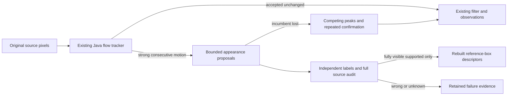

# Fraynix Agent Workspace — edition 135

**Continuity first; appearance memory must earn trust.** Updated 2026-11-13.

[Previous: edition134](README-134.md) · [All editions](docs/readmes/INDEX.md) · [Interactive offline guide](docs/readmes/135/index.html) · [Development direction](docs/INTEGRATED_AGENT_ROADMAP.md) · [Contributor continuity](README-CONTRIBUTORS.md)

This is the same local Java agent workspace: durable chat goals, an evolving physics world, browser and canvas tools, creation workflows, reusable procedures and checked evidence. This edition strengthens the observation-to-memory boundary. The purpose remains one request that can observe, reason, create, act, verify and retain a useful procedure across interruptions.

The existing tracker remains the default. An optional Java appearance bank preserves its accepted outputs, proposes source-linked examples and attempts recovery only after the incumbent reports loss. Fresh comparisons exposed substantial contamination in the automatic admission rule. A downstream export therefore retains only fully visible examples supported by independent references, rebuilding their numeric appearances from the reference boxes. Nothing automatically trains on those exports or feeds them back into the evaluation.

## What changed

| Capability | Current behavior | Evidence and limits |
| --- | --- | --- |
| Tracking continuity | Accepted incumbent results pass through unchanged; bank-disabled control available | All 380 fresh tracker/filter samples exactly match incumbent; existing drift is also preserved |
| Bounded appearance bank | Six source-linked examples maximum, initial seed retained, explicit retirement history | Motion cycle, feature coverage and color checks still admit 28 incorrect examples |
| Recovery proposal | Search only after loss; refined competing peaks and two consistent same-example matches | Works in a synthetic pose/return test; zero bank recoveries on fresh footage |
| Independent audit | Every admitted example scored against external target boxes and separate visibility | Labels never enter tracking; incorrect, unknown and partial evidence remain explicit |
| Supported appearance export | Retains reference-box RGB descriptors, source hashes, proposal overlap and full audit links | 16 fully visible examples exported; source-dependent verification, not semantic recognition |
| Durable checks | Read/export/cold restart reverify original source, labels, code and outcomes | Altered pixels or stored descriptors refused; native world unchanged |

{{VALIDATION}}

## Actual app, captured 2026-11-13

These are genuine screenshots from the isolated test application. OTB image excerpts are attributed to the benchmark authors below. No private webcam capture is included.


The audit exposes incorrect admitted examples instead of treating a successful motion check as proof of identity.


Bird1 is rendered footage, not a real-world camera demonstration. Hidden frames remain separate from partial cover and uncertain fade boundaries.


[All original captures and checks](docs/readmes/135/app-study.json) · [1100-pixel view](docs/readmes/135/appearance-1100.png)

## What the fresh test actually found

{{FINDING}}

{{RESULTS}}

The real-camera subset has 67 correct measurements out of 285 visible/partial references. Rendered Bird1 has 19/42. Across both domains there are 145 wrong overlaps and 96 missing measurements. A wrong overlap is not automatically a confirmed identity switch. There are no independent distractor boxes in these windows, so zero confirmed distractor matches cannot establish that switching was avoided.

This comparison separates continuity from accuracy. The existing tracker can remain confident while its box drifts onto nearby texture. Forward/backward motion can agree on that same wrong texture, allowing a plausible but contaminated example into the bank. More self-consistency alone does not solve object identity. The experimental option is not promoted, and physical accuracy remains unresolved.

## Freshness, occlusion and return scope

The method and scorer were frozen at source commit `4f3b719f`, with the lock committed before selected footage was opened. Tiger2 and Box were initially declared; a source-only amendment added David3 and Bird1 before their images or predictions were inspected. All 384 selected original images were reviewed from the source, then exact external boxes and separately declared visibility were frozen before predictions. No thresholds changed after fresh results.

| Source | Consecutive original frames | Domain and event |
| --- | --- | --- |
| Tiger2 |59–154| Camera; leaves partially cover the target and it clips the image edge |
| Box |439–534| Camera; caliper partially covers the box |
| David3 |57–152| Camera; partial tree occlusion and return |
| Bird1 |97–192| Rendered bird; cloud disappearance and later return |

Each starts with one initialization image, followed by 95 evaluated images. The three camera cases retain visible target remnants, so their occlusions are partial. Bird1 has 33 fully hidden and 20 uncertain images; its fade boundaries must not be counted as confident visibility. The frozen recovery scorer breaks episodes at uncertain labels, so a linked recovery delay across the uncertain reveal is unresolved. The tracker has no correct recovery in that window. No real complete out-of-frame return is demonstrated.

Target rectangles come from the [OTB benchmark by Yi Wu, Ming-Hsuan Yang and Jongwoo Lim](https://rvlab.snu.ac.kr/research/tracker_benchmark). Visibility is source-only AI review, not independent human adjudication. Box shares a tabletop setting with previously exposed Lemming but is a distinct recording and target. Exact downloads, archive hashes, frame windows and limitations are in the [source manifest](docs/publication135/source135.json). Raw ZIPs, complete images and frame packs are not redistributed. Limited app screenshots and numeric evidence remain in this repository.

[Method contract](docs/EDITION_135_CONTRACT.md) · [Source amendment](docs/EDITION_135_SOURCE_AMENDMENT.md) · [Frozen method hashes](docs/OBSERVATION_135_LOCK.json)

## How the Java appearance layer works



`AppearanceFlow135` requires three strong uninterrupted optical-flow frames, sufficient inliers and feature spread, low forward/backward error, reverse box agreement, seed color agreement, temporal separation and appearance novelty. It retains the initial seed and retires the oldest nonseed example when full. Proposed, fallback, ambiguous and recovered boxes do not immediately teach the bank; recovery starts a quarantine. These are explicit motion/appearance checks, not independently verified identity.

For loss recovery it searches retained appearances, refines competing peaks at bounded scales and requires two consistent matches of the same example. The first synthetic duplicate test caught a competitor-search flaw before fresh footage: one of two identical copies could be selected. Both competing peaks now receive refinement. That original failed test is retained alongside subsequent passing tests. The candidate never takes control while incumbent measurements remain accepted.

`AppearanceAudit135` validates exact source ordinals, frame identities, descriptor hashes, admission proofs and retained/retired history. It reports every proposal against separately supplied target references. `VerifiedAppearances135` is a post-evaluation service: it calls the complete original audit, accepts only correct fully visible admissions, and extracts new 8×8 RGB descriptors from the independent reference box. This avoids exporting the proposed drift box as if it were precise. It preserves the original proposal and overlap for comparison.

The export is immutable, checksum-bound, limited to 64 retained sets and 1 MB per set, with atomic writes and no pruning. A read recomputes the audit and source-derived descriptor, rather than trusting a saved success flag. The JSON contains numeric descriptors, references and source hashes. It needs the original project/source/audit to reverify; it is not a self-contained video archive. It does not identify named people, provide a 3D reconstruction or update LLM weights.

## Try it

1. Start the existing workspace using the normal launcher below. Use your own project; test runs use a separate project and never share the private live database.
2. Open the Spatial view and persistent-world/observations controls. Import a supported observation frame pack and bind its known subject to a world body. Camera-derived measurements are observations, not automatic native-world commands.
3. Keep `legacy-flow` for the existing default. Explicitly choose `appearance-continuity-135` to inspect the experiment, or `continuity-no-bank-135` for its control.
4. In the independent association panel, import source-bound external target boxes and visibility labels. Labels must name exact original images; they do not steer the tracking run.
5. Run the task and select its completed run in the comparison panel. Inspect accepted/missing measurements, target overlap, visibility, admissions and reasons in the source overlay.
6. Choose **Export supported visible examples** after a verified candidate comparison. If none qualify the app refuses instead of writing an empty pretend success.
7. Export the comparison/labels to retain their exact evidence. Reopen the saved comparison after restart to recheck original source. Edited or incompatible evidence is refused, never relabelled as current.

```powershell
powershell -NoProfile -ExecutionPolicy Bypass -File .\scripts\Start-Agent-Workspace.ps1
```

The inherited application uses Java 21 and its existing desktop/runtime dependencies. No new vision framework, model dependency or external service is added. Existing Electron/Chromium, Bullet and JSON infrastructure remain; Java-owned logic does not mean the entire application is dependency-free. Ollama is optional for model-backed planning, and no LLM call or webcam session was used in this study.

## Verification and measured work

{{APP_CHECKS}}

The broad regression covers durable goals, world observations, filtering, independent source audits, creation workflows, saved procedures, archived history and recovery. Focused tests exercise true appearance-bank recovery, identical distractor refusal, bounded capacity, output immutability, exact incumbent continuity, corrupted provenance, post-evaluation curation and tamper refusal. The desktop suite and actual agency regression remain separate from the new tracking evidence.

{{COST}}

These are sequential local wall times, not a statistical speed claim or calibrated forecast. Actual app tracking includes UI/start/poll work and, for Box candidate, stop/resume. The second timing includes audit plus curation/export for candidate runs; controls lack those exports, so it is not a clean service benchmark. World history grows across the six app runs, so those timings are not a policy-only comparison. The sixth95-frame task takes422.7seconds versus32.5seconds for the first; profiling is required to isolate the cause of this throughput gap. This is a durable recorded-footage workflow, not demonstrated real-time camera throughput. All methods preserve their complete source/outcome checks.

{{ATTEMPTS}}

Exact reports, original failed attempts, all 12 fresh comparisons, exposed development output and six actual app runs are retained through [original evidence](docs/readmes/135/original-evidence.json). The [verification receipt](docs/readmes/135/verification.json), [comparison data](docs/readmes/135/comparison.json) and [source inventory](docs/readmes/135/file-inventory.json) support the claims. Hosted CI was checked first and is reported separately in the eventual publication receipt; local passing checks do not establish hosted CI success.

## Repository map and continuity

```text
workspace-engine/.../AppearanceFlow135.java      optional continuity-preserving bank
workspace-engine/.../AppearanceAudit135.java     downstream proposal checks
workspace-engine/.../VerifiedAppearances135.java immutable supported exports
workspace-desktop/renderer/association134-panel.js actual audit/export controls
docs/publication135/                            source locks, scripts and labels
docs/readmes/135/                               screenshots, evidence and guide
docs/obsidian/143-appearance-continuity.*        linked implementation map
```

[Architecture](docs/ARCHITECTURE.md) · [Project memory](docs/PROJECT_MEMORY.md) · [Development log](docs/DEVELOPMENT_LOG.md) · [Obsidian home](docs/obsidian/00-home.md) · [Implementation map](docs/obsidian/143-appearance-continuity.canvas)

The publication target remains `eyeoverthink/Fraynix-Agent-Workspace`; Chandra is separate. Earlier 001–134 editions and evidence are immutable. Older run proofs with incompatible engine identity are refused. Source label/lock bytes are explicitly preserved across Git checkouts so raw input hashes are portable. No private project, credentials, model weights or raw webcam data are committed. Main and the numbered tag are pushed and fetched back before publication is called complete.

## Next steps toward the unified agent

1. **Prevent contamination before reuse.** Evaluate stronger foreground/geometry evidence against the known drift cases; retain old results as development evidence. Require a new held-out cohort before claiming improvement. Self-consistency is insufficient.
2. **Test complete camera occlusion and return.** Obtain source-only human-adjudicated target/distractor labels, distinguish full disappearance from partial cover, and measure recovery delay without bridging uncertain visibility by assumption.
3. **Use curated references explicitly.** Build an opt-in import/reuse procedure that checks provenance and separates training examples from evaluation footage. Measure fresh recovery benefit and full cost before promotion.
4. **Profile complete task cost.** Investigate evidence/history growth and repeated immutable-source checks. Any reuse must keep source and outcome verification, and be tested under changed/corrupt inputs. The observed app timings are too slow to claim live camera processing.
5. **Reconnect better measurements to useful work.** The goal is reliable chat-driven observation, world updates and artifacts, with uncertainty and independent outcome checks. New perceptions must not bypass native-world revision, source-age, coordinate/scale or action checks.

The current achievement is a functioning continuity-preserving experiment plus evidence-backed curation, with a falsified automatic-learning assumption made visible. Reliable physical perception, object association through difficult occlusion and general learning remain work to be demonstrated.
