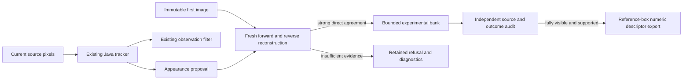

# Fraynix Agent Workspace — edition 136

**Keep drift out of retained evidence; spend less time rereading unchanged history.** Updated 2026-11-13.

[Previous: edition135](README-135.md) · [All editions](docs/readmes/INDEX.md) · [Interactive offline guide](docs/readmes/136/index.html) · [Development direction](docs/INTEGRATED_AGENT_ROADMAP.md) · [Contributor continuity](README-CONTRIBUTORS.md)

This remains the local Java agent workspace: durable chat goals, persistent physics worlds, browser and canvas tools, creation workflows, reusable procedures and independently checked outcomes. Reliable perception is needed before an agent can safely reuse what it thinks it saw. This edition improves that boundary and the cost of retrieving evidence; it does not claim that object identity, general learning or physical accuracy are solved.

## What changed

| Addition | Working behavior | Limit |
| --- | --- | --- |
| Original-image anchor | Optional `seed-anchored-136` requires fresh forward and reverse motion checks against the immutable first image before admitting an appearance | Rejects drift, but also many useful examples; remains experimental |
| Independent admission audit | Rechecks original seed, geometry, motion conditions, retained history and external target references | Motion consistency is not semantic identity; labels remain downstream only |
| Content-bound evidence reuse | Reads and SHA-256 hashes every current state byte under the existing lock; exact matches reuse a validated parsed structure | Every changed state, source image and outcome retains its checks; capacity remains 24 MB |
| Detached write cache | Copies before mutation; validates and reparses serialized content; installs the cache only after atomic durable write | More cold-open work; no timestamp shortcut, history pruning or altered proof identities |
| Cost control | **Show evidence-processing cost** displays reads, bytes hashed, structural checks, reuse and durable writes | Current-process counters, not a claim about physical accuracy |
| CI correction | Updates an obsolete exception expectation for unpublished procedures | The lifecycle refusal and unchanged publication state are still tested |

{{VALIDATION}}

## Actual application

Screenshots are from the isolated application test, with public benchmark excerpts. Private camera/project data was not used.


[All captures and checks](docs/readmes/136/app-study.json) · [1100-pixel view](docs/readmes/136/appearance-1100.png)

## Did the memory boundary improve?

{{FINDING}}

{{RESULTS}}

All 760 tracker/filter outputs per method match the incumbent across development and later windows. Existing accepted outputs are deliberately preserved, including their errors. No bank recovery occurs. The guard is working as an admission restriction, but **has not qualified as useful camera appearance learning**: it retains no new camera examples in these cohorts. Three correct admissions are from rendered Bird1 only. Positive synthetic tests also demonstrate real admission and recovery; the implementation is not an always-reject placeholder.

All three methods still achieve only 189/380 correct visible/partial measurements on the later windows, with 53 missing and 138 wrong overlaps. In the camera subset that is 134/285; the rendered subset is 55/95. No independent distractor boxes are supplied, so zero confirmed switches does not establish switch-free tracking. The existing tracker, filter and forecast defaults stay unchanged.

Fully visible examples are still exportable only after the independent audit supports them. Their descriptors are rebuilt from reference boxes and original pixels. Empty, incorrect, partial or uncertain sets cannot become a pretend successful export. No automatic training, evaluation feedback, LLM weight update or identity recognition was added.

## Evaluation scope and source honesty

The tracker and scorer were frozen at `17fdb4ab`; the method lock was committed at `e7ff6cb4`. Later-window labels were committed before predictions, with exact byte preservation corrected at `9a52ceb9`. No threshold changes followed either comparison. Existing edition135 windows are development evidence. Later temporal sections of the same already source-reviewed recordings are new predictions, **not independent unseen videos**.

| Source | Earlier development window | Later window | Later source event |
| --- | --- | --- | --- |
| Tiger2 |59–154|155–250| Camera; partial leaf cover |
| Box |439–534|535–630| Camera; early partial cover, then visible rotation |
| David3 |57–152|153–248| Camera; partial tree/post cover and return |
| Bird1 |97–192|193–288| Rendered flight; target remains visible |

Each window has one seed image and 95 evaluated originals. All 384 later originals were reviewed source-only before predictions. The later cohort contains 113 partial and 267 fully visible samples, no fully hidden samples. Complete cloud disappearance remains confined to the earlier rendered development window; no new real-camera complete occlusion or out-of-frame return was demonstrated.

Original boxes come from the [OTB benchmark by Yi Wu, Ming-Hsuan Yang and Jongwoo Lim](https://rvlab.snu.ac.kr/research/tracker_benchmark). Visibility is separate AI source review, not independent human adjudication. Source hashes and labels are pinned in the [manifest](docs/publication136/source136.json); the [contract](docs/EDITION_136_CONTRACT.md) and [method lock](docs/OBSERVATION_136_LOCK.json) record the evaluation boundary. Raw video, ZIPs and frame packs remain local; limited attributed screenshots and numeric evidence are published. [Source-note clarification](docs/EDITION_136_LABEL_NOTE.md): frozen later labels retain a generic sentence about the earlier rendered occlusion; the later rows have no hidden/uncertain samples. Original evaluated bytes are preserved.

## Why the new checks matter



A chain of small tracking errors can be internally consistent while walking onto the wrong texture. `AppearanceFlow136` requires a direct reconstruction from the original image, plus a reverse reconstruction back to that same seed. Each must use strong optical flow and at least 0.75 box overlap. The original six-example limit, initial seed, quarantine, competition checks and two-image recovery confirmation remain. `AppearanceAudit136` rechecks the anchor and scores proposals using independent labels. The metadata keeps the compatible `appearance135` API key with a new explicit schema; older evidence is never relabelled as a current proof.

This restriction is intentionally separate from the independent curation boundary. Neither motion direction proves identity. Better foreground evidence and controlled reference reuse are still needed to admit useful camera examples without contamination.

## Evidence-processing measurements

{{COST}}

The comparison uses identical first-1/3/6 completed prefixes from the closed public edition135 study, with published135 binaries versus136. Original run/history hashes remain intact. All 36 returned result hashes agree; only the current engine identity is omitted from summary-result comparison, never from saved run proofs. Each operation has three repeats. These are local measurements, not a statistically calibrated universal speedup.

At six runs, repeated summary reads improve from 408.2 ms to 20.1 ms median; complete run reads from 264.4 ms to 36.8 ms. Cold open regresses from 534.5 ms to 748.4 ms because the new write cache is detached and checked. That cost is retained in the report. Reuse still hashes all bytes on every access. Source-image bytes are checked separately on each image access. The baseline sampling profile contains substantial canonical JSON and JSON parsing/serialization work; inclusive samples are not exclusive elapsed time.

Standalone anchored tracking itself costs more: 49.7 seconds for the later four windows versus 17.4 seconds for the prior bank and 11.8 seconds for incumbent. Reconstructing from the original source is additional work. The evidence-read optimization must not be presented as making this experimental tracker faster or establishing real-time camera throughput.

{{APP_COST}}

Actual app runs include UI polling, durable writes and a stop/resume in the first run. Their datasets and history differ, so these totals are not a controlled policy comparison. Full writes and audits still scale with retained history. No verification was removed to obtain lower read timings.

## Try it

1. Start the normal workspace with Java 21 and the existing dependencies. Use a separate project for experiments.
2. In Spatial, load a persistent world and import an observation frame pack. Bind its subject to a world body.
3. Keep `legacy-flow` for normal default behavior. Select `seed-anchored-136` explicitly to inspect the new restriction, or `appearance-continuity-135` to compare the previous bank.
4. Import independent source-bound target/visibility labels in the association panel; they are never passed into tracking.
5. Run, audit and inspect the source overlay, missingness, admissions and refusal reasons. Export supported visible examples only after verification.
6. Click **Show evidence-processing cost** to see work performed by this process. Restart resets counters but retains original evidence.
7. Export the audit or labels; reopen a saved audit after restart to recheck its source and outcomes. Incompatible code proofs remain refused.

```powershell
powershell -NoProfile -ExecutionPolicy Bypass -File .\scripts\Start-Agent-Workspace.ps1
```

No new vision framework or service dependency was introduced. Existing Electron/Chromium, Bullet and JSON dependencies remain. This is Java-owned processing logic, not a claim that the whole app has zero dependencies. No LLM call or private webcam session was needed for this study.

## Validation, failures and recovery

{{APP_CHECKS}}

Tests include positive synthetic admissions/recovery, duplicate distractors, bounded memory, unchanged incumbent output, altered anchor evidence, same-size/same-time corruption, re-signed broken histories, valid external writers, failed-write isolation, input/output alias isolation, restart and source tampering. The broad regression includes world goals, data/creation workflows, procedure lifecycle, archives and recovery. All source image, code identity, history and independent outcome checks remain.

CI run43398780691 was checked first. It completed 1030 engine tests with one failure and two skipped tests. Its failing test expected an older exception type for an unpublished procedure; the actual lifecycle guard correctly refused it. The corrected test checks `IllegalStateException`, the unpublished reason and unchanged publication state. The whole failing class and broader local regression are rerun. Hosted CI for the new publication is reported separately; local success is not hosted CI success.

{{ATTEMPTS}}

[Verification receipt](docs/readmes/136/verification.json) · [Comparison](docs/readmes/136/comparison.json) · [Timing data](docs/readmes/136/cost-comparison.json) · [Original evidence](docs/readmes/136/original-evidence.json) · [Source inventory](docs/readmes/136/file-inventory.json)

## Project continuity and next steps

[Architecture](docs/ARCHITECTURE.md) · [Project memory](docs/PROJECT_MEMORY.md) · [Development log](docs/DEVELOPMENT_LOG.md) · [Implementation map](docs/obsidian/144-anchored-evidence.canvas)

Earlier editions001–135 and their evidence are immutable. Publication remains `eyeoverthink/Fraynix-Agent-Workspace`; Chandra is separate. Private projects, credentials, raw captures and model weights are not committed. Main and the numbered tag are fetched and checked before publication is called complete.

1. **Recover useful camera memory without admitting drift.** Test foreground masks or separately verified reference examples with explicit provenance, held apart from evaluation data. Measure rejected useful examples alongside accepted wrong ones.
2. **Obtain independent complete-occlusion labels.** Human-adjudicated target and distractor boxes, genuinely new camera recordings, clear source visibility and actual out-of-frame returns are still missing.
3. **Reduce cold-open and write cost safely.** Profile immutable segments or bounded write transactions; preserve every original history/source/outcome check and test interruption, external changes and tampering.
4. **Bring reliable observations back to durable goals.** The destination remains one cohesive agent that observes, predicts, creates, acts and verifies. These perception experiments must earn accuracy before increasing authority over the persistent world.
