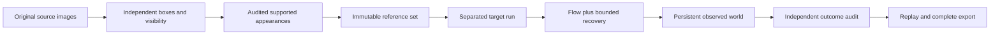

# Fraynix Agent Workspace — Edition 137

**Verified camera references, protected evidence and cheaper reopening.** This local Java agent workspace connects chat, persistent worlds, physics, browser interaction and creation tools. Edition 137 improves its observation memory and persistence layer without changing the default tracker or increasing action authority.

[Previous edition](README-136.md) · [All editions](docs/readmes/INDEX.md) · [Interactive offline guide](docs/readmes/137/index.html) · [Integrated roadmap](docs/INTEGRATED_AGENT_ROADMAP.md) · [Contributor handoff](README-CONTRIBUTORS.md)


## What changed

- **Explicit reference reuse.** Select a retained appearance set that was independently checked against original source pixels and fully visible reference boxes. Up to six examples are selected deterministically from the full immutable set. Earlier evidence remains available.
- **No learning from target predictions.** The reference bank stays frozen throughout the new run. A drifting prediction cannot become a new reference. This prevents that feedback path; it does not eliminate tracking drift.
- **Separated evaluation.** The reference source and target must be distinct single-object datasets with no shared image hashes. An explicit same-object declaration is retained as operator input, not treated as an independent identity certificate.
- **Conservative recovery.** Existing accepted flow measurements remain intact. After loss, reference matching requires a strong, spatially separated candidate and two consistent images. The seed-only control uses the same recovery logic without imported examples.
- **Cheaper durable history.** Opening completed history checks all current bytes and validates it without rewriting it. Running tasks are still marked interrupted. Transaction copying avoids a redundant JSON serialization round trip while retaining full validation, checksums, serialized reparse, forced atomic writes and detached cache publication.

Both `verified-memory-137` and `seed-only-137` are explicit experimental choices. `legacy-flow` remains the default. There is no model-weight training, biometric person identification, new network dependency or physical-device actuation in this edition.

## Measured results

{{FINDING}}

{{RESULTS}}

{{REFERENCES}}

These are earlier edition-135 source windows and later edition-136 evaluation windows from the same [OTB benchmark](https://rvlab.snu.ac.kr/research/tracker_benchmark) recordings. They have already been inspected in prior development. **They are not new unseen footage.** Tiger2, Box and David3 are camera recordings; Bird1 is rendered. Original benchmark boxes and source-only AI visibility annotations are retained. There is no independent human visibility adjudication or complete distractor annotation. The inherited generic annotation sentence is explained in [the preserved label note](docs/EDITION_136_LABEL_NOTE.md); per-frame labels determine the actual visibility counts. Later windows contain visible/partial targets, not a new complete-occlusion test.

The synthetic pose/return control proves that the new reference path can change a real recovery outcome; the seed-only control cannot recover that changed pose. An identical-twin control refuses the ambiguous match. These tests establish software behavior, not general camera accuracy.


## Startup and write costs

{{COST}}

Published edition-136 and edition-137 binaries used identical isolated copies of the same 1/3/6-run public history on the same D drive. All **36 read-result hashes** and **9 write-result/persisted-payload pairs** match. Writes modify a deterministic reason field in the isolated study; they measure persistence transactions, not full agent-task throughput. Each operation has three repeats; cold open has one measurement per size. Some reads regress, and no general speed or live-camera throughput claim follows.

Every access still reads and hashes the complete state. Only exact current byte identity may reuse previously validated structure. Changed bytes with identical size/time, forged history, external writes, source modification and failed writes remain checked. State limits remain 24 MB, 16 datasets, 24 observation runs and 2,048 world revisions. No pruning or capacity increase hides the costs.


## Try it

For a separate review project on Windows, install JDK 21 and Node.js LTS, then run from this checkout:

```powershell
$env:FRAYNIX_WORKSPACE_PROJECT = Join-Path $env:LOCALAPPDATA 'Fraynix-Review-137'
.\scripts\Start-Agent-Workspace.ps1
```

The launcher checks dependencies and existing Java owners. First preparation may download packages; after preparation, use `-Offline` to require cached dependencies. Keep your existing project path unchanged and stop its Java owner through its app before rebuilding that owner's installation.

1. Follow [the Windows launcher](scripts/Start-Agent-Workspace.ps1) with Java 21 and the existing desktop dependencies. Use a separate project directory for evaluation; preserve your current private project.
2. Open **Spatial → Real footage · observed world**. Load a saved world and import source footage with an initial object rectangle.
3. Use the independent association-label workflow to import original reference boxes and visibility annotations. Run an appearance method, audit it, and retain a supported appearance set. Incorrect, partial and uncertain proposals cannot enter this curated set.
4. Import separate target footage. Select **Experimental 137 · verified reference memory**. Open **Verified references**, list retained sets, select one and explain why it depicts the same object. Older code-incompatible evidence remains historical and is refused for current execution.
5. Confirm the world and footage, then start tracking. Compare with **Control 137 · original seed only** and the existing flow tracker. Target outcome labels stay downstream of tracking.
6. Inspect original frames and independent outcomes. Stop/resume preserves the exact run prefix. Export includes the reference set, original audit, labels, source run and donor pixels within existing bounds. The desktop file limit is 20 MB; Java also retains its 40 MB original-pixel and 64 MB raw-package bounds. If the complete export exceeds a limit, preserve/archive the project rather than discarding evidence.
7. Reopen the project. Completed observation history retains its original bytes and modification time. Original source/code/outcome checks run again when opening an audit or reusing references.

The desktop is presentation and interaction; Java owns observations, execution, persistence, validation and recovery. The Game Lab and 3D world remain connected parts of that system, not replacements for the browser, canvas or creation workflows.

## Evidence path



The target run has no edge back into its own reference set. Reuse checks source pixels, annotations, original proposal, audit, implementation identity and selected examples. Prediction confidence alone is never permission to retain an appearance.

## Validation and limits

{{VALIDATION}}

{{APP_CHECKS}}

{{ATTEMPTS}}

Hosted CI is reported separately from local checks and fetched Git publication. Original attempts, full run traces and numerical comparisons are preserved in [original evidence](docs/readmes/137/original-evidence.json), [validation](docs/readmes/137/verification.json), [comparison](docs/readmes/137/comparison.json) and [cost measurements](docs/readmes/137/cost-comparison.json). Screenshots are actual application captures using public evaluation pixels.

## Complete task costs

{{APP_COST}}

Tasks differ in source content, method and retained history size. These timings describe the observed workflow; they do not isolate a single cause or establish constant-time scaling.

## Next steps and the larger goal

1. Evaluate genuinely new camera occlusions and returns with independently adjudicated foreground, target and distractor labels. Use the outcome to decide whether any experimental method earns promotion.
2. Improve the evidence used to distinguish the object from its background and similar objects. A useful reference must improve recovery without worsening wrong-object measurements; retaining more descriptors alone is insufficient.
3. Profile complete observation tasks as the history grows. Consider separately stored immutable frame evidence to reduce repeated serialization, while retaining every source, chain, recovery and outcome check.
4. Connect only qualified observations to durable chat-driven world and creation goals, preserving source age, uncertainty, explicit action validation and independent success checks.

The destination remains one local agent system that can observe, predict, act, create, verify and remember useful procedures across sessions. Better measurements and lower evidence costs support that goal. They are not evidence of consciousness, unrestricted autonomy or general intelligence.

Raw benchmark footage is not committed. The source manifest records the original local execution paths and exact pack hashes; original public archive locations and hashes remain in [the source manifest from edition 135](docs/publication135/source135.json). Normal app use accepts your own footage.

## Source and handoff

[Reference validation](workspace-engine/src/main/java/fraymus/workspace/ReferenceMemory137.java) · [Frozen-reference tracking](workspace-engine/src/main/java/fraymus/workspace/VerifiedMemoryFlow137.java) · [Recovery audit](workspace-engine/src/main/java/fraymus/workspace/ReferenceAudit137.java) · [Durable observations](workspace-engine/src/main/java/fraymus/workspace/WorldObservationStore.java) · [Actual-app test](workspace-desktop/test/reference137-integration.cjs) · [Method lock](docs/OBSERVATION_137_LOCK.json) · [Source manifest](docs/publication137/source137.json) · [Full source inventory](docs/readmes/137/file-inventory.json) · [Project memory](docs/PROJECT_MEMORY.md)

Do not replace historical proof identities, modify frozen editions, silently change defaults, write against a private project during tests, or claim a successful publication before fetching and checking the remote commit. See [AGENTS.md](AGENTS.md) and [the edition contract](docs/EDITION_137_CONTRACT.md).
