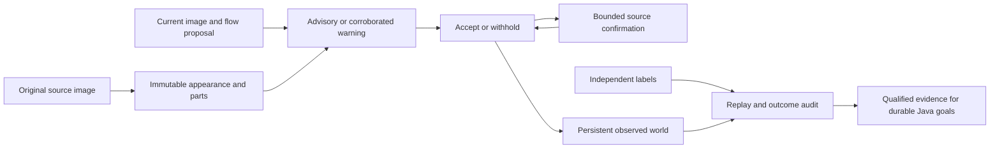

# Fraynix Agent Workspace — Edition 140

**Warnings, recovery and the cost of waiting.** Fraynix connects durable chat goals, a Java brain and simulation, observed worlds, browser interaction, data and creation tools, and reusable verified procedures. This edition tests a response to a concrete failure: one false motion warning in edition 139 suppressed many later valid observations.

[Previous edition](README-139.md) · [All editions](docs/readmes/INDEX.md) · [Interactive offline guide](docs/readmes/140/index.html) · [Integrated roadmap](docs/INTEGRATED_AGENT_ROADMAP.md) · [Contributor handoff](README-CONTRIBUTORS.md)

{{HERO}}

## What changed

The optional **corroborated-guard-140** distinguishes advisory spatial disagreement from confirmed warnings. Motion following the background, or a different arrangement of matched parts, does not by itself quarantine a box. The immutable source parts must also weaken, and the corroborated disagreement must persist for three images. Existing whole-appearance, scale and competing-appearance checks remain.

After a structural warning, a separate restoration path has a **12-image window**. It requires uninterrupted motion, a stable candidate location, strong original-source part agreement, robust flow, sufficient whole-appearance/color agreement and a margin over competing source-like appearances. **Three consecutive confirmations** are needed. Broken support resets the confirmation streak. Loss, a recovery jump, hard appearance disagreement or ambiguity disables that path for the episode. Expiry never releases a box.

The stricter original-source search remains available after loss and other hard failures, with its unique match and two-image confirmation. The new path provides a bounded way to recover continuity under supported appearance variation; it does not relax every recovery case or grant semantic identity.

**monitor-only-140** computes the same evidence while leaving every incumbent tracker and filter output unchanged. The existing **legacy-flow** default and earlier experimental methods remain available. Predictions never enter appearance memory. No model weights, new runtime vision library, action authority or capacity increase is introduced.

The interface shows advisory status, confirmed warnings, confirmation progress and the reason a stricter recovery is required. The outcome view reports false warnings and correct, incorrect or unresolved restorations separately.

## Fresh results

{{FINDING}}

{{RESULTS}}

{{WARNINGS}}

{{RECOVERIES}}

Advisories are reported even when they do not change an output. A confirmed warning on a correctly placed proposal is a false alarm. A continuity restoration is scored against the independent target box or visibility label; an internally accepted restoration is not automatically a correct one. Restoration counts describe returned tracker boxes; the observation filter can still refuse a measurement. The main tracking table includes filter acceptance, missing measurements and final accepted-output errors. Unknown labels cannot establish success. Warnings are per-frame flags. One warning can keep later outputs withheld, so missed warnings on underlying proposals are different from accepted tracking errors.

## Development and controlled tests

Edition 139 footage is now exposed development data. On bike1, current-code comparisons retain 87 correct observations and 8 wrong overlaps with the default, 13 correct and 0 wrong with the 139 guard, and **72 correct and 4 wrong with the 140 candidate**. The early background-motion false alarm no longer suppresses most of the sequence, but late missing measurements and errors remain. Ballet retains 20/34 correct with both guards versus 22/34 with the default. Current 140 also runs on the other three exposed windows; complete traces and costs are retained. These are not fresh qualification results.

A controlled image sequence gradually replaces a texture, then restores it under a local shadow. The new path restores a correctly positioned box after three original-source confirmations; the earlier strict-only guard stays withheld in this fixture. A second matching object prevents restoration. An abrupt texture return that loses flow cannot use continuity restoration. These are labelled synthetic controls, not camera demonstrations.

Tests also cover confirmation reset, candidate jumps, expiry, hard-warning exclusion, dimensions, deterministic replay, gradual same-color replacement, benign camera motion, complete loss/two-image return, identical copies, low texture, defaults, stopped prefixes and changed evidence. The restoration audit replays original pixels, then checks independent labels. A deliberately contradictory outcome label changes the verdict without changing the replayed decision.

## Sources, visibility and limits

{{SOURCES}}

The four source names were fixed before source access: **cat1, cat2, group1 and group2** from [VOT-LT2018](https://www.votchallenge.net/vot2018/dataset.html). Group2 failed the existing minimum-size rule for every prescribed event seed and its control seed. The bounded replacement, group3, also failed the same size rule. Both are retained as exclusions; the three remaining recordings form the evaluated cohort under the [source-only clarification](docs/EDITION_140_SOURCE_NOTE.md). Selection otherwise follows the [frozen contract](docs/EDITION_140_CONTRACT.md). Every selected image was reviewed without tracker predictions, then labels were committed before evaluation. Code, thresholds and scoring rules were not tuned on fresh outcomes.

{{SOURCE_REVIEW}}

External rectangles and NaN annotations are independent of this tracker. Additional source-only AI judgments about full cover, exits and uncertain boundaries are separately attributed; they are not independent human adjudication. No independent other-object boxes are supplied, so zero labelled-other matches cannot prove switch-free tracking. Original annotations, source hashes, selection exclusions and any exact-rational normalization corrections are retained. Tiny or uncertain observations remain unscored rather than being expanded or called hidden.

{{SOURCE_IMAGE}}

## Verification and persistence

{{VALIDATION}}

{{APP_CHECKS}}

Each 140 decision is reconstructed from original pixels and the initial seed before independent outcome scoring. Stored implementation identities, source hashes, world bindings, histories and outcome checks remain mandatory. A changed source or forged decision refuses verification and export. Completed-state restart preserves the original bytes and timestamps; interrupted work resumes explicitly. Observation tests do not silently move the native physical world.

## Measured costs

{{COSTS}}

These are bounded durable workflows and separately measured audit phases, not a live-camera speed claim. Imports, UI reads, replay, restart and export also cost time; the total harness duration includes them. Development comparisons use identical exposed windows. Fresh windows differ from the previous edition, so cross-edition total duration is not a controlled speed benchmark.

## Review it locally

Use JDK 21 and the prepared desktop dependencies. From the checkout:

```powershell
$env:FRAYNIX_WORKSPACE_PROJECT = Join-Path $env:LOCALAPPDATA 'Fraynix-Review-140'
.\scripts\Start-Agent-Workspace.ps1
```

After dependencies are cached, add `-Offline` to require local operation. Preserve your existing project path and stop its Java owner through the app before rebuilding that owner's installation.

1. Open **Spatial → Real footage · observed world**, choose a world, import footage and mark the initial rectangle.
2. Run **Existing flow tracker** as a baseline. Choose the 140 experimental method explicitly for comparison; the 140 monitor keeps incumbent outputs.
3. Inspect source pixels, part matches, advisory messages, warnings and restoration confirmation counts. Predictions are not measurements.
4. Import independently prepared visibility/target labels under **Object identity · occlusion & recovery**. Compare correct outputs, missing observations, false warnings and restoration outcomes.
5. Reopen, reverify and export complete evidence within existing bounds. Keep the original project if an export is too large; do not discard evidence to make it fit.

## Role in the connected application



Java continues to own durable goals, environment state, validation, recovery and evaluation. The desktop presents the world, browser and creation canvas. The purpose of better perception is to support complete tasks in that shared application. It must preserve the distinction between an observation, a forecast and an unknown state.

{{NEXT}}

## Attempts and publication

{{ATTEMPTS}}

Hosted CI, local validation and fetched Git verification are distinct. Raw footage archives and private projects are excluded from publication. Exact source identities, original external annotations, frozen labels, complete run/audit traces, failed attempts and attributed app screenshots are retained.

[Validation](docs/readmes/140/verification.json) · [Original evidence](docs/readmes/140/original-evidence.json) · [Comparison](docs/readmes/140/comparison.json) · [Source manifest](docs/publication140/source140.json) · [Method lock](docs/OBSERVATION_140_LOCK.json) · [Source inventory](docs/readmes/140/file-inventory.json)

[Guard](workspace-engine/src/main/java/fraymus/workspace/CorroboratedGuard140.java) · [Restoration gate](workspace-engine/src/main/java/fraymus/workspace/RestorationGate140.java) · [Pixel replay and independent outcome audit](workspace-engine/src/main/java/fraymus/workspace/CorroboratedAudit140.java) · [Actual-app test](workspace-desktop/test/corroborated140-integration.cjs) · [Project memory](docs/PROJECT_MEMORY.md)

Preserve defaults, private data, frozen editions and every source/outcome check. Read [AGENTS.md](AGENTS.md) before continuing.
