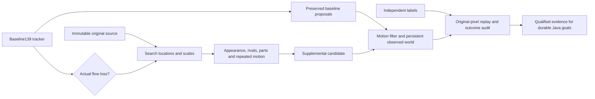

# Fraynix Agent Workspace — Edition 141

**Recover after loss without quietly switching objects.** Fraynix connects durable chat goals, a Java brain and simulation, observed worlds, browser interaction, data and creation tools, and reusable verified procedures. Edition141 adds an explicit source-qualified recovery experiment. The underlying139 guard and default tracking remain intact.

[Previous edition](README-140.md) · [All editions](docs/readmes/INDEX.md) · [Interactive offline guide](docs/readmes/141/index.html) · [Integrated roadmap](docs/INTEGRATED_AGENT_ROADMAP.md) · [Contributor handoff](README-CONTRIBUTORS.md)

{{HERO}}

## What changed

The optional **recovery-guard-141** wraps the unchanged139 guard. Every accepted139 tracker proposal is preserved exactly. An additional recovery path becomes eligible only after genuine underlying flow loss. A warning that merely quarantines a still-tracked proposal cannot enable this path. The wrapper never resets or retrains the baseline tracker.

The new Java search compares the immutable initial appearance at eight bounded scales. It retains three separate peaks per scale, refines their position and size, and compares the strongest candidate against competitors. This prevents a large match from crowding a smaller lookalike out of the search. Source texture, existing appearance/color/scale checks and immutable spatial parts must agree. A strong correlation is evidence of similar pixels, not semantic identity.

**Three consecutive source confirmations** are required. Adjacent images must also support coherent forward/backward optical flow with sufficient inliers, stable geometry and no ambiguity. An absent, competing, unsupported or discontinuous candidate resets confirmation. There is no time-based release and no automatic admission of predictions into appearance memory.

**recovery-monitor-141** computes the same evidence while preserving every139 tracker and filter output. This is a control against139, not against the legacy default. Additional candidate measurements can affect later filter estimates, so complete filtered outcomes are also compared. Existing **legacy-flow** remains the default; all earlier experimental methods stay available.

The interface shows whether recovery is inactive, checking adjacent images, or source-confirmed. The independent outcome panel reports correct, incorrect and unscored supplemental boxes separately from filter-accepted supplemental measurements. No model weights, new runtime vision library, authority change or capacity increase is introduced.

## Fresh results

{{FINDING}}

{{RESULTS}}

{{WARNINGS}}

{{RECOVERIES}}

{{DIAGNOSTICS}}

The main table counts accepted filtered observations. The supplemental table counts all new returned boxes and the subset accepted by the filter. Missing observations remain in the denominator. Unknown labels do not establish success. A low overlap means an inaccurate box; without independent distractor geometry it does not identify which other object was followed.

## Development and controlled tests

The recordings evaluated in edition140 are exposed development data. In current-code comparisons,139 and141 both retain **83 correct, 10 wrong and 69 missing** visible/partial observations across `cat1`, `cat2` and `group1`, with no accepted hidden output. The new recovery path adds no observations there and preserves all93 accepted139 tracker proposals. The monitor matches139 exactly on the cat1 control. Complete traces and costs are retained.

In this one sequential development pass, pixel processing across the three windows took 50.5 seconds for141 versus 45.2 seconds for139. The added search therefore cost work without an accuracy gain on these exposed cases. This is a single-pass measurement, not a repeated timing estimate or live-camera rate.

A controlled image fixture moves a textured object after disappearance and enlarges it by50%. The new path returns correctly located boxes after three confirmations while139 stays withheld. A differently scaled copy prevents supplemental acceptance; interrupted confirmation resets. The inherited139 tracker can itself select a copy in one fixture: that error remains visible, and the supplement must not add another measurement. These are synthetic mechanism tests, not proof of camera-level identity recognition.

Nine focused tests cover multi-scale search, competitors, uniform texture, repeated recovery, interruption, warning-only exclusion, dimensions, monitor equivalence, label-independent pixel replay, contradictory outcome labels, forged evidence, stopped prefixes, cold reopening and source tampering. Broader regression retains previous perception, world, goal, browser, creation, qualification and archive checks.

## Sources, visibility and limits

{{SOURCES}}

Three source names were fixed before access: **car3, following and person2** from [VOT-LT2018](https://www.votchallenge.net/vot2018/dataset.html). The [frozen contract](docs/EDITION_141_CONTRACT.md) selects the first eligible disappearance/return interval, or the declared first96 control if no event qualifies. Seeds must satisfy the existing minimum size. Ineligible entries are recorded and excluded without replacement searches. Every selected image is reviewed without predictions; labels are committed before fresh runs. Code, thresholds and scoring rules are not tuned on fresh results.

{{SOURCE_REVIEW}}

External rectangles and NaN annotations are independent of this tracker. Source-only AI visibility judgments are separately attributed; they are not independent human adjudication. No independent other-object rectangles are supplied, so zero labelled-other matches cannot prove switch-free tracking. Original annotations, checksums, exclusions and exact-rational normalization corrections are retained. Tiny or uncertain observations remain unscored rather than being expanded or called hidden.

{{SOURCE_IMAGE}}

## Verification and persistence

{{VALIDATION}}

{{APP_CHECKS}}

Each141 decision is reconstructed from original pixels and the saved initial seed before outcome scoring. Implementation identities, source hashes, world bindings, histories and outcome checks remain mandatory. Source or decision tampering refuses verification. Completed-state restart preserves original bytes and timestamps; interrupted work resumes explicitly. Observation experiments do not silently move the native physical world.

## Measured costs

{{COSTS}}

These are bounded durable workflows and measured audit phases, not a live-camera speed claim. Imports, UI reads, replay, restart and export also cost time; complete harness duration includes them. Fresh windows differ from previous editions, so cross-edition duration is not a controlled performance comparison.

## Review it locally

Use JDK 21 and the prepared desktop dependencies. From the checkout:

```powershell
$env:FRAYNIX_WORKSPACE_PROJECT = Join-Path $env:LOCALAPPDATA 'Fraynix-Review-141'
.\scripts\Start-Agent-Workspace.ps1
```

After dependencies are cached, add `-Offline` to require local operation. Preserve your existing project path and stop its Java owner through the app before rebuilding that owner's installation.

1. Open **Spatial → Real footage · observed world**, choose a world, import footage and mark its initial rectangle.
2. Compare **Existing flow tracker**, **Experimental139** and **Experimental141** explicitly. **Control141** preserves139 outputs.
3. Inspect original pixels, source-part matches and recovery confirmation counts. Predictions are not measurements.
4. Under **Object identity · occlusion & recovery**, import independently prepared target/visibility labels. Compare complete outcomes and supplemental-box outcomes.
5. Reopen, reverify and export complete evidence within existing bounds. Keep the original project if an export is too large; do not discard evidence to fit a limit.

## Role in the connected application



Java continues to own durable goals, environment state, validation, recovery and evaluation. The desktop presents the world, browser and creation canvas. Better perception serves complete tasks in that shared application. Observed, predicted and unknown states must remain distinct before an action or memory admission.

{{NEXT}}

## Attempts and publication

{{ATTEMPTS}}

Hosted CI, local validation and fetched Git verification are distinct. Raw footage archives and private projects are excluded from publication. Exact source identities, original annotations, frozen labels, complete traces, failed attempts and attributed app screenshots are retained.

[Validation](docs/readmes/141/verification.json) · [Original evidence](docs/readmes/141/original-evidence.json) · [Comparison](docs/readmes/141/comparison.json) · [Source manifest](docs/publication141/source141.json) · [Method lock](docs/OBSERVATION_141_LOCK.json) · [Source inventory](docs/readmes/141/file-inventory.json)

[Recovery wrapper](workspace-engine/src/main/java/fraymus/workspace/LossRecovery141.java) · [Source search](workspace-engine/src/main/java/fraymus/workspace/RecoverySearch141.java) · [Pixel replay and outcome audit](workspace-engine/src/main/java/fraymus/workspace/LossRecoveryAudit141.java) · [Actual-app test](workspace-desktop/test/recovery141-integration.cjs) · [Project memory](docs/PROJECT_MEMORY.md)

Preserve defaults, private data, frozen editions and every source/outcome check. Read [AGENTS.md](AGENTS.md) before continuing.
